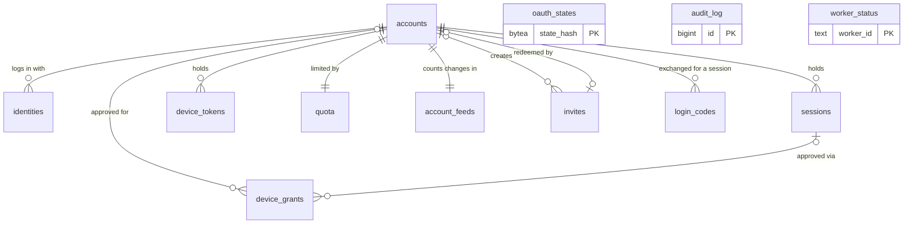
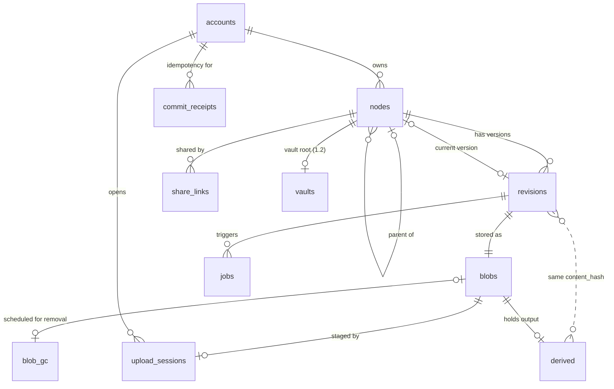
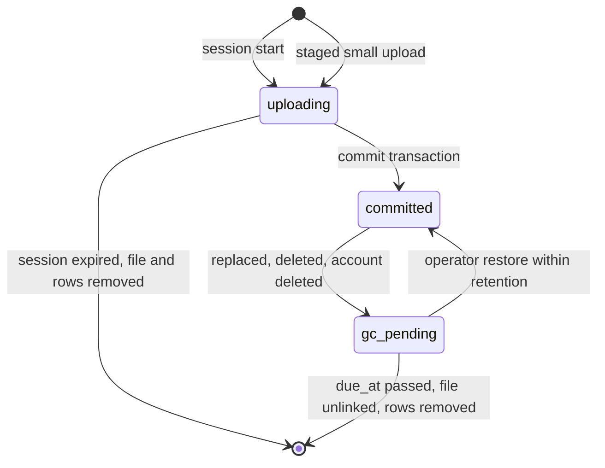

# sunnycloud — Data Model

**Status**: draft, pending owner confirmation of the items in section 15
**Date**: 2026-11-04
**Reconciled with**: `canonical-names.md` (Step 4 answers) and `component-decisions.md` (2026-11-04); where they differ, `canonical-names.md` wins.
**Sources**: `architecture.md` section 4 (entities) and section 7, `glossary.md`, `restrictions.md`, `acceptance_criteria.md`, `solution.md`, `00_research/raw/b_server_storage.md`, `tests/gap-decisions.md`.

Two stores. **PostgreSQL 18** is the server database, used only by the API process: runtime role `sunnycloud`, schema owner and migrations role `sunnycloud_migrator` (section 12.3). The worker supervisor (09) has no database login; it claims jobs, reads input and posts results over the API (`/api/v1/worker-jobs/**` on `:8081`). Each table has one owning component (section 2). **SQLite** is the desktop daemon's `LocalIndex` (section 11). Nothing else persists state: no Redis, no cache, no search index.

## 1. Conventions

- **Identifiers**: `uuid`, generated by the application. UUIDv7 for tree, session, job and account rows (B-tree locality); UUIDv4 for blob ids, because the blob path fan-out uses the leading hex digits (`blobs/<id[0:2]>/<id[2:4]>/<id>`) and v7 would put a day's blobs in one directory. No `DEFAULT` on ids.
- **Time**: every `*_at` is `timestamptz` supplied by the application from the injectable clock. No `DEFAULT now()` and no `now()` in SQL, so the test clock moves retention, expiry and lease logic in the API and in the worker supervisor alike (one shared offset; the supervisor reads it from `GET /internal/v1/test/clock-offset` in the test image).
- **Enumerations**: `text` plus a named `CHECK`, not PostgreSQL enum types (a new value is an additive constraint swap, which is allowed inside a migration transaction).
- **Secrets at rest**: session, device, invite, setup and share tokens are 256-bit random values with a type prefix; the database stores only `SHA-256(token)` as `bytea` with `CHECK (octet_length(x) = 32)`. A high-entropy token needs no salt or slow hash. Share passwords use Argon2id (PHC string in `text`). Content hashes are BLAKE3, `bytea(32)`.
- **Names of objects**: snake_case plural tables; `<table>_pkey`, `<table>_<cols>_key` (unique), `<table>_<cols>_idx`, `<table>_<col>_fkey`, `<table>_<rule>_check`.
- **Tenancy**: every tenant-owned table has `account_id uuid NOT NULL`. A child table references its parent through the composite key `(parent_id, account_id)`, so a row can never point at another account's row (the parent carries `UNIQUE (id, account_id)`). Section 12.3 lists the tables.
- **Durations** are configuration, never schema. Defaults used in this document:

| Config key | Default | Used by |
|---|---|---|
| `retention_days` | 7 (0 to 90) | `blob_gc.due_at` |
| `tombstone_days` | 90 | tombstone purge, `account_feeds.purge_horizon` |
| `upload_session_ttl` | 24 h, rolling from the last checkpoint | `upload_sessions.expires_at` |
| `max_open_sessions` / `max_staged_per_account` | 8 / 1000 | open-session cap; staged-file cap (section 6.3) |
| `login_code_ttl` | configuration (01) | `login_codes.expires_at` |
| `orphan_age` | 48 h | orphan sweep |
| `job_lease` / `job_max_attempts` | 5 min / 3 | `jobs.available_at`, `jobs.attempts` |
| `refresh_reuse_grace` | 30 s | `sessions.rotated_at` |
| `device_user_code_ttl` | 10 min (maximum) | `device_grants.expires_at` |
| `share_default_ttl` | 7 d | `share_links.expires_at` |
| `commit_receipt_ttl` / `oauth_state_ttl` / `job_terminal_ttl` | 48 h / 10 min / 14 d | janitors (section 12.1) |

## 2. Entity inventory (architecture section 4 to storage)

| Architecture entity | Realised as | Owner | Release |
|---|---|---|---|
| Account | `accounts` | 01 identity | 1.0 |
| Identity | `identities` | 01 identity | 1.0 |
| Session | `sessions` (holds the refresh-token family) | 01 identity | 1.0 |
| DeviceToken | `device_tokens` | 01 identity | 1.0 |
| DeviceGrant | `device_grants` | 01 identity | 1.0 |
| Invite, SetupToken | one table `invites` with `kind` (D2) | 01 identity | 1.0 |
| Node | `nodes` (all columns except `seq`) | 02 tree | 1.0 |
| Revision | `revisions` | 02 tree | 1.0 |
| Blob | `blobs` | 04 blobstore | 1.0 |
| BlobGc | `blob_gc` | 04 blobstore | 1.0 |
| UploadSession | `upload_sessions` (open and staged rows) | 03 transfer | 1.0 |
| ChangeEvent | no table: `nodes.seq` plus index `nodes_feed_idx` (D1) | 05 sync_feed | 1.0 |
| AccountFeed | `account_feeds` | 05 sync_feed | 1.0 |
| ShareLink | `share_links` | 06 sharing | 1.0 |
| Quota | `quota` | 07a quota | 1.0 |
| Job | `jobs` | 08 media_jobs | 1.0 |
| Derived | `derived` (keyed by content, D3) | 08 media_jobs | 1.0 |
| Vault | `vaults` (the wrapped file key of a vault file is in `revisions.client_meta`) | 20 vault_service | 1.2 |
| LocalIndex | SQLite `meta`, `pair`, `entry`, `upload_checkpoint` | 14 desktop_daemon | 1.0 |
| (proposed, not in section 4) | `oauth_states`, `login_codes` (01); `commit_receipts` (03); `audit_log` (helper 04); `worker_status` (08) (P1 to P3, P5, S4-1) | as listed | 1.0 |

07 admin owns no table (its data is the account `state` and the data that remains).

Result: 16 PostgreSQL tables in v1.0, 1 in v1.2, 4 SQLite tables, plus 5 proposed PostgreSQL tables.

## 3. Entity-relationship diagrams

Identity and access:

Tree, storage, media, sharing:

Cardinality in words: one account has one tree (one root node, many descendants), one feed counter and one quota row. A node has many revisions and at most one current revision. A revision has exactly one blob. A blob has at most one `blob_gc` row and, while uploading, exactly one `upload_sessions` row. A derived row belongs to an account and a content hash, and is shared by every revision of that account with that hash.

## 4. Identity and access

### 4.1 `accounts`
| Column | Type | Notes |
|---|---|---|
| `id` | uuid PK | v7 |
| `display_name` | text NOT NULL | from the provider profile; display only |
| `role` | text NOT NULL | `user` or `admin` |
| `state` | text NOT NULL | `active`, `disabled`, `deleting` |
| `created_at`, `deletion_requested_at` | timestamptz | second is NULL unless `deleting` |

Created in one transaction with its `identities` row, `account_feeds` row, `quota` row and root `nodes` row. An account is never found by email. Index `accounts_state_idx (state) WHERE state <> 'active'` serves the account-erase loop and the admin list of disabled accounts.

### 4.2 `identities`
`id` uuid PK; `account_id` FK; `provider` text (config key of the provider: `github`, an OIDC provider key, `apple`); `provider_user_id` text (OIDC `sub`, GitHub numeric id); `email` text NULL and `email_verified` boolean (display and invite matching only, never a lookup key); `created_at`, `last_login_at`.
`UNIQUE (provider, provider_user_id)`; index on `account_id`. Linking never copies an unverified email (AC-55).

### 4.3 `sessions` (one row = one login = one refresh-token family)
| Column | Type | Notes |
|---|---|---|
| `id` | uuid PK | |
| `account_id` | uuid FK | |
| `client_kind` | text | `web`, `android`, `ios` |
| `label` | text | user-agent summary for the device list |
| `token_hash` | bytea(32) UNIQUE | current access token |
| `access_expires_at` | timestamptz | short lived |
| `refresh_hash` | bytea(32) UNIQUE | current refresh token |
| `refresh_expires_at` | timestamptz | |
| `prev_refresh_hash` | bytea(32) NULL | the token before the last rotation |
| `rotated_at` | timestamptz NULL | time of the last rotation |
| `successor_enc` | bytea NULL | the successor access and refresh tokens of the last rotation, sealed with ChaCha20-Poly1305 under a key derived (SHA-256, domain-separated) from the previous refresh token, with the session id as associated data; the database cannot open it; replaced by the next rotation, cleared on revocation (migration `add_identity_session_successor`) |
| `created_at`, `created_ip` (inet), `last_seen_at` | | `last_seen_at` written at most once a minute |
| `revoked_at`, `revoke_reason` | | reason: `user`, `admin`, `refresh_reuse`, `account_deleted` |

Rotation updates the row under its row lock (`WHERE refresh_hash = $h AND revoked_at IS NULL`), moving the old hash to `prev_refresh_hash`. Presenting `prev_refresh_hash` within `refresh_reuse_grace` of `rotated_at` creates nothing and revokes nothing: it answers with the same successor pair, opened from `successor_enc` with the presented token (a lost response is retried; four concurrent refreshes yield one successor that all four receive, AC-58). A partial index on `prev_refresh_hash` serves this lookup. After the grace it sets `revoked_at` with reason `refresh_reuse`. Only one previous generation is kept, so an older token is simply unknown. Validation reads the row by `token_hash` and evaluates `revoked_at` and expiry in application code, not in the `WHERE`, so missing, expired and revoked take the same database path. An in-process session cache lives at most 2 s, which keeps revocation inside 5 s (AC-21).

### 4.4 `device_tokens`
`id` PK; `account_id` FK; `token_hash` bytea(32) UNIQUE; `device_name` text; `platform` text (`linux`, `windows`, `macos`); `created_at`, `last_seen_at`, `revoked_at`, `revoke_reason`. Sync scope only; no rotation (revocable, kept in the OS keychain). Index on `account_id`.

### 4.5 `device_grants` (RFC 8628 pending approvals)
`id` PK; `device_code_hash` bytea(32) UNIQUE; `user_code` text (short, shown to the user, not a bearer secret, so stored plain); `requester_ip` inet; `requester_location` text NULL; `device_name`, `platform`; `status` (`pending`, `approved`, `denied`, `consumed`); `created_at`; `expires_at` (at most 10 min); `last_polled_at` (for `slow_down`); `account_id` NULL until approved; `approved_by_session_id` FK NULL; `approved_at` NULL.
`UNIQUE (user_code) WHERE status = 'pending'`. `approved` becomes `consumed` in the same transaction that inserts the `device_tokens` row. A janitor deletes rows one hour after expiry or consumption. Wrong-attempt counters (AC-20) are not stored (section 12.4).

### 4.6 `invites` (covers SetupToken)
`id` PK; `kind` (`invite`, `setup`); `token_hash` bytea(32) UNIQUE; `grants_role` text NOT NULL DEFAULT `user` (`user` or `admin`; `CHECK (kind <> 'setup' OR grants_role = 'admin')`); `target_account_id` uuid FK NULL (`ON DELETE CASCADE`; set only by `admin reset`: redemption binds the new identity to this existing account instead of creating one; `CHECK (target_account_id IS NULL OR kind = 'invite')`); `created_by` uuid FK NULL (`ON DELETE CASCADE`; NULL for `setup` and for operator invites made by `sunnycloud admin invite|create|reset`, which have no account behind them; `CHECK (kind = 'invite' OR created_by IS NULL)`); `created_at`; `expires_at`; `redeemed_by` uuid FK NULL (`ON DELETE SET NULL`); `redeemed_at` NULL; `note` text NULL.
Redemption is `UPDATE ... SET redeemed_at = $now WHERE token_hash = $h AND redeemed_at IS NULL AND expires_at > $now RETURNING`, so it is single use under concurrency. `UNIQUE ((true)) WHERE kind = 'setup' AND redeemed_at IS NULL` allows one open setup token; on start with an empty `accounts` table and no open one, the server creates it and prints it, and replaces it on restart (plain text is never stored). A setup token is valid only while `accounts` is empty. The operator email allowlist is configuration, not a table.

### 4.7 `oauth_states` (proposal P1)
`state_hash` bytea(32) PK; `provider` text; `nonce` text; `pkce_verifier` text; `return_to` text (relative path only, `CHECK (return_to LIKE '/%' AND return_to NOT LIKE '//%')`); `client_kind` text; `invite_token_hash` bytea NULL (carried so registration completes after the provider round trip); `code_challenge` text NULL (mobile sign-in only: the PKCE challenge, copied to `login_codes` at the callback); `created_at`; `expires_at` (10 min).
Consumed by `DELETE ... WHERE state_hash = $h RETURNING`, which makes replayed, foreign and expired state fail the same way (AC-56). Rows are deleted by the janitor after expiry.

### 4.8 `login_codes` (proposal P5, decision 11)
`code_hash` bytea(32) PK; `account_id` uuid FK; `code_challenge` text (PKCE); `client_kind` text; `created_at`; `expires_at` (`login_code_ttl`).
Created at the provider callback for a mobile sign-in; the app exchanges the one-time code (with the PKCE verifier) for a session, and the exchange consumes the row (`DELETE ... RETURNING`). Persisted because the callback and the exchange can reach different requests or a restarted process. Only the hash is stored. Expired rows are deleted by the janitor.

## 5. Tree: `nodes` and `revisions`

### 5.1 `nodes`
| Column | Type | Notes |
|---|---|---|
| `id` | uuid PK | stable file or folder id (survives rename, move, save-in-place) |
| `account_id` | uuid NOT NULL | |
| `parent_id` | uuid NULL | NULL only for the account root; composite FK `(parent_id, account_id)` |
| `kind` | text | `file` or `folder` |
| `name` | text NOT NULL | exactly as received |
| `name_key` | text COLLATE "C" NOT NULL | NFC plus Unicode full case folding, computed in Rust |
| `name_key_version` | smallint NOT NULL | pinned Unicode version of the fold, lets a later release re-key in batches |
| `current_revision_id` | uuid NULL | files only; composite FK `DEFERRABLE INITIALLY DEFERRED` (created with its revision); `ON DELETE SET NULL (current_revision_id)`: a deleted file's tombstone still points at its last revision, and when the retention purge or account erase deletes that revision row the FK clears the pointer |
| `seq` | bigint NOT NULL DEFAULT 0 | account feed sequence of the last feed-visible change; 0 until the first stamp (a row inserted by 02 is stamped by the 05 statement in the same transaction) |
| `deleted_at` | timestamptz NULL | tombstone |
| `cascade_pending` | boolean NOT NULL DEFAULT false | a tombstoned folder whose descendants are not marked yet |
| `created_at`, `updated_at` | timestamptz | server time |

Constraints: `UNIQUE (id, account_id)`; `CHECK (kind = 'folder' OR parent_id IS NOT NULL)`; folders have `current_revision_id IS NULL`; `name` is not `.`/`..` and contains no `/`; `octet_length(name) <= 255`, `octet_length(name_key) <= 1024` (assumption A1); the root has `name = ''`.
Indexes:
- `nodes_parent_name_key` **UNIQUE** `(parent_id, name_key) WHERE deleted_at IS NULL` — case-insensitive uniqueness per folder (AC-42), the listing range scan, and keyset paging by `name_key`. A concurrent duplicate raises 23505 and the commit path turns it into a conflict copy or a rename.
- `nodes_root_key` UNIQUE `(account_id) WHERE parent_id IS NULL` — exactly one root.
- `nodes_feed_idx` `(account_id, seq)` — feed reads (section 7); `seq` and this index belong to 05 sync_feed.
- `nodes_parent_idx` `(parent_id)` — backs the self FK and leaf-first deletes (the partial unique index cannot; extra space is the accepted cost).
- `nodes_tombstone_idx` `(deleted_at) WHERE deleted_at IS NOT NULL` and `nodes_cascade_idx` `(account_id) WHERE cascade_pending` — small, for the purge and cascade loops.

**Listing 10,000 entries within 300 ms (AC-6).** The query reads `nodes` by the unique partial index for one `parent_id`, ordered by `name_key`, left-joins `revisions` by primary key for size, mtime, hash and media type, and returns a page (default 1,000) after a `name_key` cursor. It never touches `blocklist`, `jobs` or `derived`. CI runs it on the DS-02 fixture with the real API role (row-level security on) and fails the build on a plan other than index scan plus nested-loop primary-key lookups.

**Tombstones and retention.**
- Delete sets `deleted_at` and a new `seq` on the node; the feed carries it like any change. The unique index excludes it, so the name is free at once.
- Deleting a folder writes one tombstone and sets `cascade_pending`. A background loop marks descendants in batches of about 5,000: `deleted_at` set, **no** new `seq` (descendants stay out of the feed), blobs queued in `blob_gc`, subfolders get `cascade_pending`, quota decremented per batch. No loop state exists beyond the flag, so a restart resumes by query.
- An edit beats a delete (ADR-007): a commit onto a tombstoned file clears `deleted_at` on it and on its tombstoned ancestors up to the first live one, each with the new `seq`, and clears `cascade_pending` on each revived ancestor so the cascade loop stops; a client re-lists a folder that turns live. If the name is taken meanwhile, the restored node is renamed to a conflict-copy name.
- Moving a folder takes `pg_advisory_xact_lock(account)` first, then checks for a cycle with a recursive CTE (depth about 30); a cycle gives 409. Creating under a tombstoned parent gives 410.
- After `tombstone_days` the purge deletes tombstoned nodes leaf first in batches, then raises `account_feeds.purge_horizon` to the highest purged `seq` as the last statement of that transaction. Cascade-marked descendants are purged the same way; their `seq` is lower than their folder's tombstone, so the horizon stays correct.

### 5.2 `revisions`
| Column | Type | Notes |
|---|---|---|
| `id` | uuid PK | v7 |
| `account_id`, `node_id` | uuid | composite FK to `nodes (id, account_id)` |
| `blob_id` | uuid NOT NULL UNIQUE | composite FK to `blobs`, `ON DELETE RESTRICT` |
| `size` | bigint NOT NULL | plaintext bytes, `CHECK (size >= 0)` |
| `content_hash` | bytea(32) NOT NULL | whole-file hash from the ordered block hashes |
| `blocklist` | bytea NOT NULL | 32 bytes per 2 MiB block, `CHECK (octet_length(blocklist) % 32 = 0)`; `STORAGE EXTERNAL` and `toast_tuple_target = 256` keep listing joins on narrow rows; a 50 GiB file is about 800 KiB |
| `media_type` | text NULL | sniffed by the server at commit; NULL is served as an attachment (AC-47) |
| `client_mtime` | timestamptz NULL | as reported by the client; display only |
| `client_meta` | jsonb NULL | per-revision client metadata: camera backup (`device`, MediaStore asset id, link to the original revision) and, in v1.2, the wrapped file key of a vault revision; size bounded by a `CHECK`; the server reads only `device` (reinstall rebuild, `revisions_client_device_idx`) |
| `created_at` | timestamptz | commit time on the server clock; the "later commit wins" order is `account_feeds.seq`, never a client clock |

A revision is current when `nodes.current_revision_id` points at it. A replaced or deleted file's revision stays as a row until its blob is purged; the purge (`BlobOwnerCleanup::remove_owner_rows`) deletes the revision row whatever its state, and for a deleted file the FK `ON DELETE SET NULL` clears `nodes.current_revision_id`. Operator restore by path and time takes the latest `created_at <= T` revision of the node and **re-points the existing revision row**: it sets `current_revision_id` to it and re-parents the node into its original folder or `Restored`; it never inserts a second revision for the blob (`blob_id` is UNIQUE). In the same transaction `BlobRegistry` reinstates the blob (`gc_pending` to `committed`, `blob_gc` row removed) and `seq` is bumped. **Restore into a deleted folder**: the file goes to its original folder if that folder is live, otherwise into a folder named `Restored` at the account root (created on demand). There is no per-block table: per-block receipt state lives only in `upload_sessions`.
Indexes: `UNIQUE (id, account_id)`, `UNIQUE (blob_id)`, `(node_id, created_at)` (restore, history), `(account_id, content_hash)` (the batched `POST /api/v1/revisions:lookup` for reinstall rebuild of AC-46, the merge check of AC-31, the same-node "nothing to send" check, and derived cleanup; there is no cross-node dedupe), `revisions_client_device_idx (account_id, (client_meta->>'device')) WHERE client_meta IS NOT NULL` (the `client_device` filter of `GET /api/v1/revisions`, reinstall rebuild of AC-46).

## 6. Blobs and uploads

### 6.1 `blobs`
| Column | Type | Notes |
|---|---|---|
| `id` | uuid PK | v4; path `blobs/<2hex>/<2hex>/<id>` |
| `account_id` | uuid NOT NULL | quota, deletion, row-level security |
| `state` | text | `uploading`, `committed`, `gc_pending` |
| `size` | bigint NULL | plaintext size; NOT NULL once `committed` |
| `wrapped_key` | bytea NOT NULL | per-blob data key wrapped by the master key (nonce, ciphertext, tag) |
| `master_key_id` | smallint NOT NULL | which master key wrapped it; rotation rewraps rows, not files |
| `created_at` | timestamptz | |
| `last_scrubbed_at` | timestamptz NULL | scrub picks the oldest first; no scrub cursor is stored (P4) |
| `unavailable_at` | timestamptz NULL | optional: set when a read or scrub finds the file missing or corrupt, so downloads answer `content_unavailable` without touching the file; cleared by an operator restore of the file |

Thumbnails and transcodes are blobs too (encrypted like every other). The file header holds the format version and STREAM nonce prefix; the database holds only the key material needed to open it. Indexes: `UNIQUE (id, account_id)`, `(account_id)`, `(last_scrubbed_at NULLS FIRST, id) WHERE state = 'committed'`. After a master-key rotation the old key must be kept as long as any backup that predates the rotation may be restored (install guide).

### 6.2 `blob_gc`
`blob_id` uuid PK (FK to `blobs`); `account_id`; `due_at` timestamptz NOT NULL; `reason` text (`replaced`, `deleted`, `account_deleted`, `derived_removed`). Index `(due_at)`.
Written in the same transaction as the change that unreferences the blob, together with `blobs.state = 'gc_pending'` (one repository function owns both writes). `due_at = now + retention_days`; account erase (reason `account_deleted`) and removed derived blobs use `due_at = now` (`Due::Now`). The sweeper claims `WHERE due_at <= $now ORDER BY due_at FOR UPDATE SKIP LOCKED LIMIT 100`, unlinks each file, then calls `BlobOwnerCleanup::remove_owner_rows` for the blob, which deletes its `revisions` row whatever the row's state (for a deleted file's last revision the FK `ON DELETE SET NULL` clears `nodes.current_revision_id`) or its `derived` row, then the `blobs` and `blob_gc` rows. A changed `retention_days` affects only later rows. A missing file at unlink time is logged and the rows are still removed.

### 6.3 `upload_sessions`
| Column | Type | Notes |
|---|---|---|
| `id` | uuid PK | |
| `account_id` | uuid | |
| `blob_id` | uuid NOT NULL UNIQUE | the staging blob, written at its final path |
| `client_key` | text NOT NULL | client resume key (browser: name, size, lastModified; daemon: local file id); makes create idempotent and lets a re-selected file find its session (AC-50) |
| `declared_size` | bigint NOT NULL | `CHECK (declared_size >= 0)` (a zero-byte file is a staged row, below); the 50 GiB ceiling is configuration |
| `block_count` | integer NOT NULL | `ceil(declared_size / 2 MiB)`; 0 for a zero-byte file |
| `reserved_bytes` | bigint NOT NULL | quota reserved at start (equals `declared_size`) |
| `received` | bytea NOT NULL | received-bitmap, `ceil(block_count / 8)` bytes, advanced only after `fdatasync` |
| `block_hashes` | bytea NOT NULL | 32 bytes per block, zero until received; compared with the client's blocklist at commit so the commit stays O(1) (AC-4) |
| `created_at`, `last_checkpoint_at` | timestamptz | |
| `expires_at` | timestamptz | `last_checkpoint_at + upload_session_ttl` |

`UNIQUE (account_id, client_key)`; `(expires_at)`. A row exists exactly while the upload is open or staged; commit deletes it. A checkpoint (every about 8 MiB or 1 s) rewrites `received` and `block_hashes` in one `UPDATE`; a block acknowledged but not yet checkpointed is re-requested after a crash (at most 8 MiB acknowledged-but-uncheckpointed plus up to 8 MiB in flight, 16 MiB in all, inside AC-3 as changed on 2026-11-11). Cost note: rewriting the hash array is about 10% extra WAL for a 50 GiB file and negligible for typical files; measure in gate S1/S6 before changing the layout. The per-account open-session cap is `COUNT(*)` of rows with `block_count > 1` on the `(account_id, client_key)` index (staged rows have 0 or 1 block and have their own cap), taken after the quota row lock so concurrent starts serialise.
**Staged small uploads.** A file up to 2 MiB sent as one request is stored as a completed `upload_sessions` row: `client_key` = the client's staged key (idempotent by key), `block_count = 1` (0 for a zero-byte file, with empty `received` and `block_hashes`), `received` and `block_hashes` already filled, its blob row `uploading`, quota reserved. Staged rows count against `max_staged_per_account` (default 1,000), not the open-session cap, and expire like sessions. The single or batch commit (03 calls 02) turns the row into a revision and deletes it; the session reaper removes uncommitted ones.

### 6.4 Blob lifecycle and sweeps

- **Commit** order: `fdatasync` the file, then one transaction owned by 02 tree (revision, blob state, node, quota through the 07a port, delete session, counter bump last through the 05 port). There is no rename.
- **Sweep A, session reaper** (frequent): sessions and staged rows past `expires_at` lose their file, blob row and session row, and release `reserved_bytes`.
- **Sweep B, orphan files** (rare, merged with the scrub walk): per prefix directory, list the ids in `blobs`; a file with no row and an mtime older than `orphan_age` is logged and then deleted. It aborts if the database listing fails or is partial (a bad snapshot is how live data gets deleted). Modes `off`, `report`, `delete`.
- **Sweep C, GC queue** (6.2). **Scrub** re-verifies committed blobs oldest first under throttle; a mismatch writes an `audit_log` row and a metric.
- Files with a row but no file are reported by scrub and by `sunnycloud doctor` (restore check).

## 7. Sync feed

### 7.1 `account_feeds`
`account_id` PK (FK); `epoch` bigint NOT NULL; `seq` bigint NOT NULL DEFAULT 0; `purge_horizon` bigint NOT NULL DEFAULT 0. A separate row from `accounts` and `quota` so the commit-path lock is not shared with profile or reservation updates.

### 7.2 Rules for `epoch.seq`
1. A cursor is `epoch.seq` (two numbers). `seq` is gapless per account and equals commit order.
2. **Counter last.** Every transaction that changes the tree ends with one data-modifying statement that bumps `account_feeds.seq` (`UPDATE ... SET seq = seq + 1 RETURNING seq`) and stamps that value on every touched `nodes` row in the same statement. Nothing runs between that statement and COMMIT: no reads, no file I/O, no cycle checks. A batch commit (at most 500 entries) shares one `seq`. There is no multi-level lock-order contract: the per-account advisory lock is taken only by `publish` (commit) and folder move; `create_folder`, `delete_node` and the erase hooks work in short batches without it.
3. **Read.** `GET /changes?cursor=E.S` answers `resync_required` (HTTP 410) when `E <> epoch`, or `S < purge_horizon`, or `S > seq` (a cursor from the future means a restore without a bump). Otherwise it returns `nodes WHERE account_id = $1 AND seq > S ORDER BY seq, id`, a page ending on a `seq` boundary. The feed therefore carries the latest state of each changed node (live or tombstone), not a history; a node changed ten times appears once.
4. **Wake-up** is an in-process notifier fired after COMMIT plus a periodic safety recheck of the feed. No `LISTEN/NOTIFY` and no `PgListener`, no database wait: a parked long-poll holds no connection and no transaction.
5. **Epoch.** Created accounts copy the installation epoch (`max(epoch)` over `account_feeds`, or the clock's unix seconds on an empty install). `sunnycloud admin epoch-bump` (the restore runbook step) sets `epoch = greatest(epoch + 1, unix_seconds(now))` for every row in one transaction, so a second restore from the same backup still gets a new value, and writes the epoch to an `.epoch` marker on the blob volume (also written at API start once the check below passes). `sunnycloud serve` refuses to start when the database epoch is below the marker and prints `admin epoch-bump`; `sunnycloud doctor` reports the same as Fail. This is how a missing bump is detected. A restore without the bump is caught by the `S > seq` check only for devices that were ahead.
6. **Purge horizon.** The tombstone purge raises it; a device whose `S` is below it (offline longer than `tombstone_days` after a deletion) gets `resync_required` and does the safe full resync of AC-41.
7. The counter is never sharded and never skipped; rolled-back transactions leave no gap because the bump is the final statement.

### 7.3 `commit_receipts` (proposal P2, owned by 03 transfer)
`account_id`, `commit_id` uuid (PK together); `request_hash` bytea(32); `response` jsonb (the per-entry outcomes); `created_at`. A repeated `commit_id` with the same `request_hash` returns the stored `response` without applying anything (AC-40); with a different hash it is rejected with 422. Inserted in the commit transaction before the counter bump. Janitor deletes after `commit_receipt_ttl` (48 h, above the 24 h session lifetime). Index `(created_at)`.

## 8. Sharing and quota

### 8.1 `share_links`
`id` PK; `account_id`; `node_id` (composite FK, `ON DELETE CASCADE`: a purged target removes its links; a file in v1.0, folders are refused by 06); `token_hash` bytea(32) UNIQUE (token at least 128 bits, here 256); `password_hash` text NULL (Argon2id); `expires_at` timestamptz NOT NULL (capped by the maximum share lifetime setting); `revoked_at` NULL; `created_at`. Indexes: `(account_id)`, `(node_id)`. The short-lived password access grant is signed with the share grant key (a setting), not stored.
A link follows the node, so save-in-place does not break it (AC-34). Missing, expired and revoked links are all "row absent or not usable" decided in code after one lookup, answering identically (AC-12). A tombstoned target behaves as missing. Per-link and per-IP failure counters are in memory (12.4). Create, revoke and successful access write `audit_log` rows.

### 8.2 `quota` (owned by 07a)
`account_id` PK; `limit_bytes` bigint NULL (NULL means the installation default from configuration); `used_bytes` bigint NOT NULL DEFAULT 0; `reserved_bytes` bigint NOT NULL DEFAULT 0; `CHECK (used_bytes >= 0 AND reserved_bytes >= 0)`.
- `used_bytes` is the sum of `size` over the current revisions of live file nodes. Replaced revisions in retention, tombstoned data and derived blobs are not counted (AC-44 bounds derived storage to 20%).
- **Reserve at session start**: one `UPDATE quota SET reserved_bytes = reserved_bytes + $n WHERE account_id = $1 AND used_bytes + reserved_bytes + $n <= COALESCE(limit_bytes, $default)` ; zero rows updated means refused. A global free-space floor check on the blob volume runs before it.
- **Commit** moves the reservation to `used_bytes` (adding the new size, subtracting a replaced size) through the 07a port (`adjust_used`, `release_reservation`) inside 02's commit transaction; expiry and abort release it. `sunnycloud doctor` recomputes both columns from the tables and reports drift.

## 9. Media: `jobs` and `derived`

### 9.1 `jobs`
| Column | Type | Notes |
|---|---|---|
| `id` | uuid PK | |
| `account_id` | uuid | |
| `revision_id` | uuid | the triggering revision; `ON DELETE CASCADE` |
| `kind` | text | `stills` (thumbnail and preview in one job), `poster`, `transcode` |
| `lane` | text GENERATED STORED | `video` for `poster` and `transcode`, `image` for `stills`; the interactive decoder is image-only, the general decoder serves both (AC-10) |
| `content_hash` | bytea(32) | copied from the revision |
| `params_version` | smallint | bumped when output settings change |
| `priority` | smallint | 0 interactive, 1 bulk import |
| `status` | text | `queued`, `running`, `succeeded`, `dead` |
| `attempts` | smallint DEFAULT 0 | incremented on claim |
| `available_at` | timestamptz | `run_after` while queued, lease expiry while running |
| `leased_by` | text NULL | supervisor instance |
| `outcome` | text NULL | `derived`, `skipped_compliant` or `obsolete` (the revision was superseded or deleted before the job ran and is already collected, i.e. no longer current or retained) |
| `last_error` | text NULL | bounded to 500 characters |
| `created_at`, `finished_at` | timestamptz | |

- **Unique `(account_id, kind, content_hash, params_version)`**: idempotent enqueue (`ON CONFLICT DO NOTHING`), and no work is ever shared across accounts (D4).
- **Claim** (run by 08 inside the API when the supervisor asks over `:8081`): one statement selects `lane = $lane AND status IN ('queued','running') AND available_at <= $now AND attempts < 3` ordered by `(priority, available_at)` `FOR UPDATE SKIP LOCKED LIMIT 1`, and sets `status = 'running'`, `attempts + 1`, `available_at = $now + job_lease`. A running job whose lease expired is claimed again (that is the retry); the supervisor's heartbeat extends `available_at` while a decoder runs. A reaper marks `running` rows with an expired lease and `attempts >= 3` as `dead`. Failure with attempts left sets `status = 'queued'` and a backoff `available_at`.
- Index `jobs_claim_idx (lane, priority, available_at) WHERE status IN ('queued','running')`; `(revision_id)`; `(finished_at) WHERE status IN ('succeeded','dead')` for the janitor; `jobs_queued_idx (account_id) WHERE status = 'queued'` for the per-account queued count that decides the bulk lane. Table tuned for churn: low autovacuum scale factor and low fillfactor; terminal rows deleted after `job_terminal_ttl`.
- Jobs are not created for vault files. `jobs` is a system-scope table (claims cross accounts) reached only through the API: the supervisor has no database login and claims, heartbeats, reads input, writes output and fails jobs over `/api/v1/worker-jobs/**` on `:8081`; the queue SQL lives in 08 inside the API (section 12.3).

### 9.2 `derived`
`account_id`; `content_hash` bytea(32); `kind` text; `params_version` smallint (these four are the PK); `blob_id` uuid NOT NULL UNIQUE (composite FK to `blobs`); `media_type` text; `size` bigint; `width`, `height`, `duration_ms` integer NULL; `created_at`.
Derived output belongs to content within an account, so copies and restored revisions reuse it. The retention purge, after deleting revisions, removes `derived` rows whose `(account_id, content_hash)` has no remaining revision, and queues their blobs in `blob_gc` with `due_at = now` (regenerable, no retention). Thumbnail lookup for a node is `revisions.content_hash` then this key. A transcode skipped as already compliant leaves no row; `jobs.outcome = 'skipped_compliant'` records it. A lossless remux (compliant codecs, index moved to the front) produces an ordinary `transcode` derived row.

### 9.3 `worker_status` (owned by 08)
`worker_id` text PK; `seen_at` timestamptz NOT NULL; `image_age_days` integer NOT NULL; `decoder_ok` boolean NOT NULL. One row per supervisor, upserted by the API on each supervisor heartbeat over `:8081`; installation-level (no `account_id`, no row-level security), read by the health aggregation (07) and `sunnycloud doctor` to show that a worker is alive, how old its image is and whether its decoder probe passes. Only 08 touches it.

## 10. Audit log and vault

### 10.1 `audit_log` (proposal P3)
`id` bigint identity PK; `at` timestamptz; `actor_account_id` uuid NULL and `actor_session_id` uuid NULL (no foreign keys, so deletion does not erase history); `event` text (`sign_in`, `device_approved`, `device_revoked`, `session_revoked`, `refresh_reuse`, `share_created`, `share_revoked`, `share_accessed`, `admin_action`, `account_deleted`, `abuse_trip`, `vault_failure`, `scrub_mismatch`, `scrub_summary`); `subject_type` text NULL; `subject_id` uuid NULL; `ip` inet NULL; `detail` jsonb NULL (ids and codes only, no names, emails or paths; `CHECK (octet_length(detail::text) <= 2048)`).
Append only: the table is owned by `sunnycloud_migrator`; the runtime role `sunnycloud` is granted `INSERT` and `SELECT` only, so it cannot update or delete a row and cannot re-grant (it owns nothing). Retention deletes go through one `SECURITY DEFINER` purge function owned by the migrator and executable by `sunnycloud`; a CI test checks that an update or delete as `sunnycloud` fails. Scrub run summaries are `scrub_summary` events plus metrics; there is no scrub table. Indexes `(at)`, `(actor_account_id, at)`. Retention is operator configuration. It is not tenant data and no endpoint exposes it to non-admins, so it has no row-level security.

### 10.2 `vaults` (v1.2, additive migration, owned by 20 vault_service)
`vaults`: `id` PK; `account_id`; `root_node_id` UNIQUE (composite FK to `nodes`); `header` bytea (authenticated, opaque to the server: format version, KDF bounds, passphrase-wrapped and recovery-wrapped vault key, key-commitment value); `created_at`, `updated_at`.
There is no per-node key table. The wrapped file key of a vault file travels with each revision in `revisions.client_meta`, so it is committed atomically with the revision by the normal commit path. Vault file content uses the normal `revisions` and `blobs` (ciphertext, still encrypted at rest). Open for the v1.2 spec: whether names are ciphertext (then `name_key` uniqueness degrades to nonce-unique).

## 11. Desktop `LocalIndex` (SQLite, rusqlite)

An index and cache, never the source of truth: if lost, the daemon rescans and runs the first-sync merge (identical content links, different content becomes a conflict copy, nothing is deleted). Settings: WAL, `foreign_keys = ON`, schema version in `PRAGMA user_version`, forward-only embedded migrations, refuses to open an index newer than itself (offers rebuild). No tokens (OS keychain).

- `meta (key TEXT PK, value TEXT)`: server URL, account id, installation label, and the feed cursor (`cursor_epoch`, `cursor_seq`): one cursor per account, one feed loop, not per pair.
- `pair (id INTEGER PK, server_node_id BLOB, local_root TEXT, rules TEXT, root_sentinel TEXT, case_insensitive INTEGER, state TEXT, hold_detail TEXT)`: `state` in `active`, `paused`, `hold_mass_delete`, `root_missing`.
- `entry (pair_id, rel_path TEXT, node_id BLOB NULL, revision_id BLOB NULL, content_hash BLOB NULL, size INTEGER, mtime_ns INTEGER, file_id TEXT, state TEXT, settle_until INTEGER NULL, escaped_from TEXT NULL, PRIMARY KEY (pair_id, rel_path))`: `state` in `synced`, `dirty`, `delete_held`, `conflict`, `skipped_placeholder`, `name_escaped`. Indexes `(pair_id, node_id)` for applying feed rows, `(pair_id, file_id)` for rename-over tracking, `(pair_id, state) WHERE state <> 'synced'`.

- `batch (commit_id TEXT PK, pair_id INTEGER, entries TEXT, created_at INTEGER)`: unfinished small-file batches (`entries` is the JSON list of staged key, parent, name, base revision, file hash); saved before the first stage, removed after the per-entry results are stored.
- `upload_checkpoint (pair_id INTEGER, rel_path TEXT, session_id TEXT, commit_id TEXT, file_hash BLOB, hash_state BLOB, blocklist BLOB, PRIMARY KEY (pair_id, rel_path))`: resume state of an in-flight upload of the file at that path (the server upload session id, the batch commit id, the whole-file hash, the incremental hash state and the blocklist built so far); deleted when the commit is acknowledged. It is the daemon's `CheckpointStore`.

Echo suppression compares a watcher event with the `synced` entry's `(file_id, size, mtime_ns, content_hash)`; no extra column. The Android uploader keeps its own checkpoint database (media asset id to node id, hash cache); it is outside architecture section 4 and specified with the mobile component.

## 12. Cross-cutting rules

### 12.1 Janitors
Loops in the `sunnycloud` binary's scheduler (12), in the one API process of v1.0 (the supervisor has no blob mount and no database login); there is no leader election: session and staged-row reaper, orphan sweep, GC, scrub, tombstone purge and cascade, and deletion of expired `device_grants`, `oauth_states`, `login_codes`, `commit_receipts`, terminal `jobs`, and revoked or expired `sessions` after 30 days. Each is restart-safe by query alone and claims rows with `FOR UPDATE SKIP LOCKED`.

### 12.2 Account deletion (AC-27, within 15 min)
Driven through the `AccountLifecycleHook` port (`initialize(tx, account)` at creation; `erase_batch(account, limit) -> EraseProgress{remaining}` at deletion), implemented by 02 tree, 03 transfer, 05 sync_feed, 06 sharing, 07a quota, 08 media_jobs and 20 vault_service. Only 01 triggers hooks.
1. One short transaction (01 and 07): `accounts.state = 'deleting'`; `sessions` and `device_tokens` revoked. Requests now fail within 5 s, and commits are refused by the account-state check at the start of the commit transaction.
2. Loop (07's `DeletionPurger`, claims `state = 'deleting'` accounts): calls every hook's `erase_batch` in short batches (about 5,000 rows), in registration order (06 first so links stop at once, then 02, 03, 08, 20; 05 and 07a last because the tree's batches still stamp the feed and adjust the quota), until all report `remaining = 0`. 02 deletes revisions and nodes leaf first and queues each blob in `blob_gc` with `Due::Now`, `reason = 'account_deleted'`; 03 deletes upload sessions, staged rows, `commit_receipts` and reservations (their blobs also go to `blob_gc` with `Due::Now`); 06 deletes `share_links`; 08 deletes `jobs` and `derived` (derived blobs `Due::Now`); 05 deletes `account_feeds`; 07a deletes `quota`; 20 deletes `vaults`. Never one long transaction.
3. The GC sweeper unlinks the files. When every hook reports nothing left, 01 `AccountAdmin::finalize_deletion` deletes `identities`, `sessions`, `device_tokens`, `device_grants`, `login_codes` and the `accounts` row. `audit_log` keeps its id-only rows plus an `account_deleted` event. Verification: a count of blob files for the account is zero.
Foreign keys from tenant tables to `accounts` are `ON DELETE RESTRICT`; there is no cascading delete of a large tree. Backups taken earlier still contain the data (stated in the privacy text).

### 12.3 Tenant isolation: `account_id` and row-level security
Carry `account_id` (and the composite FK to the parent): `identities`, `sessions`, `device_tokens`, `device_grants` (NULL until approved), `nodes`, `revisions`, `blobs`, `blob_gc`, `upload_sessions`, `account_feeds`, `commit_receipts`, `share_links`, `quota`, `jobs`, `derived`, `vaults`. `accounts` is keyed by `id`. Installation-level tables without `account_id`: `invites`, `oauth_states`, `audit_log`, `worker_status`; `login_codes` carries it but is resolved by hash before the caller is known, so like the first two it is reachable only by sign-in code in system scope; the log only by admins.
- The IDOR matrix (AC-59) lists every operation and ID parameter; each query is scoped `WHERE account_id = $caller`, so a foreign id is a 404.
- **Row-level security is defence in depth** (architecture section 7): `ENABLE ROW LEVEL SECURITY` (no `FORCE`) on the tables above with policy `account_id = (SELECT current_setting('sunnycloud.account_id', true)::uuid)`, a scalar subselect so it is evaluated once per statement. Each request transaction starts with `set_config('sunnycloud.account_id', $id, true)`; unset means no rows (fail closed). Cross-account code (admin endpoints, janitors, share-token resolution before the owner is known, `sunnycloud admin`) sets `sunnycloud.scope = 'system'`, which the policy also accepts; only a small system repository module may set it, and a grep test enforces that.
- Roles (two): `sunnycloud_migrator` owns the schema and runs migrations; as table owner it bypasses row-level security. `sunnycloud` is the API runtime role: DML only, no DDL, owns nothing, no `BYPASSRLS`; the policies apply to it because it is not the owner, so `FORCE` is not needed. A compromised API process therefore cannot alter the schema, re-grant privileges or switch off row-level security. `audit_log` gives `sunnycloud` `INSERT` and `SELECT` only (10.1). `jobs` is a system-scope table, claimed across accounts and reachable only through the API. The supervisor and the decoder have no database access. Backups run `pg_dump` as the Postgres superuser inside the db container.

### 12.4 State deliberately not persisted
Abuse counters (AC-20: device-approval attempts, share passwords, invalid share tokens, failed sign-in steps) are in-memory token buckets. A restart resets them; this is acceptable because device codes live at most 10 min and tokens carry at least 128 bits, so a reset buys an attacker little; trips are written to `audit_log` as single events, not per attempt. No persisted scrub cursor, no persisted long-poll state, no cached listing.

### 12.5 Index summary for the named access paths

| Access path | Index | Bound |
|---|---|---|
| Folder listing, 10,000 entries (AC-6) | `nodes_parent_name_key` + `revisions` PK | 300 ms p95 |
| Feed read per account | `nodes_feed_idx (account_id, seq)` | one range scan per poll |
| Case-insensitive name uniqueness (AC-42) | `nodes_parent_name_key` | enforced by the database |
| Job claim (`SKIP LOCKED`, per lane) | `jobs_claim_idx` | index-only candidate scan |
| Queued jobs per account (bulk lane) | `jobs_queued_idx` | one range count |
| Session, device, invite, share lookup | `UNIQUE` on each `*_hash` | one probe |
| Revision lookup by hash (AC-31, AC-46) | `revisions (account_id, content_hash)` | one probe per hash |
| Revisions of one device (reinstall rebuild, AC-46) | `revisions_client_device_idx` | one range scan |
| GC, session reaper, tombstone purge | `blob_gc (due_at)`, `upload_sessions (expires_at)`, `nodes_tombstone_idx` | ordered scans |
| Scrub | `blobs (last_scrubbed_at NULLS FIRST, id)` | oldest first |

## 13. Migrations, seed data, compatibility

### 13.1 Migration strategy
- **Tool**: sqlx 0.9 migrations embedded in the server binary from a `migrations/` directory of plain SQL. The `.sqlx/` offline query data is committed and CI fails when it is stale.
- **Files**: every migration is a reversible pair `YYYYMMDDHHMMSS_<verb>_<object>.up.sql` / `.down.sql` (sqlx does not mix reversible and simple files, so all are pairs from the first). The v1.0 baseline is split by domain: `create_identity_tables`, `create_tree_tables`, `create_blob_tables`, `create_job_tables`, `create_audit_log`. Applied files are immutable (checksum mismatch refuses to start; CI blocks edits to files already in a release tag).
- **Reversibility**: `down` is written for every migration and CI runs up, down, up on an empty database. A migration whose effect cannot be undone (data rewrite, drop in a contract release) carries a `down` that raises `irreversible: restore from backup`, with a header comment naming the reason; reviewers treat each as an exception.
- **Additive-only by default** (expand/contract): new nullable columns or columns with constant defaults, new tables, new indexes, new `CHECK` values. Dropping or renaming a column, changing a type, or tightening a constraint is allowed only as a contract step in a later release than the expand step, after the code stopped using it. Per the data rules, no table, column or database rename without owner confirmation.
- **Atomicity (AC-65, restriction on upgrades)**: each migration runs in one transaction (DDL is transactional in PostgreSQL). Migrations run in a one-shot Compose step (`sunnycloud migrate`, role `sunnycloud_migrator`) before the API starts, guarded by sqlx's advisory lock against concurrent runs; the API does not migrate itself. A failed or killed migration rolls back; earlier migrations stay applied; the step exits non-zero, the API does not start, and the next run retries from the failed version. At start the API checks the schema version and refuses to serve on a mismatch, including a database newer than the binary (applied version unknown to it). Migrations that cannot run in a transaction (`CREATE INDEX CONCURRENTLY`) are marked `-- no-transaction`, must be idempotent (`IF NOT EXISTS`, invalid-index cleanup), and are listed in release notes; sqlx's dirty-state detection must block start after an interruption [Verify at sqlx 0.9].
- **Upgrade test**: CI restores the N-1 backup set (DS-22), runs the N migrations and the N test suite, then runs the documented backup and restore (AC-65). The operator guide says: back up, `docker compose pull && up -d`.
- **Privileges**: migrations (`sunnycloud migrate`, which uses `db_migrator_url`) run as `sunnycloud_migrator`; the running API uses `sunnycloud` (`db_api_url`). Roles are created by the database init script; later privileges (grants to `sunnycloud`) come from migrations.
- **Server settings checked at start**: `data_checksums = on` (PG 18 default), and a warning if the Postgres data or WAL directory shares the blob volume.

### 13.2 Seed data per environment
Migrations contain structure only; production has no seed rows. The first start with an empty `accounts` table prints the setup token (4.6).
- **Development**: `sunnycloud admin dev-seed`, refused when the environment is production, goes through the same service layer (so invariants hold): one admin and two users, a 1 GiB quota on one of them (reservation behaviour), a small tree with Unicode and mixed-case names, one open upload session, one share link per user, queued jobs. The Compose dev profile can use the same `mock-idp` as the tests; short durations come from `.env`.
- **Staging**: no seed. The first deploy uses the setup token. Before each staging deploy of release N the upgrade check restores the N-1 backup set and migrates it. Real providers are the operator's; no production data is copied.
- **Test image** (`-test`, with the test clock: one offset shared by the API and, through `GET /internal/v1/test/clock-offset`, the supervisor): the database starts empty per stack; tests create accounts through the mock identity provider and invite tokens, and `ctl` purges accounts through the real deletion path (which also exercises AC-27). Required fixtures from `tests/test-data.md`: DS-02 (one folder of 10,000 entries with mixed-case and Unicode names, folded into a golden snapshot), DS-22 (20 accounts, about 2,000 files, conflict copies, shares, a GC queue with pending blobs, thumbnails, transcodes, dumped from release N-1), DS-29 (500 accounts through `sunnycloud admin`), DS-26 (100 sessions declaring 50 GiB), DS-13 (server pre-seed for the 1,000-file collision), and a two-account fixture (a tree, a share, an upload session and a job per account) for the AC-59 matrix. Restoring any database snapshot in tests runs the restore step that rewrites `epoch` (7.2 rule 5). Durations are the short test values.

### 13.3 Backward compatibility
- **API**: everything under `/api/v1`; within v1 only additive changes (new optional request fields, new response fields, new endpoints); clients ignore unknown fields; an OpenAPI diff in CI fails on a removing or tightening change. A breaking change means `/api/v2` served beside v1 while v1 clients remain supported.
- **Minimum client version** (AC-64): configuration holds a minimum version per client family (`web`, `android`, `desktop`, `ios`); clients send their family and version in a header; a lower version gets HTTP 426 with a stable error code and the update location, never partial behaviour. Raised only after the new release has been out for the operator's stated window.
- **Schema**: the expand/contract rule means the previous binary still runs on the new schema, so an image rollback after an upgrade needs no `down` migration unless the release was a contract release (marked in the notes). DTOs map to columns explicitly, so a column rename never leaks into the API.
- **Desktop**: the `LocalIndex` version is independent of the server; a newer daemon migrates forward, an older one refuses and offers a rebuild.

## 14. Entity to acceptance-criteria map

| Entity (table) | Acceptance criteria supported |
|---|---|
| `accounts`, `identities` | AC-19, AC-23, AC-27, AC-55 |
| `sessions` | AC-21, AC-58, AC-20, AC-59 |
| `device_tokens`, `device_grants` | AC-21, AC-57, AC-20, AC-23 |
| `invites` (incl. setup token) | AC-23, AC-55 |
| `oauth_states` (P1) | AC-56, AC-19, AC-20, AC-54 |
| `login_codes` (P5) | AC-54, AC-56, AC-20 |
| `nodes` | AC-6, AC-8, AC-37, AC-41, AC-42, AC-34, AC-30, AC-27 |
| `revisions` | AC-4, AC-7, AC-8, AC-30, AC-31, AC-34, AC-46, AC-47, AC-52 |
| `blobs` | AC-24, AC-30, AC-38, AC-43, AC-7 |
| `blob_gc` | AC-30, AC-27, AC-65 |
| `upload_sessions` | AC-3, AC-4, AC-38, AC-39, AC-50, AC-52 |
| `account_feeds` (feed via `nodes.seq`) | AC-5, AC-8, AC-21, AC-35, AC-41, AC-65 |
| `commit_receipts` (P2) | AC-40, AC-8 |
| `share_links` | AC-12, AC-20, AC-34, AC-47 |
| `quota` | AC-39, AC-4, AC-27 |
| `jobs`, `worker_status` | AC-10, AC-11, AC-25, AC-28, AC-45 |
| `derived` | AC-10, AC-11, AC-43, AC-44, AC-47 |
| `audit_log` (P3) | AC-12, AC-20, AC-23, AC-24, AC-27, AC-57 |
| `vaults` (1.2) | AC-13, AC-14, AC-60, AC-61, AC-62 |
| `LocalIndex` | AC-15, AC-18, AC-29, AC-31, AC-32, AC-33, AC-34, AC-35, AC-37, AC-66, AC-67 |
| Cross-cutting: `account_id` + RLS | AC-59 |
| Cross-cutting: migrations and compatibility | AC-64, AC-65, AC-22 |

AC-1, AC-2, AC-9, AC-16, AC-17, AC-26, AC-48, AC-49, AC-51, AC-53, AC-63 constrain code, clients or infrastructure, not stored data.

## 15. Deviations, proposals and open decisions (need the owner's OK)

**Deviations from architecture section 4** (each makes the model smaller):
- **D1 ChangeEvent has no table.** The feed is `nodes.seq` plus `nodes_feed_idx`, returning the latest state of each changed node. Saves a second row per change and the compaction and retention jobs for an event log. Cost: no per-event history, and the node index is rewritten on every change. If rejected: `change_events (account_id, seq, node_id, op)`, written in the same final statement, compacted per node on write.
- **D2 SetupToken is an `invites` row** with `kind = 'setup'`: identical single-use redemption logic, one table.
- **D3 `derived` is keyed by `(account_id, content_hash, kind, params_version)`**, not by revision, to match the job key and avoid recomputing identical content.
- **D4 The job unique key includes `account_id`** (the brief gives `(kind, content_hash, params_version)`); without it two accounts uploading the same photo would share work, which is cross-user deduplication (out of scope).

**New persistent state proposed:**
- **P1 `oauth_states`**: needed for one-time state, nonce and PKCE verifier across the provider redirect (AC-56 replayed state). Rejected alternatives: a signed cookie cannot detect replay; an in-memory map is lost on restart and breaks with a second API replica.
- **P2 `commit_receipts`**: needed for batch commit idempotency by client commit id (AC-40, gap 17); no existing table can hold a per-request result.
- **P3 `audit_log`**: required by architecture section 7 but absent from the section 4 list.
- **P4 columns** `nodes.cascade_pending` (restartable folder deletes without a job type) and `blobs.last_scrubbed_at` (scrub progress without a stored cursor).
- **P5 `login_codes`** (confirmed 2026-11-04, decision 11): state for the mobile one-time sign-in code, which must survive between callback and exchange.
- **S4-1 `worker_status`** (owner answer at Step 4): replaces the worker's direct database access; one row per supervisor with `seen_at`, `image_age_days`, `decoder_ok`.
- **Further additions confirmed 2026-11-04 (decision 11)**: `revisions.client_meta`; staged small uploads as completed `upload_sessions` rows under a staged-file cap; optional `blobs.unavailable_at`; job outcome `obsolete` and the `jobs_queued_idx` partial index.

**Assumptions to confirm:**
- **A1** Name length limit 255 bytes (matches ext4, XFS, NTFS component limits); the API otherwise accepts all names per gap decision 4.
- **A2** Upload session expiry is 24 h of inactivity (rolling), not 24 h from creation, so a slow 50 GiB upload is not cut off.
- **A3** Quota counts only current revisions of live files; retained and derived blobs do not count.
- **A4** Device tokens do not rotate in v1.0.
- **A5** Orphan sweep default mode is `delete` with the abort conditions in 6.4; set `report` first on restored installations.
- **A6** Vault name handling and per-vault versus per-account vault count are decided in the v1.2 spec.

## Confirmed by owner (2026-11-04)

All deviations D1-D4, additions (oauth_states, commit_receipts, audit_log, nodes.cascade_pending, blobs.last_scrubbed_at) and assumptions A1-A5 in this document are confirmed. Camera-backup client metadata is stored per revision. See architecture.md section 9.
