# Component dependency graph

Final component list (confirmed 2026-11-04, `component-decisions.md`, updated by the Step 4 answers in `canonical-names.md`): 01-12 server side, 07a quota, 13-19 clients and shared client libraries, 20 vault service (v1.2 stub), helpers 01-08, shared crates `contracts` and `media-shared`. Same graph as `components.drawio`.

Solid arrows: build-time or in-process dependency. Every solid arrow between components 01-20 is a port trait defined in the `contracts` crate (the label names the port); components depend on `contracts`, never on each other's crates. Dashed arrows: runtime call over a network, socket or file. Common helpers are drawn once (`uses`) to keep the graph readable.

```mermaid
flowchart LR
  USERS([End users]) -.-> CLIENTS
  STORES([App stores]) -. install .-> MOBILE
  UPD([GitHub Releases: offline-signed Ed25519 update manifest, two pinned keys])
  subgraph CLIENTS["Clients (user devices)"]
    direction TB
    subgraph BROWSER["Browser"]
      C16["16_web_app<br/>Svelte 5, Worker"]
    end
    subgraph DESKTOP["Desktop: Windows, Linux (macOS v1.1)"]
      C14["14_desktop_daemon<br/>watcher, LocalIndex, tray, ipc_schema"]
      C15["15_desktop_settings<br/>Slint, on demand"]
    end
    subgraph MOBILE["Mobile"]
      C17["17_android_app<br/>Flutter, Kotlin, mobile_backup, UniFFI only"]
      C18["18_ios_app (v1.1)"]
    end
    subgraph SHARED["Shared client libraries"]
      C13["13_sync_core<br/>sans-IO protocol, WASM, client part"]
      C19["19_vault_core (v1.2)"]
    end
  end
  subgraph HOST["Operator host: Docker Compose"]
    subgraph PUBLIC["network: proxy (caddy, api)"]
      Caddy["Caddy<br/>TLS 1.3, buffering off, h2c to API"]
    end
    subgraph PRIVATE["network: backend (api, db, worker; API process = sunnycloud binary)"]
      C11["11_http_api<br/>axum, /api/v1, OpenAPI<br/>public :8080, worker :8081"]
      C01["01_identity"]
      C02["02_tree"]
      C03["03_transfer"]
      C04["04_blobstore"]
      C05["05_sync_feed"]
      C06["06_sharing"]
      C07["07_admin"]
      C07A["07a_quota"]
      C08["08_media_jobs"]
      C12["12_operator_cli<br/>binary: composition root, janitors, scheduler"]
      C20["20_vault_service (v1.2)"]
      PG[("PostgreSQL 18<br/>roles: sunnycloud_migrator (owner), sunnycloud (runtime)")]
      BLOB[("Blob volume")]
    end
    subgraph WORKERS["Worker container: trusted supervisor (backend network, no database login)"]
      C09["09_worker_supervisor"]
    end
    subgraph INTERNAL["Decoder containers: network_mode none, socket volume only"]
      C10["10_decoder interactive<br/>libvips, ffmpeg, probes only"]
      C10B["10_decoder general<br/>disk-backed scratch"]
    end
  end
  subgraph HELPERS["Common helpers 01-08"]
    H01["01_helper_config"]
    H02["02_helper_error"]
    H03["03_helper_clock"]
    H04["04_helper_audit (server only)"]
    H05["05_helper_ids_hashing"]
    H06["06_helper_names"]
    H07["07_helper_db"]
    H08["08_helper_ratelimit"]
  end
  subgraph CRATES["Shared crates"]
    CONTRACTS["contracts<br/>server-only port traits, break dependency cycles"]
    MS["media-shared<br/>media types, job DTOs, policy, decoder protocol (no sqlx)"]
  end
  IDP([Identity providers: GitHub, OIDC, Apple v1.1])
  OPER([Operator])
  BKP([Operator backup target])
  C11 --> C01
  C11 --> C02
  C11 --> C03
  C11 --> C04
  C11 --> C05
  C11 --> C06
  C11 --> C07
  C11 --> C08
  C11 --> C20
  C02 -->|BlobRegistry, GcQueue| C04
  C02 -->|sync_feed port, in commit tx| C05
  C02 -->|QuotaLedger, in commit tx| C07A
  C02 -->|CommitEffect, ThumbnailStateSource| C08
  C03 -->|TreeReader, TreeCommit| C02
  C03 -->|BlobWriter, BlobReader| C04
  C03 -->|QuotaLedger| C07A
  C05 -->|revalidate| C01
  C06 -->|TreeReader| C02
  C06 -->|share download| C03
  C07 --> C01
  C07 --> C02
  C07 --> C03
  C07 --> C04
  C07 --> C05
  C07 --> C06
  C07 --> C07A
  C07 --> C08
  C08 -->|TreeReader| C02
  C08 -->|DownloadService| C03
  C08 -->|BlobWriter| C04
  C12 --> C01
  C12 --> C02
  C12 --> C04
  C12 --> C05
  C12 --> C07
  C12 --> C07A
  C12 --> C08
  C20 -->|TreeReader, v1.2| C02
  C01 -->|AccountLifecycleHook| C02
  C01 -->|AccountLifecycleHook| C03
  C01 -->|AccountLifecycleHook| C05
  C01 -->|AccountLifecycleHook| C06
  C01 -->|AccountLifecycleHook| C07A
  C01 -->|AccountLifecycleHook| C08
  C01 -->|AccountLifecycleHook| C20
  C08 --> MS
  C09 -->|job DTOs, policy| MS
  C10 --> MS
  C10B --> MS
  C14 --> C13
  C16 -->|WASM subset| C13
  C17 --> C13
  C18 -->|mobile_backup| C17
  C17 -->|v1.2| C19
  C16 -->|v1.2 WASM| C19
  C15 -.->|JSON-RPC, user-only socket or pipe| C14
  C13 -.->|HTTPS, HTTP/2, /api/v1| Caddy
  C16 -.->|HTTPS, /api/v1| Caddy
  Caddy -.->|h2c| C11
  C09 -.->|worker listener :8081, /api/v1/worker-jobs/**, worker bearer| C11
  C09 -.->|decoder-protocol; Unix socket, scratch dir| C10
  C09 -.->|decoder-protocol; Unix socket, scratch dir| C10B
  C02 -.->|sqlx, role sunnycloud| PG
  C04 -.->|file I/O| BLOB
  C01 -.->|OIDC, OAuth| IDP
  C14 -.->|signed update check| UPD
  OPER -.->|admin, restore, doctor| C12
  PG -.->|backup| BKP
  BLOB -.->|backup| BKP
  HOST -->|uses 01-08| HELPERS
  HOST -->|every cross-component call is a port| CONTRACTS
  CLIENTS -->|uses 01, 02, 03, 05, 06| HELPERS
```

## Reading the graph

- Client-side traits (`SyncClient`, `CredentialProvider`, `FileSource`, `DownloadSink`, `CheckpointStore`, `ProgressSink`) live in `13_sync_core`, not in `contracts`; `BackupCore` is defined in `mobile_backup` and the daemon control types in `ipc_schema`.
- Clients depend on 13_sync_core; 13 reaches the server only over HTTPS; the server never imports client crates. 09 reaches 11 only through the worker listener (`:8081`, `/api/v1/worker-jobs/**`) and has no database login, so 09 is not a build dependency of 11 and no arrow joins 09 and PostgreSQL. 09, 08 and 10 share `media-shared`; 09 does not depend on 08.
- **Dependency cycles are resolved by `contracts`.** The loops the component authors declared (02 and 07a for the quota ledger, 02 and 08 for `ThumbnailStateSource` and `CommitEffect`, 03 and 07a) exist only as trait calls: each trait lives in `contracts`, both sides depend on it, and the crate graph stays acyclic. The edges labelled with a port name are those.
- **Transaction ownership**: the commit transaction belongs to 02_tree. It calls `AccountGuard::ensure_active` (01) first, then the 07a quota port and the 05 sync_feed port inside the transaction (counter last). The advisory lock is taken only by publish and folder move. 03 and 08 hand their effects to 02 through ports.
- **Delivery**: 11_http_api only binds, calls one business operation per request and maps the result. 12_operator_cli is the composition root and the home of the janitor loops and scheduler; no component depends on it.
- 07_admin owns no table; its former quota ledger is 07a_quota. 07a has no `Requires`: `QuotaAdmin::recompute` receives its values from the caller, which reads them from `LiveUsageSource` (02) and `ReservationSource` (03).
- `TreeReader` absorbed `NodeResolver`: one port for node lookup, listing and live-file resolution.
- **Account erase**: `AccountLifecycleHook` is implemented by 02, 03, 05, 06, 07a, 08 and 20; 07's `DeletionPurger` drives every hook until all report nothing left, and only 01 triggers hooks (drawn as the arrows out of 01_identity).
- **Database roles**: `sunnycloud_migrator` (schema owner, one-shot `migrate` step) and `sunnycloud` (API runtime). The worker and the decoders have no database access.
- **Mobile bridge**: UniFFI only; Kotlin owns the Rust uploader handle and sends status to Flutter over a Method/EventChannel.
- 15_desktop_settings depends on 14 only through the JSON-RPC contract and the `ipc_schema` crate owned by 14.
- 18_ios_app reuses the `mobile_backup` crate owned by 17.
- v1.1 items: 18, macOS desktop, Sign in with Apple. v1.2 items: 19, 20 and the vault page of 16.
