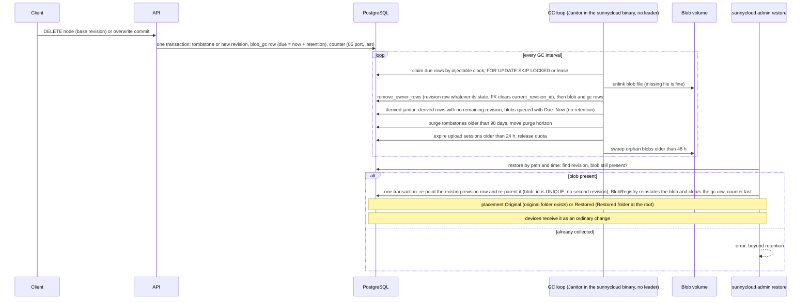

# Flow F12: Deletion, blob GC queue, retention and operator restore

Details, preconditions and errors: [system-flows.md](../../system-flows.md#flow-f12-deletion-blob-gc-retention-and-operator-restore)

