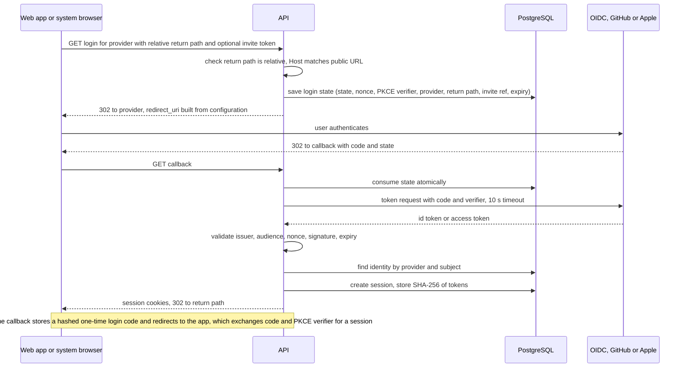
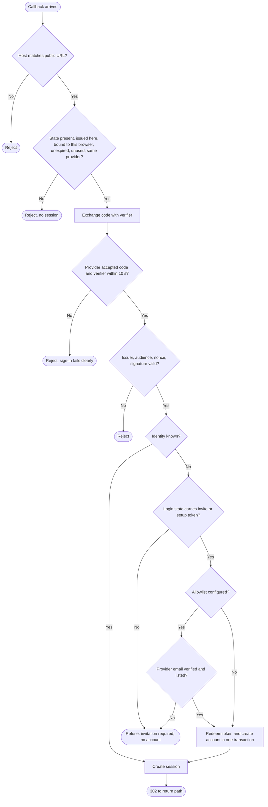

# Flow F2: Sign-in through OIDC or GitHub (Apple in v1.1)

Details, preconditions and errors: [system-flows.md](../../system-flows.md#flow-f2-sign-in-through-oidc-or-github)

## Sequence

## Callback decision flow

