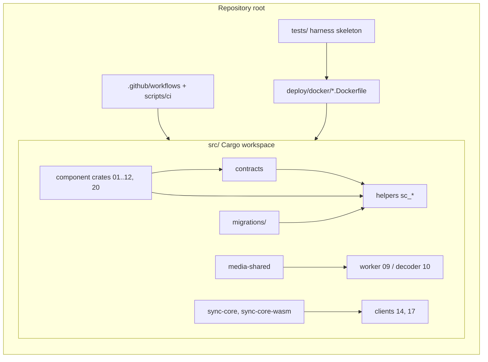
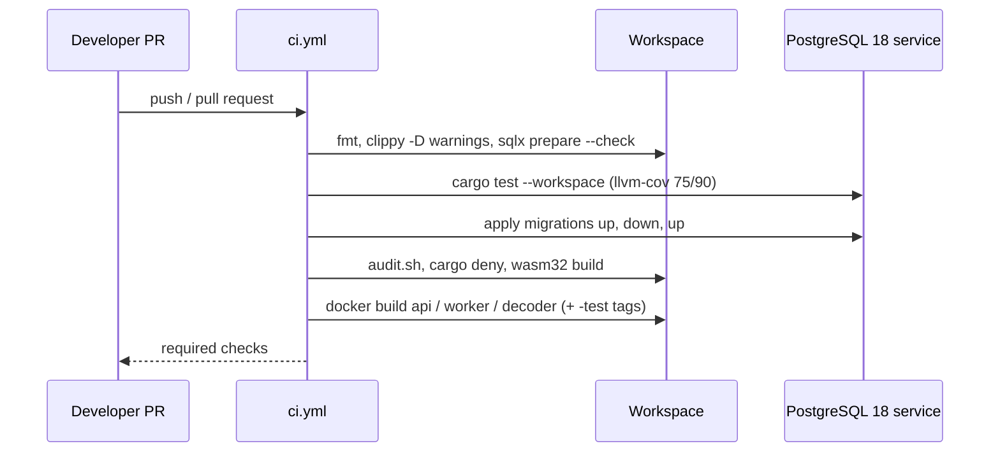

## Epic: Bootstrap & Initial Structure — A compiling workspace with every contract in place

**Epic id**: E-00
**epic_type**: bootstrap

### Epic Summary

Create the repository skeleton under `src/`: the Cargo workspace, the `contracts` crate with every port trait, the `media-shared` and `sync-core` skeletons, empty crates for every helper and component, a shared test-harness skeleton, a CI skeleton, the migrations directory and the three Dockerfiles. Every later epic starts from a workspace that builds, lints and runs an empty CI.

### Problem / Context

The repository holds documentation only (`tests/environment.md`: "no `src/` yet"). ADR-015 makes every cross-component call go through a port trait in `contracts`; about 50 ports must exist before any component can be built or faked, otherwise the crate graph cannot be acyclic by construction. The first vertical slice (upload, commit, feed, download) is the answer to R15 (complexity) and depends on this structure.

- Architecture: `_docs/02_document/architecture.md` (Component list, Dependency rule, Technology Stack)
- Decisions: `component-decisions.md`, `canonical-names.md` § Ports
- Deployment: `deployment/containerization.md`, `deployment/ci_cd_pipeline.md`; tests: `tests/environment.md`

### System context



### Scope

**In Scope**:
- Workspace root: `src/Cargo.toml`, `rust-toolchain.toml` (stable, MSRV 1.88), `rustfmt.toml`, clippy lint set, `deny.toml` with the dependency floors, `.cargo/config.toml`, `.gitignore` additions (logs, `e2e-results/`, `target/`).
- Empty library crates for all eight helpers (`src/shared/<concern>/`) and a stub `sc_observability` (E-09); one library crate per server component (01-08, 11, 20), the `sunnycloud` binary crate (12), `sunnycloud-worker` (09), `decoder-runner` (10), `ipc_schema` and the desktop crates (14, 15), `mobile_backup` (17, 18), `vault-core` (19).
- `contracts`: every port trait and shared DTO named in `canonical-names.md` § Ports and the component descriptions, signatures only, no implementation (list under Interface specification).
- `media-shared` skeleton: job DTOs, transcode policy types, `decoder_protocol` request/response types; no sqlx, no I/O.
- `sync-core` and `sync-core-wasm` skeletons with the six client traits and native/WASM feature split (`wasm32-unknown-unknown` build in CI).
- Test-harness skeleton: `tests/run.sh --profile`, `tests/compose.test.yml` (service names as in `canonical-names.md`), the pytest consumer with the CSV reporter, the `e2e-ctl` stub.
- CI skeleton: `ci.yml` jobs `rust-lint`, `rust-test` (PostgreSQL 18 service), `pg18-migrations`, `supply-chain`, `images` (build only), scripts `audit.sh`, `watchdog.sh`; actions pinned by SHA.
- Migrations setup: `src/migrations/`, committed `.sqlx/`, `cargo sqlx prepare --check` in CI.
- Dockerfile skeletons (`api`, `worker`, `decoder`), `.dockerignore`, `compose.dev.yml` with the Postgres 18 role init script.
- AGPL-3.0 `LICENSE`.

**Out of Scope**:
- Any behaviour: helper logic (E-01..E-09), component logic (E-10..E-30).
- Svelte (`src/web`) and Flutter (`src/mobile`) project scaffolds: created by E-26 and E-27/E-28.
- The `COPYING.iOS` App Store exception text (needs owner wording, see Risks).
- Release workflows (`release.yml`, `weekly-rebuild.yml`, `nightly.yml`).

### Assumptions

- One Cargo workspace for all Rust code (architecture "Confirmed decisions"); Svelte and Flutter apps sit beside it as separate top-level project folders.
- Component crates are named `sunnycloud-<name>`, helpers `sc_<concern>` (proposed; the architecture fixes only `sc_*` and `sunnycloud-server`).
- `contracts` pulls server dependencies and is never a client dependency (ADR-015); `sc_db` supplies only the `DbTx` type to it.
- GitHub Actions is the primary CI; the Woodpecker fallback runs the same scripts and only builds and tests.

### Dependencies

**Epic dependencies** (must be completed first): none.

**External dependencies**:
- GitHub repository `zxsanny/sunnycloud` with Actions enabled; GHCR access for the `images` job.
- Digests for every base image (rust, node, debian, distroless, postgres, caddy) recorded at first build.
- Docker with Compose and `/dev/kvm` only for later tiers; not needed here.

### Effort Estimation

**T-shirt size**: XL
**Story points range**: 36-44 (planned 40)

### Users / Consumers

| Type | Who | Key Use Cases |
|------|-----|--------------|
| Internal | Implementers of E-01..E-31 | Start from a building workspace; code against fakes of the ports |
| System | CI (GitHub Actions, Woodpecker) | PR gate on an empty workspace; image build |
| System | Test harness | `tests/run.sh --profile core` starts and reports on an empty stack |

### Requirements

**Functional**:
- `cargo build --workspace --locked` and `cargo test --workspace --locked` pass on the skeleton; the crate graph has no component-to-component edge (checked by a `cargo metadata` test).
- `contracts` compiles with no implementation and no `todo!()`; `sc_db` exposes `DbTx` with no public constructor.
- The workspace builds for `wasm32-unknown-unknown` for `sync-core-wasm` and `sc_ids`.

**Non-functional**:
- Every dependency version below is pinned in `[workspace.dependencies]`; `--locked` everywhere; MSRV 1.88.
- PR gate on the skeleton finishes in under 15 minutes on GitHub-hosted runners.
- No quiet test runs (`cargo test` without `-q`; `tests/run.sh` verbose).

**Security / Compliance**:
- `cargo audit` and `cargo deny` are blocking; floors: tokio >= 1.54.1, h2 >= 0.4.16, bytes >= 1.11.1, rustls >= 0.23.45; `yanked = "deny"`; GPL-3.0-compatible licences only (RESTRICT-12, RESTRICT-29).
- Actions pinned to full commit SHAs, images by digest (RESTRICT-30); workflow `permissions: contents: read` by default.

### Interface specification

Workspace layout (proposed):

```
src/
  Cargo.toml  rust-toolchain.toml  deny.toml  rustfmt.toml
  contracts/  media-shared/  sync-core/  sync-core-wasm/  vault-core/
  shared/{config,error,clock,audit,ids_hashing,names,db,ratelimit,observability}/
  components/{01_identity,02_tree,03_transfer,04_blobstore,05_sync_feed,06_sharing,
              07_admin,07a_quota,08_media_jobs,11_http_api,20_vault_service}/
  server/ (binary `sunnycloud`)   worker/ (`sunnycloud-worker`)   decoder/ (`decoder-runner`)
  desktop/{daemon,settings,ipc_schema}/   mobile_backup/
  migrations/   (web/ and mobile/ are added by E-26 and E-27)
deploy/{docker,postgres,compose}/   scripts/ci/   tests/
```

Port traits to declare in `contracts` (signatures from the component descriptions):
- Registries and lifecycle: `Janitor`, `AccountLifecycleHook`, `EraseProgress`, `BlobOwnerCleanup`, `DoctorCheck`, `HealthContributor`, `ReadinessCheck`.
- 01: `Authenticator`, `PrincipalRevalidator`, `AccountGuard`, `SignInService`, `SessionService`, `DeviceGrantService`, `InviteService`, `OperatorIdentityOps`, `AccountAdmin`.
- 02: `TreeService`, `TreeReader`, `TreeCommit`, `TreeRestore`, `LiveUsageSource`, `TreeMaintenance`, `CommitEffect`, `CommitActor`, `EffectError`.
- 03: `UploadService`, `CommitService`, `DownloadService`, `ReservationSource`.
- 04: `BlobWriter`, `BlobReader`, `BlobRegistry`, `BlobCatalog`, `GcQueue`, `Scrubber`, `BlobInventory`, `MasterKeyring`, `EpochMarker`, `BlobRef`.
- 05: `FeedStamp`, `FeedNotifier`, `FeedHorizon`, `ChangeFeed`, `EpochAdmin`. 06: `ShareService`, `PublicShareService`.
- 07 / 07a: `AdminService`, `AccountService`, `AccountDeletionService`, `DevSeed`, `QuotaLedger`, `QuotaAdmin`.
- 08: `ThumbnailStateSource`, `DerivedOpener`, `WorkerAuthenticator`, `WorkerJobs`, `MediaAdmin`. 20: `VaultService`.

Client traits in `sync-core`: `SyncApi`, `CredentialProvider`, `FileSource`, `DownloadSink`, `CheckpointStore`, `ProgressSink`. `BackupCore` lives in `mobile_backup`, `DaemonControl` types in `ipc_schema`.

### Data flow



### Design & Architecture

- Architecture doc: `_docs/02_document/architecture.md`
- ADRs: `adr/015_ports-only-component-dependencies.md`, `adr/001_rust-for-server-workers-and-desktop.md`
- Component specs: `_docs/02_document/components/*/description.md` (Ports sections)
- System flows: `_docs/02_document/system-flows.md`

### Architecture notes

- ADR-015 (ports only), ADR-001 (Rust), ADR-009 (workers API-only: `media-shared` has no sqlx), ADR-014 (two DB roles; init script only creates roles).
- Pins (`[workspace.dependencies]`): axum 0.8.9, hyper 1.12 with hyper-util, tokio >= 1.54.1, h2 >= 0.4.16, bytes >= 1.11.1, rustls >= 0.23.45, sqlx 0.9, blake3 1.8.7, `chacha20poly1305 =0.11.0`, `aead-stream =0.6.0`, openidconnect 4.1.0, oauth2 5.0.0, uniffi 0.32.2, notify 8.2.1, tray-icon 0.26.1, slint 1.18.1 (software renderer), rfd 0.17.2, rusqlite 0.41.1, reqwest 0.13.5, `wasm-bindgen =0.2.130` with wasm-pack 0.15.x; PostgreSQL 18; Svelte 5. `jsonwebtoken` has no version in the architecture table and is pinned when E-15 starts.
- Release images build with `--locked -p sunnycloud-server --features ${FEATURES:-}`; `test-clock` is a feature of the API and worker crates only.

### Testing strategy

- Harness self-test: `tests/run.sh --profile core` on the empty stack writes `e2e-results/report.csv` with the columns of `tests/environment.md` (Reporting) and exits non-zero on any FAIL; NOT-RUN rows are `SKIP` with a `NOT-RUN(<code>):` prefix.
- Workspace tests: crate-graph test (no component-to-component edge, `contracts` is the only shared edge), `contracts` doc-compile test, wasm32 build check.
- CI proofs: `images` job builds the release and `-test` tags; the 404 assertion for the test-clock routes is added by E-21 once the routes exist (FT-N-35, NFT-SEC-38 step 4).

### Definition of Done

- [ ] All in-scope capabilities implemented
- [ ] `cargo build/test --workspace --locked` pass; clippy `-D warnings`, rustfmt clean
- [ ] PR gate green on the skeleton (rust-lint, rust-test, pg18-migrations, supply-chain, images)
- [ ] Coverage gate configured (75% overall, 90% critical-path; `quality-thresholds`)
- [ ] README section describes the layout and how to run the PR gate locally
- [ ] Every port trait of `canonical-names.md` § Ports exists in `contracts`

### Acceptance Criteria

| # | Criterion | Measurable Condition |
|---|-----------|---------------------|
| 1 | Workspace builds and tests | `cargo test --workspace --locked` exit 0 on a clean checkout (RESTRICT-05) |
| 2 | Dependency floors enforced | `cargo deny check` fails when tokio 1.54.0 or h2 < 0.4.16 is introduced (RESTRICT-12, AC-63) |
| 3 | Every port declared | A listing test compares `contracts` public traits with the names in this epic: 0 missing |
| 4 | Acyclic crate graph | `cargo metadata` test: 0 edges between component crates (ADR-015) |
| 5 | Images build | api, worker, decoder and the `-test` tags of api and worker build from the Dockerfiles (RESTRICT-30: digests pinned) |
| 6 | Migrations job runs | `pg18-migrations` passes on an empty PG 18 with 0 migrations and runs up, down, up when files exist |
| 7 | Harness reports | `tests/run.sh --profile core` produces `report.csv` with 0 FAIL on the skeleton |

### Risks & Mitigations

| # | Risk | Mitigation | Owner |
|---|------|------------|-------|
| 1 | R15: about 50 ports; a wrong boundary costs a `contracts` change plus every implementer | Signatures copied from the component descriptions; vertical slice first; tasks split by component family | Epic owner |
| 2 | R17/RESTRICT-30: unpinned actions or images enter at the start | SHA and digest pins in the skeleton; Dependabot configured; supply-chain job blocks | CI owner |
| 3 | `COPYING.iOS` wording missing (R18) | Create only `LICENSE`; the CI check for `COPYING.iOS` is enabled when the owner supplies the text | Project owner |
| 4 | Crate and folder names proposed here differ from the owner's taste | Names confirmed in the first task before the rest is created | Epic owner |

### Labels

- `sunnycloud`
- `epic:bootstrap`

### Child Issues

| Type | Title | Points |
|------|-------|--------|
| Enabler | Workspace root, toolchain, lint set, `deny.toml`, `.gitignore` | 3 |
| Enabler | Skeleton crates for helpers, components, binaries, `DbTx` stub; crate-graph test | 3 |
| Task | `contracts` part 1: registries, lifecycle, 01 identity, 07 admin, 07a quota ports | 5 |
| Task | `contracts` part 2: 02 tree, 03 transfer, 05 sync_feed ports and `CommitEffect` | 5 |
| Task | `contracts` part 3: 04 blobstore, 06 sharing, 08 media, 20 vault ports | 3 |
| Task | `media-shared` skeleton (job DTOs, policy types, decoder protocol types) | 2 |
| Task | `sync-core` and `sync-core-wasm` skeletons with client traits and wasm32 build | 3 |
| Enabler | Shared test-harness skeleton (`run.sh`, compose.test.yml, pytest reporter, `e2e-ctl` stub) | 5 |
| Enabler | CI skeleton (`ci.yml`, `audit.sh`, `watchdog.sh`, SHA pins, coverage gate) | 5 |
| Enabler | Migrations setup (`src/migrations/`, `.sqlx/`, sqlx prepare check) | 2 |
| Enabler | Dockerfile skeletons, `.dockerignore`, `compose.dev.yml`, Postgres role init script | 3 |
| Task | AGPL-3.0 `LICENSE` and README layout section | 1 |
