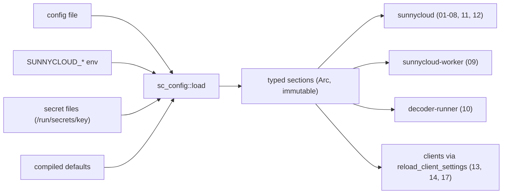
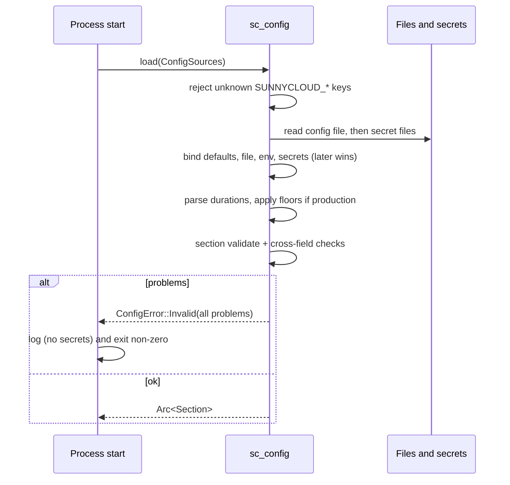

## Epic: Cross-Cutting Configuration — One typed, validated settings loader

**Epic id**: E-01
**epic_type**: cross-cutting
**concern**: config

### Epic Summary

Build `sc_config`: the single place that turns defaults, a config file, environment variables and secret files into typed, validated settings, with one closed key-to-env table for all three binaries. Every duration is a configuration value, so production defaults (7 days) and test overrides (seconds) use the same code path.

### Problem / Context

Components need dozens of tunables (retention, TTLs, leases, limits). Without one owner the same key gets two spellings, secrets leak into logs, and a typo in an environment variable silently does nothing. The project rule is "no raw key lookups in business code" and "bind typed config; validate at startup". Tests depend on short durations (`environment = test`), and a below-floor production value must refuse to start (RESTRICT-32, FT-P-17).

- Helper spec: `_docs/02_document/common-helpers/01_helper_config.md` (the key table is authoritative)
- Architecture: `architecture.md` (Environment-specific configuration), `canonical-names.md` § Runtime

### System context

### Scope

**In Scope**:
- Layered binding in the fixed order: compiled defaults, config file, environment, secret files; later wins.
- The closed key table (all groups of helper 01: General, HTTP, Database, Identity, Abuse limits, Tree and feed, Transfer, Sharing, Admin and quota, Blobstore, Media jobs, Worker, Limits, Decoder, Vault, CLI, client overrides) with default, type, range, secret flag and "read by" binaries.
- `DurationSetting` (`2s`, `5m`, `7d`) with production floors and ceilings that apply only when `environment = production`.
- `Secret<T>` whose `Debug`/`Display` print `***`; `MissingSecret` for absent required secrets.
- Unknown `SUNNYCLOUD_*` variables refuse start, all offenders listed; the tolerated prefixed name is `SUNNYCLOUD_VERSION`.
- Cross-field validation hooks per section (retention 0-90 days, at least one sign-in provider, `public_url` is https outside development).
- `reload_client_settings`: atomic swap of one `Arc`; the previous settings stay active on error.
- Release-fixed values (updater source and keys, minimum API family, HTTPS-required flag) not overridable in release builds.

**Out of Scope**:
- Choosing section contents for later keys: a component that adds a key adds its row in its own change.
- The settings window UI (E-25) and the daemon's settings file location (E-24).
- Runtime reload on the server (v1.0 restarts to apply server config).

### Assumptions

- Keys are flat snake case; the environment name is `SUNNYCLOUD_` plus the upper-cased key; no aliases.
- One `.env` serves all containers; a binary ignores keys it does not read.
- Compose-only variables (`PUBLIC_HOST`, `BLOB_PATH`, `WORKER_CPUS`, `WORKER_MEM`) are never read by a binary.
- The web app has no runtime config (build-time constants only).

### Dependencies

**Epic dependencies** (must be completed first):
- E-00 Bootstrap & Initial Structure

**External dependencies**:
- Docker secrets or secret files mounted at `/run/secrets/<key>` in the stack.
- `.env.test` with short durations supplied by the test harness.

### Effort Estimation

**T-shirt size**: M
**Story points range**: 4-5 (one task at the 5-point cap; see Risks)

### Users / Consumers

| Type | Who | Key Use Cases |
|------|-----|--------------|
| Internal | Every server component (01-12) | Receive their typed section; never read an env var |
| System | `sunnycloud`, `sunnycloud-worker`, `decoder-runner` | Fail start with all problems listed |
| System | `sunnycloud doctor` (E-22) | Report config problems without secrets |
| Internal | Clients 13, 14, 17 | Validate a settings change before applying it |

### Requirements

**Functional**:
- `load::<T>` returns an immutable `Arc<T>` or `ConfigError::Invalid(Vec<KeyProblem>)` listing every problem at once.
- `KeyProblem` reasons: `OutOfRange{min,max}`, `WrongType`, `Unknown`, `MissingRequired`, `ForbiddenInRelease`.
- A secret is read from `SUNNYCLOUD_<KEY>_FILE`, else `/run/secrets/<key>`; the value never reaches logs, errors or `Debug`.
- Test environments accept floors below production (this is how 7-day retention becomes seconds).

**Non-functional**:
- Load of the full table under 50 ms; no panics on malformed input (property test over random env maps).
- Pure library: no global state, no I/O except reading the named files.

**Security / Compliance**:
- Secrets never appear in logs, images or error text (NFT-SEC-38).
- Updater keys and source cannot be overridden by env or file in release builds (NFT-SEC-33 step 3, AC-49).

### Interface specification

| Operation | Input | Output | Errors |
|-----------|-------|--------|--------|
| `load::<T: ConfigSection>` | `ConfigSources { env, files, secrets_dir, environment }` | `Arc<T>` | `ConfigError::{Invalid(Vec<KeyProblem>), MissingSecret(key), Unreadable(path, io_kind)}` |
| `ConfigSection::validate` | bound struct | `Vec<KeyProblem>` | none (collects) |
| `DurationSetting::get` | none | `Duration` | none (validated at load) |
| `Secret<T>` | value | opaque wrapper, prints `***` | none |
| `reload_client_settings` | new settings JSON | applied `T` | validation errors; old settings stay |

Rows are declared once in a key table (`KeySpec { key, type, default, secret, duration_range, read_by }`); section structs are generated from it so a second spelling cannot exist. `environment` is `production`, `development` or `test`.

### Data flow

### Design & Architecture

- Architecture doc: `_docs/02_document/architecture.md`
- Helper spec: `_docs/02_document/common-helpers/01_helper_config.md`
- Component specs: each component's "Configuration" section lists the keys it reads
- System flows: `_docs/02_document/system-flows.md`

### Architecture notes

- ADR-001 (Rust); ADR-009/ADR-014 shape the Database and Worker groups (`db_api_url`, `db_migrator_url`; no worker DB key).
- Technology: plain `serde` binding, no config framework with global state; durations parsed by the crate itself (units `s`, `m`, `h`, `d`).
- Crate `sc_config` at `src/shared/config/`; dependencies: `serde`, `serde_json`, `thiserror` only (no sqlx, no tokio).
- Known keys not yet in the table: `desktop.wake_gap` (named in helper 03) and the numbers for sign-in and device-approval limits (compiled AC-20 defaults).

### Testing strategy

- Black-box: FT-P-17 (retention range rejected), FT-N-25 (no provider, refuse start), NFT-SEC-38 (no secrets in logs or images), NFT-SEC-33 step 3 (updater override ignored), FT-P-49 (setting change applied without restart, client reload).
- Unit: binding order; unknown-key listing; each duration floor and ceiling in production vs test; `_FILE` and default secret path; `Debug` of `Secret`; atomic reload keeps old value on error; one test that every table row has exactly one env name (no alias).
- Coverage: >= 75% overall, >= 90% on validation (critical path: refuse-to-start).

### Definition of Done

- [ ] All in-scope capabilities implemented
- [ ] Automated tests pass (unit + blackbox FT-P-17, FT-N-25)
- [ ] Coverage threshold met (`quality-thresholds`)
- [ ] Key table matches `01_helper_config.md` row for row
- [ ] Crate docs list how a component adds a key

### Acceptance Criteria

| # | Criterion | Measurable Condition |
|---|-----------|---------------------|
| 1 | Out-of-range values refuse start | `retention=91d` in production exits non-zero naming the key (AC-30, FT-P-17) |
| 2 | All problems listed at once | A file with 5 bad keys yields 5 `KeyProblem` entries in one error |
| 3 | Unknown variable refused | `SUNNYCLOUD_TYPO=1` fails start and names the variable; `SUNNYCLOUD_VERSION` is tolerated |
| 4 | Secrets never printed | 0 occurrences of a planted secret value in logs, `Debug` output and error text (NFT-SEC-38) |
| 5 | Production floors only in production | `upload_session_ttl=10s` is accepted when `environment=test`, `ForbiddenInRelease` when production |
| 6 | Release-fixed values | Env or file override of the updater source or keys is ignored in a release build (AC-49) |
| 7 | Client reload is atomic | A failing `reload_client_settings` leaves the previous `Arc` active (AC-16 5 s change) |

### Risks & Mitigations

| # | Risk | Mitigation | Owner |
|---|------|------------|-------|
| 1 | One task covers about 150 keys plus the machinery and is at the 5-point cap | Table-driven rows and generated sections; rows are data, tests are generic | Epic owner |
| 2 | Floors hide a misconfiguration outside production | Log the active `environment` at start (helper risk) | Implementer |
| 3 | Component epics forget to add their key rows | Unknown-key refusal makes a missing row fail the component's own tests | Component owners |
| 4 | Client reload not atomic | Single `Arc` swap, tested | Implementer |

### Labels

- `sunnycloud`
- `epic:cross-cutting`
- `concern:config`

### Child Issues

| Type | Title | Points |
|------|-------|--------|
| Task | `sc_config` in `src/shared/config/`: loader, key table, durations, secrets, validation, client reload | 5 |
