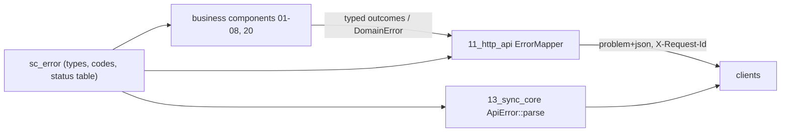
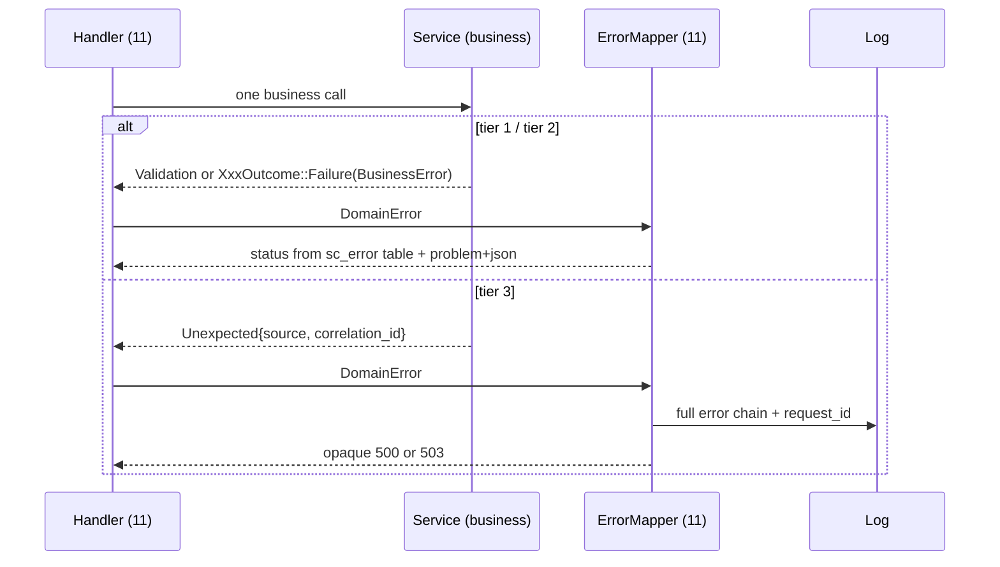

## Epic: Cross-Cutting Error Model — One taxonomy, one wire vocabulary

**Epic id**: E-02
**epic_type**: cross-cutting
**concern**: error-handling

### Epic Summary

Build `sc_error`: the three-tier failure taxonomy (validation, expected business failure, unexpected), the stable snake_case `ErrorCode` set with its single status-code table, and the client-side parser of `application/problem+json`. Business code returns typed results and never knows an HTTP status; the one mapper lives in `11_http_api`.

### Problem / Context

Clients must recover from defined outcomes (`name_conflict`, `need_blocks`, `resync_required`, `quota_exceeded`) and must never see internals. Without one code table, each component invents codes and status choices, the OpenAPI document drifts, and share-link failures stop being byte-identical (AC-12). The project rule: centralise error to response at one boundary, no silent catch, no throw on hot per-item paths.

- Helper spec: `_docs/02_document/common-helpers/02_helper_error.md` (status table is authoritative)
- Component spec: `components/11_http_api/description.md` (error mapping), `canonical-names.md` (HTTP 507 `quota_exceeded`, 410 `resync_required`, 426 `upgrade_required`)

### System context

### Scope

**In Scope**:
- `ErrorCode` enum with every code of the status table (about 45 codes) and its status, as plain integers (no HTTP crate dependency).
- Tier types: `Validation(Vec<FieldProblem>)`, `BusinessError` with typed params (`need_blocks`, `retry_after`, `reason`), `Unexpected { source, correlation_id }`, and the `DomainError` sum.
- `CorrelationId` (UUIDv7 value type, parse of `X-Request-Id`, new when missing or malformed).
- `ApiError::parse(status, headers, body)` for clients, including `ApiError::Transport(kind)`; unknown codes become `internal`.
- The `not_found` constructor shared by cross-account IDs and share-link failures so response bytes are identical.
- CI lint gate: `clippy::let_underscore_must_use` plus a grep test for empty `catch` and `let _ =` on `Result`.

**Out of Scope**:
- `ErrorMapper::to_response`, headers and HTTP types: owned by E-21 (`11_http_api`).
- Per-operation `XxxOutcome` enums: owned by each component's epic, built on `BusinessError`.
- OpenAPI generation (E-21).

### Assumptions

- `quota_exceeded` is fixed at HTTP 507; `resync_required` is 410 with extra field `reason`.
- Clients build `sc_error` natively and for `wasm32` through `sync-core-wasm` (parsing only).
- The correlation id is generated by the caller (11) from `sc_ids` and `Clock`; `sc_error` stays independent of later helpers.

### Dependencies

**Epic dependencies** (must be completed first):
- E-00 Bootstrap & Initial Structure

**External dependencies**: none.

### Effort Estimation

**T-shirt size**: S
**Story points range**: 2-3

### Users / Consumers

| Type | Who | Key Use Cases |
|------|-----|--------------|
| Internal | All server components | Return tier 1/2/3 values; never choose a status |
| Internal | E-21 `11_http_api` | Map `DomainError` to a response from one table |
| System | Clients 13, 14, 16, 17 | Parse errors; show the request id in "report this" text |

### Requirements

**Functional**:
- Every `ErrorCode` has exactly one status; the table matches helper 02 row for row (including 404 for `content_unavailable`, 401 for `password_required`, 416, 413, 507, 429, 426, 410).
- Tier 3 body carries no message, path, SQL or stack trace; tier 1/2 bodies never echo secrets or other accounts' data.
- Clients treat unknown codes as `internal` and keep the correlation id.

**Non-functional**:
- Constructing an error on a hot path allocates nothing beyond the value (no backtrace capture for tier 2).
- Crate compiles for native and `wasm32-unknown-unknown` with the `client` feature.

**Security / Compliance**:
- Share-link and cross-account failures use one constructor; no branch can tell them apart (AC-12, AC-59).

### Interface specification

| Operation | Input | Output | Errors |
|-----------|-------|--------|--------|
| `ErrorCode::as_str` / `status` | none | stable snake_case code / `u16` status | none |
| `BusinessError::new` | `ErrorCode`, optional params | `BusinessError` | none |
| `DomainError` | `Validation(..)`, `Business(..)`, `Unexpected{source, correlation_id}` | sum type | none |
| `CorrelationId::from_request` | `Option<&str>` header, `fresh: impl FnOnce() -> Uuid` | `CorrelationId` | none |
| `ApiError::parse` (client feature) | status, headers, body | `ApiError{code, retry_after, correlation_id}` or `Transport(kind)` | none |

Problem body fields: `type` (`urn:sunnycloud:error:<code>`), `title`, `status`, `code`, `request_id`, optional `retry_after`, `need_blocks`, `reason`, `min_version`.

### Data flow

### Design & Architecture

- Architecture doc: `_docs/02_document/architecture.md`
- Helper spec: `_docs/02_document/common-helpers/02_helper_error.md`
- Component spec: `_docs/02_document/components/11_http_api/description.md`
- System flows: `_docs/02_document/system-flows.md`

### Architecture notes

- ADR-015 keeps delivery thin (bind, one call, map); ADR-005 and ADR-004 define the conflict and resync codes.
- Crate `sc_error` at `src/shared/error/`; dependencies `serde`, `serde_json`, `thiserror`, `uuid`; features `server` (default) and `client`.
- The status table is data in this crate; the mapper in 11 reads it, so "the only place status codes are chosen" holds without an HTTP dependency here.

### Testing strategy

- Black-box: FT-N-27 (426 upgrade message), FT-N-09 and NFT-SEC-17 (identical not-found), NFT-SEC-13 (404 matrix), NFT-SEC-09 (403 CSRF), NFT-SEC-04/05/06 (429 with `Retry-After`), FT-N-02 (corruption never delivered as a good file).
- Unit: every `ErrorCode` maps to exactly one status; `ErrorCode::as_str` is unique and snake_case; round trip `BusinessError` -> body -> `ApiError::parse`; unknown code becomes `internal`; tier 3 serialisation leaks nothing (planted secret in `source`).
- CI gate: clippy lint and grep test for silent catches fail on a seeded violation.

### Definition of Done

- [ ] All in-scope capabilities implemented
- [ ] Automated tests pass (unit + blackbox via E-21)
- [ ] Coverage threshold met (`quality-thresholds`)
- [ ] Status table reviewed against `02_helper_error.md`
- [ ] Silent-catch gate wired into the PR gate

### Acceptance Criteria

| # | Criterion | Measurable Condition |
|---|-----------|---------------------|
| 1 | One status per code | Unit test enumerates all codes: 0 duplicates, 0 unmapped |
| 2 | Quota is 507 | `quota_exceeded` and `free_space_floor` map to 507 (AC-39) |
| 3 | Identical not-found | Responses built through the shared constructor are byte-identical for missing, expired and revoked links (AC-12) |
| 4 | Tier 3 is opaque | 20 malformed requests show 0 stack traces, SQL or paths in bodies (NFT-SEC-38 step 3) |
| 5 | Rate limit carries `Retry-After` | `rate_limited` and `overloaded` carry a `retry_after` value (AC-20) |
| 6 | Client parse is total | Fuzzed bodies never panic; unknown code yields `internal` |
| 7 | Silent catch rejected | Seeded `let _ = result;` fails the lint gate |

### Risks & Mitigations

| # | Risk | Mitigation | Owner |
|---|------|------------|-------|
| 1 | Quota fixed at 507, other clients may expect 413 or 403 | One table; OpenAPI generated from it | Epic owner |
| 2 | Silent catch regressions | Clippy lint plus grep test as a CI gate | CI owner |
| 3 | Helper 02 says `correlation_id`, 11 and observability say `request_id` on the wire | Wire field is `request_id`; `CorrelationId` is the Rust type name | Epic owner |
| 4 | Status table drift against the OpenAPI document | E-21 generates OpenAPI from this table; diff in CI | E-21 owner |

### Labels

- `sunnycloud`
- `epic:cross-cutting`
- `concern:error-handling`

### Child Issues

| Type | Title | Points |
|------|-------|--------|
| Task | `sc_error` in `src/shared/error/`: codes, tiers, status table, correlation id, client parser, silent-catch lint gate | 3 |
