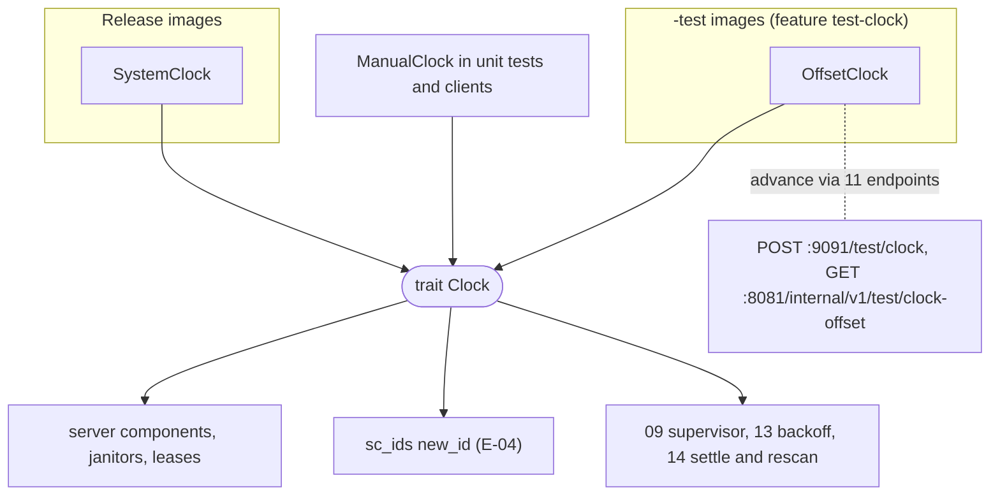
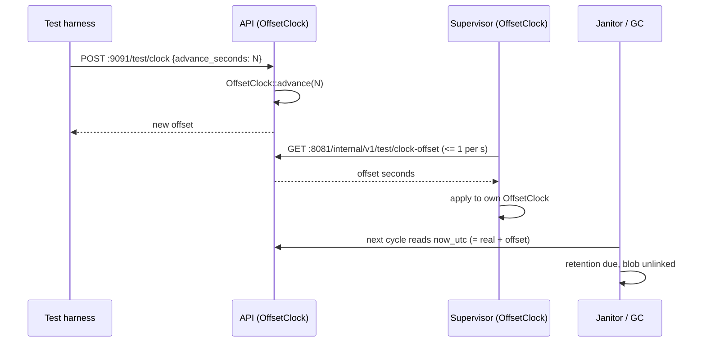

## Epic: Cross-Cutting Clock — Injectable time for retention, leases and timing rules

**Epic id**: E-03
**epic_type**: cross-cutting
**concern**: other-named-concern (time)

### Epic Summary

Build `sc_clock`: a `Clock` trait (UTC wall time, monotonic time, cancellable sleep) with a system implementation for release, an offset implementation for the `-test` images and a manual implementation for unit tests. No component reads the system clock directly, so seven-day retention and 90-day tombstone tests advance days in seconds.

### Problem / Context

AC-30 requires blob retention, tombstone horizon and share expiry tests that cross days; AC-18 requires a 2 s settle rule that must be unit-testable without sleeping. Lease, expiry and age questions need a controllable clock, while ordering must never depend on a timestamp (server order is `account_feeds.seq`, AC-8). The data model forbids SQL `now()`: the application passes `Timestamp` values.

- Helper spec: `_docs/02_document/common-helpers/03_helper_clock.md`
- Data model: `data_model.md` § 1 Conventions (Time); `canonical-names.md` § Runtime (test clock)

### System context

### Scope

**In Scope**:
- `Timestamp` (UTC, microsecond) and `MonotonicInstant` types; `Clock::{now_utc, monotonic, sleep_until_monotonic}`.
- `SystemClock`, `OffsetClock` (atomic offset applied to wall time only), `ManualClock` (both clocks move only on `tick`).
- `OffsetClock::advance` with `ClockError::NegativeAdvance`; read of the current offset for the shared-offset endpoint.
- A pure wake-gap predicate (wall jump larger than a gap between two ticks of a monotonic timer) used by the daemon's `Resumed` signal.
- CI checks: grep test that SQL never calls `now()`; release-binary check that the `test-clock` symbol is absent.

**Out of Scope**:
- The two HTTP endpoints (`POST /test/clock`, `GET /internal/v1/test/clock-offset`): owned by E-21; the supervisor poll loop: E-20.
- Duration values: they come from `sc_config` (E-01); the clock only measures them.
- The daemon's timer loop and settle logic (E-24).

### Assumptions

- Feature `test-clock` exists only on the API and worker crates; release builds never enable it.
- `monotonic` is never offset, so a day-long advance does not wake sleepers early.
- The supervisor sees an advance up to one second late (polls at most once per second).

### Dependencies

**Epic dependencies** (must be completed first):
- E-00 Bootstrap & Initial Structure

**External dependencies**: none.

### Effort Estimation

**T-shirt size**: S
**Story points range**: 2-3

### Users / Consumers

| Type | Who | Key Use Cases |
|------|-----|--------------|
| Internal | All server components | Expiry, lease, retention, tombstone horizon, `*_at` values |
| Internal | E-04 `sc_ids` | Time-ordered UUIDv7 from the injected clock |
| System | 09 supervisor, 13 sync_core, 14 daemon | Backoff, settle (2 s), rescan, wake detection |
| System | Test harness | Advance days via the test-image endpoints |

### Requirements

**Functional**:
- `now_utc` returns microsecond UTC; `monotonic` never goes back.
- `sleep_until_monotonic` completes at the instant and returns `Cancelled` on shutdown.
- `OffsetClock` offset is non-negative and monotone; `advance(d)` returns the new offset.
- `ManualClock::tick` is the only thing that moves time in unit tests.

**Non-functional**:
- `now_utc` and `monotonic` are lock-free reads (atomic offset); no allocation.
- No test advancing wall time may early-wake a sleeper or corrupt a timeout.

**Security / Compliance**:
- The release image contains neither the feature nor the routes: CI asserts a 404 on the pushed digest and checks the binary for the `test-clock` symbol (FT-N-35, NFT-SEC-38 step 4).

### Interface specification

| Operation | Input | Output | Async | Errors |
|-----------|-------|--------|-------|--------|
| `Clock::now_utc` | none | `Timestamp` (UTC, microsecond) | No | none |
| `Clock::monotonic` | none | `MonotonicInstant` | No | none |
| `Clock::sleep_until_monotonic` | `MonotonicInstant` | completes at the instant | Yes | `Cancelled` (shutdown) |
| `OffsetClock::advance` (feature `test-clock`) | `Duration` | new offset | No | `ClockError::NegativeAdvance` |
| `OffsetClock::offset` | none | current offset | No | none |
| `ManualClock::tick` | `Duration` | advances wall and monotonic | No | none |
| `wake_gap_exceeded` | previous and current wall and monotonic readings, gap | `bool` | No | none |

### Data flow

### Design & Architecture

- Architecture doc: `_docs/02_document/architecture.md` (Environment-specific configuration, Durations)
- Helper spec: `_docs/02_document/common-helpers/03_helper_clock.md`
- Containerization: `deployment/containerization.md` (`FEATURES=test-clock`, release-versus-test rule)
- System flows: `_docs/02_document/system-flows.md`

### Architecture notes

- ADR-002 (single API process): one offset in the API, mirrored to supervisors by polling.
- Crate `sc_clock` at `src/shared/clock/`; depends on `tokio` (time) behind the trait only; no `chrono` in the public API beyond `Timestamp` conversion.
- Rules owned here: SQL never calls `now()` (grep test in CI); ordering is by `account_feeds.seq`, never a timestamp.
- The `desktop.wake_gap` setting name appears in helper 03 but is not in the config key table; the predicate takes the gap as an argument and E-24 supplies it.

### Testing strategy

- Black-box: FT-N-35 (endpoints only in the test image), FT-P-16/17/18 (retention), FT-P-14 (91-day device), NFT-RES-09/10 (GC timing), NFT-RES-25 (clock skew), NFT-RES-16 (wake), FT-P-52 (2 s settle with `ManualClock`).
- Unit: `OffsetClock` leaves `monotonic` unchanged after `advance`; negative advance rejected; `ManualClock` sleepers wake only on `tick`; cancel returns `Cancelled`; `wake_gap_exceeded` boundary cases; seeded `now()` in an SQL file fails the grep test.
- CI: release build has no `test-clock` symbol.

### Definition of Done

- [ ] All in-scope capabilities implemented
- [ ] Automated tests pass (unit + blackbox via E-21 and E-10)
- [ ] Coverage threshold met (`quality-thresholds`)
- [ ] Grep gate for SQL `now()` and release-symbol check in CI
- [ ] Crate docs state which clock each layer uses

### Acceptance Criteria

| # | Criterion | Measurable Condition |
|---|-----------|---------------------|
| 1 | Time advances without sleeping | A test advances 8 days with `ManualClock` and a retention check flips in under 1 s (AC-30) |
| 2 | Sleepers not woken early | After `OffsetClock::advance(1 day)` a 10 s monotonic sleep still takes 10 s |
| 3 | Release has no control surface | Release binary lacks the `test-clock` symbol; endpoints answer 404 (FT-N-35) |
| 4 | No SQL `now()` | The grep gate finds 0 occurrences in `*.sql` and query strings |
| 5 | Settle rule testable | A 2 s settle test runs with `ManualClock` and no real sleep (AC-18, FT-P-52) |
| 6 | Shutdown cancels sleeps | `sleep_until_monotonic` returns `Cancelled` within 100 ms of shutdown |

### Risks & Mitigations

| # | Risk | Mitigation | Owner |
|---|------|------------|-------|
| 1 | `OffsetClock` leaking into release lets API users skip retention | Feature flag, 404 test on the pushed digest, symbol check | CI owner |
| 2 | An advance expires the test client's own sessions | Harness mints tokens after the advance or uses the clock-aware helper | Test owner |
| 3 | Supervisor lags an advance by up to 1 s | Tests wait one poll interval after `POST /test/clock` | Test owner |

### Labels

- `sunnycloud`
- `epic:cross-cutting`
- `concern:clock`

### Child Issues

| Type | Title | Points |
|------|-------|--------|
| Task | `sc_clock` in `src/shared/clock/`: `Clock`, system/offset/manual clocks, wake-gap predicate, `now()` and symbol gates | 3 |
