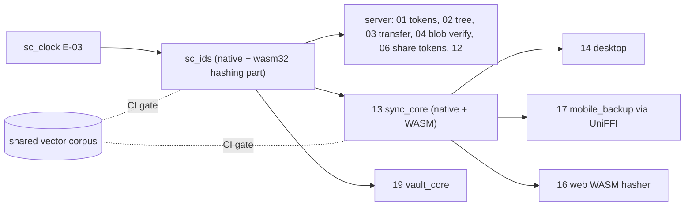
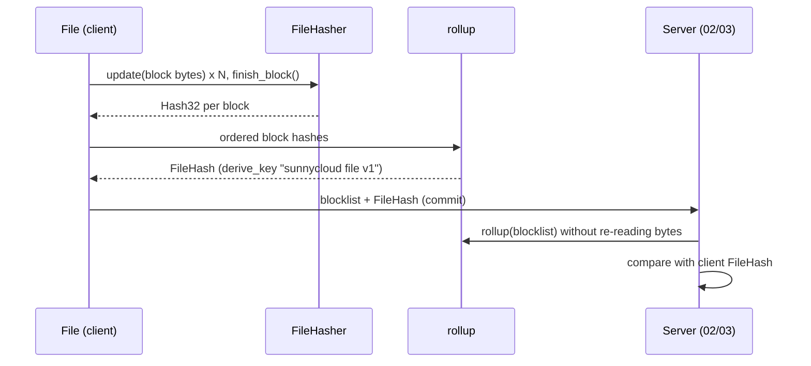

## Epic: Cross-Cutting IDs and Hashing — Byte-exact identifiers, hashes and tokens

**Epic id**: E-04
**epic_type**: cross-cutting
**concern**: other-named-concern (ids-hashing)

### Epic Summary

Build `sc_ids`: UUIDv7 ids, BLAKE3 block and file hashing with the fixed rollup rule, deterministic mobile commit ids, and the token rules (256-bit random tokens, SHA-256 storage hash, constant-time compare). It builds natively and for WASM so the server, the Android and desktop cores and the web hasher agree byte for byte.

### Problem / Context

"Server has hash" checks, resume diffs and idempotent commits only work if every implementation computes the same block hash, file hash and commit id. A drifted rollup silently breaks verification (helper risk). Tokens must be unguessable, stored only as hashes and compared in constant time everywhere (AC-12, AC-58, AC-75, AC-76).

- Helper spec: `_docs/02_document/common-helpers/05_helper_ids_hashing.md`
- Related: `data_model.md` § 1 (ids, secrets at rest), RESTRICT-11 (2 MiB blocks, BLAKE3)

### System context

### Scope

**In Scope**:
- `new_id(&dyn Clock) -> Uuid` (v7, time-ordered, random tail).
- `hash_block` (BLAKE3, block at most 2 MiB), `FileHasher` (`update`, `finish_block`, `finish`), `rollup` (BLAKE3 `derive_key` mode, context `sunnycloud file v1`, over the ordered 32-byte block hashes; empty file is the rollup of an empty list).
- `derive_client_key(device_id, asset_id, FileHash)`: first 16 bytes of keyed BLAKE3 (context `sunnycloud commit v1`) with UUID version and variant bits set.
- `new_token(kind)` (256-bit CSPRNG, URL-safe base64, never logged), `new_user_code` (8 characters base-20, RFC 8628 5.1), `sha256_token`, `ct_eq`.
- `wasm32-unknown-unknown` build of the hashing part (block-sized calls only).
- The shared vector file for blocks of 0, 1, 2 MiB and 2 MiB + 1 byte, consumed as a CI gate by native, WASM and UniFFI tests.

**Out of Scope**:
- Block verification and blob encryption (E-10).
- Where tokens are stored and redeemed (E-15 identity, E-16 sharing).
- Vault key derivation (E-29).

### Assumptions

- Block size is fixed at 2 MiB; the last block may be shorter.
- Desktop and web use random UUIDv7 commit ids; only mobile uses `derive_client_key`.
- BLAKE3 speed in WASM is browser dependent; the hasher exposes block-sized calls so the Worker heap stays bounded (AC-50).

### Dependencies

**Epic dependencies** (must be completed first):
- E-00 Bootstrap & Initial Structure
- E-03 Cross-Cutting: Clock (for `new_id`)

**External dependencies**: OS randomness (CSPRNG) on every target; `crypto.getRandomValues` in the browser.

### Effort Estimation

**T-shirt size**: M
**Story points range**: 4-5

### Users / Consumers

| Type | Who | Key Use Cases |
|------|-----|--------------|
| Internal | 01, 06 | Session, device, invite, share tokens and their stored hashes |
| Internal | 02, 03, 04 | New ids, block list and file hash checks, block verification |
| System | 13, 14, 17, 16 | Same hashes on the client; mobile commit ids stable across reinstall |

### Requirements

**Functional**:
- Same inputs give identical `Hash32`, `FileHash` and `derive_client_key` on native, WASM and UniFFI targets.
- `FileHasher::update` rejects a block over 2 MiB with `HashError::BlockTooLarge`.
- `ct_eq` is constant time and checks length inside.
- `user_code` is stored plain (not a bearer secret); `device_code` and mobile login codes are `new_token` values stored hashed.

**Non-functional**:
- Hash throughput on the reference server within the AC-2 budget (BLAKE3 1.8.7); no per-block allocation beyond the output.
- Deterministic ids with `ManualClock`.

**Security / Compliance**:
- Tokens carry 256 random bits (AC floor 128); only `sha256_token` output is stored; raw tokens never reach logs or `Debug` (NFT-SEC-16).

### Interface specification

| Operation | Input | Output | Errors |
|-----------|-------|--------|--------|
| `new_id` | `&dyn Clock` | `Uuid` v7 | none |
| `hash_block` | `&[u8]` (at most 2 MiB) | `Hash32` | none |
| `FileHasher` | `update(&[u8])`, `finish_block()`, `finish()` | ordered `Vec<Hash32>` and `FileHash` | `HashError::BlockTooLarge` |
| `rollup` | `&[Hash32]` | `FileHash` | none |
| `derive_client_key` | `device_id`, `asset_id: &str`, `FileHash` | `Uuid` (stable) | none |
| `new_token` | `TokenKind` | `RawToken` | `RngUnavailable` |
| `new_user_code` | none | `UserCode` | `RngUnavailable` |
| `sha256_token` | `&RawToken` or `&str` | `TokenHash` (32 bytes) | none |
| `ct_eq` | `&[u8]`, `&[u8]` | `bool` | none |

### Data flow

### Design & Architecture

- Architecture doc: `_docs/02_document/architecture.md` (Technology Stack: BLAKE3 1.8.7)
- Helper spec: `_docs/02_document/common-helpers/05_helper_ids_hashing.md`
- Component specs: `13_sync_core`, `03_transfer`, `01_identity`
- System flows: `_docs/02_document/system-flows.md`

### Architecture notes

- ADR-004 (2 MiB blocks, BLAKE3), ADR-013 (shared Rust core through UniFFI), ADR-001 (one core for web and mobile).
- Crate `sc_ids` at `src/shared/ids_hashing/`; pins: `blake3 1.8.7`, `sha2`, `uuid` (v7 feature), `getrandom` with the `js` feature on wasm32; `wasm-bindgen =0.2.130` only in `sync-core-wasm`.
- UUIDv4 for blob ids is generated by E-10, not here (leading hex digits must be uniform).

### Testing strategy

- Black-box: FT-P-05 (block conformance), FT-P-38 and NFT-SEC-16 (random, hashed share tokens), FT-N-01/02 (bit flip detected), FT-P-32 (commit id stable across reinstall), AC-75/AC-76 single-use unit tests with E-15.
- Unit: known-answer vectors for blocks of 0, 1, 2 MiB, 2 MiB + 1; rollup of an empty list; `derive_client_key` stability and version/variant bits; `ct_eq` length mismatch; token length and alphabet; `new_id` ordering with `ManualClock`.
- Cross-implementation gate: the shared vector file runs on native, WASM (headless) and Kotlin/Swift via UniFFI (the latter wired by E-27/E-28) and fails the PR when any target differs.

### Definition of Done

- [ ] All in-scope capabilities implemented
- [ ] Automated tests pass (unit + vector gate on native and WASM)
- [ ] Coverage threshold met (`quality-thresholds`)
- [ ] Vector file committed and referenced by every consumer's CI
- [ ] `wasm32-unknown-unknown` build in the PR gate

### Acceptance Criteria

| # | Criterion | Measurable Condition |
|---|-----------|---------------------|
| 1 | Byte-exact hashing | Native and WASM produce identical `FileHash` for all vector cases (AC-7) |
| 2 | Bit flip detected | One flipped bit in any block changes its `Hash32` and the `FileHash` (FT-N-01) |
| 3 | Stable mobile commit id | Same device, asset and hash give the same id after reinstall (AC-46, FT-P-32) |
| 4 | Token strength | `new_token` yields 256 bits; 1,000,000 draws show 0 collisions (AC-12, AC-58) |
| 5 | Raw tokens never printed | `Debug` and `Display` of `RawToken` print a placeholder, never the value (NFT-SEC-16) |
| 6 | Oversized block rejected | `HashError::BlockTooLarge` for 2 MiB + 1 byte in one block |

### Risks & Mitigations

| # | Risk | Mitigation | Owner |
|---|------|------------|-------|
| 1 | Rollup rule drift between server and clients | Shared vector file is a CI gate for every consumer | Epic owner |
| 2 | WASM BLAKE3 speed is browser dependent | Block-sized calls only; measured in AC-50 tests (E-26) | E-26 owner |
| 3 | UniFFI target differs silently | Vector test runs on the Kotlin side in E-27 CI | E-27 owner |
| 4 | RNG unavailable on a target | `RngUnavailable` is typed; callers fail the operation | Implementer |

### Labels

- `sunnycloud`
- `epic:cross-cutting`
- `concern:ids-hashing`

### Child Issues

| Type | Title | Points |
|------|-------|--------|
| Task | `sc_ids` in `src/shared/ids_hashing/`: ids, hashing, rollup, commit key, tokens, WASM build, shared vector file | 5 |
