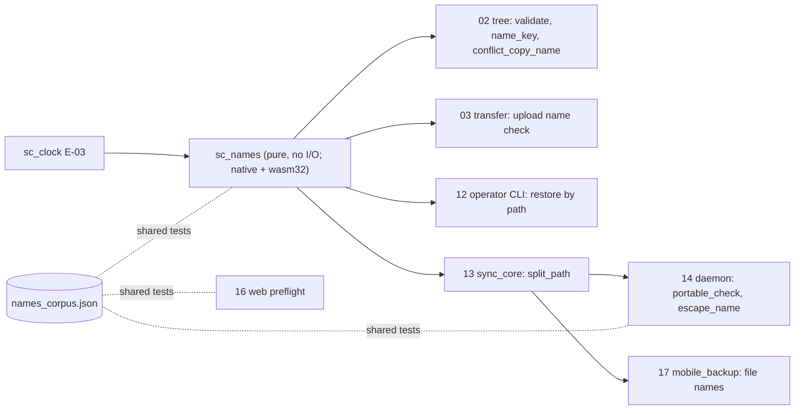
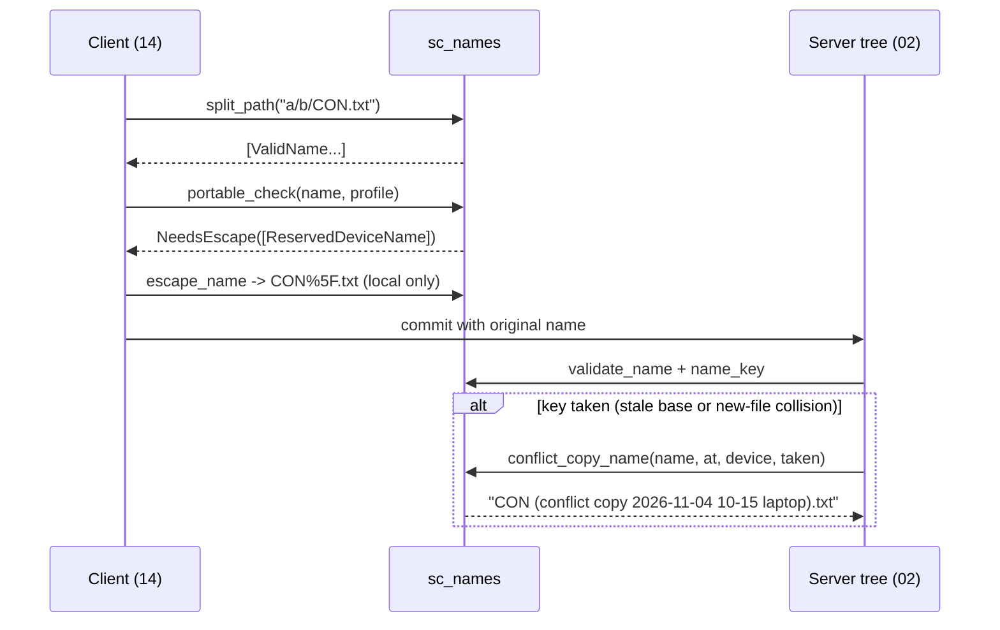

## Epic: Cross-Cutting Name Rules — One definition of a legal name

**Epic id**: E-05
**epic_type**: cross-cutting
**concern**: other-named-concern (name-rules)

### Epic Summary

Build `sc_names`, a pure crate that defines a legal name, the case-insensitive `name_key`, the server-assigned conflict-copy name, and what a client does with a name its operating system cannot hold. The server accepts everything except a short list; clients carry the portability burden using the same shared corpus.

### Problem / Context

Names must be unique per folder case-insensitively and stored case-preserving (AC-42). Hostile names (traversal, alternate data streams, reserved Windows names, bidi characters) must cause 0 writes outside the sync root (AC-37). Conflict copies must be named by one function so the server decides and clients never retry with another name. If server and clients folded names differently, files would collide or duplicate across devices.

- Helper spec: `_docs/02_document/common-helpers/06_helper_names.md`
- Related: `component-decisions.md` decisions 9 and 15; `canonical-names.md` (new-file collision at commit: server assigns the conflict-copy name); `tests/test-data.md` (hostile-name corpus)

### System context

### Scope

**In Scope**:
- `validate_name`: rejects `.` and `..` as whole names, `/`, NUL, Unicode Cc control characters, bidi controls (U+061C, U+200E, U+200F, U+202A to U+202E, U+2066 to U+2069), empty, and over 255 bytes of UTF-8; accepts everything else.
- `name_key`: NFC then Unicode full case folding, with a pinned Unicode version exposed as `NAME_KEY_VERSION`.
- `conflict_copy_name`: `stem (conflict copy YYYY-MM-DD HH-MM device).ext`, UTC time, device label sanitised, truncation on a character boundary within 255 bytes (label cut first), numeric suffix ` (2)`, ` (3)` before the extension on collision; always passes `validate_name`.
- `split_path`: relative `/`-separated path to `Vec<ValidName>`; never yields `.`, `..` or a component with a separator.
- Client portability: `portable_check` and `escape_name` for `FsProfile` (`WindowsNtfs`, `PosixCaseSensitive`, `CaseInsensitivePreserving`); `%XX` escaping of offending scalars.
- The shared corpus file `names_corpus.json` (40 hostile cases per OS) consumed by server, daemon and web tests.

**Out of Scope**:
- Symlink, junction and reparse-point defence: needs file handles, owned by `SafeFs` in E-24.
- File-system profile detection (probe file): E-24.
- Batch re-key when the Unicode table changes (a later release, tracked by `name_key_version`).

### Assumptions

- Names are at most 255 bytes of UTF-8 (assumption A1).
- `name_key` is computed in Rust only, never in SQL; `COLLATE "C"` makes uniqueness byte-exact.
- The `%XX` escaping format is decided; the Windows reserved-name marker (`%5F`) and the ` (2)` suffix are proposed defaults still open with the owner and are implemented as constants easy to change.
- Escaped names are local only and never uploaded back as a rename.

### Dependencies

**Epic dependencies** (must be completed first):
- E-00 Bootstrap & Initial Structure
- E-03 Cross-Cutting: Clock (the `Timestamp` type used by `conflict_copy_name`)

**External dependencies**: a Unicode normalisation and case-folding library whose Unicode version can be pinned and reported (choice made inside the task).

### Effort Estimation

**T-shirt size**: M
**Story points range**: 4-5

### Users / Consumers

| Type | Who | Key Use Cases |
|------|-----|--------------|
| Internal | 02 tree | Validate on create and rename; `name_key`; conflict-copy names in the commit transaction |
| Internal | 03 transfer, 12 CLI | Upload name check; restore by path |
| System | 13, 14, 17, 16 | Path splitting; portability check and escaping on the client |

### Requirements

**Functional**:
- Server accepts reserved Windows names, trailing dots and spaces, backslash, colon, case variants, leading dashes and emoji; it rejects only the list above.
- `name_key` is stable across calls and records `NAME_KEY_VERSION`.
- `escape_name` is deterministic and collision-free within the folder (`a:b` becomes `a%3Ab`; `CON.txt` becomes `CON%5F.txt`).
- Portability reasons cover Windows reserved device names, trailing dot or space, `< > : " | ? * \`, alternate-data-stream syntax, platform length limit, lone surrogates, case and NFC/NFD collisions.

**Non-functional**:
- Pure functions, no I/O, no global state; builds natively and for `wasm32-unknown-unknown`.
- `validate_name` plus `name_key` under 5 microseconds for a typical name.

**Security / Compliance**:
- 0 writes outside the sync root from the 40-case corpus per OS (AC-37); `split_path` never produces a traversal component.

### Interface specification

| Operation | Input | Output | Errors |
|-----------|-------|--------|--------|
| `validate_name` | `&str` | `ValidName` | `NameError::{Empty, TooLong(bytes), Dot, DotDot, ContainsSlash, ContainsNul, ControlChar, BidiControl}` |
| `name_key` | `&ValidName` | `NameKey` | none |
| `NAME_KEY_VERSION` | const | pinned Unicode version id | none |
| `portable_check` | `&ValidName`, `FsProfile` | `Portable::Ok` or `NeedsEscape(Vec<Reason>)` | none |
| `escape_name` | `&ValidName`, `FsProfile`, `&dyn NameLookup` | `EscapedName` | none |
| `split_path` | `&str` | `Vec<ValidName>` | `NameError` for any component |
| `conflict_copy_name` | contested `&ValidName`, `Timestamp`, `device_label: &str`, `&dyn NameLookup` | `ValidName` | none |

`NameLookup` (is this name taken in the folder) is defined here so callers pass a database-backed or in-memory implementation.

### Data flow

### Design & Architecture

- Architecture doc: `_docs/02_document/architecture.md` (Data Model Overview: Node name, name_key)
- Helper spec: `_docs/02_document/common-helpers/06_helper_names.md`
- Component specs: `02_tree`, `14_desktop_daemon`
- System flows: `_docs/02_document/system-flows.md` (conflicts)

### Architecture notes

- ADR-005 (last write wins with conflict copies); RESTRICT-07 (names unique per folder case-insensitively, case-preserving); R16 (Unicode fold version is user-visible).
- Crate `sc_names` at `src/shared/names/`; no dependency on `sc_db`; depends on `sc_clock` for `Timestamp` only; Unicode library and its version are pinned in the task and reported through `NAME_KEY_VERSION`.
- `names_corpus.json` lives in the crate and is copied by reference (not duplicated) into daemon and web tests.

### Testing strategy

- Black-box: FT-N-41 (server accepts and rejects exactly the list), NFT-SEC-22 (names in the API), FT-N-19 and NFT-SEC-31 (40-case corpus per OS), FT-N-04/05, FT-P-15 (case-only rename keeps the file id).
- Unit: fold stability across `NAME_KEY_VERSION`; `conflict_copy_name` with a multi-byte stem near 255 bytes, extension kept, label sanitised, numeric suffix on collision; `escape_name` determinism and collisions; every rejected and accepted class in the Server rules; `split_path` on traversal inputs.
- Property tests: `validate_name(conflict_copy_name(x))` always succeeds; `name_key` idempotent.

### Definition of Done

- [ ] All in-scope capabilities implemented
- [ ] Automated tests pass (unit + corpus + blackbox via E-13 and E-24)
- [ ] Coverage threshold met (`quality-thresholds`)
- [ ] `names_corpus.json` committed with 40 cases per OS
- [ ] Open defaults (`%5F`, ` (2)`) recorded as named constants with a note for the owner

### Acceptance Criteria

| # | Criterion | Measurable Condition |
|---|-----------|---------------------|
| 1 | Exact accept/reject list | The server rules reject exactly `.`, `..`, `/`, NUL, Cc, bidi; accepts the rest (AC-37, FT-N-41) |
| 2 | Case-insensitive uniqueness | `Readme.md` and `README.MD` produce the same `name_key`; the stored name keeps its case (AC-42) |
| 3 | Conflict copy fits | Result is at most 255 bytes, passes `validate_name`, keeps the extension (AC-8) |
| 4 | Hostile corpus | 40 cases per OS: 0 writes outside the root, 0 overwrites using `escape_name` (AC-37) |
| 5 | Deterministic escaping | The same input and folder state yield the same escaped name on repeat |
| 6 | Pure and portable | Crate has no I/O dependency and builds for `wasm32-unknown-unknown` |

### Risks & Mitigations

| # | Risk | Mitigation | Owner |
|---|------|------------|-------|
| 1 | R16: a Unicode table update changes keys | `name_key_version` stored with each node; batch re-key in a later release | Epic owner |
| 2 | Escaped-name suffix and reserved-name marker still open with the owner | Constants isolated in one module; tests assert the current choice | Project owner |
| 3 | Literal `%41` in a real name vs an escaped `A` | Escaped names are never decoded; collision rule keeps them distinct | Implementer |
| 4 | Server and daemon corpus diverge | One corpus file consumed by both | Implementer |

### Labels

- `sunnycloud`
- `epic:cross-cutting`
- `concern:name-rules`

### Child Issues

| Type | Title | Points |
|------|-------|--------|
| Task | `sc_names` in `src/shared/names/`: validation, `name_key`, conflict-copy names, portability and escaping, shared corpus | 5 |
