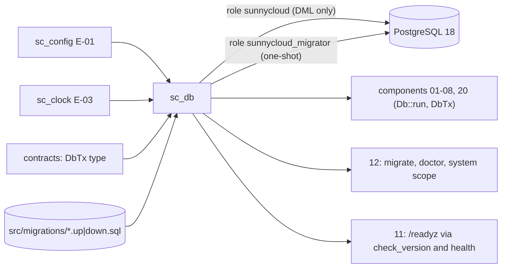

## Epic: Cross-Cutting Database Access and Migrations — Pool, short transactions, tenant scope, schema versioning

**Epic id**: E-06
**epic_type**: cross-cutting
**concern**: other-named-concern (database-access)

### Epic Summary

Build `sc_db`: the only code that owns PostgreSQL connections, transaction shape, tenant scope (row-level security) and migrations. Components never open a pool, set a session variable or run a migration; every transaction is short and a wrong database role or a newer schema refuses to serve.

### Problem / Context

Tenant isolation rests on application scoping plus row-level security (R09), the API runs as a DML-only role that cannot alter the schema or the audit log (ADR-014), and upgrades must roll back cleanly and refuse a mismatched schema (RESTRICT-32, AC-65). Long transactions across file I/O, HTTP calls or held long-polls are forbidden by project rule. These behaviours must be implemented once or each component will drift.

- Helper spec: `_docs/02_document/common-helpers/07_helper_db.md`
- Data model: `data_model.md` § 12.3 (tenancy), § 13 (migrations); ADR-014; `canonical-names.md` S4-2

### System context



### Scope

**In Scope**:
- `Db::connect(DbConfig, DbRole::{Api, Migrator})` with role verification: the connected user matches, and the API role is not a superuser, has no `BYPASSRLS` and does not own the schema (`DbError::WrongRole`).
- `Db::run(Scope::Account(id), closure)` and `Db::run_system(op, closure)`: tenant scope set with `set_config(..., true)` as the first statement; unset scope means no rows.
- `DbTx` (no public constructor), `DbTx::savepoint`, `DbTx::advisory_lock_account`, and the `DbError` mapping from SQLSTATE (23505, 23503, 23514, 40001, connection loss).
- `Migrator::{run_pending, revert, status, check_version}` over sqlx 0.9 reversible pairs embedded from `src/migrations/`; checksum and unknown-newer detection.
- Pool settings from config (`db_pool_max`, `db_acquire_timeout`, `db_idle_in_tx_timeout`, `db_statement_timeout`, `db_recovery_budget`) and `Db::health`.
- Read-only stats snapshot (pool state, query durations by op, pending migrations) for E-09 collectors.
- CI gates: grep that `sunnycloud.scope` appears only in `sc_db`; system-scope call-site allowlist; no SQL `now()`; no query text outside repository modules.

**Out of Scope**:
- Table definitions: each owning component's epic adds its migration files; the audit table is E-07.
- The role-creation init script and Postgres container: E-00.
- The `migrate` command and `serve` start-up refusal wiring (E-22); readiness check registration (E-22/E-21).
- Backups (`pg_dump` as superuser inside the db container).

### Assumptions

- Two roles only (S4-2): `sunnycloud_migrator` (owner, bypasses RLS as owner) and `sunnycloud` (runtime). No worker role.
- RLS is `ENABLE`d without `FORCE`; the policy binds `sunnycloud` because it is not the owner.
- Migrations are reversible pairs `YYYYMMDDHHMMSS_<verb>_<object>.up.sql` / `.down.sql`, each in one transaction under sqlx's advisory lock.
- `contracts` takes only the `DbTx` type from this crate.

### Dependencies

**Epic dependencies** (must be completed first):
- E-00 Bootstrap & Initial Structure (migrations directory, role init script, `DbTx` stub)
- E-01 Cross-Cutting: Configuration (`db_*` keys)
- E-03 Cross-Cutting: Clock (callers pass `Timestamp`)

**External dependencies**: PostgreSQL 18 container for tests (no mocks for query correctness); secrets `db_api_url`, `db_migrator_url`.

### Effort Estimation

**T-shirt size**: M
**Story points range**: 4-5 (one task at the 5-point cap; see Risks)

### Users / Consumers

| Type | Who | Key Use Cases |
|------|-----|--------------|
| Internal | Components 01-08, 20 | Short transactions with the right tenant scope; typed error variants |
| Internal | 12 operator CLI | `migrate`, system-scope janitors, schema check at `serve` |
| System | 11 http_api | `/readyz` database and migrations checks |
| Operator | Upgrade procedure | Interrupted migration rolls back; `serve` refuses a mismatched schema |

### Requirements

**Functional**:
- `Db::run` rolls back on a closure error and releases the connection; after a request the tenant setting is empty on the returned connection.
- `run_system` is the only path to system scope and labels the metric with `op`.
- `check_version` returns `SchemaState::{Current, Pending{n}, UnknownNewer}`; `serve` refuses unless `Current`.
- `Migrator::revert` returns `IrreversibleMigration` where a `down` raises; a killed migration leaves earlier ones applied.

**Non-functional**:
- Idle-in-transaction timeout 15 s and statement timeout 30 s by default; the pool recovers within 60 s of the database returning (RESTRICT-32).
- Pool max 50, acquire timeout 5 s; held long-polls hold no connection.

**Security / Compliance**:
- API role has no DDL, no `BYPASSRLS`, is not superuser; on `audit_log` only INSERT and SELECT (R09, NFT-SEC-47).
- System scope is reachable only through `run_system`; a reviewed allowlist bounds call sites.

### Interface specification

| Operation | Input | Output | Errors |
|-----------|-------|--------|--------|
| `Db::connect` | `DbConfig`, `DbRole` | `Db` | `DbError::{Unavailable, WrongRole}` |
| `Db::run` | `Scope::Account(AccountId)`, `FnOnce(&mut DbTx) -> Result<T, E>` | `T` | closure `E` (rolled back), `DbError` |
| `Db::run_system` | `op: &'static str`, closure | `T` | as `run` |
| `DbTx::savepoint` | closure | `T`; typed failure rolls back to the savepoint | as the closure |
| `DbTx::advisory_lock_account` | `AccountId` | `()` (`pg_advisory_xact_lock`) | none |
| `DbError` | SQLSTATE | `UniqueViolation{constraint}`, `ForeignKeyViolation`, `CheckViolation`, `Serialization`, `Unavailable`, `Other` | callers match and return their own typed result |
| `Migrator::run_pending` / `revert` | `Db` (Migrator role), steps | `MigrationReport` | `MigrationFailed`, `ChecksumMismatch`, `UnknownNewer`, `IrreversibleMigration` |
| `Migrator::status` / `check_version` | `Db` | state / `SchemaState` | none |
| `Db::health` | none | `{reachable, server_version, migrations_pending, pool_in_use}` | none |

### Data flow

```mermaid
sequenceDiagram
  participant H as Handler / service
  participant D as sc_db
  participant P as PostgreSQL
  H->>D: run(Scope::Account(a), closure)
  D->>P: BEGIN
  D->>P: set_config('sunnycloud.scope', a, true)
  D->>P: closure statements (RLS applies)
  alt typed failure inside savepoint
    D->>P: ROLLBACK TO SAVEPOINT (outer tx usable)
  end
  alt closure Ok
    D->>P: COMMIT
  else Err or panic
    D->>P: ROLLBACK
  end
  D-->>H: T or E; connection returned with scope cleared
```

### Design & Architecture

- Architecture doc: `_docs/02_document/architecture.md` (Deployment Model: db and migrate units; Security Architecture)
- Helper spec: `_docs/02_document/common-helpers/07_helper_db.md`
- Data model: `data_model.md` § 13; ADR-014
- System flows: `_docs/02_document/system-flows.md` (upgrade, restore)

### Architecture notes

- ADR-014 (two roles with RLS), ADR-003 (PostgreSQL metadata), ADR-015 (`DbTx` crosses ports as `&mut DbTx`).
- Pins: PostgreSQL 18, sqlx 0.9 (compile-time checked queries with `SQLX_OFFLINE`, `.sqlx/` committed, CI fails when stale).
- Crate `sc_db` at `src/shared/db/`; migrations embedded from `src/migrations/`; no `await` on a non-database call inside a `Db::run` closure (review rule backed by the idle timeout).
- Metrics emitted through a stats snapshot read by E-09 (`db_up`, `db_pool_connections{state}`, `db_query_duration_seconds{op}`, `migrations_pending`), because E-09 comes after this epic.

### Testing strategy

- Black-box: FT-N-39 and NFT-RES-14 (interrupted migration rolls back, server refuses to start), NFT-RES-LIM-02 and NFT-SEC-13 (two-account matrix with the real `sunnycloud` role and RLS on), NFT-SEC-47 (audit log append-only for the API role).
- Integration on a real PostgreSQL 18 container (no in-memory store): pooled-connection scope reset; role privilege test (no DDL, no `BYPASSRLS`, cannot UPDATE or DELETE `audit_log`, migrator-owned tables not owned by `sunnycloud`); `check_version` refusal for pending and newer; savepoint keeps the transaction usable; idle-timeout kills a held transaction; up, down, up on an empty database.
- Grep tests: `sunnycloud.scope` only in `sc_db`; no `now()`; system-scope allowlist.

### Definition of Done

- [ ] All in-scope capabilities implemented
- [ ] Automated tests pass (unit + integration on real PG 18 + blackbox)
- [ ] Coverage threshold met (`quality-thresholds`; critical path 90%)
- [ ] Grep and allowlist gates in the PR gate
- [ ] Migration authoring rules (reversible pairs, owner header for data rewrites) documented in the crate README

### Acceptance Criteria

| # | Criterion | Measurable Condition |
|---|-----------|---------------------|
| 1 | Cross-account reads return nothing | Two-account matrix with RLS on: 0 successful cross-account calls (AC-59) |
| 2 | Wrong role refused | `Db::connect(Api)` with a superuser or `BYPASSRLS` role returns `WrongRole` |
| 3 | Interrupted migration | Killing `migrate` mid-way leaves earlier migrations applied; `serve` refuses to start until re-run (FT-N-39, AC-65) |
| 4 | Scope never leaks | After 1,000 pooled requests the setting is empty on every returned connection |
| 5 | Short transactions | A transaction idle 16 s is terminated; no handler holds one across an HTTP call |
| 6 | Newer schema refused | `check_version` returns `UnknownNewer` for a database ahead of the binary |
| 7 | Recovery | After the database returns, `Db::health` is reachable again within 60 s (RESTRICT-32) |

### Risks & Mitigations

| # | Risk | Mitigation | Owner |
|---|------|------------|-------|
| 1 | R09: a bug in a system-scope function bypasses isolation | Few named functions, reviewed allowlist, grep gate | Epic owner |
| 2 | R14: churn from `block_hashes` rewrites and hot rows | Pool and timeouts here; autovacuum tuning measured in gates S1/S6 | E-12/E-14 owners |
| 3 | A data-rewriting migration runs as owner and bypasses RLS | Each such migration states in its header which accounts it touches | Reviewers |
| 4 | One task covers pool, scope, errors, migrator and gates at the 5-point cap | Keep the gates generic; split during decomposition only if the cap is exceeded | Epic owner |

### Labels

- `sunnycloud`
- `epic:cross-cutting`
- `concern:database-access`

### Child Issues

| Type | Title | Points |
|------|-------|--------|
| Task | `sc_db` in `src/shared/db/`: pool, scopes, `DbTx`, error mapping, `Migrator`, role checks, CI gates | 5 |
