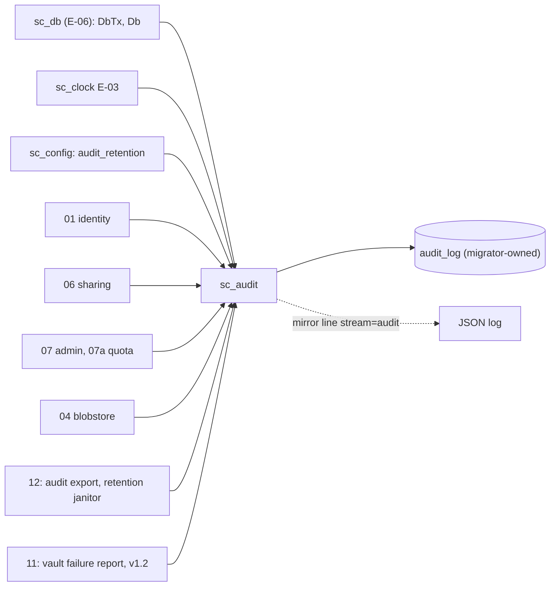
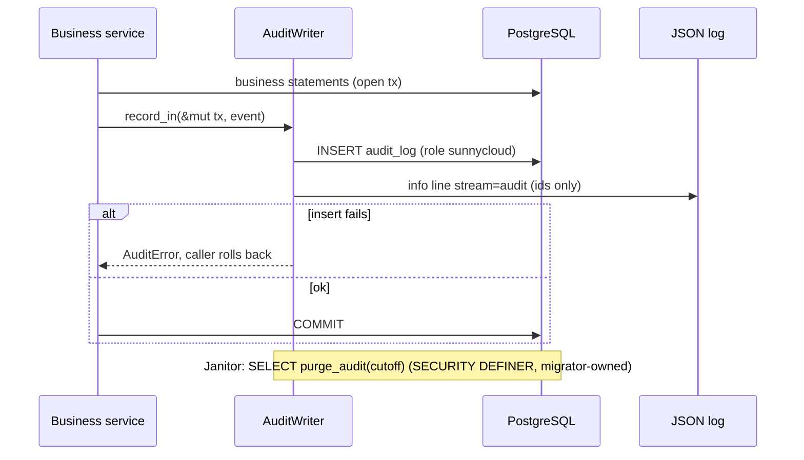

## Epic: Cross-Cutting Audit Log — Append-only, IDs-only security events

**Epic id**: E-07
**epic_type**: cross-cutting
**concern**: audit

### Epic Summary

Build `sc_audit`: one typed writer for the `audit_log` table, the migration that creates it with API-role grants of INSERT and SELECT only, and the retention purge function. It makes it impossible to write a name, email or path into the log and makes a failed security write visible instead of swallowed.

### Problem / Context

Sign-ins, device approvals and revocations, share events, admin actions and account deletion must leave a trustworthy trail (AC-21, AC-30). A compromised API process must not be able to update, delete or re-grant audit rows (ADR-014, NFT-SEC-47). State-changing events must fail closed: if the audit write fails, the business change rolls back. Reads on hot or background paths (`share_accessed`, scrub events) may be best effort, but that exception must be explicit and counted.

- Helper spec: `_docs/02_document/common-helpers/04_helper_audit.md`
- Data model: `data_model.md` § 10.1; observability: `deployment/observability.md` (Audit log)

### System context



### Scope

**In Scope**:
- `AuditEvent` with a typed `AuditDetail` of Uuid, enum and integer fields only (no free string); event kinds: `sign_in`, `device_approved`, `device_revoked`, `session_revoked`, `refresh_reuse`, `share_created`, `share_revoked`, `share_accessed`, `admin_action`, `account_deleted`, `abuse_trip`, `vault_failure`, `scrub_mismatch`, `scrub_summary`.
- `AuditWriter::{record_in, record, record_best_effort}`, `AuditPurge::purge_older_than`, `AuditReader::export` (paged, ids only).
- Migration pair `create_audit_log`: table, named `CHECK`s (2,048-byte detail cap, event values), indexes `(at)` and `(actor_account_id, at)`, grants of `INSERT` and `SELECT` to `sunnycloud`, and a `SECURITY DEFINER` purge function owned by the migrator and executable by `sunnycloud`.
- Mirror of every recorded event to the JSON log with `"stream":"audit"`.
- `sc_audit_write_failures_total` counter source for best-effort failures.
- Role-privilege and compile-fail tests.

**Out of Scope**:
- Which events each component writes (E-15, E-16, E-17, E-10, E-22).
- The admin audit list screen and `admin audit export` command (E-17, E-21, E-22).
- Row-level security (the table is installation data, readable only by admin routes).

### Assumptions

- `record_in` runs as the last statement before commit inside the business transaction.
- Only `share_accessed`, `scrub_mismatch` and `scrub_summary` use `record_best_effort`.
- A limiter trip writes one `abuse_trip` event, never one per attempt; `share_accessed` is written once per download start.
- Retention comes from `audit_retention` (default 365 days, `0` keeps).

### Dependencies

**Epic dependencies** (must be completed first):
- E-00 Bootstrap & Initial Structure
- E-01 Cross-Cutting: Configuration
- E-03 Cross-Cutting: Clock
- E-06 Cross-Cutting: Database access and migrations

**External dependencies**: PostgreSQL 18 with both roles created by the init script.

### Effort Estimation

**T-shirt size**: M
**Story points range**: 4-5

### Users / Consumers

| Type | Who | Key Use Cases |
|------|-----|--------------|
| Internal | 01, 06, 07, 07a, 04, 11 | Record security and admin events with ids only |
| Internal | 12 CLI | Export; retention purge janitor |
| External | Operator / admin | Read events in the admin section and via `admin audit export` |

### Requirements

**Functional**:
- `record_in` fails closed: a failed write returns `AuditError` and rolls the caller's transaction back.
- `record_best_effort` never returns an error; failures are logged at ERROR and counted.
- `AuditDetail` has no `String` field; the 2,048-byte limit is also a database `CHECK`.
- Purge deletes rows older than the cutoff only through the `SECURITY DEFINER` function.

**Non-functional**:
- Insert adds one statement to the business transaction; volume is low (security events only).
- Export pages are bounded; the index on `(at)` serves retention and export.

**Security / Compliance**:
- Append only: `sunnycloud` has INSERT and SELECT and owns nothing; a CI test fails on any other statement against `audit_log` (NFT-SEC-47).
- IDs only: no names, emails, paths or tokens in any row or log line (NFT-SEC-38, NFT-SEC-16).

### Interface specification

| Operation | Input | Output | Errors |
|-----------|-------|--------|--------|
| `AuditWriter::record_in` | `&mut DbTx`, `AuditEvent` | `()` | `AuditError::{Rejected, Store}` |
| `AuditWriter::record` | `AuditEvent` (own short transaction) | `()` | same |
| `AuditWriter::record_best_effort` | `AuditEvent` | `()` | none; logged and counted |
| `AuditPurge::purge_older_than` | `Timestamp` | `rows_deleted: u64` | `AuditError::Store` |
| `AuditReader::export` | `since`, optional event filter, page cursor | page of `AuditRow` (ids only) | `AuditError::Store` |

```
AuditEvent { event, actor_account_id?, actor_session_id?, subject: SubjectRef{type, id}?, ip?, detail: AuditDetail }
```

### Data flow



### Design & Architecture

- Architecture doc: `_docs/02_document/architecture.md` (Audit logging in Security Architecture)
- Helper spec: `_docs/02_document/common-helpers/04_helper_audit.md`
- Observability: `deployment/observability.md` (Audit log table)
- System flows: `_docs/02_document/system-flows.md`

### Architecture notes

- ADR-014 (two roles; audit grants), ADR-006/ADR-008 events originate in 04 and 01.
- Crate `sc_audit` at `src/shared/audit/`; migration files in `src/migrations/` (`..._create_audit_log.up.sql` / `.down.sql`), the first real migration in the repository.
- Compile-fail test (for example `trybuild`) proves an event with a `name` field does not compile.
- Scrub summaries are `scrub_summary` events plus metrics; there is no scrub table (decision 6).

### Testing strategy

- Black-box: NFT-SEC-47 (audit log append-only for the API role), NFT-SEC-38 and NFT-SEC-16 (no secrets or tokens in logs and audit), FT-P-36..38 (share events; one `share_accessed` for a download split into Range requests), NFT-SEC-05/07 (device approval events), FT-P-19 (account-deletion event kept).
- Unit/integration on real PG 18: `record_in` rolls back with the business change; `record_best_effort` swallows nothing silently (error logged, counter incremented); `UPDATE` and `DELETE` as `sunnycloud` fail; purge function works as `sunnycloud` and deletes only old rows; 2,048-byte `CHECK`; compile-fail for a free-text field; up, down, up of the migration.

### Definition of Done

- [ ] All in-scope capabilities implemented
- [ ] Automated tests pass (unit + integration + NFT-SEC-47)
- [ ] Coverage threshold met (`quality-thresholds`)
- [ ] Migration reviewed by the DB owner (grants, `SECURITY DEFINER` search_path pinned)
- [ ] Event list reconciled with `data_model.md` § 10.1 (see Risks)

### Acceptance Criteria

| # | Criterion | Measurable Condition |
|---|-----------|---------------------|
| 1 | Append only | As `sunnycloud`, UPDATE and DELETE on `audit_log` fail; INSERT and SELECT succeed (NFT-SEC-47) |
| 2 | IDs only | Compile-fail test for a name field passes; a full suite run finds 0 emails, names or tokens in rows and logs (AC-12 tokens, NFT-SEC-38) |
| 3 | Fail closed | Forcing the insert to fail rolls back a device approval and returns an error (AC-21) |
| 4 | Best effort is visible | Forced failure of `record_best_effort` increments `sc_audit_write_failures_total` and logs at ERROR |
| 5 | Retention | Purge removes only rows older than `audit_retention`; `0` keeps all (AC-30) |
| 6 | Mirror line | Each recorded event produces one log line with `"stream":"audit"` |

### Risks & Mitigations

| # | Risk | Mitigation | Owner |
|---|------|------------|-------|
| 1 | `data_model.md` § 10.1 omits `abuse_trip` from the event list while helper 04 includes it | Add it to the `CHECK` in this migration and fix the data model text | Epic owner |
| 2 | Audit table growth | Retention janitor and index on `(at)`; low volume | Operator |
| 3 | `record_in` inside long transactions | Callers use it as the last statement before commit (review rule) | Reviewers |
| 4 | `SECURITY DEFINER` function abuse | Owned by the migrator, fixed `search_path`, only DELETE by cutoff, role privilege test in CI | DB owner |

### Labels

- `sunnycloud`
- `epic:cross-cutting`
- `concern:audit`

### Child Issues

| Type | Title | Points |
|------|-------|--------|
| Task | `sc_audit` in `src/shared/audit/`: typed events, writer, purge, export, `create_audit_log` migration and privilege tests | 5 |
