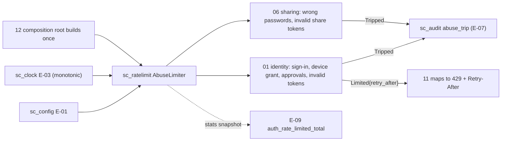
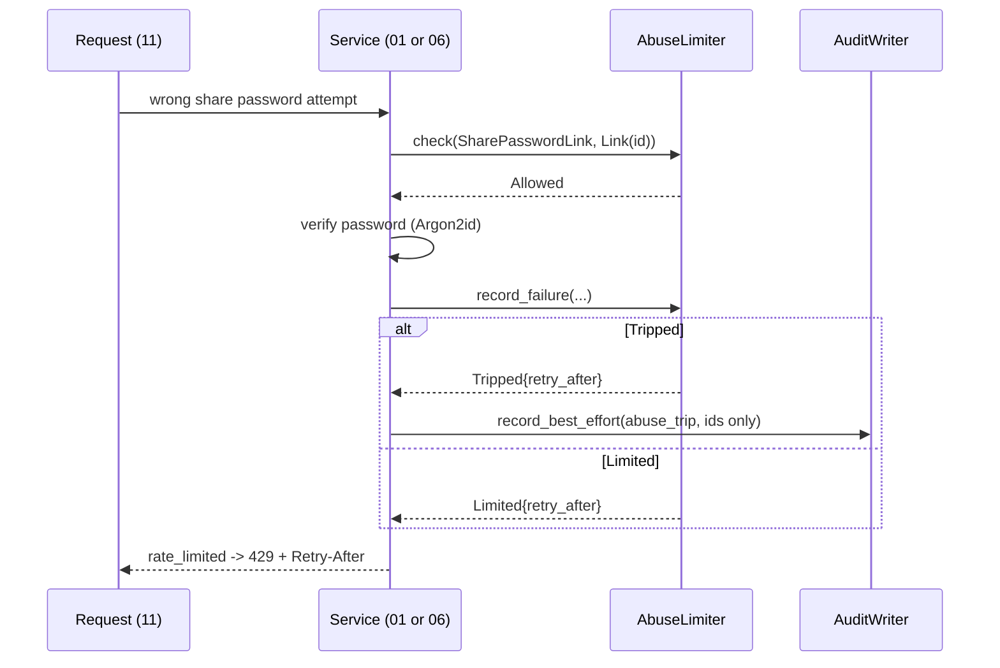

## Epic: Cross-Cutting Abuse Rate Limiting — In-memory limiter for the AC-20 failures

**Epic id**: E-08
**epic_type**: cross-cutting
**concern**: other-named-concern (abuse-limits)

### Epic Summary

Build `sc_ratelimit`: one in-memory token-bucket limiter for the defined abuse failures (bad sign-in steps, device grants and approvals, invalid tokens, wrong share passwords, invalid share tokens). It is constructed once by the `sunnycloud` binary and injected; the HTTP layer only maps its verdict to 429.

### Problem / Context

AC-20 defines abuse limits for specific failures, with HTTP 429 and `Retry-After` beyond them. There is deliberately no generic per-route limiter in v1.0. Counters are in memory (data model § 12.4): a restart resets them, which is acceptable because device codes live at most 10 minutes and tokens carry at least 128 bits. v1.0 runs one API process, so per-process counters are exact.

- Helper spec: `_docs/02_document/common-helpers/08_helper_ratelimit.md`
- Data model: `data_model.md` § 12.4; `canonical-names.md` § Runtime (scheduler and rate limiter built by 12)

### System context

### Scope

**In Scope**:
- `AbuseLimiter::new(&dyn Clock, LimitTable)` with `check`, `record_failure`, `clear`.
- `LimitId`: `SigninIp`, `DeviceGrantIp`, `DeviceApprovalSession`, `DeviceApprovalAccount`, `DeviceApprovalIp`, `InvalidTokenIp`, `SharePasswordLink`, `ShareTokenIp`, each mapped to the metric label of `observability.md`.
- `Subject`: `Ip`, `Session`, `Account`, `Link` (never a name, email or token).
- `LimitSpec { capacity, window }` with AC-20 defaults: sign-in 10 per minute per IP; device approvals 5 per session, 20 per account and 50 per IP per hour; wrong share passwords 10 per link per 10 minutes; invalid share tokens 100 per minute per IP; `DeviceGrantIp` and `InvalidTokenIp` from config.
- Sharded bucket map with oldest-idle eviction at `ratelimit_max_entries` (default 100,000); full buckets are dropped.
- Stats snapshot (per-limit limited and tripped counters) for E-09.

**Out of Scope**:
- Calling the limiter (E-15, E-16) and writing the `abuse_trip` audit event (callers use E-07).
- Mapping to 429 (E-21).
- Any generic per-route or per-account request limiter; per-principal long-poll hold caps (E-12).
- Persistence or sharing of counters across processes.

### Assumptions

- Time comes from the injected clock's monotonic reading, so `ManualClock` drives tests.
- One API process: a second replica would multiply every limit (documented limit).
- The numbers for sign-in and device-approval limits are compiled AC-20 defaults; only the device-grant, invalid-token, share-password and share-token numbers have config keys today.

### Dependencies

**Epic dependencies** (must be completed first):
- E-00 Bootstrap & Initial Structure
- E-01 Cross-Cutting: Configuration (`device_grant_ip_limit`, `invalid_token_ip_limit`, `ratelimit_max_entries`, share limit keys)
- E-03 Cross-Cutting: Clock

**External dependencies**: none.

### Effort Estimation

**T-shirt size**: S
**Story points range**: 2-3

### Users / Consumers

| Type | Who | Key Use Cases |
|------|-----|--------------|
| Internal | 01 identity | Limit sign-in steps, device grant requests and approvals, invalid tokens |
| Internal | 06 sharing | Limit wrong share passwords per link and invalid share tokens per IP |
| System | 11 http_api | Turn `Limited{retry_after}` into 429 with `Retry-After` |
| System | 12 operator_cli | Construct the single limiter instance |

### Requirements

**Functional**:
- `check` only reads; `record_failure` returns `Allowed`, `Tripped{retry_after}` (this call exhausted the bucket) or `Limited{retry_after}` (already empty).
- `clear` resets a bucket after a successful step for limits that count consecutive failures.
- A `Limited` result is returned before any costly work or any information about the subject is revealed.
- `Tripped` happens once per exhaustion so the caller audits it once.

**Non-functional**:
- No lock held across an `await`; per-call cost O(1) with sharded mutexes.
- Memory bounded by `ratelimit_max_entries`; eviction by oldest idle bucket first.

**Security / Compliance**:
- Subjects are ids and addresses only; an attacker spraying IPs cannot grow memory beyond the cap (weakest case equals a restart).
- `auth_rate_limited_total{limit}` is incremented on every `Limited` and `Tripped`.

### Interface specification

| Operation | Input | Output | Errors |
|-----------|-------|--------|--------|
| `AbuseLimiter::new` | `&dyn Clock`, `LimitTable` | `AbuseLimiter` | `ConfigError` on zero capacity or window |
| `check` | `LimitId`, `&Subject` | `Verdict::Allowed` or `Limited{retry_after}` | none |
| `record_failure` | `LimitId`, `&Subject` | `Allowed`, `Tripped{retry_after}`, `Limited{retry_after}` | none |
| `clear` | `LimitId`, `&Subject` | `()` | none |

The bucket refills at `capacity / window`. Caller protocol: `check` before the provider call, Argon2id or lookup; `record_failure` after a failure; `clear` after success where consecutive failures are counted.

### Data flow

### Design & Architecture

- Architecture doc: `_docs/02_document/architecture.md` (Authorization and abuse limits)
- Helper spec: `_docs/02_document/common-helpers/08_helper_ratelimit.md`
- Component specs: `01_identity`, `06_sharing`
- System flows: `_docs/02_document/system-flows.md` (sign-in, device login, share link)

### Architecture notes

- ADR-008 (built-in OIDC sign-in and device grant), ADR-002 (single API process, per-process counters exact).
- Crate `sc_ratelimit` at `src/shared/ratelimit/`; state is a sharded map `(LimitId, Subject) -> bucket` behind mutexes, no external crate for the algorithm.
- Constructed by the composition root (12) and passed to 01, 06 and 11 by `Arc`; no global.

### Testing strategy

- Black-box: NFT-SEC-04, NFT-SEC-05, NFT-SEC-06 (429 with `Retry-After` at the documented thresholds), NFT-SEC-17 (uniform failure for missing, expired and revoked share links).
- Unit with `ManualClock`: refill rate, trip exactly once, `Limited` afterwards, `clear`, eviction order at the cap, full-bucket drop, each `LimitId` default matches AC-20, zero capacity rejected at construction.
- Concurrency test: 1,000 parallel `record_failure` calls trip exactly once.

### Definition of Done

- [ ] All in-scope capabilities implemented
- [ ] Automated tests pass (unit + blackbox via E-15 and E-16)
- [ ] Coverage threshold met (`quality-thresholds`)
- [ ] Limit table documented with the config key for each non-default number
- [ ] Stats snapshot consumed by E-09

### Acceptance Criteria

| # | Criterion | Measurable Condition |
|---|-----------|---------------------|
| 1 | Device approval limits | The 6th wrong approval from one session in an hour is `Limited` with `Retry-After` (AC-20, AC-57) |
| 2 | Share password limit | The 11th wrong password on one link within 10 minutes is `Limited` (AC-20) |
| 3 | Trip once | Exhausting a bucket returns `Tripped` exactly once; later calls return `Limited` |
| 4 | Refill | After the window with `ManualClock`, `check` returns `Allowed` |
| 5 | Bounded memory | At `ratelimit_max_entries` the oldest idle buckets are evicted; map size never exceeds the cap |
| 6 | No work before limit | A `Limited` result is produced before any provider or Argon2id call (call counter 0) |

### Risks & Mitigations

| # | Risk | Mitigation | Owner |
|---|------|------------|-------|
| 1 | IP spraying evicts a victim's bucket | Cap plus oldest-idle eviction; worst case equals a restart | Epic owner |
| 2 | Behind a misconfigured proxy all clients share one IP and one bucket | `doctor` warns when the trusted-proxy list is empty (E-22) | E-22 owner |
| 3 | A second API replica multiplies limits | v1.0 runs one process (R06); documented | Operator |
| 4 | Sign-in and approval numbers have no config key | Compiled AC-20 defaults; add keys when an operator needs them | Epic owner |

### Labels

- `sunnycloud`
- `epic:cross-cutting`
- `concern:abuse-limits`

### Child Issues

| Type | Title | Points |
|------|-------|--------|
| Task | `sc_ratelimit` in `src/shared/ratelimit/`: `AbuseLimiter`, limit table, bucket map with eviction, stats snapshot | 3 |
