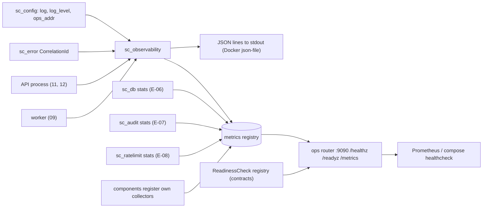
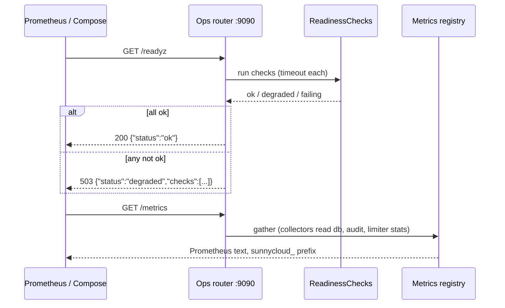

## Epic: Cross-Cutting Observability — Structured logs, Prometheus metrics, health endpoints

**Epic id**: E-09
**epic_type**: cross-cutting
**concern**: telemetry

### Epic Summary

Build `sc_observability`: the JSON log setup with the fixed field schema and redaction rules, a Prometheus metrics registry with the `sunnycloud_` prefix and low-cardinality label rules, and the shared ops router (`/healthz`, `/readyz`, `/metrics`) used by the API and the worker. Components register their own collectors on this machinery.

### Problem / Context

Operators run their own Prometheus or Loki; no monitoring stack is bundled (architecture "Observability" decision). Logs must carry a request id that matches the error body, never contain secrets, tokens, names or paths, and stay quiet on 2xx. Metrics must stay low cardinality so dashboards compose. Compose health checks call `/readyz` through `sunnycloud healthcheck`, so readiness semantics must be the same in the API and the worker.

- Spec: `_docs/02_document/deployment/observability.md` (Endpoints, Logging, Metrics, Alerts)
- Components: `11_http_api` (§ 10 Ops endpoints), `09_worker_supervisor` (§ 8 Logging and metrics), `07_admin` (`HealthContributor`)

### System context

### Scope

**In Scope**:
- Logging: `tracing` subscriber with JSON (`log=json`) or text output, level from `log_level`, one object per line with `ts` (UTC RFC 3339), `level`, `target`, `msg`, `request_id`, `component` (`api`, `worker`, `decoder-runner`), optional `account_id`, `node_id`, `route`, `status`, `duration_ms`, `err`.
- Redaction rules: a typed-field API for log fields and a test harness that proves tokens, secrets, key material, names, paths, emails and share URLs never appear; `stream:"audit"` lines for the `audit` target.
- Metrics: registry with the `sunnycloud_` prefix, constructors that accept only static label enums, one shared histogram bucket set per family, `build_info{version,commit,test_clock}` and the standard process collector (`process_resident_memory_bytes`, `process_open_fds`, CPU seconds).
- Collectors for helper-owned families: `db_up`, `db_pool_connections{state}`, `db_query_duration_seconds{op}`, `migrations_pending`, `auth_rate_limited_total{limit}`, audit write failures.
- Ops router: `/healthz` (liveness, no dependency checks), `/readyz` (registered `ReadinessCheck`s, JSON `status: ok|degraded` plus failing checks, 503 when any check is degraded or failing), `/metrics` (Prometheus text).
- A `HealthContributor` to `ReadinessCheck` adapter note for 07 and a readiness switch that turns 503 on shutdown signal.

**Out of Scope**:
- Component-specific metric families (transfer, sync, jobs, scrub, GC): declared by the owning epics with these constructors.
- HTTP-layer metrics and request-id middleware (E-21), janitor metrics (E-22), `doctor` (E-22), the example Prometheus alert file (release bundle).
- Tracing backends, OpenTelemetry, bundled dashboards (not in v1.0).
- The ops listener bind address and the `sunnycloud healthcheck` command (E-21, E-22).

### Assumptions

- Ops listener is `:9090`, backend network only, never routed by Caddy; the worker has its own listener with the same router.
- The `-test` image reports `test_clock="true"` in `build_info`; release reports `false`.
- Debug level is off by default and never enabled by a default config in release images.
- Helper crates E-06, E-07 and E-08 expose read-only stats snapshots; this epic wires them, because it comes after them.

### Dependencies

**Epic dependencies** (must be completed first):
- E-00 Bootstrap & Initial Structure
- E-01 Cross-Cutting: Configuration
- E-02 Cross-Cutting: Error model (`CorrelationId`)
- E-03 Cross-Cutting: Clock (timestamps, `build_info`)
- E-06 Cross-Cutting: Database access (stats), E-07 Audit log (stats, audit target), E-08 Abuse rate limiting (stats)

**External dependencies**: operator-side Prometheus and log collector (not shipped).

### Effort Estimation

**T-shirt size**: M
**Story points range**: 4-5 (one task at the 5-point cap; see Risks)

### Users / Consumers

| Type | Who | Key Use Cases |
|------|-----|--------------|
| Internal | Every server component and the worker | Log with typed fields; register metric families |
| System | Docker Compose health checks | `sunnycloud healthcheck` calls `/readyz` |
| External | Operator | Scrape `/metrics`, tail JSON logs, match a user's request id |

### Requirements

**Functional**:
- Log lines are single-line JSON with the field schema above; `request_id` equals the `X-Request-Id` header and the error body field.
- Per-request lines at `info` only for non-2xx; 2xx are counted in metrics; no per-block or per-chunk lines.
- `/readyz` answers 200 only when every registered check is ok; the body lists failing checks.
- Exported names carry `sunnycloud_`; labels are enumerations only, never account, node, file, share or IP values.

**Non-functional**:
- Logging adds under 5 microseconds per disabled-level event; metric increment is lock-free for counters.
- `/metrics` render under 50 ms with 5,000 series.

**Security / Compliance**:
- Never logged: secrets, tokens (even hashed), master key material, provider tokens, file names and paths, emails, share URLs, the setup token (except the single labelled first-start line) (NFT-SEC-38).
- Ops listener unauthenticated by design; never published on a public interface by default.

### Interface specification

| Operation | Input | Output | Errors |
|-----------|-------|--------|--------|
| `init_logging` | `LogConfig {format, level, component}` | installed subscriber guard | `ObsError::AlreadyInstalled` |
| `Metrics::counter / gauge / histogram` | name (no prefix), static label enum | typed handle | `ObsError::BadLabel` at construction |
| `Metrics::register_collector` | `Collector` | `()` | `ObsError::Duplicate` |
| `ops_router` | `Arc<Metrics>`, `ReadinessRegistry`, `Liveness` | axum `Router` for `/healthz`, `/readyz`, `/metrics` | none |
| `ReadinessRegistry::add` | `Arc<dyn ReadinessCheck>` | `()` | none |

`/readyz` body: `{"status":"ok|degraded","checks":[{"name","status","detail"}]}`; `detail` never contains secrets.

### Data flow

### Design & Architecture

- Architecture doc: `_docs/02_document/architecture.md` (Observability confirmed decision, Audit logging)
- Spec: `_docs/02_document/deployment/observability.md`
- Component specs: `11_http_api`, `09_worker_supervisor`, `07_admin`, `12_operator_cli`
- System flows: `_docs/02_document/system-flows.md`

### Architecture notes

- ADR-002 (single host, one API process), ADR-009 (worker has its own ops listener and no database).
- Technology: `tracing` and `tracing-subscriber` (JSON layer) for logs; the metrics library is not fixed in the architecture. Proposal: the `prometheus` crate with an explicit registry and text encoder (no global recorder, easy to test); the task confirms it against precedent before coding.
- Crate `sc_observability` at `src/shared/observability/` (name proposed). Depends on `sc_config`, `sc_error`, `sc_clock` and the `contracts` `ReadinessCheck` trait. A `collectors` module reads the read-only stats snapshot types of `sc_db`, `sc_audit` and `sc_ratelimit`; those crates themselves never depend on `sc_observability` (they use plain `tracing` macros and expose snapshots), so there is no cycle.
- Compose health checks call `sunnycloud healthcheck` (no curl in images).

### Testing strategy

- Black-box: NFT-SEC-38 (no secrets in logs across a full suite run), NFT-SEC-16 (tokens absent from logs and audit), FT-P-69 (30-minute install: health checks green), NFT-SEC-50 (worker routes absent from the public listener), NFT-RES-37 (doctor and metrics after restore).
- Unit: JSON schema of a log line; planted secret, token and path never printed; label enums reject free strings; `/readyz` 503 on one failing check and 200 when all pass; readiness 503 after the shutdown signal; metrics text parses with a Prometheus parser; prefix applied once.
- Cardinality test: registering a label with an unbounded value type fails to compile or panics at construction.

### Definition of Done

- [ ] All in-scope capabilities implemented
- [ ] Automated tests pass (unit + blackbox via E-21, E-22, E-20)
- [ ] Coverage threshold met (`quality-thresholds`)
- [ ] Metric library choice recorded in the task and crate docs
- [ ] Redaction test runs in the PR gate

### Acceptance Criteria

| # | Criterion | Measurable Condition |
|---|-----------|---------------------|
| 1 | No secrets in logs | Full functional suite: 0 hits for tokens, setup/invite/share tokens, OAuth `code`/`state`, master key, provider secrets (NFT-SEC-38) |
| 2 | Request id correlates | The id in `X-Request-Id`, the error body and the log line is identical for a failing request |
| 3 | Readiness semantics | `/readyz` returns 503 with the failing check named when the database is unreachable, 200 otherwise (AC-22, AC-65) |
| 4 | Liveness is shallow | `/healthz` returns 200 with the database stopped |
| 5 | Low cardinality | A scrape after a 10,000-request run has no label value derived from account, node, file, share or IP |
| 6 | Prefix and format | All exported names start with `sunnycloud_`; output parses as Prometheus text (AC-24, AC-25 metrics reachable) |
| 7 | Quiet 2xx | 1,000 successful requests produce 0 per-request `info` lines |

### Risks & Mitigations

| # | Risk | Mitigation | Owner |
|---|------|------------|-------|
| 1 | One task covers logging, registry, collectors and ops router at the 5-point cap | Keep component families out; split at decomposition only if the cap is exceeded | Epic owner |
| 2 | A component logs a name or path by accident | Typed field helpers plus the full-suite grep in NFT-SEC-38 | Reviewers |
| 3 | Metrics library choice not fixed by the architecture | Decide against precedent in the task; record it | Epic owner |
| 4 | `/readyz` 503 on any degraded contributor may be too strict (04 suspect blobs) | Revisit with the 11 spec (G-11-4); keep the behaviour configurable in code only if the owner asks | Project owner |

### Labels

- `sunnycloud`
- `epic:cross-cutting`
- `concern:telemetry`

### Child Issues

| Type | Title | Points |
|------|-------|--------|
| Task | `sc_observability` in `src/shared/observability/`: JSON logging, metrics registry and helper collectors, shared ops router | 5 |
