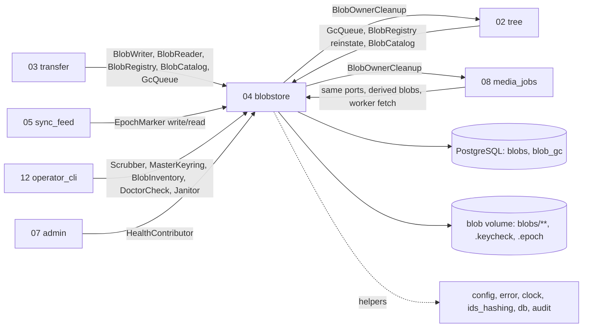
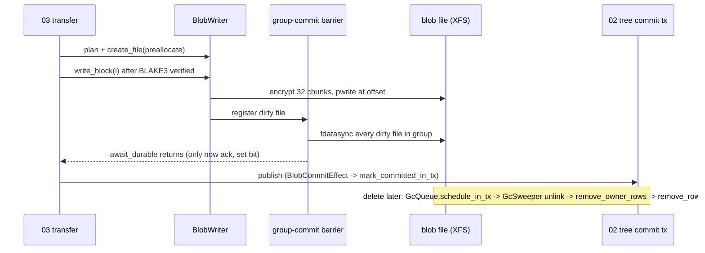

## Epic: 04 Blobstore — Encrypted, durable blob storage with GC, scrub and restore

**epic_type**: component
**Local id**: E-10 (Jira id added later)

### Epic Summary

Build the only component that touches the blob volume: envelope-encrypted random-access blobs (XChaCha20-Poly1305 STREAM, 64 KiB chunks), group-commit fdatasync durability, the master key and key check, the GC queue, orphan sweep, scrub, rewrap and operator reinstatement. It makes AC-38 (no acked-but-unsynced block), AC-43 (stolen disk yields nothing) and AC-30 (retention) true.

### Problem / Context

Content lives as plain ID-named files on XFS/ext4 with metadata in PostgreSQL (ADR-003). Every blob is encrypted by the server (ADR-006, RESTRICT-08) with per-blob keys wrapped by an operator master key, and a block may be acknowledged only after a batched `fdatasync` (RESTRICT-09). Replaced and deleted blobs stay for a retention period (RESTRICT-10). The construction is hand-built (`aead-stream` cannot jump to chunk `i`), so correctness rests on known-answer tests and an external review (R08).
Docs: `_docs/02_document/architecture.md` (Component list, Dependency rule, §6, §7), `components/04_blobstore/description.md`, `components/04_blobstore/tests.md`, `system-flows.md` F4, F6, F12, F14, F15, ADR 003, 006, 014, 015.

### System context

### Scope

**In Scope**:
- Layout `blobs/<id[0:2]>/<id[2:4]>/<id>`, 64-byte header, chunk `i` at `64 + i*(65536+16)`, hand-built STREAM nonce with final flag, AAD = `blob_id`.
- Key hierarchy: per-blob data key wrapped by master key id; key ring, `rewrap_batch`, `.keycheck`, `load_and_verify`, `init_key_check`.
- Writer/reader ports, group-commit durability barrier, preallocation, free-space floor, `write_complete`, `discard`.
- `BlobRegistry`, `BlobCatalog::get_ref`, `GcQueue` (single writer of `blob_gc`), `GcSweeper`, `OrphanSweeper`, `Scrubber`/`ScrubJanitor`, `BlobInventory`, `EpochMarker`, `BlobHealth`, doctor checks, `blobs.unavailable_at`.
- Metrics and logs of blob I/O; zeroize-on-drop key types.

**Out of Scope**:
- Quota arithmetic (E-11), upload sessions and received-bitmap (E-14), Range parsing and HTTP headers (E-14, E-21), derived rows (E-18), which revision is current (E-13), tombstone purge (E-13).
- Reviewing the cryptographic construction externally (owner action; tracked as a spike and release gate).
- Re-encrypting data keys after a master key leak (R22, accepted).

### Assumptions

- Blob ids are server-generated v4 UUIDs; callers pass account-scoped rows (03/08 resolve `BlobRef` through `BlobCatalog`).
- The caller (03) verifies the BLAKE3 hash of a 2 MiB block before `write_block`; a block is never re-sealed with different bytes (rule pending, see ST-04-8).
- XFS is the documented default; ext4 is informational (gate S14). Only the API container mounts the volume; the master key file is mounted in the API container only.
- One API process in v1.0 (ADR-002), so the group-commit barrier and the activity gauge are in-process.

### Dependencies

**Epic dependencies** (must be completed first):
- E-00 Bootstrap and Initial Structure (workspace, `contracts` crate holding the port traits, test harness, Postgres test image)
- E-01 Configuration (typed `SUNNYCLOUD_*` keys, secrets from files, startup validation of retention 0..90 d)
- E-02 Error model (`BlobError`, `KeyError`, problem codes)
- E-03 Clock (retention `due_at`, orphan age, scrub cursor)
- E-04 IDs and hashing (UUID ids, SHA-256/BLAKE3 helpers)
- E-06 Database access and migrations (`blobs`, `blob_gc` tables, short-tx runner, system scope, `unavailable_at` column and scrub index)
- E-07 Audit log (`scrub_mismatch`, `scrub_summary`, `admin_action`)
- E-09 Observability (metrics registry, JSON logging)

**Port counterparts** (no crate dependency; traits live in `contracts`): `BlobOwnerCleanup` is implemented by E-13 and E-18; tests here use a recording implementation, real ones are exercised in the integration suite after those epics land.
**External dependencies**: XFS loop-mounted image tool `tests/tools/make-blob-volume.sh` (needs a privileged runner), reference hardware REF-SRV for C-REF timing rows (R03), pinned `aead-stream =0.6.0` as test oracle, `chacha20poly1305 =0.11.0`.

### Effort Estimation

**T-shirt size**: XL
**Story points range**: 55-68 (planned child issues total 60)

### Users / Consumers

| Type | Who | Key Use Cases |
|------|-----|--------------|
| System | E-14 transfer | Write blocks, ack after durable, stream downloads, staged files |
| System | E-18 media_jobs | Derived blobs, internal worker fetch through the same reader |
| System | E-13 tree | Schedule GC for replaced/deleted blobs, reinstate on restore |
| System | E-12 sync_feed | `.epoch` marker write/read |
| System | E-22 operator_cli | `scrub run`, `key-check`, `admin rewrap`, `admin keycheck-init`, `admin gc-run`, doctor |
| Internal | Operator | Master key rotation, restore drill, scrub findings |

### Interface specification

All errors are the typed enum `BlobError` (`NoSpace`, `FreeSpaceFloor`, `Io`, `BlobMissing`, `KeyUnavailable`, `Corrupt`, `RangeNotSatisfiable`, `OutOfRange`, `SizeMismatch`); `ByteStream` is a neutral `Stream<Item = Result<Bytes, StreamError>>`, no framework types.

| Port | Method | Input -> Output | Errors |
|---|---|---|---|
| `BlobWriter` | `plan` | `account_id, plaintext_size` -> `BlobPlan{blob_id, wrapped_key, master_key_id}` (pure) | `KeyUnavailable` |
| | `create_file` | `BlobPlan, preallocate` -> `BlobHandle` | `NoSpace`, `FreeSpaceFloor`, `Io` |
| | `open_for_write` | `blob_id, wrapped_key, master_key_id, size` -> `BlobHandle` | `BlobMissing`, `KeyUnavailable` |
| | `write_block` | `BlobHandle, block_index, Bytes (2 MiB)` -> `DurableToken` | `NoSpace`, `Io`, `OutOfRange` |
| | `await_durable` | `DurableToken` -> `()` after the covering group fdatasync | `Io` |
| | `write_complete` | `account_id, size, ByteStream` -> `WrittenBlob{plan,size}`, no row | `NoSpace`, `FreeSpaceFloor`, `SizeMismatch`, `Io` |
| | `discard` | `blob_id` -> `()` (missing is Ok) | `Io` |
| `BlobReader` | `open` | `blob_id, wrapped_key, master_key_id, size, Option<ByteRange>` -> `PlaintextStream` (first chunk verified before return) | `BlobMissing`, `RangeNotSatisfiable`, `Corrupt`, `KeyUnavailable` |
| | `read_head` | same + `max_bytes <= 64 KiB` -> `Bytes` | as above |
| `BlobRegistry` | `register_in_tx`, `mark_committed_in_tx`, `reinstate_in_tx` (`Reinstated\|BeyondRetention\|FileMissing`), `remove_row_in_tx` | caller-owned `DbTx` | typed |
| `BlobCatalog` | `get_ref(account, blob)` | `Option<BlobRef{blob_id,size,wrapped_key,master_key_id}>`; foreign id is `None` | none |
| `GcQueue` | `schedule_in_tx(tx, blob, reason, Due::AfterRetention\|Now)`, `pending_for_account` | single writer of `blob_gc` and `state = gc_pending` | typed |
| `Janitor` | `GcSweeper`, `OrphanSweeper(mode off\|report\|delete)`, `ScrubJanitor` `run_cycle(now)` | `GcStats{removed, remaining_due, budget_spent}` | typed |
| `Scrubber` | `start_run(mode Full\|Due, rate)`, `run_step`, `finish_run`, `status` | `ScrubRun{started_at}`, `StepResult{checked, mismatched, missing, done}` | typed |
| `MasterKeyring` | `load_and_verify`, `init_key_check`, `rewrap_batch(from,to,n)` | `Keyring` / `KeyError` (`FileMissing`, `WrongLength`, `KeyCheckMismatch`, `KeyCheckAbsentButBlobsExist`, `KeyCheckSampleFailed`) | typed |
| Others | `BlobInventory::find_missing(batch)`, `EpochMarker::{write, read}` (atomic), `BlobHealth::probe` -> `{writable, free_bytes, below_floor, unavailable_count}`, `DoctorCheck` and `HealthContributor` impls | | |
| Requires | `BlobOwnerCleanup::remove_owner_rows(tx, blob_id)` (E-13 deletes the revision row in any state; E-18 the `derived` row) | | |

### Data flow

### Architecture notes

- ADR-003 (plain ID-named files, rows in Postgres), ADR-006 (envelope encryption, owner decision costing zero-copy), ADR-014 (API role is DML only; sweepers and scrub run in system scope), ADR-015 (ports only; 04 depends on no component crate), ADR-002 (single API process).
- Pins: Rust stable MSRV 1.88, `chacha20poly1305 =0.11.0`, `aead-stream =0.6.0` (oracle only), sqlx 0.9, tokio 1.54.1+ with a blocking pool of 2 x cores for pread/pwrite/AEAD.
- No DB transaction is ever held across a sync, read, unlink or directory walk. No key cache (one AEAD unwrap per request). Orphan sweep aborts on any partial listing.
- Settings added to the E-01 key table: `retention`, `orphan_*`, `blob_free_reserve`, `gc_*`, `scrub_*`, `blob_sync_coalesce_delay`, `blob_preallocate`, `blob_read_ahead_chunks`, `blob_io_threads`, `blob_root`, `master_key_*`.

### Non-functional requirements

| Requirement | Target | Failure threshold | Source |
|---|---|---|---|
| 4 KiB range read p95, warm / cold NVMe | 2 ms / 4 ms | 5 ms | PT-04-1, AC-43 |
| Single-stream write / read with encryption | 300 / 500 MB/s | 112 MB/s (90% of 1 GbE) | PT-04-2, AC-2 |
| `await_durable` p95, 400 concurrent writers | 100 ms | 250 ms; aggregate 112 MB/s | PT-04-3, AC-38 |
| Group flushes for 100 concurrent writes | <= 25 | uncontended ack <= 20 ms | IT-04-5 |
| Write throughput with scrub running | >= 95% of baseline | 90%; scrub rate <= 55 MiB/s (60 fail) | PT-04-4, AC-24 |
| Peak RSS for 1 GiB read | growth <= 32 MiB | fail above | IT-04-18 |
| Durability | 0 zero-filled acked blocks after `kill -9` with 100 uploads | any | AC-38, NFT-RES-03 |
| GC backlog | drains in one cycle within `gc_cycle_budget` (30 s) | one batch per cycle | IT-04-10 |
Coverage floor: 90% on write, read, key and GC paths (critical, `quality-thresholds`).

### Requirements

**Functional**: random-access reads touch at most 2 chunks per 4 KiB range; tampered, truncated, spliced or rolled-back files yield `Corrupt` and never a complete-looking short body; wrong or absent master key stops start with "data is unreadable without the master key"; GC never removes a blob before `due_at`; scrub selects only `committed` rows and re-checks state after a mismatch; `write_complete` writes the file before any row, sessions write the row before the file (orphans swept after `orphan_age`).
**Non-functional**: see table; no per-chunk or per-block log lines; ids only in logs.
**Security / Compliance**: key and data-key buffers zeroized, `Debug` redacts; paths built only from UUIDs (no traversal); account-scoped catalog; no plaintext or master key on the volume (AC-43); audit events `scrub_mismatch`, `scrub_summary`, `admin_action`.

### Design & Architecture

- Architecture doc: `_docs/02_document/architecture.md`
- Component spec: `_docs/02_document/components/04_blobstore/description.md`; tests: `.../tests.md`
- System flows: `_docs/02_document/system-flows.md` (F4, F6, F12, F14, F15); canonical names: `canonical-names.md`

### Testing strategy

Component integration (`cargo test -p blobstore`) against real PostgreSQL 18 and a temp blob root or loop-mounted XFS (`needs-root`, otherwise `NOT-RUN(C-priv)`); manual clock with millisecond config.
- Integration: IT-04-1 round trip and layout, IT-04-2 nonce vectors vs `aead-stream`, IT-04-3 ranges, IT-04-4 tamper matrix, IT-04-5 group commit, IT-04-6 `write_complete`, IT-04-7 floor and preallocation, IT-04-8 registry/reinstate, IT-04-9 GC queue, IT-04-10 sweeper, IT-04-11 scrub runs, IT-04-12 AC-80 races, IT-04-13 key startup and rewrap, IT-04-14 orphan sweep, IT-04-15 missing blobs, IT-04-16 epoch/health, IT-04-18 1 GiB read.
- Performance: PT-04-1..4. Security: ST-04-1..7 (ST-04-8 BLOCKED). Acceptance: AT-04-1 rotation, AT-04-3 restore drill.
- System scenarios: FT-P-06, 16, 17, 18, 40, 41, 42, 43; FT-N-12, 33, 35, 40, 43; NFT-SEC-23..26; NFT-PERF-02, 03, 11; NFT-RES-03, 04, 06, 09, 10, 34, 37, 39; NFT-RES-LIM-01, 05.

### Definition of Done

- [ ] All in-scope ports implemented in the `blobstore` crate and registered in `contracts`
- [ ] Automated tests pass (IT/ST/AT plus the unit tests for nonce vectors, chunk math, barrier fault injection, rewrap idempotence, scrub termination, `init_key_check` refusal)
- [ ] Coverage >= 90% on write/read/key/GC paths, >= 75% overall (`quality-thresholds`)
- [ ] ST-04-8 unblocked and written once the owner decides the block-rewrite rule
- [ ] Runbook lines for key rotation, `keycheck-init`, `orphan_mode = report` after restore, ext4 caveat
- [ ] External review of the blob encryption scheduled or completed (release gate for v1.0)

### Acceptance Criteria

| # | Criterion | Measurable Condition |
|---|-----------|---------------------|
| 1 | AC-38: ack only after fdatasync | IT-04-5 pending >= 300 ms under blocked sync; `kill -9` leaves 0 zero-filled acked blocks (NFT-RES-03) |
| 2 | AC-43 / RESTRICT-08: stolen disk, 4 KiB range <= 5 ms p95 | ST-04-1 0 hits; PT-04-1 p95 <= 5 ms |
| 3 | AC-7 (at rest) and AC-24: scrub flags a flipped bit, throttled | IT-04-11 mismatched = 3, rate <= 11 MiB/s; PT-04-4 >= 90% transfer baseline |
| 4 | AC-30 / RESTRICT-10: retention and reinstate | IT-04-9/10: 0 removed 1 ms before `due_at`; reinstate returns `Reinstated` within retention |
| 5 | AC-39 (floor part): free-space floor | IT-04-7 `FreeSpaceFloor`, preallocated blob never `ENOSPC` |
| 6 | AC-65 / AC-72: key check, restore, 1 GiB equal | IT-04-13 typed `KeyError`; IT-04-18 BLAKE3 equal, RSS growth <= 32 MiB |
| 7 | AC-73 / AC-80: missing blob typed; scrub false positives | IT-04-15 `BlobMissing`, never 5xx; IT-04-12 200/200 iterations 0 false positives |
| 8 | AC-27 (files) / AC-68: GC removes account blobs; file-before-row for `write_complete` | IT-04-10, IT-04-6, IT-04-14 |
| 9 | RESTRICT-09: free-space and durability policy | PT-04-3 acked-but-unsynced after sync failure = 0 |

### Risks & Mitigations

| # | Risk | Mitigation | Owner |
|---|------|------------|-------|
| 1 | R08 hand-built nonce / block rewrite reuses a nonce | Known-answer vectors vs `aead-stream` in CI; hash bound before ack; external review before v1.0; decide rewrite rule (spike) | Epic owner |
| 2 | R22 one master key; rewrap does not change data keys | Document in operator guide; consider data-key re-encrypt tool after v1.0 (accepted) | Epic owner |
| 3 | R12 janitors share CPU/IO with requests | Drain-until-empty within time budget, rate caps, activity-gauge pause for scrub | Epic owner |
| 4 | R33 backup ordering vs GC | Rule: retention minus GC interval exceeds copy time; documented in E-22 procedure | Epic owner |
| 5 | R02 restore without epoch bump | `EpochMarker` consumed by E-12/E-22; `orphan_mode = report` first after restore | Epic owner |
| 6 | R03 no reference hardware for C-REF numbers | Perf rows report `NOT-RUN(HW-REF)` until provisioned; run spike S14 early | Owner (hardware) |

### Labels

- `sunnycloud`
- `component:blobstore`

### Child Issues

| Type | Title | Points |
|------|-------|--------|
| Spike | Decide block-rewrite rule (reject / idempotent-only) and scope the external encryption review; unblocks ST-04-8 (`tests/spec-gaps.md`, ST-04-8, R08) | 3 |
| Spike | Group-commit on XFS vs ext4 under 400 writers (gate S14) | 2 |
| Enabler | `blobstore` crate skeleton, `BlobError`/`KeyError`, config section, port wiring in `contracts` | 2 |
| Task | File format and hand-built STREAM nonce with known-answer tests vs `aead-stream` (IT-04-2) | 5 |
| Task | `MasterKeyring`: load/verify, `.keycheck`, ring, `init_key_check` (IT-04-13) | 5 |
| Task | `BlobWriter` create/write_block/open_for_write/write_complete/discard, preallocation, floor | 5 |
| Task | Group-commit fdatasync barrier with fault-injection hook (IT-04-5) | 5 |
| Task | `BlobReader` random access, read-ahead, `read_head`, tamper matrix (IT-04-3/4/18) | 5 |
| Task | `BlobRegistry`, `BlobCatalog`, `GcQueue` single writer (IT-04-8/9) | 3 |
| Task | `GcSweeper` with claim lease, owner cleanup call, drain budget (IT-04-10) | 5 |
| Task | `OrphanSweeper` modes and abort-on-partial (IT-04-14) | 3 |
| Task | `Scrubber`, `ScrubJanitor`, AC-80 race handling (IT-04-11/12) | 5 |
| Task | `rewrap_batch`, `EpochMarker`, `BlobInventory`, `BlobHealth`, doctor checks (IT-04-15/16, AT-04-1/3) | 5 |
| Task | Perf and security test suites PT-04-1..4, ST-04-1..7 | 5 |
| Task | Metrics and logging (`block_fsync_duration_seconds`, `blob_read_duration_seconds`, `blob_free_*`) | 2 |
