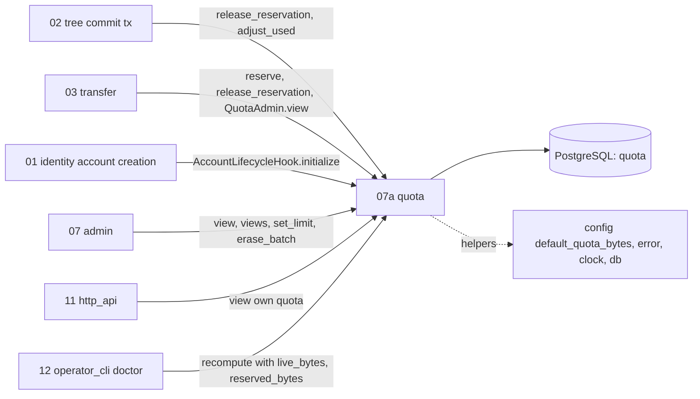
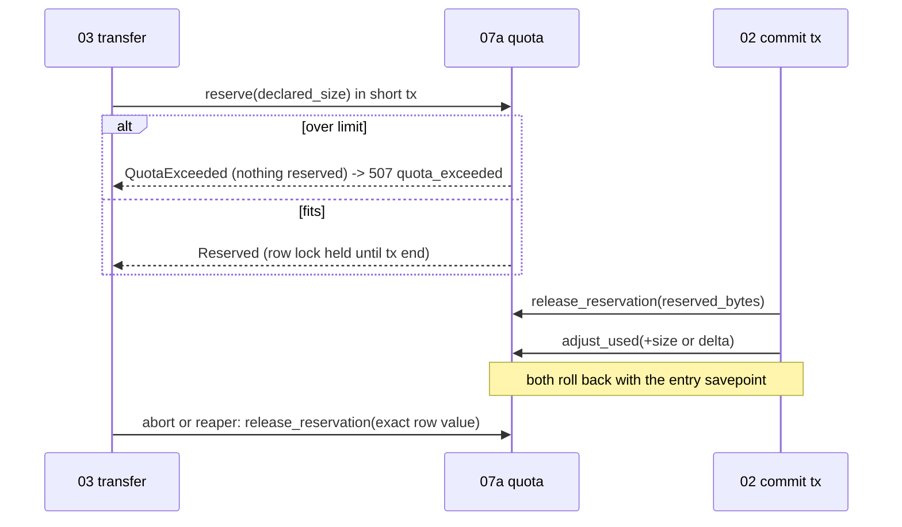

## Epic: 07a Quota — Atomic per-account storage ledger

**epic_type**: component
**Local id**: E-11 (Jira id added later)

### Epic Summary

Build the quota ledger: one row per account with limit, used and reserved bytes, updated atomically by uploads, commits and deletes, plus the admin view, limit changes and a drift check. It guarantees that concurrent sessions can never exceed the quota (AC-39) and that usage equals the sum of live current revisions (AC-74).

### Problem / Context

Uploads reserve quota at session start, commits convert the reservation to usage, deletes release it. Merged with admin orchestration the old `07_admin_quota` formed a dependency cycle (02 -> 07 -> 02), so the ledger was split out (`component-decisions.md`) and depends on `contracts` and helpers only. The reserve must be a single conditional UPDATE so 100 concurrent 50 GiB sessions cannot overshoot; counting is confirmed as current revisions of live files only (thumbnails, transcodes, replaced revisions and tombstoned data never count). R07 (hot rows) and R11 (drift) apply.
Docs: `architecture.md` (Dependency rule), `components/07a_quota/description.md`, `tests.md`, `data_model.md` (`quota`), `system-flows.md` F4, F13, `canonical-names.md` (`QuotaAdmin::recompute`).

### System context

### Scope

**In Scope**:
- `quota` table (`account_id` PK, `limit_bytes`, `used_bytes`, `reserved_bytes`, CHECK >= 0) and its lifecycle hook (create at account creation, delete at erase).
- `QuotaLedger`: `reserve`, `release_reservation`, `adjust_used` inside caller transactions.
- `QuotaAdmin`: `view`, `views` (batched for 500 accounts), `set_limit`, `recompute` with caller-supplied truth.
- Effective limit (per-user or installation default), `QuotaExceeded` with nothing reserved.

**Out of Scope**:
- Session cap and free-space floor (E-14, E-10 refuse before calling the ledger).
- Computing `live_bytes` (E-13 `LiveUsageSource`) and `reserved_bytes` (E-14 `ReservationSource`).
- Derived storage, billing, organizations, user trash, admin user listing (E-17), HTTP mapping to 507 (E-21).

### Assumptions

- Callers own the transaction (`&mut DbTx`); 07a never opens one for ledger calls.
- `InvalidLimit` bounds: 0 <= limit <= 2^53 bytes, 0 means no new data (default chosen at Step 5 gap pass); `views` omits unknown ids.
- A deadlock between transactions is resolved by the database and retried by the caller (E-13 retries once).
- Lowering a limit below current use is allowed and deletes nothing.

### Dependencies

**Epic dependencies** (must be completed first):
- E-00 Bootstrap and Initial Structure (workspace, `contracts` ports, Postgres test harness)
- E-01 Configuration (`default_quota_bytes`)
- E-02 Error model (`QuotaError`, problem code `quota_exceeded`)
- E-03 Clock (logging timestamps only)
- E-06 Database access and migrations (`quota` table, `DbTx`, system scope, RLS policy, `sunnycloud` role grants)
- E-09 Observability (structured logs)

**Requires no component port.** Blocks the integration tests of E-13 and E-14.
**External dependencies**: PostgreSQL 18 (pinned digest); `pg_stat_statements` for IT-07a-12; accounts-500 snapshot (DS-29); REF-SRV for PT-07a-1 timing (otherwise `NOT-RUN(HW-REF)`).

### Effort Estimation

**T-shirt size**: M
**Story points range**: 12-16 (planned child issues total 14)

### Users / Consumers

| Type | Who | Key Use Cases |
|------|-----|--------------|
| System | E-14 transfer | Reserve at session start, release on abort/expiry, `view` for staged pre-check |
| System | E-13 tree | Release reservation and adjust used inside the commit transaction; delete and cascade deltas |
| System | E-15 identity | `initialize` at account creation |
| System | E-17 admin / E-21 http_api | Usage in listings, own quota view, `set_limit` |
| System | E-22 operator_cli | Doctor drift check via `recompute` |

### Interface specification

| Port | Method | Input -> Output | Errors |
|---|---|---|---|
| `QuotaLedger` | `reserve` | `&mut DbTx, account, bytes` -> `Reserved` | `QuotaExceeded{limit, used, reserved}` (row unchanged) |
| | `release_reservation` | `tx, account, bytes` -> `()` clamped at 0, WARN if it would go negative | none |
| | `adjust_used` | `tx, account, delta (signed)` -> `()` | `InvariantViolation` if result < 0 |
| `QuotaAdmin` | `view` | `account` -> `QuotaView{limit_bytes?, effective_limit, used, reserved}` | `NotFound` |
| | `views` | `[account]` -> map; unknown ids omitted; one round trip | none |
| | `set_limit` | `account, Option<i64>` (None = default) -> `()` | `NotFound`, `InvalidLimit` |
| | `recompute` | `account, live_bytes, reserved_bytes, repair` -> `Drift{stored, computed}` | none |
| `AccountLifecycleHook` | `initialize(tx, account)`; `erase_batch(account, limit) -> EraseProgress{remaining}` | inserts the row; deletes it (`remaining = 0`, idempotent, unknown account fine) | none |

`reserve` is exactly: `UPDATE quota SET reserved_bytes = reserved_bytes + $n WHERE account_id = $1 AND used_bytes + reserved_bytes + $n <= COALESCE(limit_bytes, $default)`; zero rows means refused. The UPDATE holds its row lock to the end of the caller's transaction, which lets E-14 run its open-session cap check after `reserve` and roll back.

### Data flow

### Architecture notes

- ADR-015 ports only (crate graph: 07a depends on `contracts` and helpers, never on tree or admin; enforced in CI by `cargo deny`/workspace graph check), ADR-014 (API role: DML only, no DDL; RLS as defence in depth), ADR-002 (single process).
- sqlx 0.9 only; no cache, no in-memory state. Row-level updates are commutative so contention is limited to one hot row per account (R07).
- Config key `default_quota_bytes` is added to the E-01 key table; no durations.

### Non-functional requirements

| Requirement | Target | Failure threshold | Source |
|---|---|---|---|
| Hot account latency p95 (reserve + release + adjust) | 30 ms | 100 ms | PT-07a-1 |
| 64 accounts latency p95 | 5 ms | 20 ms | PT-07a-1 |
| Hot account throughput | 500 tx/s | 200 tx/s (AC-40 needs about 167 commits/s) | PT-07a-1 |
| `views` for 500 accounts | one round trip | more than one statement | IT-07a-12, AC-1 |
| Invariants after 1,000 concurrent commits/deletes | `used` == recomputed sum, never > limit | any CHECK violation | IT-07a-10, AC-74 |
| Memory | stateless | n/a | description |

### Requirements

**Functional**: atomic reserve; release and adjust exactly once by the row owner; counting rule is current revisions of live files only; effective limit falls back to the installation default; drift reporting and repair are doctor/test tools, never on a request path.
**Non-functional**: see table.
**Security / Compliance**: every statement scoped by `account_id`; `set_limit` reachable only through E-17 (`Scope::Admin`) or the operator CLI; extreme inputs (`i64::MAX`, negative, overflow) give typed errors, never a panic or raw SQL text; the runtime role cannot ALTER or TRUNCATE.

### Design & Architecture

- Architecture doc: `_docs/02_document/architecture.md`
- Component spec: `_docs/02_document/components/07a_quota/description.md`; tests: `.../tests.md`
- System flows: `_docs/02_document/system-flows.md` (F4 large upload, F13 account deletion); ADR 014, 015

### Testing strategy

Real PostgreSQL 18 only (conditional UPDATE and row locks are the behaviour under test); one database per test from a migrated template; accounts seeded through `AccountLifecycleHook::initialize`.
- Integration: IT-07a-1 hook, 2 reserve, 3 refusal changes nothing, 4 race of 100 x 50 GiB (exactly 20 reserved), 5 lock held to tx end, 6 limits, 7 signed deltas, 8 clamp, 9 savepoint rollback, 10 AC-74 workload, 11 interleaved accounts, 12 `views`, 13 erase, 14 `recompute`.
- Performance: PT-07a-1. Security: ST-07a-1 account scoping, ST-07a-2 overflow, ST-07a-3 role privileges. Acceptance: AT-07a-1 (HTTP 507 leaves nothing reserved), AT-07a-2 (derived data does not count).
- System scenarios: FT-P-19, FT-P-65, FT-N-40, NFT-RES-05, NFT-RES-06, NFT-RES-34, NFT-RES-38, NFT-RES-LIM-01, NFT-SEC-27, NFT-SEC-46, NFT-PERF-01.

### Definition of Done

- [ ] `QuotaLedger`, `QuotaAdmin` and the lifecycle hook implemented behind `contracts` ports
- [ ] IT-07a-1..14, ST-07a-1..3, PT-07a-1 pass (perf rows `NOT-RUN(HW-REF)` until reference hardware exists)
- [ ] Coverage >= 90% (critical: financial/limit enforcement) and >= 75% overall
- [ ] Crate graph check proves no edge from 07a to 02, 03 or 07
- [ ] OpenAPI quota view fields agreed with E-21; documentation updated

### Acceptance Criteria

| # | Criterion | Measurable Condition |
|---|-----------|---------------------|
| 1 | AC-39 (quota side): 100 sessions of 50 GiB refused beyond quota with nothing reserved | IT-07a-4 exactly 20 of 100 reserved at 1 TiB; AT-07a-1 HTTP 507 `quota_exceeded`, `reserved` equals sum of accepted |
| 2 | AC-74: usage equals sum of live current revisions and <= quota after 1,000 concurrent commits/deletes | IT-07a-10 `used == ledger sum`, `reserved == 0`, sampler never above limit |
| 3 | AC-68 (partly): reserved quota released at session expiry | IT-07a-8/9 release clamps at 0 and rolls back with the savepoint |
| 4 | AC-27: account deletion erases the ledger row | IT-07a-13 `remaining = 0`, row gone, idempotent |
| 5 | AC-1: 500 accounts in the admin tool | IT-07a-12 one statement for 500 ids |
| 6 | Derived data never counts | AT-07a-2 `used` unchanged after jobs |

### Risks & Mitigations

| # | Risk | Mitigation | Owner |
|---|------|------------|-------|
| 1 | R11 quota drift (clamped releases, replace and conflict-copy accounting) | Doctor alert on `recompute` difference, `--repair`, AC-74 race tests | Epic owner |
| 2 | R07 hot `quota` row serialises an account's commits | Aggregate deltas per batch (E-13); gates NFT-PERF-09, S1, S6 | Epic owner |
| 3 | Dependency cycle returns if the ledger imports tree/admin types | Crate-graph CI check; caller supplies `live_bytes`/`reserved_bytes` | Epic owner |
| 4 | Conflict copies consume quota and can fill a nearly full account | Documented, not blocked | Product owner |

### Labels

- `sunnycloud`
- `component:quota`

### Child Issues

No open spec gap or BLOCKED test remains for this component (G-07a-1, G-07a-2, G-07a-3 are closed in `tests/spec-gaps.md` section 1), so no spike is planned.

| Type | Title | Points |
|------|-------|--------|
| Enabler | `quota` crate skeleton, migration for `quota` table with CHECKs, grants and RLS policy, `QuotaError` | 2 |
| Task | `QuotaLedger` reserve/release/adjust with the single conditional UPDATE (IT-07a-2..5, 7..9) | 3 |
| Task | `AccountLifecycleHook` initialize/erase_batch and `QuotaAdmin::view/views/set_limit` (IT-07a-1, 6, 12, 13) | 3 |
| Task | `QuotaAdmin::recompute` with repair and drift logging (IT-07a-14) | 2 |
| Task | Concurrency suite: AC-74 workload, interleaved accounts, savepoint cases (IT-07a-10, 11) | 3 |
| Task | Security and performance tests ST-07a-1..3, PT-07a-1, AT-07a-1/2 harness | 1 |
