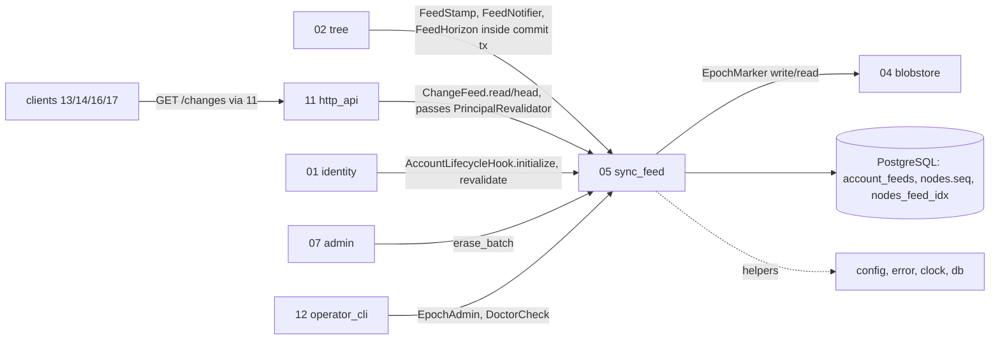

## Epic: 05 Sync Feed — Gapless per-account change feed and long-poll

**epic_type**: component
**Local id**: E-12 (Jira id added later)

### Epic Summary

Build the per-account `epoch.seq` change feed: a gapless stamp written last in every tree-changing transaction, the `GET /changes` read with cursor validation and `resync_required`, a connection-free long-poll with revocation recheck, and the epoch bump used after a restore. It lets every device converge in at most 5 s and detect a restored server.

### Problem / Context

Devices long-poll a server-ordered feed (ADR-004) instead of receiving events: the feed returns the latest state of each changed node (`nodes.seq`), so there is no event table. The counter row is the one serialisation point per account, so the stamp must be the last statement before COMMIT (AC-69). Wake-up is an in-process notifier plus a 10 s safety recheck; there is no PgListener, which forces one API process (ADR-002, decision 12). After a restore the epoch must change (`admin epoch-bump`) and the `.epoch` marker on the blob volume lets `serve` and `doctor` notice a missing bump (R02).
Docs: `architecture.md` (Component list), `components/05_sync_feed/description.md`, `tests.md`, `data_model.md` §7.2, `system-flows.md` F7, F14, ADR 004, 015.

### System context



### Scope

**In Scope**:
- `account_feeds` row, the single-CTE stamp, `nodes.seq` and `nodes_feed_idx` ownership.
- `ChangeFeed::read/head`: projection of latest state per node, page boundaries on `seq`, cursor classification (`epoch_changed`, `below_purge_horizon`, `cursor_ahead`, malformed).
- Long-poll hold: park on a per-account notifier, `longpoll_auth_recheck`, `feed_safety_recheck`, shutdown wake, per-principal hold cap.
- `FeedNotifier`, `FeedHorizon::raise_purge_horizon`, `EpochAdmin` (`bump_epoch`, `head_report`, `marker_status`), epoch `DoctorCheck`, `AccountLifecycleHook` impl.

**Out of Scope**:
- Deciding what a change means or selecting tombstones to purge (E-13); authentication (E-15).
- Cross-host notification fan-out (v1.0 is one API process); client cursor persistence (E-23, E-24).
- HTTP routing, `Cache-Control: no-store`, 410/422 mapping (E-21).

### Assumptions

- Only E-13 stamps; a batch commit (up to 500 entries) shares one `seq`; no stamp when no node was touched.
- The caller supplies `PrincipalRevalidator` into `ChangeFeed::read` (no wiring cycle with 01).
- CLI commands in another process cannot call the in-process notifier; held polls see them on the 10 s recheck.
- The feed row is created by the lifecycle hook, which picks the installation epoch itself (`max(epoch)` or clock seconds on an empty install; the latter also writes the marker).

### Dependencies

**Epic dependencies** (must be completed first):
- E-00 Bootstrap and Initial Structure (workspace, `contracts` ports, test harness)
- E-01 Configuration (`longpoll_wait_max`, `longpoll_auth_recheck`, `feed_safety_recheck`, `feed_page_limit_*`, `max_holds_per_principal`, `tombstone_horizon`)
- E-02 Error model (`ResyncRequired` 410, `BadCursor` 422, `Unauthenticated`)
- E-03 Clock (epoch from clock seconds, hold timers)
- E-06 Database access and migrations (`account_feeds`, `nodes.seq` column and index, system scope)
- E-09 Observability (`feed_missed_wake_total`, logs)
- E-10 Blobstore (`EpochMarker` write/read)

**Port counterparts** (higher epics, traits in `contracts`): `nodes` rows come from E-13 (tests use fixture SQL as `sunnycloud_migrator`, plus "via 02" cases after E-13); `PrincipalRevalidator` from E-15 (scripted in tests, real in IT-05-7 after E-15).
**External dependencies**: PostgreSQL 18; temp directory for the marker; reference hardware for C-REF rows.

### Effort Estimation

**T-shirt size**: L
**Story points range**: 24-32 (planned child issues total 28)

### Users / Consumers

| Type | Who | Key Use Cases |
|------|-----|--------------|
| System | E-13 tree | Stamp last, notify after COMMIT, raise purge horizon in the purge tx |
| System | E-21 http_api | `GET /api/v1/changes`, `GET /api/v1/changes/head` |
| External | Web, desktop, Android clients | Long-poll sync, catch-up, resync after restore |
| System | E-22 operator_cli | `admin epoch-bump`, `serve` refusal, doctor head report |
| System | E-15 / E-17 | Hook initialize / erase_batch |

### Interface specification

| Port | Method | Input -> Output | Errors |
|---|---|---|---|
| `FeedStamp` | `stamp` | `&mut DbTx, account, TouchedNodes (non-empty)` -> `Seq` (one CTE: counter UPDATE + node stamp) | `AccountFeedMissing` |
| `FeedNotifier` | `notify` | `account, seq` -> non-blocking wake | none |
| `FeedHorizon` | `raise_purge_horizon` | `tx, account, seq` -> last statement of purge tx; non-decreasing: `GREATEST(purge_horizon, $seq)`, a lower seq leaves it unchanged | none (zero rows ok) |
| `ChangeFeed` | `read` | `Principal, &dyn PrincipalRevalidator, Cursor{epoch,seq}, wait?, limit?` -> `ChangePage{items, next_cursor, has_more}` | `ResyncRequired{reason}` (410), `Unauthenticated`, `BadCursor` (422 `invalid_cursor`), `TooManyHolds{retry_after}` (429 `rate_limited` + `Retry-After`) |
| | `head` | `account` -> `Cursor` | none |
| `EpochAdmin` | `marker_status()` -> `MarkerStatus{db_epoch, marker: Absent\|Present}`; `bump_epoch(now) -> new_epoch` (`greatest(epoch+1, unix_seconds(now))` for all rows, then `EpochMarker::write`); `head_report()` | | marker write error (command is rerunnable) |
| `AccountLifecycleHook` | `initialize(tx, account)`, `erase_batch(account, limit)` | feed row insert / delete | none |
| `DoctorCheck` | epoch marker check | Fail when `.epoch` absent on a volume with blobs or differs from `max(epoch)` | |

`ChangeItem` = `node_id, parent_id, kind, name, state live|tombstone, revision_id?, size?, content_hash?, seq`. A folder tombstone means the whole subtree is deleted; a tombstone -> live folder must be re-listed by clients. HTTP: `GET /api/v1/changes?cursor=E.S&wait=&limit=` and `GET /api/v1/changes/head` (SessionOrDevice).

### Data flow

```mermaid
sequenceDiagram
  participant W as 02 commit tx (writer)
  participant S as 05 stamp
  participant N as notifier
  participant H as held GET /changes
  W->>S: stamp(touched) as LAST statement
  S-->>W: Seq (shared by the batch)
  W->>W: COMMIT
  W->>N: notify(account, seq)
  N-->>H: wake held request
  H->>S: read seq > S (1 short query, index scan)
  H-->>Client: ChangePage ends on a seq boundary
  Note over H: every longpoll_auth_recheck revalidate principal; every feed_safety_recheck re-read; wait expiry returns empty page, same cursor
```

### Architecture notes

- ADR-004 (feed design, `epoch.seq`), ADR-002 (one process), ADR-015 (ports only, 05 never calls 02), ADR-014 (RLS defence in depth), ADR-005 (tombstone semantics).
- Pins: sqlx 0.9, tokio 1.54.1+ (`Notify`, timers). No PgListener, no held DB connection while parked. State is in memory only (notifier map, dropped when no waiter); nothing to rehydrate.
- Defaults: `longpoll_wait_max` 30 s (1-55 s, below proxy/API timeouts), `longpoll_auth_recheck` 2 s (must stay below 5 s minus cache TTL), `feed_safety_recheck` 10 s, `feed_page_limit_default` 500, `max_holds_per_principal` 4, `tombstone_horizon` 90 d.

### Non-functional requirements

| Requirement | Target | Failure threshold | Source |
|---|---|---|---|
| Stamp throughput, 50 writers on one account | >= 1,000 stamps/s | 300 stamps/s | PT-05-1 |
| Stamp latency p95 / p99 | 50 / 100 ms | 150 / 300 ms | PT-05-1 |
| Gaps or duplicates in `seq` | 0 | any | PT-05-1, AC-69 |
| Feed page latency p95 (1,000,000 nodes, 500 items) | 20 ms | 60 ms; any Seq Scan fails | PT-05-2 |
| DB connections used by 100/1,000 holders | <= 5 | 10 | PT-05-3, AC-1 |
| RSS per holder | 16 KiB | 64 KiB | PT-05-3 |
| Wake latency server side p95 / p99 | 50 / 150 ms | 250 / 500 ms (end to end budget 5 s) | PT-05-4, AC-5 |
| Revoked principal's held request ends | within 5 s | longer | AC-21, IT-05-7 |
| Missed wakes | 0 | any | PT-05-3 |

### Requirements

**Functional**: stamp is one data-modifying statement with nothing between it and COMMIT; a rolled-back stamp leaves no gap; pages return the latest state per node ordered by `seq, id`; cursor E != epoch, S < purge horizon, S > seq all answer 410 `resync_required` with `reason`; graceful shutdown wakes every hold; DB outage during a hold returns 503 (client re-polls); `bump_epoch` is idempotent in effect.
**Non-functional**: see table.
**Security / Compliance**: all reads scoped by the caller's `account_id`; a cursor of one account is meaningless to another (ST-05-1); the 5th hold per principal is refused (ST-05-3); malformed cursor injection is rejected (ST-05-4); no names or paths in logs; RLS with the runtime role (ST-05-2).

### Design & Architecture

- Architecture doc: `_docs/02_document/architecture.md`
- Component spec: `_docs/02_document/components/05_sync_feed/description.md`; tests: `.../tests.md`
- System flows: `_docs/02_document/system-flows.md` (F7 long-poll sync, F14 restore and resync); ADR 004

### Testing strategy

Component integration (`cargo test -p sync-feed`) against real PostgreSQL 18, real `EpochMarker` on a temp directory, scripted `PrincipalRevalidator`, manual clock, millisecond timers.
- Integration: IT-05-1 stamp semantics, 2 fifty concurrent stamps, 3 pages and boundaries, 4 cursor validation, 5 head, 6 hold/wake/no connection, 7 revalidation ends a hold, 8 shutdown, 9 DB outage, 10 `bump_epoch`, 11 restore without bump, 12 `FeedHorizon` (non-decreasing rule, G-05-3 decided), 13 hook, 14 doctor check, 15 notifier lifecycle.
- Performance: PT-05-1..4. Security: ST-05-1..5. Acceptance: AT-05-1 commit wakes B, AT-05-2 restore then resync, AT-05-3 revoked device stops.
- System scenarios: FT-P-07, 08, 13, 14, 58; FT-N-30; NFT-PERF-01, 08, 09; NFT-RES-07, 08, 13, 20, 21, 25, 35; NFT-SEC-08, 13.

### Definition of Done

- [ ] All in-scope ports implemented in the `sync-feed` crate; epoch `DoctorCheck` registered
- [ ] IT-05-1..15 (IT-05-12 with the non-decreasing rule), ST-05-1..5, AT-05-1..3 pass
- [ ] Coverage >= 90% (critical: ordering and epoch) and >= 75% overall
- [ ] OpenAPI for both routes reviewed with E-21; hold-cap error code named
- [ ] Runbook note: restore procedure requires `admin epoch-bump`

### Acceptance Criteria

| # | Criterion | Measurable Condition |
|---|-----------|---------------------|
| 1 | AC-69 / AC-8: 50 concurrent commits seen exactly once in order | IT-05-2 set of `nodes.seq` == 1..N, 0 deadlocks; PT-05-1 gaps = 0 |
| 2 | AC-5: wake after COMMIT in milliseconds | PT-05-4 p95 <= 50 ms; AT-05-1 |
| 3 | AC-21: revoked principal's held poll ends | IT-05-7 and AT-05-3 within 5 s with 401 |
| 4 | AC-41: epoch, horizon, future cursor give 410 | IT-05-4 all classified; AT-05-2 devices resync |
| 5 | AC-65 / RESTRICT-09: epoch bump and missing-bump detection | IT-05-10, IT-05-14 doctor Fail when marker differs |
| 6 | AC-1: 70% idle long-poll without connections | PT-05-3 <= 5 DB connections for 100 holders |
| 7 | AC-35: catch-up after suspend | IT-05-3, IT-05-4 resume from cursor, page ends on `seq` boundary |
| 8 | AC-27: feed row removed at erase | IT-05-13 `remaining = 0`, idempotent |
| 9 | AC-59: cross-account scoping | ST-05-1, ST-05-2 0 foreign items |

### Risks & Mitigations

| # | Risk | Mitigation | Owner |
|---|------|------------|-------|
| 1 | R02 snapshot restore rolls the marker back with the database | `serve` refuses when DB epoch < marker; client `S > seq` check; DB incarnation id evaluated in ADR | Epic owner |
| 2 | R06 in-process notifier does not fan out to replicas | One API process in v1.0; notifier behind a port so a PgListener is possible later | Architect |
| 3 | R07 hot counter row contention | Stamp-last rule, measured in NFT-PERF-09 and PT-05-1 | Epic owner |
| 4 | A page ending on a batch boundary can hold 500 items; revived ancestors must all be in `TouchedNodes` | Documented contract with E-13; IT-05-3 covers it | Epic owner |
| 5 | R14 Postgres churn on `nodes` seq rewrites | Autovacuum tuning, measured in S1/S6 | Epic owner |

### Labels

- `sunnycloud`
- `component:sync_feed`

### Child Issues

| Type | Title | Points |
|------|-------|--------|
| Spike | Resolve G-05-2 (hold-cap error `TooManyHolds`, wire `rate_limited` 429) and G-05-3 (`raise_purge_horizon` non-decreasing); decided 2026-11-07, unblocks IT-05-6 and IT-05-12 (`tests/spec-gaps.md`) | 2 |
| Enabler | `sync-feed` crate skeleton, migration pieces for `account_feeds`, `nodes.seq`, `nodes_feed_idx`, config section | 2 |
| Task | `FeedStamp::stamp` single-CTE implementation and concurrency suite (IT-05-1, 2, PT-05-1) | 5 |
| Task | `ChangeFeed::read/head` projection, paging on `seq` boundary, cursor classification (IT-05-3, 4, 5, PT-05-2) | 5 |
| Task | Long-poll hold: notifier map, auth recheck, safety recheck, shutdown, DB outage, hold cap (IT-05-6..9, 15, PT-05-3/4) | 5 |
| Task | `FeedHorizon` and `AccountLifecycleHook` (IT-05-12, 13) | 2 |
| Task | `EpochAdmin` bump, marker status, head report, epoch `DoctorCheck` (IT-05-10, 11, 14, AT-05-2) | 3 |
| Task | Security and acceptance suites ST-05-1..5, AT-05-1, AT-05-3; metrics and logs | 3 |
| Task | "via 02" integration cases against the real `TreeCommit` (IT-02-13 repeat, AC-69 end to end) after E-13 | 1 |
