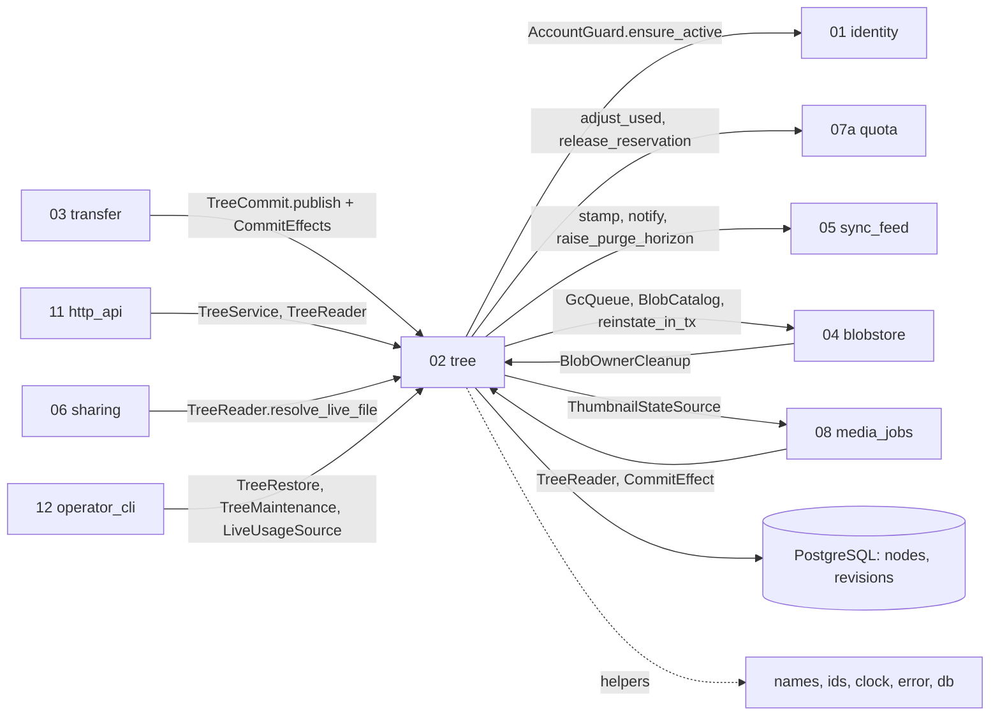

## Epic: 02 Tree — File tree, revisions, conflicts and the commit transaction

**epic_type**: component
**Local id**: E-13 (Jira id added later)

### Epic Summary

Build the per-account tree of folders and files and the one transaction that publishes a change: names and case-insensitive uniqueness, create/rename/move/delete, revisions, conflict copies, edit-beats-delete revival, tombstone cascade and purge, listing, revision lookups, operator restore and the quota deltas. It is the single writer of `nodes` and `revisions` and owns the heart of the sync model (ADR-005).

### Problem / Context

"Last commit wins, stale edit becomes a conflict copy, edit beats delete" (RESTRICT-24) needs one transaction that touches node, revision, quota, GC queue and feed counter atomically, with the feed stamp as the last statement (AC-69). To break dependency cycles the transaction lives in 02 and calls 07a, 04, 05 and 01 through `contracts` ports; 03 and 08 inject `CommitEffect`s. Names are unique per folder case-insensitively but case-preserving (AC-42); 02 also serves `TreeReader` (absorbing `NodeResolver`) to 03, 06, 07, 08, 11, 12, 20.
Docs: `architecture.md` (Dependency rule), `components/02_tree/description.md`, `tests.md`, `data_model.md`, `system-flows.md` F4, F5, F8, F12, F13, `canonical-names.md` (restore, conflict names), ADR 005, 015.

### System context



### Scope

**In Scope**:
- Folder/file nodes, name rules via helper 06 (`NameKey`), listing with keyset paging, `thumb_state` enrichment.
- `TreeCommit::publish` (single and up to 500-entry batch) with savepoint per entry, effects protocol, outcomes `Created/Updated/Replaced/ConflictCopied/CreatedAsCopy/Revived/NoChange`.
- `create_folder`, `update_node` (rename/move, cycle check), `delete_node` (`EditedSince`), `resolve_path`, `find_revisions`, `lookup_revisions` (<= 1000 hashes).
- Cascade and purge maintenance (janitors), `TreeRestore::restore_revision`, `LiveUsageSource`, `BlobOwnerCleanup`, `AccountLifecycleHook` (root node, erase).
- Quota deltas of a commit/delete/cascade, GC scheduling of replaced/deleted blobs.

**Out of Scope**:
- Upload sessions, receipts, bitmaps, sniffing (E-14); blob state flip and `blob_gc` writes (E-10 through ports); the feed counter (E-12); shares (E-16); thumbnails (E-18).
- HTTP routing and status mapping (E-21).

### Assumptions

- A commit addresses an existing file by node id, never by path, so a concurrent folder move keeps the edit's file id (AC-70).
- Retained non-current revisions are not downloadable by users; restore is operator-only (`canonical-names.md`).
- `revisions.blob_id` is UNIQUE; restore re-points the existing row, never inserts a second revision.
- A file under a tombstoned ancestor is `Gone` immediately via a bounded parent-chain walk, independent of the 30 s cascade (gap-pass default).
- Deadlock or serialization aborts are retried once, then fail as unexpected.

### Dependencies

**Epic dependencies** (must be completed first):
- E-00 Bootstrap and Initial Structure (workspace, `contracts`, test harness)
- E-01 Configuration (`tombstone_horizon`, `listing_*`, `cascade_batch_size`, `purge_batch_size`, `tree_maintenance_interval`, `conflict_copy_time_zone`)
- E-02 Error model (`TreeError`, problem codes `name_conflict`, `invalid_name`, `cycle`, `edited_since`, `parent_deleted`)
- E-03 Clock (conflict-copy timestamp, restore instant)
- E-04 IDs and hashing (node/revision ids, content hash)
- E-05 Name rules (`NameKey`, Unicode folding, escaping)
- E-06 Database access and migrations (`nodes`, `revisions`, advisory lock helper, indexes, system scope)
- E-09 Observability
- E-10 Blobstore (`BlobCatalog`, `GcQueue`, `BlobRegistry::reinstate_in_tx`)
- E-11 Quota (`QuotaLedger`)
- E-12 Sync feed (`FeedStamp`, `FeedNotifier`, `FeedHorizon`)

**Port counterparts in higher epics** (traits in `contracts`; real implementations exercised after they land): `AccountGuard` from E-15, `ThumbnailStateSource` from E-18, `CommitEffect` impls from E-14 and E-18. Tests before then use recording implementations at the port boundary; the "no fake stores" integration cases (IT-02-10, IT-02-12, IT-02-23) are scheduled after E-14, E-15 and E-18.
**External dependencies**: PostgreSQL 18; DS-02 (10,000-entry folder) and name corpus (DS-12 style) for listing and hostile-name tests.

### Effort Estimation

**T-shirt size**: XL
**Story points range**: 50-64 (planned child issues total 58)

### Users / Consumers

| Type | Who | Key Use Cases |
|------|-----|--------------|
| System | E-14 transfer | `publish` for upload and batch commits, node/revision checks |
| System | E-21 http_api | Folder create, rename/move, delete, listing, revision routes |
| System | E-16 sharing, E-18 media_jobs, E-17 admin, E-30 vault_service | `TreeReader` lookups |
| System | E-22 operator_cli | `admin restore`, `resolve_path`, doctor `describe_blobs`, janitors |
| External | Web, desktop, Android | Listings, conflict copies, reinstall lookup by hash/device |

### Interface specification

| Port | Method | Output | Typed errors |
|---|---|---|---|
| `TreeService` | `create_folder(account, parent, name)` | `NodeView` | `NameInvalid`, `NameConflict`, `ParentDeleted`, `NotFound`, `NotAFolder` |
| | `update_node(account, id, name?, parent?)` | `NodeView` | + `Cycle`, `IsRoot` |
| | `delete_node(account, id, base_revision)` | `()` idempotent | `EditedSince{current_revision}`, `IsRoot`, `NotFound` |
| | `resolve_path`, `find_revisions(filter client_device)` | node id / `[RevisionRef]` | `NotFound`, `InvalidCursor` |
| `TreeReader` | `get_node`, `list_children(after_name_key, limit<=1000)`, `find_live_node`, `resolve_live_file -> LiveFile{kind, revision, blob_ref}\|Gone`, `root_node`, `get_revision`, `is_current_or_retained`, `describe_blobs`, `lookup_revisions(<=1000)` | views | `NotFound`, `NotAFolder`, `InvalidCursor`, `BatchTooLarge` |
| `TreeCommit` | `publish(CommitActor, Vec<PublishEntry>, Vec<CommitEffect>, now)` | `Published(Vec<EntryResult>)` or `Replayed(stored)` | whole call: `AccountNotActive`, `CommitIdReused`, `EffectFailed`; per entry: `NameInvalid`, `ParentDeleted`, `ParentNotFound`, `NotAFolder`, `NotFound`, `BlocklistMismatch`, `EffectFailed(code)` |
| `TreeRestore` | `restore_revision(account, node/path, at)` | `RestoreOutcome{restored_revision, placement Original\|Restored}` | `BeyondRetention`, `FileMissing`, `NotFound` |
| Others | `LiveUsageSource::live_bytes`, `TreeMaintenance::{cascade_batch, purge_tombstones}` (+ `Janitor`), `BlobOwnerCleanup::remove_owner_rows`, `AccountLifecycleHook` | | |
| Requires | `AccountGuard`, `BlobCatalog`, `QuotaLedger`, `FeedStamp/Notifier/Horizon`, `GcQueue`, `BlobRegistry::reinstate_in_tx`, `ThumbnailStateSource`, `CommitEffect` (`on_begin`, `on_entry`, `on_batch`; `EffectError::Entry\|Batch`) | | |

`PublishEntry` = `Target::Existing{node_id, base_revision?}` or `Target::New{parent_id, name}`, `NewRevision{revision_id, blob_id, size, content_hash, blocklist, media_type, client_mtime, client_meta, reserved_bytes, import_hint}`, `vault: bool`. HTTP routes (owned, routed by E-21): `/api/v1/nodes/root`, `/nodes/{id}`, `/nodes/{id}/children`, `/nodes`, `/revisions/{id}`, `/revisions`, `/revisions:lookup`.

### Data flow

```mermaid
sequenceDiagram
  participant C as 03 transfer
  participant T as 02 publish
  participant DB as PostgreSQL tx
  C->>T: publish(actor, entries, effects)
  T->>DB: AccountGuard.ensure_active (first)
  T->>DB: advisory_lock_account
  T->>DB: effects.on_begin (receipt lookup may Replay)
  loop each entry in a savepoint
    T->>DB: node + revision writes, adjust_used, release_reservation, GcQueue.schedule_in_tx(replaced)
    T->>DB: effects.on_entry (blob committed, session row, job enqueue)
  end
  T->>DB: effects.on_batch (receipts)
  T->>DB: FeedStamp.stamp(union of touched) as LAST statement
  T->>DB: COMMIT
  T-->>C: Published(results); FeedNotifier.notify after COMMIT
```

### Architecture notes

- ADR-005 (conflict copies, edit beats delete, 7-day operator-only retention), ADR-015 (the tree owns the transaction; 03/08 pass effects; 02 imports no sibling crate), ADR-014 (maintenance loops use system scope; RLS as defence in depth), ADR-003.
- Pins: sqlx 0.9 through helper 07; `unicode-normalization` and case folding live in helper 06 (`name_key_version`); tokio 1.54.1+.
- Locking: the account advisory lock is taken only by `publish`, folder move and restore; `create_folder`, `delete_node`, cascade, purge and erase work in short batches. Parent row `FOR SHARE` on child creation. No lock-order contract between components.
- Conflict copy name: `name (conflict copy YYYY-MM-DD HH-MM device)` using the injectable clock and `CommitActor.device_label`; stem truncated to 255 bytes; numeric suffix on collision. Open owner items (not resolved here): NFC vs NFD (G-1), Windows reserved-name marker and ` (2)` suffix.

### Non-functional requirements

| Requirement | Target | Failure threshold | Source |
|---|---|---|---|
| Full 10,000-entry listing p95 (summed pages) | 200 ms | 300 ms (AC-6) | PT-02-1 |
| One 1000-entry page p95 | 40 ms | 80 ms | PT-02-1 |
| Hot account throughput, 50 writers | >= 200 commits/s | 100 commits/s; seq gaps 0 | PT-02-3, AC-69 |
| Commit latency p95 on a hot account | 250 ms | 600 ms | PT-02-3 |
| 500-entry batch publish p95 (20 batches in 60 s, AC-40) | 1.0 s | 2.0 s | PT-02-4 |
| Cascade batch of 5,000 nodes | 2 s | 5 s | PT-02-4 |
| DB connections | <= 16 (listing <= 8) | above | PT-02-1/3 |
| Usage after 1,000 concurrent commits/deletes | equals recomputed sum | any drift | IT-02-15, AC-74 |

### Requirements

**Functional**: case-insensitive unique, case-preserving names; stale base produces exactly one conflict copy sharing the same blob; new-file name collision gets the conflict-copy name with no client retry; edit beats delete and revives ancestors (clearing `cascade_pending`); a failed entry in a batch rolls back only its savepoint including its quota release; restore creates no second revision row and lands in `Restored` when the original folder is gone; GC of a deleted file's blob is never blocked by the revision FK.
**Non-functional**: see table; listing is an index scan plus PK lookups (CI plan check on DS-02 with the real RLS role).
**Security / Compliance**: every query carries `account_id`; foreign ids are 404 (AC-59); server rejects `/`, NUL, `.`/`..`, control and bidi-control characters and names over 255 bytes (AC-37); `publish` verifies that `NewRevision.blob_id` belongs to the account through `BlobCatalog`; restore is operator-only; no names or paths in logs.

### Design & Architecture

- Architecture doc: `_docs/02_document/architecture.md`
- Component spec: `_docs/02_document/components/02_tree/description.md`; tests: `.../tests.md`
- System flows: `_docs/02_document/system-flows.md` (F4, F5, F8, F12, F13); `data_model.md` (nodes, revisions)

### Testing strategy

Component integration against real PostgreSQL 18 with the real RLS role; ports backed by the real E-10/E-11/E-12 implementations; E-15/E-18/E-14 counterparts first as recording doubles, then real in the integration suite.
- Integration: IT-02-1 names, 3 rename/move, 4 delete and quota delta, 5 publish outcomes, 6 conflict copy, 7 new-name collision, 8 edit beats delete, 9 500-entry savepoints, 10 effect protocol and statement order, 12 no revision names an uncommitted blob, 13 fifty concurrent commits, 14 move races edit, 15 exact quota, 16 listing and paging, 17 `resolve_live_file`, 18 revision lookups, 20 cascade and purge, 21 restore re-points, 23 erase hook.
- Performance: PT-02-1, 3, 4. Security: ST-02-1 IDOR, 2 RLS, 3 hostile names, 4 foreign blob (marked BLOCKED in tests.md; the owner of the check was fixed at the Step 5 gap pass). Acceptance: AT-02-1 stale edit gives one conflict copy.
- System scenarios: FT-P-08..12, 15, 16, 18, 19, 32, 54, 57; FT-N-04, 41, 42, 44; NFT-PERF-08, 09, 10; NFT-RES-07, 08, 09, 18, 25, 30, 34, 35, 37, 38; NFT-SEC-13, 14, 22, 27.

### Definition of Done

- [ ] All ports implemented in the `tree` crate and registered in `contracts`; janitors registered for E-22
- [ ] Automated tests pass (IT/ST/AT above; unit tests for name rules, cycle check, conflict-name builder)
- [ ] Coverage >= 90% on `publish`, conflict, restore and quota paths (critical) and >= 75% overall
- [ ] CI plan check: listing uses `nodes_parent_name_key`, no Seq Scan
- [ ] OpenAPI error codes agreed with E-21; documentation updated

### Acceptance Criteria

| # | Criterion | Measurable Condition |
|---|-----------|---------------------|
| 1 | AC-6: listing 10,000 entries p95 <= 300 ms | PT-02-1 |
| 2 | AC-8 / RESTRICT-24: stale edit yields exactly one conflict copy; edit beats delete | IT-02-6, IT-02-8, AT-02-1 |
| 3 | AC-42: `A.txt` and `a.txt` never overwrite; case-only rename keeps id | IT-02-1, IT-02-3 |
| 4 | AC-69 / AC-5: 50 concurrent commits, stamp last | IT-02-10 no statement after stamp; IT-02-13; PT-02-3 gaps 0 |
| 5 | AC-70 / AC-34: move races edit; save-in-place keeps id | IT-02-14 edit in moved folder, 0 conflict copies |
| 6 | AC-74: usage equals sum of live current revisions | IT-02-15 |
| 7 | AC-77 / AC-12: deleted file is Gone at once | IT-02-17 parent-chain walk beats 30 s cascade |
| 8 | AC-30 / AC-27 / AC-68: GC queued on replace/delete; erase leaves no revision or blob | IT-02-4, IT-02-12, IT-02-21, IT-02-23 |
| 9 | AC-31 / AC-46 / AC-41: hash and device lookup; purge horizon | IT-02-18, IT-02-20 |
| 10 | AC-59 / AC-37: IDOR matrix and hostile names | ST-02-1..3 0 cross-account successes |

### Risks & Mitigations

| # | Risk | Mitigation | Owner |
|---|------|------------|-------|
| 1 | R07 per-account serialisation (advisory lock, 500-entry batch, hot rows) | Lock only in publish/move; aggregate deltas per batch; gates NFT-PERF-09, S1, S6 | Epic owner |
| 2 | R15 complexity of ports and effects | First vertical slice (upload, commit, feed, download); contract tests with real 03 effects | Architect |
| 3 | R16 Unicode fold version and `%XX` escaping are hard to migrate | `name_key_version`, shared corpus (E-05) | Epic owner |
| 4 | Deadlock between publish and non-locking batch (cascade, erase) | Database resolves, retried once; batch size bounds lock time | Epic owner |
| 5 | Thumbnail enrichment adds a second query per page | Measure in NFT-PERF-10; `none` if no source wired | Epic owner |

### Labels

- `sunnycloud`
- `component:tree`

### Child Issues

| Type | Title | Points |
|------|-------|--------|
| Spike | Confirm NFC/NFD stored form and escaping marker with E-05 (G-1 is an owner item; cites `tests/spec-gaps.md`) and contract-test plan for `CommitEffect` with E-14/E-18 | 2 |
| Enabler | `tree` crate skeleton, `TreeError`, config section, migrations coordination (`nodes`, `revisions`, indexes), advisory-lock helper use | 3 |
| Task | `TreeReader`: get_node, listing keyset paging, `resolve_live_file` with parent-chain walk, `root_node` (IT-02-16, 17) | 5 |
| Task | `create_folder`, `update_node` (rename/move, cycle check, case-only rename), `delete_node` (IT-02-1, 3, 4) | 5 |
| Task | `publish` core: guard, lock, effects protocol, per-entry savepoint, stamp-last tail (IT-02-5, 9, 10, 12, 13) | 5 |
| Task | Conflict copy builder and new-name collision, edit-beats-delete revival with ancestors (IT-02-6, 7, 8) | 5 |
| Task | Quota deltas and GC scheduling within publish/delete/cascade (IT-02-4, 15) | 3 |
| Task | Blob ownership check in `publish` via `BlobCatalog` and `BlocklistMismatch`/`NotFound` mapping (ST-02-4) | 2 |
| Task | Move-vs-edit race handling and AC-70 suite (IT-02-14) | 3 |
| Task | Cascade and purge janitors with `FeedHorizon` (IT-02-20, PT-02-4) | 5 |
| Task | `TreeRestore` with `Original`/`Restored` placement and re-point (IT-02-21) | 5 |
| Task | `lookup_revisions`, `find_revisions`, `describe_blobs`, `LiveUsageSource` (IT-02-17, 18) | 3 |
| Task | `AccountLifecycleHook` and `BlobOwnerCleanup` (IT-02-23) | 3 |
| Task | `ThumbnailStateSource` enrichment of listings and `thumb_state` fields | 2 |
| Task | Security and performance suites ST-02-1..3, PT-02-1/3/4, AT-02-1 | 5 |
| Task | Integration pass against real E-14/E-15/E-18 implementations (IT-02-10/12/23) | 2 |
