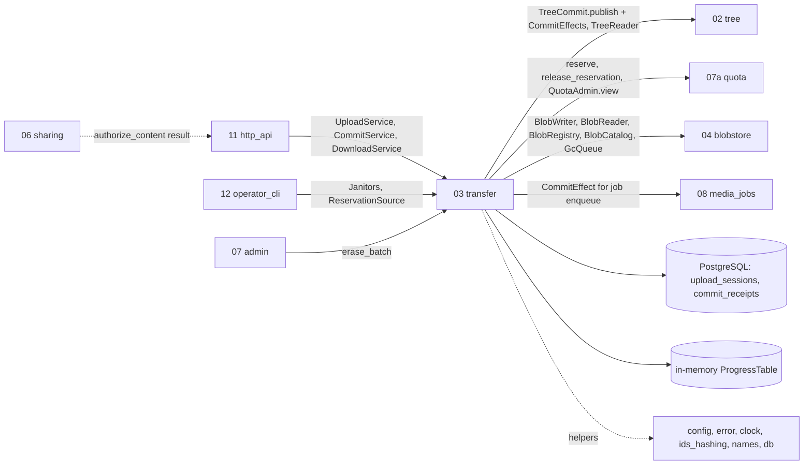
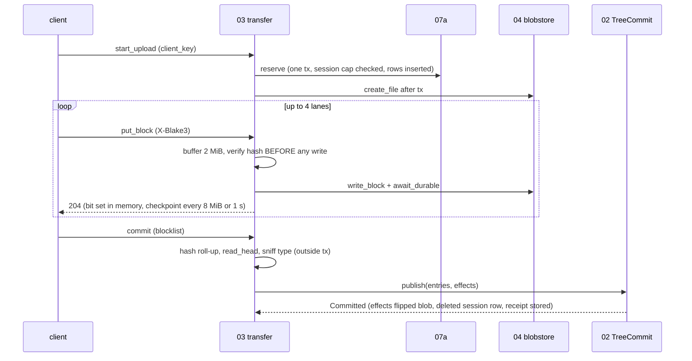

## Epic: 03 Transfer — Resumable uploads, batch commits and Range downloads

**epic_type**: component
**Local id**: E-14 (Jira id added later)

### Epic Summary

Build the byte-moving service: upload sessions with a received-bitmap over 2 MiB blocks and up to 4 lanes, single-request staged uploads (zero bytes included), single and batch commit with receipts, and download with Range streaming. It turns verified, durable blocks into a ready blob for the tree and streams stored blobs back, meeting the speed, resume and small-file targets (AC-2, AC-3, AC-40).

### Problem / Context

The sync protocol (ADR-004) is plain HTTPS/2 with fixed 2 MiB blocks, BLAKE3 per block, server-ordered commits and a batch endpoint for small files. 03 never opens the commit transaction: it calls `TreeCommit::publish` and passes `CommitEffect`s that run inside 02's transaction (ADR-015). Progress is held in memory and checkpointed (every 8 MiB or 1 s), which is why v1.0 runs one API process (decision 12, R06). Quota is reserved at session start (RESTRICT-09), blocks are acked only after the group fdatasync (AC-38).
Docs: `architecture.md`, `components/03_transfer/description.md`, `tests.md`, `data_model.md` (`upload_sessions`, `commit_receipts`), `system-flows.md` F4, F5, F6, F8, ADR 004, 015.

### System context

### Scope

**In Scope**:
- `start_upload` (name rules, parent check, floor, quota reserve, session cap, resume by `client_key`, `NothingToSend`), `get_upload`, `put_block` (hash before write, in-flight caps, idempotent repeats), `abort_upload`, `stage_small`.
- `commit_upload` and `commit_batch`: blocklist check, hash roll-up without reading file bytes, sniffing from bytes only, `ReceiptEffect`, `BlobCommitEffect`, target choice (`Existing` vs `New`).
- `DownloadService` (`open_revision_content`, `open_blob_content`): Range, ETag, inline allowlist (AC-47), non-current revisions hidden from users.
- Janitors: `SessionReaper`, `ReceiptJanitor`, `ProgressTable::flush_idle`; `ReservationSource`; `AccountLifecycleHook`.

**Out of Scope**:
- Node names, conflict copies, edit-beats-delete, revision rows, the commit transaction, the feed counter (E-13); quota limits and usage (E-11); encryption, fsync, GC (E-10); thumbnails (E-18); HTTP headers and status mapping (E-21); share tokens (E-16).
- Cross-node content dedupe (commit by hash): out of v1.0.

### Assumptions

- Callers pass a resolved `AccountId`, never a credential; 11 fills `CommitActor{account_id, device_label}`.
- `client_key` is opaque (<= 256 bytes) and unique per account; `staged_key` is a client UUID; a batch retry reuses `commit_id` and entries unchanged.
- v1.0 runs one API process; all lanes of a session reach the same process; memory bound 100 sessions x 800 KiB hashes = 80 MB.
- Block size 2 MiB is a protocol constant; the large path is `declared_size > 0`, zero-byte files use `stage_small`.
- `AccountNotActive` at start/put/commit is enforced through `AccountGuard` (E-15) inside the transactions that own it.

### Dependencies

**Epic dependencies** (must be completed first):
- E-00 Bootstrap and Initial Structure (workspace, `contracts`, harness)
- E-01 Configuration (`upload_session_ttl`, `max_declared_size`, `max_open_sessions`, `max_staged`, `checkpoint_*`, `max_lanes`, `max_inflight_blocks_per_account`, `batch_max_entries`, `commit_receipt_ttl`, `max_buffered_block_bytes`, reaper intervals)
- E-02 Error model (typed errors and stable problem codes)
- E-03 Clock (session TTL, receipts)
- E-04 IDs and hashing (BLAKE3 block verification, hash roll-up, `derive_commit_id` inputs)
- E-05 Name rules (checks at start)
- E-06 Database access and migrations (`upload_sessions`, `commit_receipts`, short-tx runner)
- E-09 Observability (Transfer metrics table)
- E-10 Blobstore (writer/reader/registry/catalog/GC)
- E-11 Quota (`QuotaLedger`, `QuotaAdmin::view`)
- E-13 Tree (`TreeCommit`, `TreeReader`)

**Port counterparts in higher epics** (traits in `contracts`): `AccountGuard` (E-15), media-job `CommitEffect` (E-18, injected by the composition root E-22). Integration tests that need the real implementations run after those epics.
**External dependencies**: XFS blob volume for throughput rows; DS-01 (small files), DS-10 (50 GiB sparse hybrid), DS-25 (1 GiB), REF-SRV with 1 GbE for C-REF/C-LARGE rows.

### Effort Estimation

**T-shirt size**: XL
**Story points range**: 48-62 (planned child issues total 54)

### Users / Consumers

| Type | Who | Key Use Cases |
|------|-----|--------------|
| System | E-21 http_api | Upload, commit, batch commit, download routes; share and derived downloads composed with 06/08 |
| External | Web, desktop, Android clients | Resumable uploads, small-file batches, Range reads |
| System | E-13 tree | Receives `CommitEffect`s (receipt lookup, blob flip, session delete) |
| System | E-22 / E-17 | Janitors, `ReservationSource` for quota drift check, erase hook |

### Interface specification

All methods async; errors typed, none swallowed.

| Port | Method | Input -> Output | Errors |
|---|---|---|---|
| `UploadService` | `start_upload` | `StartUpload{parent_id, name, declared_size, client_key, content_hash?, base_revision?, client_meta?}` -> `Started{upload_id, need_blocks, block_size, lane_limit, expires_at}` or `NothingToSend{revision}` | `InvalidName`, `ParentNotFound`, `NotAFolder`, `SizeTooLarge`, `QuotaExceeded`, `SessionCapReached`, `FreeSpaceFloor`, `ClientKeyMismatch`, `AccountNotActive` |
| | `get_upload` | `upload_id` -> `UploadState{need_blocks, received_count, expires_at}` | `UploadNotFound` |
| | `put_block` | `upload_id, index, expected_hash, body, length` -> `BlockAck` | `IndexOutOfRange`, `LengthMismatch`, `HashMismatch`, `BlockConflict`, `Overloaded`, `StorageFull`, `Storage`, `UploadNotFound` |
| | `abort_upload` | -> `()` releases quota and file | `UploadNotFound` |
| | `stage_small` | `staged_key, expected_hash?, body, length 0..=2 MiB` -> `Staged{staged_key,size}` (idempotent) | `QuotaExceeded`, `StagedCapReached`, `HashMismatch`, `LengthMismatch`, `ClientKeyMismatch`, `FreeSpaceFloor`, `Overloaded`, `AccountNotActive`, `Storage` |
| `CommitService` | `commit_upload` | `CommitUpload{upload_id, parent_id, name, base_revision?, blocklist, client_mtime?, client_meta?, import_hint}` -> `Committed{node_id, revision_id, conflict_copy?}` | `NeedBlocks(list)`, `BlocklistMismatch`, `UploadNotFound`, `InvalidName`, `EditedSince`, `ParentGone`, `ParentNotFound`, `NotAFolder`, `AccountNotActive` |
| | `commit_batch` | `BatchCommit{commit_id, entries<=500}` -> `BatchResult{per_entry}` | `BatchTooLarge`, `CommitIdReused`, `AccountNotActive` |
| `DownloadService` | `open_revision_content` / `open_blob_content` | account, ref, `retained_ok`, `Range?`, `If-Range?`, `If-None-Match?` -> `Download{status Full\|Partial\|NotModified, total_size, range, etag, media_type, disposition, suggested_name, body}` | `NotFound`, `RangeNotSatisfiable`, `ContentUnavailable`, `Storage` |
| Others | `SessionReaper`, `ReceiptJanitor`, `ProgressTable::flush_idle` (`Janitor`); `ReservationSource::open_reserved_bytes`; `CommitEffect` impls `BlobCommitEffect`, `ReceiptEffect`; `AccountLifecycleHook` | | |

HTTP routes owned (handlers in E-21): `POST /api/v1/uploads`, `GET|DELETE /uploads/{id}`, `PUT /uploads/{id}/blocks/{index}`, `PUT /staged-uploads/{staged_key}`, `POST /commits`, `POST /commits:batch`, `GET|HEAD /nodes/{id}/content`, `/revisions/{id}/content`. Stable codes include `quota_exceeded` 507, `free_space_floor` 507, `session_cap_exceeded` 409, `staged_cap_reached` 409, `block_hash_mismatch` 422, `need_blocks` 409, `edited_since` 409, `overloaded` 503, `content_unavailable` 404.

### Data flow

### Architecture notes

- ADR-004 (blocklist protocol, 2 MiB blocks, 4 lanes), ADR-015 (03 depends on `contracts` only), ADR-002 (single process, replicas unsupported for uploads), ADR-006 (hash verified before write also avoids nonce reuse, see E-10 risk), ADR-005.
- Pins: axum 0.8.9 / hyper 1.12 live in E-21; 03 uses `ByteStream` neutral types, sqlx 0.9, tokio 1.54.1+, BLAKE3 1.8.7.
- State justification (against stateless): acks arrive at about 56 blocks/s for 100 sessions and rewriting an 800 KiB hash array per ack is the WAL cost the data model rejected; the DB checkpoint is the durable state and `ProgressTable` loads lazily from it (no rehydrate at start).
- A reservation is released by whoever deletes the session row (commit via 02, reaper, abort); never twice.
- Caps: 8 open sessions, 1000 staged files per account, 32 in-flight blocks per account, `max_buffered_block_bytes` 1 GiB (503 + `Retry-After`).

### Non-functional requirements

| Requirement | Target | Failure threshold | Source |
|---|---|---|---|
| Single-session ingest | >= 250 MB/s | 112 MB/s | PT-03-1, AC-2 |
| Ack latency p95, 100 sessions x 4 lanes | 150 ms | 400 ms | PT-03-1 |
| Commit time, 1 MiB vs 8 GiB (constant time) | p95 <= 100 ms, spread 20% | 2 s / 50% | PT-03-2, AC-4 |
| 10,000 small files server time | <= 25 s (stage p95 40 ms, batch p95 1.0 s) | 45 s / 100 ms / 2 s | PT-03-3, AC-40 |
| 4 KiB range p95 (open + first chunk) | 4 ms | 5 ms | PT-03-4, AC-43 |
| Download throughput | >= 250 MB/s | 112 MB/s | PT-03-4 |
| ProgressTable memory, 100 sessions | <= 80 MB | 100 MB | PT-03-5 |
| Download RSS growth (5 GiB stream) | <= 16 MiB | 64 MiB | PT-03-5, AC-51 |
| Resume re-send after a drop | <= 10 MiB | AC-3; worst case 16 MiB (G-03-1) | IT-03-4 |

### Requirements

**Functional**: hash verified before the first byte is written; ack only after durable; repeat of an acked block with the same hash is idempotent, other bytes give `BlockConflict`; resume with the same `client_key` returns the existing session, changed size gives `ClientKeyMismatch`; batch retries with the same `commit_id` replay the stored receipt under the account lock; a taken name on a new file is not an error (server-assigned conflict-copy name); only one byte range honoured; retained non-current revisions are `NotFound` for users; a later `Corrupt` ends the stream with an error, never a short complete-looking body.
**Non-functional**: see table; no per-block log lines.
**Security / Compliance**: all lookups carry `account_id` (AC-59); body length must equal the expected block length; declared size above 50 GiB refused before any file exists; sniffed type only (client MIME and file names ignored); no file names in logs or errors; inline only for image jpeg/png/gif/webp/avif and video mp4/webm.

### Design & Architecture

- Architecture doc: `_docs/02_document/architecture.md`
- Component spec: `_docs/02_document/components/03_transfer/description.md`; tests: `.../tests.md`
- System flows: `_docs/02_document/system-flows.md` (F4, F5, F6, F8)

### Testing strategy

Integration against real PostgreSQL 18, real E-10, E-11, E-13; media and identity effects first recorded, then real.
- Integration: IT-03-1 start decisions, 2 `put_block` verification and caps, 3 ack after fdatasync, 4 resume (drop and restart), 5 `stage_small`, 6 commit roll-up and sniffing, 7 target choice and conflict copy, 8 `commit_batch` receipts, 9 effects inside the tx and reaper vs commit, 10 reaper/abort/checkpoints, 12 `ReservationSource`, 13 download semantics, 14 corruption and missing blobs, 15 erase hook, 17 crash between blob write and commit, 18 commit after the parent moved, 19 effects after the stamp, 20 lane races.
- Performance: PT-03-1..5. Security: ST-03-1 IDOR, 2 protocol abuse, 3 Range abuse, 4 hostile content types, 5 quota/disk DoS. Acceptance: AT-03-1 interrupted upload resumes, AT-03-2 folder of small files with a retried batch.
- System scenarios: FT-P-01..06, 39, 42, 67, 68; FT-N-01, 02, 03, 11, 38, 40, 41; NFT-PERF-02..07, 11, 27, 28; NFT-RES-01..06, 22, 34, 35, 38; NFT-RES-LIM-01; NFT-SEC-18..21.

### Definition of Done

- [ ] All ports implemented in the `transfer` crate; janitors registered for E-22; effects wired by the composition root
- [ ] Automated tests pass (IT/ST/AT; unit tests for bitmap/lane races, duplicate-block rules, receipt race, range math)
- [ ] Coverage >= 90% on `put_block`, commit, reaper (critical) and >= 75% overall
- [ ] Deployment doc states: one API process, no `replicas` for uploads
- [ ] Open owner gap G-03-1 (AC-3 worst case) decided and reflected in lane/checkpoint config or the AC

### Acceptance Criteria

| # | Criterion | Measurable Condition |
|---|-----------|---------------------|
| 1 | AC-2 / RESTRICT-11: >= 90% of 1 GbE with encryption on | PT-03-1 >= 250 MB/s (fail < 112 MB/s) |
| 2 | AC-3: resume re-sends <= 10 MiB | IT-03-4, AT-03-1 (pending G-03-1) |
| 3 | AC-4: constant-time commit up to 50 GiB | PT-03-2 spread <= 20% |
| 4 | AC-38 / AC-7: ack only after durable; per-block BLAKE3 | IT-03-2, IT-03-3 corrupt body never reaches disk |
| 5 | AC-39: session cap, quota, floor | IT-03-1: 100 x 50 GiB refused beyond cap and quota, nothing reserved |
| 6 | AC-40: 10,000 files <= 60 s at 20 ms RTT | PT-03-3 server time <= 25 s; AT-03-2 retried batch applies once |
| 7 | AC-47 / AC-51 / AC-43: serving rules and Range | IT-03-13, ST-03-4, PT-03-4 |
| 8 | AC-68 / AC-74: reserve and release exactly once | IT-03-9, IT-03-10, IT-03-17 |
| 9 | AC-69 / AC-70: effects add nothing after the stamp; commit by node id | IT-03-19, IT-03-18 |
| 10 | AC-27 / AC-30: erase removes sessions, staged rows, receipts and queues blobs `Due::Now` | IT-03-15 |
| 11 | AC-59: two-account matrix | ST-03-1 |

### Risks & Mitigations

| # | Risk | Mitigation | Owner |
|---|------|------------|-------|
| 1 | R06 in-memory progress breaks with replicas | One API process; checkpoint makes restart safe; documented | Architect |
| 2 | R13 one user exhausts the buffer semaphore / HTTP/2 window memory | Per-session and per-account in-flight caps; quota and staged-cap pre-checks before writing; NFT-SEC-15 | Epic owner |
| 3 | R29 staged-file cap (1000/account) throttles bulk imports | `max_staged_per_account` in `ServerInfo`, client pacing, release staged rows on abort | Epic owner |
| 4 | `CommitEffect` contract drift with 02/08 | Contract tests run 02's real commit with 03's real effects incl. reaper vs commit | Epic owner |
| 5 | R27 daemon memory vs upload buffers; R04 Caddy HTTP/2 windows cap throughput | Lower in-flight cap (client); run NFT-PERF-04 through Caddy; owner decision on G-03-1 | Architect |
| 6 | R03 no reference hardware | Perf rows `NOT-RUN(HW-REF)` until REF-SRV exists | Owner (hardware) |

### Labels

- `sunnycloud`
- `component:transfer`

### Child Issues

| Type | Title | Points |
|------|-------|--------|
| Spike | Resolve G-03-1 (16 MiB worst-case resend vs AC-3: lane/checkpoint limits or AC change) with the owner and G-03-3 (wire response for a stale-base commit); cites `tests/spec-gaps.md` | 2 |
| Spike | Confirm with E-13 that `NothingToSend` is returned for `(parent, name, hash)` after a lost commit response (IT-13-16 B in `tests/spec-gaps.md`) | 1 |
| Enabler | `transfer` crate skeleton, `upload_sessions`/`commit_receipts` migrations coordination, config section, ProgressTable type | 3 |
| Task | `start_upload` (names, parent, floor, reserve, cap, resume, `NothingToSend`) and compensating tx (IT-03-1) | 5 |
| Task | `put_block` with verify-before-write, in-flight caps, idempotency, ProgressTable and checkpointing (IT-03-2, 3, 20) | 5 |
| Task | Resume after drop/restart, `get_upload`, `abort_upload`, lazy load from checkpoint (IT-03-4, 10) | 3 |
| Task | `stage_small` including zero-byte path and pre-checks (IT-03-5) | 3 |
| Task | `commit_upload`: blocklist check, hash roll-up, head sniff, target choice, `BlobCommitEffect` (IT-03-6, 7, 9) | 5 |
| Task | `commit_batch` with `ReceiptEffect`, `request_hash`, replay and `CommitIdReused` (IT-03-8, AT-03-2) | 5 |
| Task | `DownloadService`: Range, ETag, conditional, disposition, retained rules, corruption handling (IT-03-13, 14) | 5 |
| Task | `SessionReaper`, `ReceiptJanitor`, `flush_idle`, `ReservationSource` (IT-03-9, 10, 12, 17) | 3 |
| Task | `AccountLifecycleHook` erase and crash/AC-68/69/70 integration cases (IT-03-15, 17, 18, 19) | 3 |
| Task | Security suite ST-03-1..5 | 3 |
| Task | Performance suite PT-03-1..5 and Transfer metrics | 3 |
| Task | Integration pass against real E-15 `AccountGuard` and E-18 job effect | 2 |
| Task | Documentation: OpenAPI error codes, one-process note, client retry rules | 3 |
