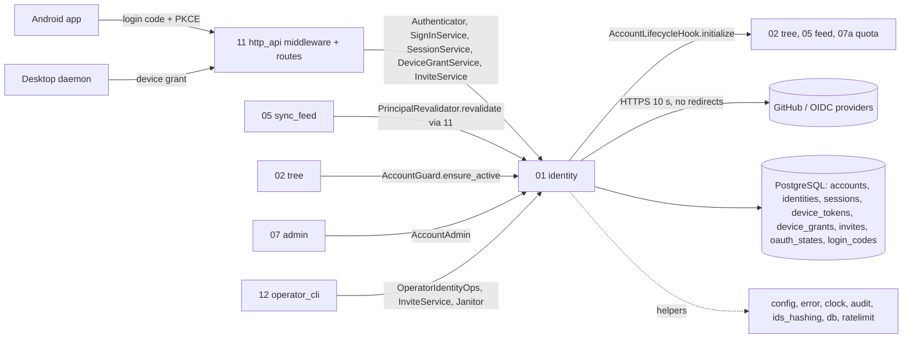
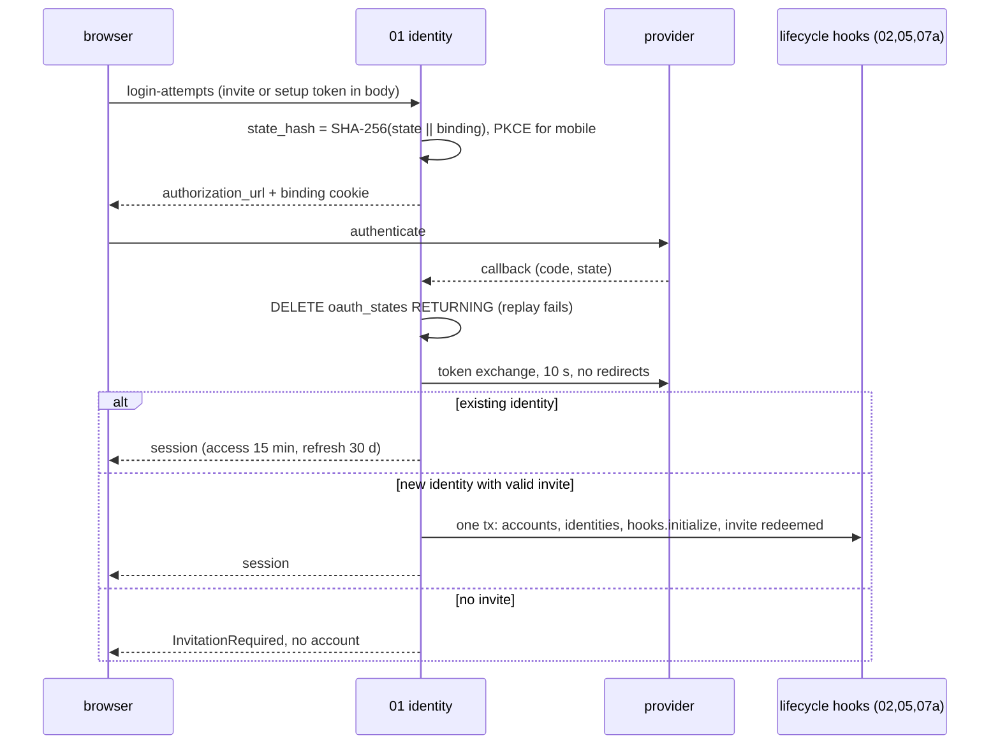

## Epic: 01 Identity — Sign-in, sessions, device grants, invites and the account guard

**epic_type**: component
**Local id**: E-15 (Jira id added later)

### Epic Summary

Build authentication and credential lifecycle: built-in OAuth/OIDC sign-in (GitHub and generic OIDC; Google through OIDC), server-owned opaque sessions with refresh rotation, the desktop RFC 8628 device grant, the mobile one-time-code hand-off, single-use invites and the setup token, the scope model every route relies on, and the `AccountGuard` that stops commits racing account deletion. Without it nobody can sign in, and controlled registration (AC-23) does not exist.

### Problem / Context

There are no local passwords: identity is `(provider, provider user id)`, never email (RESTRICT-17, ADR-008). The API issues its own sessions (15-minute access token, rotating refresh token with a 30 s reuse grace) and sync-only device tokens through its own device grant, because Apple has no device flow. Registration is controlled by a one-time setup token for the first admin and single-use invites afterwards (RESTRICT-18). Revocation must be visible within 5 s, including to held long-polls (AC-21), so `authenticate` is one indexed probe wrapped by a 2 s cache.
Docs: `architecture.md` (Security Architecture), `components/01_identity/description.md`, `tests.md`, `data_model.md` (identity tables), `system-flows.md` F1, F2, F3, F13, ADR 008, 014, 015.

### System context

### Scope

**In Scope**:
- `Authenticator` (`authenticate`, `revalidate`, `require` with scopes `Public`, `SessionOnly`, `SessionOrDevice`, `Admin`) and the 2 s session cache.
- `SignInService`: begin/complete, 12 negative callback cases, link provider, `list_providers`, mobile `exchange_mobile_code` with PKCE; email rule (verified, only at invite redemption, AC-55).
- `SessionService` (refresh rotation and reuse revocation, revoke, list, touch), `DeviceGrantService`, `InviteService`, `OperatorIdentityOps` (setup token, admin invite, reset-admin re-bind).
- `AccountAdmin` (list, `lock_active_admins`, `set_role`, `set_state`, `begin_deletion`, `finalize_deletion`), `AccountGuard`, `IdentityMaintenance` janitor.
- Account creation as one transaction over `AccountLifecycleHook::initialize`; audit events for sign-in/device/session.

**Out of Scope**:
- CSRF/Origin checks, cookie attributes, 429 mapping (E-21); admin screens and the last-admin rule (E-17); deletion orchestration (E-17 purger); worker authentication (E-18 `WorkerAuthenticator`).
- Sign in with Apple (v1.1): the v1.0 `ProviderClient` trait must not change for it.

### Assumptions

- `public_url` is absolute `https` outside development; `redirect_uri` is built from it, never from Host.
- At least one provider is configured at start; operators register their own provider apps; a server with no internet cannot authenticate (RESTRICT-20).
- Device tokens do not rotate in v1.0 and are revocable; the device grant is desktop only; mobile sign-in yields a `sessions` row.
- Hook list is registered late by E-22 through `register_hooks` on the identity service (set once; unset fails closed; AZ-3681, 2026-11-11).
- GeoIP data comes from a local file behind a `GeoLookup` trait; a missing file means location unknown.

### Dependencies

**Epic dependencies** (must be completed first):
- E-00 Bootstrap and Initial Structure (workspace, `contracts`, mock IdP harness)
- E-01 Configuration (providers, TTLs, `public_url`, abuse limits, secrets from files)
- E-02 Error model (`Unauthenticated`, `Forbidden`, typed sign-in errors)
- E-03 Clock (expiry, cache TTL, grace windows)
- E-04 IDs and hashing (SHA-256 token hashes, 256-bit token generation)
- E-06 Database access and migrations (identity tables, `FOR SHARE`/`FOR UPDATE` helpers, RLS scope)
- E-07 Audit log (`sign_in`, `device_approved`, `session_revoked`, `refresh_reuse`)
- E-08 Abuse rate limiting (`AbuseLimiter`: sign-in 10/min/IP, device approvals 5/session, 20/account/h, 50/IP/h, invalid tokens)
- E-09 Observability
- E-11 Quota, E-12 Sync feed, E-13 Tree (their `AccountLifecycleHook::initialize` runs inside account creation; real implementations needed for IT-01-17)

**External dependencies**: GitHub and generic OIDC provider apps (mock-idp for CI), GeoIP database file, PostgreSQL 18.

### Effort Estimation

**T-shirt size**: XL
**Story points range**: 45-58 (planned child issues total 50)

### Users / Consumers

| Type | Who | Key Use Cases |
|------|-----|--------------|
| System | E-21 http_api | Auth middleware, sign-in/session/device/invite routes |
| System | E-13 tree | `AccountGuard::ensure_active` first in commit and tree mutations |
| System | E-12 sync_feed | `revalidate` to end held polls |
| System | E-17 admin | `AccountAdmin` for roles, state, deletion |
| System | E-22 operator_cli | Setup token, `admin create/reset`, operator invites |
| External | Web user, Android user, desktop daemon | Sign-in, mobile code, device approval |

### Interface specification

| Port | Method | Input -> Output | Errors |
|---|---|---|---|
| `Authenticator` | `authenticate(Credential Session\|Device)` -> `Principal{account_id, kind, id, role, label}` | one `Unauthenticated` variant for missing/unknown/expired/revoked/disabled/deleting, same DB path | `Unauthenticated` |
| | `revalidate(&Principal)` -> `bool` (cache <= `session_cache_ttl`); `require(&Principal, Scope)` | | `Forbidden` |
| `SignInService` | `begin(provider, return_to, client_kind, invite/setup token?, code_challenge, host)` -> `AuthorizationRedirect{url, browser_binding}` | | `UnknownProvider`, `InvalidReturnPath`, `HostMismatch`, `RateLimited{retry_after}` |
| | `complete(provider, params, browser_binding, host)` -> `Session{tokens, return_to}` \| `MobileCode{code, return_to}` | | `UntrustedState`, `TrustedFailure{code}`, `InvitationRequired`, `ProviderUnavailable`, `RateLimited` |
| | `begin_link`/`complete_link`, `exchange_mobile_code(code, verifier)`, `list_providers` | | `IdentityTaken`, `InvalidCode` |
| `SessionService` | `refresh` -> tokens \| `ReuseDetected`; `revoke`, `revoke_all`, `list`, `touch` | | `Unauthenticated` |
| `DeviceGrantService` | `request`, `poll`, `lookup_for_approval`, `decide`, `list_devices`, `revoke_device`, `revoke_self` | exactly-once mint: `UPDATE ... WHERE status='approved' AND expires_at > now RETURNING` + insert | `AuthorizationPending`, `SlowDown`, `AccessDenied`, `ExpiredToken`, `UnknownCode`, `AlreadyDecided` |
| `InviteService` / `OperatorIdentityOps` | `create_invite`, `list`, `revoke`; `ensure_setup_token`, `create_admin_invite`, `reset_admin(account)` | redemption `UPDATE ... WHERE redeemed_at IS NULL AND expires_at > now RETURNING` in the account-creation tx | `InvitationRequired` |
| `AccountAdmin` | `list_accounts`, `lock_active_admins`, `set_role`, `set_state`, `begin_deletion`, `finalize_deletion` (all with caller's `&mut DbTx`) | | typed |
| `AccountGuard` | `ensure_active(&mut DbTx, account)` (`SELECT state ... FOR SHARE`) | | `AccountNotActive` |
| `Janitor` | `IdentityMaintenance::run_cycle(now)` | expired states, grants (+1 h), login codes, sessions (+30 d) | |

HTTP routes owned (handled in E-21): `/api/v1/auth/providers`, `/auth/login-attempts`, `/auth/providers/{provider}/callback`, `/auth/mobile-code-exchanges`, `/auth/refresh-tokens`, `/sessions`, `/identity-link-attempts`, `/device-grants`, `/device-tokens`, `/devices`, `/devices/me`, `/admin/invites`.

### Data flow

### Architecture notes

- ADR-008 (built-in OIDC and device grant; Dex/Keycloak rejected), ADR-014 (API role DML only; RLS), ADR-015 (ports only; identity imports no implementer), ADR-002.
- Pins: `openidconnect 4.1.0`, `oauth2 5.0.0`, `jsonwebtoken` (id-token signature; Apple ES256 secret in v1.1), reqwest (workspace-pinned, 0.13.5) provider client with redirects off, SHA-256 via E-04, Argon2 not used here.
- Tokens are 256-bit random with type prefix; only SHA-256 stored. Evaluation of revoked/expired happens in code, not in `WHERE`, so the DB path is identical for every dead credential.
- Providers: operator-configured issuers only; link-local and metadata ranges blocked. Setup token printed once to stdout (documented exception to "no secrets in logs").

### Non-functional requirements

| Requirement | Target | Failure threshold | Source |
|---|---|---|---|
| `authenticate` p95, cache hit | 0.2 ms | 1 ms | PT-01-1 |
| `authenticate` p95 / p99, cache miss | 3 ms / 6 ms | 8 ms / 15 ms | PT-01-1 |
| Load | 5,000 req/s, 100 principals, 2 min, error rate 0% | any error | PT-01-1 |
| Revocation visible | <= `session_cache_ttl` (2 s) + 50 ms; held poll ends <= 5 s | `session_cache_ttl` above 3 s breaks AC-21 | IT-01-2, AC-21 |
| Provider call timeout | 10 s | `ProviderUnavailable`, never a partial account | description |
| Resource budget | CPU <= 1 core, DB connections <= 8, memory growth <= 20 MB | above | PT-01-1 |
| Concurrency | 4 parallel refreshes -> 1 successor; 2 parallel invite redemptions -> 1 account | any extra | IT-01-10, IT-01-8 |

### Requirements

**Functional**: unknown identity without invite creates no account; the setup token works once and only while `accounts` is empty; replay of `state` or a foreign state is `UntrustedState`; unverified provider email never creates or links (AC-55); refresh replay after the grace revokes the family and audits; a device code exchanges exactly once and never after expiry (AC-76); approval view shows requester vs approver IP and location with a mismatch warning; device tokens are refused on session-only scopes (AC-57); a disabled or `deleting` account fails `authenticate` and its sessions/tokens are revoked.
**Non-functional**: see table.
**Security / Compliance**: only hashes at rest; `return_to` validated at store and redirect; identical responses for missing/expired/revoked credentials; limits per AC-20; IDs and codes only in audit; never tokens, codes or emails in logs; abuse counters in memory (a restart resets them, trips audited once); worker tokens never accepted here (AC-79).

### Design & Architecture

- Architecture doc: `_docs/02_document/architecture.md`
- Component spec: `_docs/02_document/components/01_identity/description.md`; tests: `.../tests.md`
- System flows: `_docs/02_document/system-flows.md` (F1 first-run, F2 sign-in, F3 device grant, F13 account deletion); ADR 008

### Testing strategy

Integration against real PostgreSQL 18 and a mock IdP (mock-idp) with the 12 negative callbacks; real lifecycle hooks from E-11/E-12/E-13 for IT-01-17.
- Integration: IT-01-1 uniform `Unauthenticated`, 2 revocation within the TTL, 3 scope matrix without a worker scope, 4 `begin` validation, 5 the 12 negative callbacks, 6 email rule, 7 setup token, 8 concurrent invite redemption, 9 operator invites and admin re-bind, 10 refresh rotation under concurrency, 11 device code exactly once, 12 approval view, 13 abuse counters, 14 mobile code exchange and janitor, 15 `AccountAdmin` and lifecycle, 16 `AccountGuard` vs `begin_deletion`, 17 account creation is one transaction over hooks (partly BLOCKED on `register_hooks`).
- Performance: PT-01-1. Security: ST-01-1 IDOR, 2 RLS, 4 worker/foreign bearer, 5 token storage and entropy. Acceptance: AT-01-1 first admin then member by invite.
- System scenarios: FT-P-62..66; FT-N-20..25, 28..30; NFT-SEC-01..05, 07, 08, 10, 13, 14, 30, 38, 48, 49, 50; NFT-RES-24, 26, 32.

### Definition of Done

- [ ] All ports implemented in the `identity` crate and registered in `contracts`; every OpenAPI operation declares one scope (CI fails otherwise)
- [ ] Automated tests pass (IT/ST/AT above; unit tests for token format, PKCE, state hashing)
- [ ] Coverage >= 90% on authenticate, refresh, invite redemption, device mint (critical: security) and >= 75% overall
- [x] `register_hooks` entry point named and documented with E-22 (AZ-3681, 2026-11-11)
- [ ] Install guide covers setup-token printing exception and provider registration

### Acceptance Criteria

| # | Criterion | Measurable Condition |
|---|-----------|---------------------|
| 1 | AC-19 / RESTRICT-17: sign in with each configured provider | IT-01-4, IT-01-5, AT-01-1 |
| 2 | AC-23 / RESTRICT-18: setup token once, then invite-only | IT-01-7, IT-01-9; unknown identity creates 0 accounts |
| 3 | AC-56: 12 negative OAuth callbacks | IT-01-5 all non-2xx (service errors), 0 sessions |
| 4 | AC-55: unverified email never creates or links | IT-01-6 |
| 5 | AC-58 (rotation part): 4 concurrent refreshes give 1 successor; replay revokes the family | IT-01-10 |
| 6 | AC-21: revoked session/device stops within 5 s | IT-01-2 flip <= 250 ms at 200 ms TTL; PT-01-1 |
| 7 | AC-75 / AC-76: single-use invite and device code | IT-01-8 (1 account), IT-01-11 (second exchange fails) |
| 8 | AC-57 / AC-79: device approval view; no worker scope; session-only scopes | IT-01-3, IT-01-12, ST-01-4 |
| 9 | AC-20: abuse limits | IT-01-13 |
| 10 | AC-27 (01 half): finalize removes identities, sessions, tokens, grants, codes, account | IT-01-15, IT-01-16 |
| 11 | AC-54 / AC-59: https redirect from `public_url`; authn half of IDOR matrix | IT-01-4, ST-01-1, ST-01-2 |

### Risks & Mitigations

| # | Risk | Mitigation | Owner |
|---|------|------------|-------|
| 1 | R05 mobile token lifecycle (15-minute access token, lost rotation revokes family) | Single-flight refresh, refresh token persisted before use, 30 s grace, 15-minute-token test | Epic owner |
| 2 | Session cache of 2 s plus long-poll recheck bounds revocation; raising TTL above 3 s breaks AC-21 | Config ceiling and test; document | Epic owner |
| 3 | Hook ordering at account creation must stay inside one short transaction | IT-01-17; hooks do no I/O | Epic owner |
| 4 | R09 tenant isolation rests on RLS plus scoping | API role not owner; two-account matrix (AC-59) | Epic owner |
| 5 | R17/R18 provider and store policy (Apple v1.1 must not change the trait) | Keep `ProviderClient` stable; Apple in a later epic | Architect |
| 6 | G-12-3 reset of the sole admin: does `LastAdmin` apply? | Decided 2026-11-11 (AZ-3681, owner): reset is allowed, no `LastAdmin` | Product owner |

### Labels

- `sunnycloud`
- `component:identity`

### Child Issues

| Type | Title | Points |
|------|-------|--------|
| Spike | Name `register_hooks` in 01's interface (IT-01-17 BLOCKED partial) and decide G-12-3 sole-admin reset vs `LastAdmin`; cites `tests/spec-gaps.md` | 2 |
| Enabler | `identity` crate skeleton, migrations coordination for 8 tables, config section, mock-idp fixtures | 3 |
| Task | `Authenticator` with single-probe path, 2 s cache, scopes, `PrincipalRevalidator` (IT-01-1..3, PT-01-1) | 5 |
| Task | `ProviderClient` for GitHub and generic OIDC, state/PKCE handling, `begin`/`complete` and the 12 negative callbacks (IT-01-4, 5) | 5 |
| Task | Email rule, invite redemption and account creation transaction over hooks, concurrency (IT-01-6, 8, 17) | 5 |
| Task | `SessionService`: refresh rotation, reuse grace, family revoke, touch (IT-01-10) | 5 |
| Task | `DeviceGrantService` with approval view, GeoLookup, exact-once mint (IT-01-11, 12) | 5 |
| Task | Setup token, `InviteService`, `OperatorIdentityOps`, admin re-bind (IT-01-7, 9) | 5 |
| Task | Mobile one-time code exchange and `IdentityMaintenance` janitor (IT-01-14) | 3 |
| Task | `AccountAdmin` and `AccountGuard` (IT-01-15, 16) | 3 |
| Task | Abuse counters integration with E-08 and audit events (IT-01-13) | 2 |
| Task | Security suite ST-01-1,2,4,5 and acceptance AT-01-1 | 3 |
| Task | OpenAPI scope declarations and CI scope check | 2 |
| Task | Link-provider flow and `list_providers`/`setup_required` | 2 |
