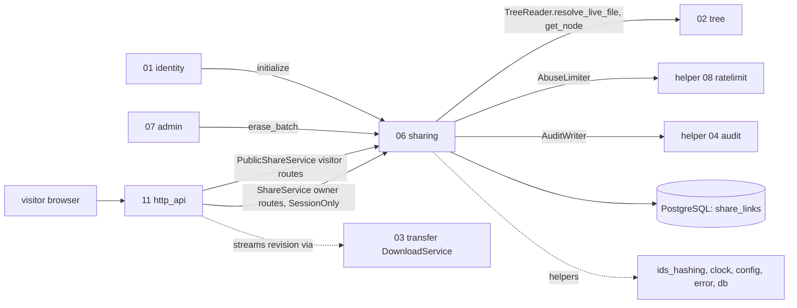
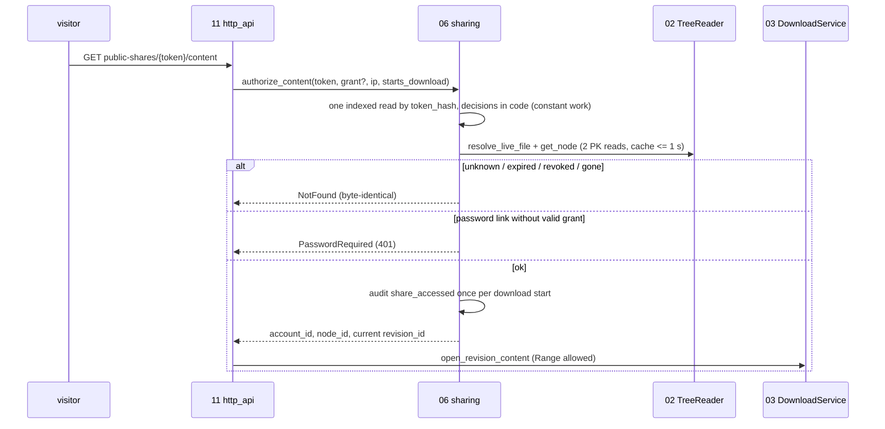

## Epic: 06 Sharing — Revocable share links for files

**epic_type**: component
**Local id**: E-16 (Jira id added later)

### Epic Summary

Build share links: create, list, revoke and resolve revocable links to a file for visitors without an account, with uniform not-found behaviour, optional Argon2id password, short-lived signed access grants, abuse limits and audit. The link opens in at most 2 s, follows its file across rename, move and save-in-place, and dies within 5 s of revoke or delete (AC-12, AC-34, AC-77).

### Problem / Context

v1.0 sharing between users is by link only; share links target files, not folders (decision 15). A visitor must learn nothing about whether a token exists, expired, was revoked or points at a deleted file, and the lookup must do the same work in each case (timing median within 1 ms). Tokens appear in URL paths, so log redaction in E-21 is a hard dependency. 06 never serves bytes: E-21 composes `authorize_content` with E-14's `DownloadService`. Revocation needs no grant table: `authorize_content` re-reads the link on each content request with a cache of at most 1 s.
Docs: `architecture.md`, `components/06_sharing/description.md`, `tests.md`, `data_model.md` (`share_links`), `system-flows.md` F11, `canonical-names.md` (vault files are not link-shareable in v1.2), ADR 015.

### System context

### Scope

**In Scope**:
- `ShareService` (`create`, `list`, `revoke`), token generation (`sc_shr_` + 256-bit) with SHA-256 at rest, expiry rules, optional Argon2id password.
- `PublicShareService` (`open`, `verify_password`, `authorize_content`): uniform `NotFound`, `PasswordRequired`, `RateLimited{retry_after}`, stateless `AccessGrant` = HMAC(`share_grant_key`, token_hash || expires_at).
- Per-link (10 wrong passwords / 10 min) and per-IP (100 invalid tokens / min) abuse counters, password-hash concurrency semaphore, audit events `share_created`, `share_revoked`, `share_accessed` (once per download start).
- `AccountLifecycleHook` (`erase_batch` deletes the account's links).

**Out of Scope**:
- Byte streaming, Range, `nosniff`/CSP and the inline allowlist (E-14, E-21); log redaction of `/public-shares/*` (E-21).
- Folder links and vault links; shared folders between accounts; access to the owner's identity or path by visitors.
- Session-only scope check on create (done at the boundary by E-15 `Authenticator::require` and E-21; `ShareService` receives a plain `AccountId`).

### Assumptions

- A link follows the node id, so moves and renames need no handling; purged targets remove links by `ON DELETE CASCADE`.
- `password_required` is HTTP 401 `{code: "password_required"}` (closes G-9).
- The single cross-account token lookup runs in the system RLS scope, confined to the lookup function.
- `share_grant_key` is a Docker secret; the server refuses to start without it. `ShareConfig` validation in the sharing crate is the single entry point (refuses missing, unreadable, empty or shorter than 32 bytes, naming `share_grant_key`); the `serve` composition root (E-22) calls it before binding the listener; E-01's secret loader checks only that the file exists and is readable (decided 2026-11-07, AZ-3695).
- Expiry boundary: `expires_at > now` is live, `expires_at <= now` is `NotFound`, time from the injectable clock (decided 2026-11-07, AZ-3695; written into the description).
- A correct password while the per-link wrong-password counter is limited gets `RateLimited{retry_after}`; the cost is that ten wrong guesses lock the link for the window, legitimate viewers included (decided 2026-11-07, AZ-3695, G-06-2).

### Dependencies

**Epic dependencies** (must be completed first):
- E-00 Bootstrap and Initial Structure (workspace, `contracts`, harness)
- E-01 Configuration (`share_default_ttl`, `share_max_ttl`, `share_lookup_cache`, `share_grant_ttl`, limits, Argon2 parameters, `share_grant_key`)
- E-02 Error model (typed results, problem codes)
- E-03 Clock (expiry, windows, skew tests NFT-RES-25)
- E-04 IDs and hashing (token generation, SHA-256, constant-time compare)
- E-06 Database access and migrations (`share_links`, composite FK to `nodes`, system scope lookup)
- E-07 Audit log (share events, abuse trips)
- E-08 Abuse rate limiting (`AbuseLimiter`)
- E-09 Observability
- E-13 Tree (`TreeReader::resolve_live_file`, `get_node`; integration tests run against the real tree, no fake store)

**External dependencies**: PostgreSQL 18; REF-SRV for timing-uniformity measurements (PT-06-2, NFT-SEC-17); DS-03 photo for AT-06-1.

### Effort Estimation

**T-shirt size**: M
**Story points range**: 27-36 (planned child issues total 31)

### Users / Consumers

| Type | Who | Key Use Cases |
|------|-----|--------------|
| External | File owner (web session) | Create with TTL/password, list, revoke |
| External | Visitor without account | Open link, enter password, download |
| System | E-21 http_api | Owner and public routes, cookie for the access grant, log redaction |
| System | E-17 admin / E-15 identity | Erase hook |

### Interface specification

| Port | Method | Input -> Output | Errors |
|---|---|---|---|
| `ShareService` | `create` | `account, node, expires_in?, password?` -> `CreatedShare{id, token (once), url_path, expires_at, has_password}` | `TargetNotFound` (foreign, tombstoned, purged, random: identical), `TargetNotShareable` (folder; vault file), `ExpiryOutOfRange` (> `share_max_ttl` 365 d, <= 0) |
| | `list` | `account, node?` -> `[ShareInfo]` (no token) | none |
| | `revoke` | `account, share_id` -> `()` idempotent | `NotFound` |
| `PublicShareService` | `open` | `token, ip` -> `Available{name, size, media_type, expires_at}` \| `PasswordRequired` \| `NotFound` | `RateLimited{retry_after}` |
| | `verify_password` | `token, password, ip` -> `AccessGrant{value, expires_at}` | `NotFound`, `WrongPassword`, `RateLimited` |
| | `authorize_content` | `token, Option<AccessGrant>, ip, starts_download` -> `ShareContent{account_id, node_id, revision_id}` (current revision) | `NotFound`, `PasswordRequired`, `RateLimited` |
| `AccountLifecycleHook` | `initialize` (no-op), `erase_batch(account, limit)` | `EraseProgress{remaining}` | none |
| Requires | `TreeReader::{resolve_live_file, get_node}`; helpers `AbuseLimiter`, `AuditWriter`, `Clock`, `Db` | | |

HTTP (routed by E-21): `POST|GET /api/v1/shares` and `DELETE /api/v1/shares/{id}` (SessionOnly; device tokens get 403, AC-57); `GET /api/v1/public-shares/{token}`; `POST /api/v1/public-shares/{token}/password-verifications`; `GET /api/v1/public-shares/{token}/content`.

### Data flow

### Architecture notes

- ADR-015 (ports only, 06 depends on no component crate; 11 composes 06 and 03), ADR-014 (single documented cross-account lookup in system scope), ADR-005 (revision currency).
- Pins: `argon2` (Argon2id PHC), `hmac`/`sha2`, `subtle` for constant-time compare; sqlx 0.9; tokio 1.54.1+.
- Password verification is limited by a semaphore (`share_password_max_concurrency`) so hash cost cannot exhaust CPU; no hashing for tokens that do not exist.
- Config defaults: `share_default_ttl` 7 d, `share_max_ttl` 365 d, `share_lookup_cache` 1 s, `share_grant_ttl` 10 min, `share_wrong_password_limit` 10 per 10 min, `share_invalid_token_limit` 100/min/IP.

### Non-functional requirements

| Requirement | Target | Failure threshold | Source |
|---|---|---|---|
| `open` p95 | 10 ms | 50 ms | PT-06-1 |
| `authorize_content` p95 (cache miss, 2 PK reads) | 15 ms | 60 ms | PT-06-1 |
| Link opens end to end | <= 2 s | AC-12 | AT-06-1 |
| Timing difference between missing/expired/revoked | median <= 0.3 ms | 1 ms; response inequality 0 | PT-06-2, NFT-SEC-17 |
| `open` p95 during a 1,000-concurrent wrong-password flood | 50 ms | 200 ms; CPU <= permits x 1 core | PT-06-3 |
| Revocation / delete visible | <= 5 s | longer | IT-06-7, AC-77 |
| DB connections | <= 12 | above | PT-06-1 |

### Requirements

**Functional**: default expiry 7 days, maximum 365 days; one `NotFound` variant for unknown, expired, revoked, tombstoned or purged; `authorize_content` returns the current revision so save-in-place keeps the link alive (AC-34); the 11th wrong password in 10 minutes is `RateLimited` with `retry_after`; a correct password while the per-link counter is limited behaves per the closed gap decision; only one `share_accessed` audit event per download start.
**Non-functional**: see table.
**Security / Compliance**: token and password never stored in plaintext or logged; grants cannot be forged, transplanted or extended (ST-06-4); visitors see only name, size, type and expiry, never owner, account id or path; two-account owner matrix (AC-59); audit with IDs only; audit write failure is logged and does not leak into the response.

### Design & Architecture

- Architecture doc: `_docs/02_document/architecture.md`
- Component spec: `_docs/02_document/components/06_sharing/description.md`; tests: `.../tests.md`
- System flows: `_docs/02_document/system-flows.md` (F11); security notes NFT-SEC-16..19

### Testing strategy

Integration against real PostgreSQL 18 and the real E-13 tree behind `TreeReader`; short TTLs and windows; manual clock.
- Integration: IT-06-1 create/list/revoke, 2 `open` outcomes, 3 password verification and grant, 4 current revision on `authorize_content`, 5 link follows rename and move, 6 delete/revive/purge, 7 expiry and revocation timing, 8 abuse limits, 9 constant-work lookup, 10 erase hook, 11 audit events and audit failure, 12 grant key required at start (component test against `ShareConfig` validation).
- Performance: PT-06-1..3. Security: ST-06-1 cross-account owner operations, 2 token strength and storage, 3 enumeration, 4 grant forgery and replay, 5 password storage and DoS, 6 wrong-password limit bypass, 7 visitor disclosure, 8 RLS and the single cross-account lookup. Acceptance: AT-06-1 share a photo, AT-06-2 password link, AT-06-3 survives edits and moves, dies with delete.
- System scenarios: FT-P-36..39, 57; FT-N-09..11, 24, 44; NFT-SEC-06, 07, 13, 16..19, 27; NFT-RES-25.

### Definition of Done

- [ ] `ShareService`, `PublicShareService` and the hook implemented in the `sharing` crate and registered in `contracts`
- [ ] Automated tests pass (IT/ST/AT above; unit tests for HMAC grant, token format, expiry boundaries)
- [ ] Coverage >= 90% on lookup, password, grant, authorize paths (critical: security) and >= 75% overall
- [x] G-06-2, G-06-3 and the grant-key entry point written back into the component description
- [ ] Log redaction of `/public-shares/*` verified with E-21 (NFT-SEC-16)

### Acceptance Criteria

| # | Criterion | Measurable Condition |
|---|-----------|---------------------|
| 1 | AC-12: opens <= 2 s, 7-day default, revoke <= 5 s, hashed tokens, uniform missing | IT-06-1, 2, 6, 7, 9; PT-06-2 median diff <= 1 ms; AT-06-1 |
| 2 | AC-20: password and invalid-token limits | IT-06-8: 11th wrong password in 10 min gives `RateLimited`; ST-06-6 no bypass |
| 3 | AC-34: link survives save-in-place | IT-06-4, AT-06-3 |
| 4 | AC-77: follows rename/move; delete is missing within 5 s | IT-06-5, IT-06-6 |
| 5 | AC-47: media type from the sniffed current revision | IT-06-2 |
| 6 | AC-57: create is session-only | System FT-N-24, NFT-SEC-07 (scope check at the boundary) |
| 7 | AC-59: two-account matrix | ST-06-1, ST-06-8 |
| 8 | AC-27: account deletion removes links | IT-06-10 |
| 9 | Token cannot be recovered from DB or logs | ST-06-2: 0 plaintext tokens in any column or log |

### Risks & Mitigations

| # | Risk | Mitigation | Owner |
|---|------|------------|-------|
| 1 | Path-borne tokens leak through access logs | E-21 redacts `/public-shares/*` segments (NFT-SEC-16) | Epic owner |
| 2 | Constant-work lookup depends on a measured timing on the reference server | PT-06-2 on REF-SRV; `NOT-RUN(HW-REF)` until provisioned (R03) | Owner (hardware) |
| 3 | Argon2id cost DoS | Concurrency semaphore, no hashing for unknown tokens, PT-06-3 | Epic owner |
| 4 | Vault files must not be link-shared (v1.2); how 06 learns it is undefined | `TargetNotShareable`; decide with E-30 (owner item "Vault membership") | Product owner |
| 5 | Erase hook ordering: links must stop first | E-17 registers 06 first; a tombstone behaves as missing meanwhile | Epic owner |
| 6 | R09 tenant isolation | Single documented cross-account lookup; RLS elsewhere (ST-06-8) | Epic owner |

### Labels

- `sunnycloud`
- `component:sharing`

### Child Issues

| Type | Title | Points |
|------|-------|--------|
| Spike | Close G-06-2 (correct password while link counter limited), G-06-3 (expiry boundary) and name the grant-key validation entry point (IT-06-12 was BLOCKED, resolved 2026-11-07); cites `tests/spec-gaps.md` | 2 |
| Enabler | `sharing` crate skeleton, `share_links` migration coordination, config section, secret loading for `share_grant_key` | 2 |
| Task | `ShareService` create/list/revoke with token and password hashing (IT-06-1) | 3 |
| Task | Constant-work token lookup and `open` outcomes with uniform `NotFound` (IT-06-2, 9) | 5 |
| Task | `verify_password` with Argon2id semaphore and HMAC `AccessGrant` (IT-06-3, ST-06-4, 5) | 5 |
| Task | `authorize_content` with 1 s cache, current revision, `starts_download` audit rule (IT-06-4..7, 11) | 3 |
| Task | Abuse counters wiring with E-08 and trip auditing (IT-06-8, ST-06-6) | 3 |
| Task | `AccountLifecycleHook` erase (IT-06-10) | 1 |
| Task | Security and performance suites ST-06-1..8, PT-06-1..3 | 5 |
| Task | Acceptance AT-06-1..3 and timing measurement on REF-SRV | 2 |
