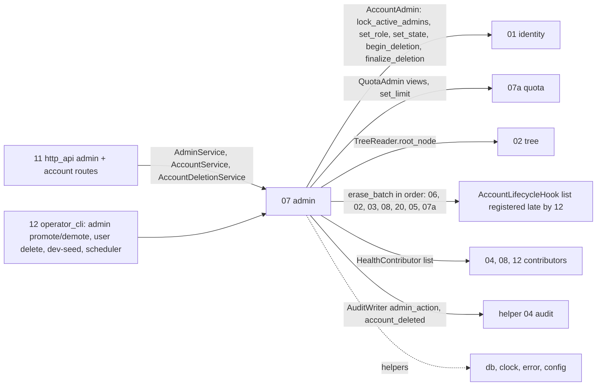
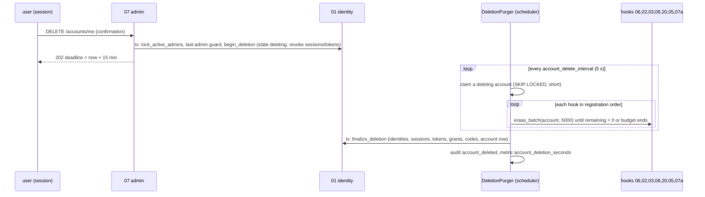

## Epic: 07 Admin — Users, invites, account deletion and last-admin protection

**epic_type**: component
**Local id**: E-17 (Jira id added later)

### Epic Summary

Build the admin and account-lifecycle layer: user listing with usage, role, state and quota changes, the rule that the last active admin can never be demoted, disabled or deleted, account self-view and self-deletion, the `DeletionPurger` that erases an account across all components within 15 minutes, health aggregation and dev-seed. It is the orchestrator that makes "delete my account" and "manage my users" safe.

### Problem / Context

07 was split from the old `07_admin_quota` to break a cycle (02 -> 07 -> 02); the quota ledger is now E-11. 07 owns no tables: it sits above 01 and 07a and reaches every other component through `contracts` ports only (ADR-015). Account deletion is immediate (retention does not apply, AC-30) and must leave zero rows, blob files, shares and sessions within 15 minutes (AC-27). Each component implements `AccountLifecycleHook::erase_batch`; 07 drives them in registration order until every hook reports `remaining = 0`, then calls `AccountAdmin::finalize_deletion`. The last-admin rule is decision 15.
Docs: `architecture.md` (Dependency rule), `components/07_admin/description.md`, `tests.md`, `system-flows.md` F13, `canonical-names.md` (hooks and operator commands), ADR 015.

### System context

### Scope

**In Scope**:
- `AdminService`: `list_users` (accounts from 01, usage from 07a `views`, two calls, no cross-owner SQL), `update_user` (role/state), `set_quota`, `health`; `Actor::Admin(principal)` or `Actor::Operator`.
- Last-admin guard: `lock_active_admins` then guard then mutation in one short transaction; same guard for admin route, self-deletion and operator commands.
- `AccountService::view/quota_view`; `AccountDeletionService::request` (session-only, confirmation, `LastAdmin`, returns `deadline`).
- `DeletionPurger` (`Janitor`): claims `deleting` accounts, walks the hook list, time budget per cycle, finalizes, audits `account_deleted`.
- `HealthContributor` aggregation with per-check timeout; `DevSeed` (refuses production); `admin_action` audit for every mutation.

**Out of Scope**:
- The quota ledger (E-11), session cap and floor (E-14/E-10), billing, organizations, user-facing trash.
- `/healthz`, `/metrics` (E-21); restore and scrub commands, scheduler, composition root (E-22).
- Invite service (owned by E-15; routed under the admin group in E-21).

### Assumptions

- The hook list and cleanup lists are passed to the `DeletionPurger` constructor by the composition root (late registration; gap-pass default).
- `LastAdmin` maps to HTTP 409; `InvalidLimit` bounds are defined in E-11.
- Concurrent purger runs on one account are prevented by claiming the `deleting` account row with `FOR UPDATE SKIP LOCKED`, and the claim must not span the idle time of a cycle (short-transaction rule); decided 2026-11-07 (G-07-2): per-step claim, no lease column; each purger step takes the lock via the proposed `AccountAdmin::lock_deleting(tx, account) -> bool` in its own short transaction.
- Deleted data is removed immediately; older backups still contain it (privacy text).
- Tree's `remaining` includes the account's blobs the GC sweeper has not removed yet, so finalize waits for files.

### Dependencies

**Epic dependencies** (must be completed first):
- E-00 Bootstrap and Initial Structure (workspace, `contracts` incl. `AccountLifecycleHook`, `HealthContributor`, `Janitor`)
- E-01 Configuration (`account_delete_batch_size`, `account_delete_interval`, `account_delete_alert_after`, `account_delete_deadline`, `health_check_timeout`, `admin_list_page_size`)
- E-02 Error model (`LastAdmin` 409, `ConfirmationMismatch`, `Forbidden`)
- E-03 Clock (deadline, alert thresholds)
- E-06 Database access and migrations (short-tx runner, system scope)
- E-07 Audit log (`admin_action`, `account_deleted`)
- E-09 Observability (`account_deletion_seconds`, janitor lag)
- E-11 Quota (`QuotaAdmin`, hook run last)
- E-12 Sync feed (hook run second to last; held polls end through revalidation)
- E-13 Tree (`TreeReader::root_node`, tree hook, `GcQueue` drain)
- E-14 Transfer (hook for sessions, staged rows, receipts)
- E-15 Identity (`AccountAdmin` incl. `begin_deletion` and `finalize_deletion`)
- E-16 Sharing (hook run first so links stop at once)

**Port counterparts in higher epics** (traits in `contracts`): hooks of E-18 media_jobs and E-30 vault_service (stub), `HealthContributor` impls of E-10, E-18, E-22. Integration tests for the full hook chain (IT-07-9, AT-07-1) run after E-18; E-30 is a v1.2 stub.
**Proposed `contracts` change tasks** (spike AZ-3814, decided 2026-11-07; module-layout Rule 6; no tracker key yet). E-17/c05 (AZ-3819 deletion request) and E-17/c06 (AZ-3820 purger) list all three as dependencies and do not start before they are accepted:
- CC-1, E-15 (01 identity): `AccountAdmin::lock_deleting(tx, account) -> bool`, the per-step `FOR UPDATE SKIP LOCKED` claim of the `deleting` row (G-07-2; no lease column).
- CC-2, E-17: `AccountDeletionService::request_as_operator(account) -> DeletionAccepted{deadline}` for `admin user delete --yes`; `request` unchanged.
- CC-3, E-17 (E-17/c01 AC-4, already planned): `AdminError::Forbidden` on all four `AdminService` operations (non-admin gets 403, G-S6).

**External dependencies**: PostgreSQL 18; DS-29 (500 accounts); a populated large account for PT-07-2.

### Effort Estimation

**T-shirt size**: L
**Story points range**: 28-38 (planned child issues total 33)

### Users / Consumers

| Type | Who | Key Use Cases |
|------|-----|--------------|
| External | Admin (web) | User list with usage, role/state/quota, health |
| External | Any user (web session) | View account, delete account with confirmation |
| System | E-21 http_api | `/accounts/me`, `/admin/users`, `/admin/health` routes |
| System | E-22 operator_cli | `admin promote/demote`, `admin user list/set-quota/delete`, `admin dev-seed`; scheduler runs the purger |
| System | All hook implementers | `erase_batch` driven by the purger |

### Interface specification

| Port | Method | Input -> Output | Errors |
|---|---|---|---|
| `AdminService` | `list_users(page)` | -> `[AdminUserView{account, role, state, last_login, used, limit}]` | none |
| | `update_user(account, role?, state?)` | one tx: `lock_active_admins`, guard, `set_role`/`set_state` (01 revokes sessions/tokens on disable) | `LastAdmin` (409), `NotFound` |
| | `set_quota(account, limit)` | -> `QuotaAdmin.set_limit` | `NotFound`, `InvalidLimit` |
| | `health()` | -> `HealthReport` from contributors (database, blob volume vs floor, master key, scrub result, dead jobs, janitor lag) | none |
| `AccountService` | `view(principal)` -> `AccountView{id, display_name, role, identities, quota, root_node_id}`; `quota_view` | | |
| `AccountDeletionService` | `request(principal, confirmation)` -> `DeletionAccepted{deadline}` | | `Forbidden` (device token), `LastAdmin`, `ConfirmationMismatch` |
| `Janitor` | `DeletionPurger::run_cycle(now)` | per `deleting` account: hooks in order, `erase_batch(account, batch)` until `remaining = 0` or the budget ends; then `finalize_deletion` + audit | failed batch logged with account id and hook position, retried next tick |
| `DevSeed` | `seed` | refuses `environment = production` | |
| Requires | `AccountAdmin`, `AccountLifecycleHook` list, `QuotaAdmin`, `TreeReader`, `HealthContributor` list | | |

HTTP (routed by E-21): `GET|DELETE /api/v1/accounts/me` (DELETE SessionOnly, body `{confirmation}`, 202 with deadline), `GET /accounts/me/quota`, `GET /admin/users`, `PATCH /admin/users/{id}`, `PUT /admin/users/{id}/quota`, `GET /admin/health`.

### Data flow

### Architecture notes

- ADR-015 (ports only), ADR-014 (system scope for janitor, RLS), ADR-002 (purger runs in the single API process), ADR-003 (blobs queued with `Due::Now` in the same transaction as the row delete).
- Hook order matters: 06 first (links stop), then 02, 03, 08, 20, and 05, 07a last because the tree's batches still stamp the feed and adjust usage. A hook missing from the list leaves rows behind silently; NFT-SEC-27 counts rows.
- No tables, no cache, stateless; each health check has its own timeout. Pins: sqlx 0.9, tokio 1.54.1+.
- Config defaults: batch 5000, interval 5 s, alert after 10 min, deadline 15 min.

### Non-functional requirements

| Requirement | Target | Failure threshold | Source |
|---|---|---|---|
| Admin listing, page of 20 with 500 accounts, p95 / p99 | 30 ms / 60 ms | 100 ms / 200 ms | PT-07-1, AC-1 |
| Large account: request to finalize | 5 min | 15 min (AC-27) | PT-07-2 |
| Longest purger transaction | 2 s | 10 s | PT-07-2 |
| Other accounts' commit p95 during a purge | within 20% of baseline | 2x baseline | PT-07-2 |
| Requests fail after deletion request | <= 5 s | longer | AC-21, IT-07-8 |
| Alert | deletion past 10 min | n/a | `account_delete_alert_after` |

### Requirements

**Functional**: two concurrent demotions cannot both pass; the same guard serves route, self-deletion and CLI; deletion request does only `begin_deletion` (no other work); purger is idempotent per step and resumes by query after a crash at any hook position; drains until nothing is due within a per-cycle time budget; two overlapping purgers cannot process one account; dev-seed refuses production.
**Non-functional**: see table.
**Security / Compliance**: admin role is checked from the session principal on every call (`Scope::Admin`; device tokens never satisfy it); deletion is session-only with explicit confirmation; no PII in audit `detail` (actor, subject id, action code only); admin routes belong to the generated two-account matrix (non-admin 403, other account 404, AC-59).

### Design & Architecture

- Architecture doc: `_docs/02_document/architecture.md`
- Component spec: `_docs/02_document/components/07_admin/description.md`; tests: `.../tests.md`
- System flows: `_docs/02_document/system-flows.md` (F13 account deletion); `canonical-names.md` (hook ports)

### Testing strategy

Integration with real components behind the ports (fakes only in unit tests); real PostgreSQL 18; short intervals.
- Integration: IT-07-1 listing and paging, 2 role/state/quota changes, 3 last-admin on every mutation, 4 concurrent demotions, 5 mixed delete/disable/demote races, 6 health aggregation, 7 `AccountService` views, 8 deletion request, 9 purger drains every hook and finalizes last, 10 resume after a failed batch at each hook position, 11 time budget and batch bound, 12 two purgers overlap, 13 janitor with nothing to do, 14 `DevSeed`.
- Performance: PT-07-1, PT-07-2. Security: ST-07-1 non-admin/foreign calls, 2 deletion is session-only with confirmation, 3 demotion cannot be raced, 4 no PII in audit/logs. Acceptance: AT-07-1 deleting leaves nothing behind, AT-07-2 the last admin cannot be removed by any route.
- System scenarios: FT-P-19, 65; FT-N-20, 21, 30, 40; NFT-RES-30; NFT-SEC-08, 13, 20, 27; NFT-PERF-01.

### Definition of Done

- [ ] All ports implemented in the `admin` crate; `DeletionPurger` registered as a `Janitor` by E-22 with the full hook list
- [ ] Automated tests pass (IT/ST/AT; unit tests for the guard under two concurrent demotions and purger resume at each step)
- [ ] Coverage >= 90% on guard, deletion request and purger (critical: data loss, security) and >= 75% overall
- [ ] NFT-SEC-27 row count after deletion is 0 for every table, including after a crash mid-purge
- [ ] OpenAPI for admin/account routes reviewed with E-21; privacy text mentions backups

### Acceptance Criteria

| # | Criterion | Measurable Condition |
|---|-----------|---------------------|
| 1 | AC-27 / AC-30: account deletion leaves zero rows, blob files, shares and sessions within 15 min, immediate (no retention) | AT-07-1, IT-07-9, PT-07-2 request to finalize <= 5 min (fail 15 min) |
| 2 | AC-21: deleted account's requests fail within 5 s | IT-07-8 `Authenticator` rejects sessions/tokens after `request`; held poll end covered by FT-N-30 |
| 3 | AC-23: the last active admin cannot be demoted, disabled or deleted by any route or command | IT-07-3..5, ST-07-3, AT-07-2: 0 successful removals under races |
| 4 | AC-1: 500 users via admin tooling | PT-07-1 p95 page <= 30 ms (fail 100 ms) |
| 5 | AC-59: admin routes in the matrix | ST-07-1: non-admin 403 `forbidden`, foreign 404 (G-S6 resolved 2026-11-07) |
| 6 | AC-57: device tokens cannot delete the account | ST-07-2 |
| 7 | Purger idempotent and resumable | IT-07-10 (crash at each hook position), IT-07-12 overlap |
| 8 | Admin health shows degraded when a component reports it | IT-07-6 (slow contributor times out) |

### Risks & Mitigations

| # | Risk | Mitigation | Owner |
|---|------|------------|-------|
| 1 | Large-account deletion time depends on E-10 GC throughput (R12) | Drain-until-empty within budget, GC `Due::Now`, PT-07-2 | Epic owner |
| 2 | A hook missing from the late-registered list leaves rows behind | NFT-SEC-27 counts rows; composition-root test asserts the full list | Epic owner |
| 3 | Hook order: 05 and 07a must run last | Order asserted in IT-07-9 | Epic owner |
| 4 | Claiming the account row for a whole cycle breaks the short-transaction rule | Resolved 2026-11-07 (G-07-2): per-step `FOR UPDATE SKIP LOCKED` claim in its own short transaction, no lease column | Epic owner |
| 5 | Slow health contributor blocks the page | Per-check timeout (`health_check_timeout`) | Epic owner |
| 6 | Sole-admin reset (G-12-3) decided 2026-11-11 (AZ-3681, owner): allowed, no `LastAdmin`; non-admin status resolved 2026-11-07 (G-S6): 403 `forbidden`, another account's id 404 | none | Product owner |
| 7 | KNOWN RISK (G-07-2): hooks run on their own connections; a hook inserting a row with a foreign key to `accounts` takes `FOR KEY SHARE` on the `deleting` row, which the purger's `FOR UPDATE` blocks (self-deadlock). `FOR NO KEY UPDATE` avoids it. Owner asked; open | E-17/c06 confirms no deadlock in IT-07-9 (use `FOR NO KEY UPDATE` if it shows) | E-17 / E-15 owners |

### Labels

- `sunnycloud`
- `component:admin`

### Child Issues

| Type | Title | Points |
|------|-------|--------|
| Spike | Choose purger claim mechanism (per-step `SKIP LOCKED` claim vs lease column, G-07-2 default) and close G-S6 (403 vs 404 for admin-only ops by non-admins); cites `tests/spec-gaps.md`. Decided 2026-11-07 (AZ-3814): per-step claim via `lock_deleting`, no lease column; non-admin 403, other account 404; confirmation = own account id; operator method `request_as_operator` | 2 |
| Enabler | `admin` crate skeleton, config section, constructor wiring for hook/cleanup/health lists | 2 |
| Task | `AdminService` list_users, update_user, set_quota with `admin_action` audit (IT-07-1, 2) | 3 |
| Task | Last-admin guard in one transaction with `lock_active_admins`, concurrency suite (IT-07-3..5, ST-07-3) | 5 |
| Task | `AccountService` and `AccountDeletionService::request` (IT-07-7, 8, ST-07-2) | 3 |
| Task | `DeletionPurger`: claim, hook walk, budget, resume, finalize, audit (IT-07-9..13) | 5 |
| Task | Health aggregation with per-check timeout and `HealthContributor` registry (IT-07-6) | 3 |
| Task | `DevSeed` with production refusal (IT-07-14) | 2 |
| Task | Security suite ST-07-1, 2, 4 and acceptance AT-07-1, AT-07-2 | 3 |
| Task | Performance suite PT-07-1, PT-07-2 on a large account | 3 |
| Task | Integration pass of the full hook chain against real E-18 (and E-30 stub) | 2 |
