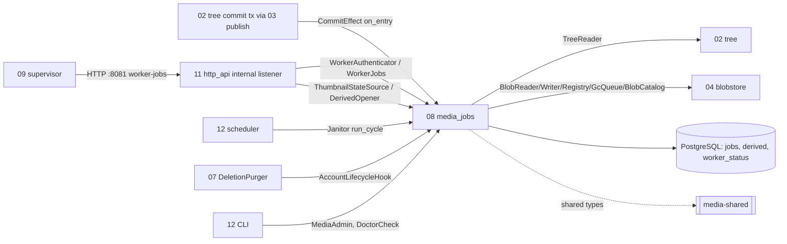
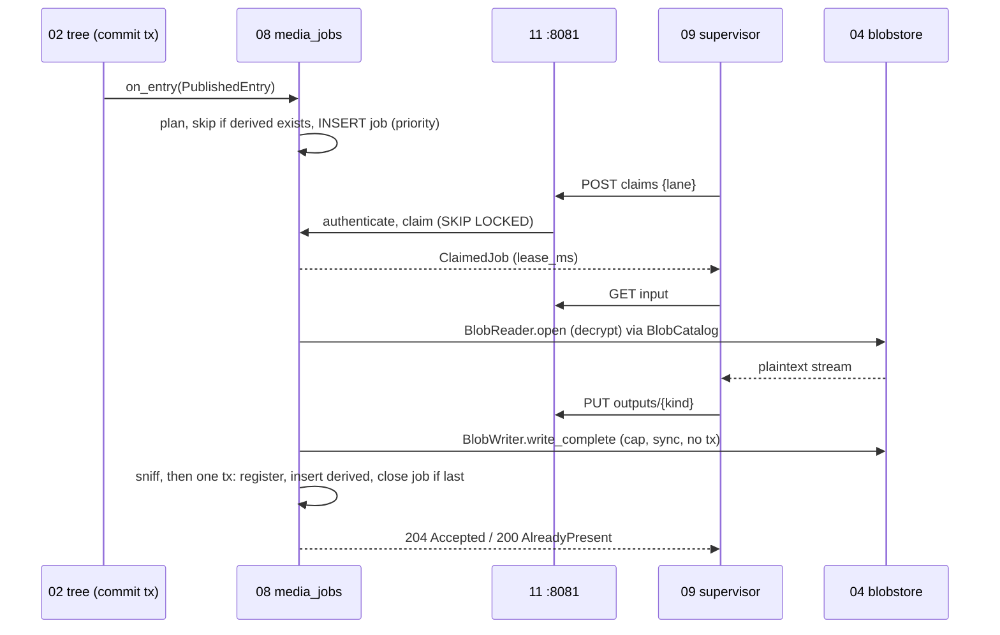

## Epic: 08 Media Jobs — Job queue, derived files and worker-facing API

**Epic id**: E-18 (local id; the Jira key is added when the parent creates the issue)

**epic_type**: component

### Epic Summary

Build the API-side owner of all media work: plan thumbnail and transcode jobs inside the commit transaction, run the Postgres `jobs` queue (`SKIP LOCKED`), accept worker results safely and idempotently as encrypted `derived` files, and serve them back. Without it no photo gets a thumbnail and no video is transcoded (AC-10, AC-11), and the workers have no way to reach any data (S4-1).

### Problem / Context

Thumbnails and transcodes are produced by untrusted parsers (ffmpeg, libvips, libheif). Per ADR-009 the supervisor (E-20) has no database login, no blob mount and no master key, so someone inside the API must own the queue SQL, the lease rules, the decrypted-input stream and the acceptance of outputs. That owner is component 08, crate `media-api`, plus the shared crate `media-shared` (types, policy, decoder protocol; no sqlx). Architecture: `_docs/02_document/architecture.md` (Component list, Dependency rule, section 7); component spec `_docs/02_document/components/08_media_jobs/description.md`; flow F10 in `system-flows.md`.

### System context

### Scope

**In Scope**:
- Job planning at commit (`MediaEnqueueEffect`), lanes `image`/`video`, priority 0 (interactive) / 1 (bulk), idempotent enqueue on `(account_id, kind, content_hash, params_version)`.
- Claim, lease extension, release, skipped/obsolete close, failure with API-clock backoff, reaper, terminal purge, requeue of dead jobs.
- `derived` storage: `accept_output` (streamed, size-capped, sniffed, one short transaction), `open_input` (decrypted original), exactly one derived file per key (AC-71).
- Thumbnail state for listings, derived serving (`open_derived`, `open_derived_for`), never SVG, never falling back to the original.
- Worker token authentication (`WorkerAuthenticator`), `worker_status`, doctor and health contributions.
- `media-shared` crate: `types`, `policy` (compliance, remux/transcode decision, poster offset), `params_version` constants.
- Janitors `JobReaper`, `DerivedJanitor`; `BlobOwnerCleanup` for derived rows; `AccountLifecycleHook`; `MediaAdmin` (requeue, stats).

**Out of Scope**:
- Decoder sandbox, ffmpeg/vips invocation, scratch files (E-19, E-20).
- Encryption and file I/O (E-10), download streaming and Range (E-14), which revision is current (E-13), quota (derived does not count, E-11), scheduling (E-22), HTTP routing and the wire layer (E-21), share-token authorisation (E-16).

### Assumptions

- One API process (decision 12); `:8081` is plaintext on the internal Compose network.
- `jobs` and `worker_status` are system-scope tables reached only through `Db::run_system` (helper 07).
- 500 users x 40 photos/day gives about 20 k jobs/day and about 280 k terminal rows at 14-day retention (about 60 MB); claim polling is about 4 requests/s for two slots.

### Dependencies

**Epic dependencies** (must be completed first):
- E-00 Bootstrap & Initial Structure (workspace, `contracts` and `media-shared` crate skeletons, CI).
- E-01 Configuration, E-02 Error model, E-03 Clock, E-06 Database access and migrations, E-07 Audit log, E-09 Observability (cross-cutting).
- E-10 04_blobstore (`BlobReader`, `BlobWriter`, `BlobRegistry`, `GcQueue`, `BlobCatalog`, `BlobRef`).
- E-13 02_tree (`TreeReader`: `resolve_live_file`, `get_revision`, `is_current_or_retained`).
- E-14 03_transfer (supplies the `CommitEffect` per `publish`; downloads stream the `BlobRef`).

**External dependencies**:
- PostgreSQL 18 with roles `sunnycloud_migrator` and `sunnycloud`; test blob volume (XFS) and a per-run master key for the integration harness H1.

### Effort Estimation

**T-shirt size**: L
**Story points range**: 40-48 (planned child total: 44)

### Users / Consumers

| Type | Who | Key Use Cases |
|------|-----|--------------|
| System | E-21 http_api | Internal worker routes, thumbnail, transcode and `thumbnail-states` routes |
| System | E-20 worker_supervisor | Claim, heartbeat, fetch input, post outputs, fail, report status |
| System | E-13 02_tree / E-14 03_transfer | `CommitEffect` in the commit transaction; `ThumbnailStateSource` in listings |
| System | E-22 operator_cli | Scheduler (janitors), `admin media-requeue`, `admin media-stats`, `doctor` |

### Requirements

**Functional**:
- `JobPlanner::plan` (pure): photo gives one `stills` job (`thumb` 320 px + `preview` 1440 px, one fetch); video gives one `poster` and one `transcode` job; vault, SVG, unknown, zero-byte and unsupported give none; skip when every output already has a `derived` row.
- Claim orders by `priority, available_at`, never crosses lanes, sets `running`, `attempts + 1`, `leased_by`, returns `lease_ms`; it first marks `dead` any expired-lease job with exhausted attempts.
- `accept_output` is idempotent: a second identical result answers `AlreadyPresent` and schedules the surplus blob with `GcQueue Due::Now`; `succeeded/derived` is written only here, once every expected output exists.
- Job-scoped calls require `running`, `leased_by` the caller, unexpired lease; otherwise `LeaseLost` (409 `lease_lost`).
- Output type is sniffed (WebP or JPEG for `thumb`/`preview`, MP4 for `transcode`); the worker is never trusted on type or size.

**Security / Compliance**:
- Worker token compared as SHA-256 digests in constant time (`worker_api_token`, optional `worker_api_token_next` during rotation); every auth failure is the same `Forbidden`; secrets never logged.
- Internal routes exist only on the internal listener; the public path answers 404 (AC-79); a non-holder gets 409, never data.

### Interface specification

**Provided ports** (declared in `contracts`)

| Port | Methods | Consumers |
|---|---|---|
| `CommitEffect` (impl `MediaEnqueueEffect`) | `on_entry(tx, &PublishedEntry)`, `on_batch(tx, &[PublishedEntry])` (no-op) | E-13/E-14, inside the commit transaction |
| `ThumbnailStateSource` | `states(account, [content_hash]) -> Map<hash, Ready \| Pending \| Failed \| None>` | E-13 listing, E-21 |
| `DerivedOpener` | `open_derived(account, node, kind)`, `open_derived_for(live_file, kind)` -> `BlobRef \| NotReady \| NotFound` | E-21 |
| `WorkerAuthenticator` | `authenticate(bearer) -> Result<WorkerIdentity, WorkerAuthError>` | E-21 internal listener |
| `WorkerJobs` | `claim`, `extend_lease`, `release`, `complete_skipped`, `fail`, `open_input`, `accept_output`, `record_status` | E-21 internal routes |
| `AccountLifecycleHook` | `initialize` (no-op), `erase_batch(account, limit) -> EraseProgress{remaining}` | E-17 `DeletionPurger` (registered by E-22) |
| `MediaAdmin` | `requeue_dead(filter)`, `stats()` | E-22 |
| `BlobOwnerCleanup` | `remove_owner_rows(tx, blob_id)` for derived rows | E-10 GC |
| `Janitor` x2 | `JobReaper`, `DerivedJanitor`: `name()`, `run_cycle(now)` | E-22 scheduler |
| `HealthContributor`, `DoctorCheck` | dead jobs, queue depth, worker status | E-17, E-22 |

**`JobQueue` repository (system scope)**

| Method | Output | Notes |
|---|---|---|
| `enqueue_in_tx(tx, JobSpec, priority)` | `Enqueued \| AlreadyExists` | `ON CONFLICT DO NOTHING` on the unique key |
| `claim(lane, worker_id)` | `Option<ClaimedJob{job_id, kind, content_hash, params_version, attempt, lease_ms}>` | one statement, `SKIP LOCKED` |
| `extend_lease(job_id, worker_id)` | `Extended \| LeaseLost` | heartbeat |
| `complete_skipped(job_id, worker_id, outcome)` | `()` | `skipped_compliant \| obsolete`, no derived row |
| `fail(job_id, worker_id, code, Retry\|Permanent)` | `Requeued \| Dead` | backoff doubles from `job_retry_backoff`; `last_error` bounded to 500 chars |
| `release(job_id, worker_id)` | `()` | back to `queued`, `attempts - 1` |
| `reap(now)` / `purge_terminal(before)` / `requeue_dead(filter)` | `ReapStats` / count / count | batched |

**`DerivedStore::accept_output`**: input `job_id, worker_id, kind, media_type, width?, height?, duration_ms?, body, length`; output `Accepted | AlreadyPresent`; errors `LeaseLost`, `RevisionObsolete`, `OutputTooLarge`, `OutputTypeRejected`, `OutputKindRejected`, `Storage`.

**Internal HTTP resources** (listener `:8081` only; headers `Authorization: Bearer`, `X-Worker-Id`; `Cache-Control: no-store`)

| Endpoint | Method | Result |
|---|---|---|
| `/api/v1/worker-jobs/claims` | POST `{lane}` | 200 `ClaimedJob` or 204 |
| `/api/v1/worker-jobs/{job_id}/lease` | PUT / DELETE | 200 `{lease_ms}` / 204; 409 `lease_lost` |
| `/api/v1/worker-jobs/{job_id}/input` | GET | 200 exact `Content-Length`; 404 `revision_obsolete`; 409 |
| `/api/v1/worker-jobs/{job_id}/outputs/{kind}` | PUT | 204 Accepted, 200 AlreadyPresent, 413, 422, 409, 404 |
| `/api/v1/worker-jobs/{job_id}/result` | PUT `{outcome}` | 204 |
| `/api/v1/worker-jobs/{job_id}/failure` | POST `{code, disposition}` | 200 `{result: requeued \| dead}` |
| `/api/v1/worker-jobs/status` | PUT `WorkerStatus{decoder_ok, image_age_days}` | 204 |

**Public resources owned here** (auth: session or device): `GET|HEAD /api/v1/nodes/{node_id}/thumbnail?size=small|preview`, `GET|HEAD /api/v1/nodes/{node_id}/transcode`, `POST /api/v1/thumbnail-states` (body at most 1,000 ids).

**`media-shared::policy`**: `is_compliant(&Probe)`, `decide(probe, caps, encoder_pref) -> SkipCompliant | Remux | Transcode(Plan)`, `poster_offset_ms(duration_ms)`, `supported_kinds_for(media_type)`.

### Data flow

### Architecture notes

- ADR-009 (API-only workers, no worker database login), ADR-015 (ports-only dependencies), ADR-003 (jobs table, no Redis), ADR-006 (derived blobs encrypted), ADR-010 (CPU-first; GPU v1.1), ADR-014 (system scope, roles).
- Technology: Rust, sqlx 0.9 (`SKIP LOCKED`), axum types stay in E-21; PostgreSQL 18; `media-shared` has no sqlx and no I/O (crate-graph test).
- Lane rule: `decoder-interactive` claims `image` only; `decoder-general` claims `video` and `image` with the first lane rotated per claim; priority ordering serves interactive jobs first.
- Config keys: `job_lease` 5m, `job_attempts` 3, `job_retry_backoff` 30s doubling, `bulk_queue_threshold` 200, `job_terminal_ttl` 14d, `job_reap_interval` 1m, `derived_janitor_interval` 1h, `worker_api_token(_next)`, `internal_addr`, `derived_max_thumb/preview/transcode` (5 MiB / 20 MiB / 10 GiB), `worker_status_interval` 30s.

### Non-functional requirements

| Requirement | Target | Failure threshold | Source |
|---|---|---|---|
| Claim latency p95 / p99 | 5 ms / 10 ms | 20 ms / 50 ms | PT-08-1 |
| Claim throughput, deep queue | 1,000 claims/s | below 300 claims/s | PT-08-1 |
| Interactive job passes a 10,000-job bulk backlog | claimed in 1 round (<= 500 ms) | 2 s; any bulk job claimed first = fail | PT-08-2, AC-10 |
| Input streaming rate | 112 MB/s or more | 90 MB/s | PT-08-3, AC-72 |
| API RSS growth while streaming | under 64 MiB | 200 MiB | PT-08-3 |
| Bulk 10,000 12 MP JPEGs | 15 min on the 4-core reference | above 15 min | NFT-PERF-14 |

### Design & Architecture

- Architecture doc: `_docs/02_document/architecture.md`
- Component spec: `_docs/02_document/components/08_media_jobs/description.md`; tests `.../08_media_jobs/tests.md`

### Testing strategy

- Harness H1 (component tests.md): Rust integration binary, real PostgreSQL 18, real E-10/E-13/E-14 ports, temp XFS blob dir, injectable clock, HTTP through a real `HttpServer` on `:8081`; short config (`job_lease=2s`, `job_attempts=3`, `bulk_queue_threshold=5`).
- Integration: IT-08-1 planning matrix, IT-08-2 idempotent enqueue, IT-08-3 bulk priority, IT-08-4 claim ordering and lanes, IT-08-5 claim concurrency, IT-08-6 lease expiry, IT-08-7 failure dispositions, IT-08-8 release and skip, IT-08-9 encrypted derived, IT-08-10 accept race, IT-08-11 rejections, IT-08-12 plaintext input, IT-08-13 no fallback, IT-08-14 thumbnail states, IT-08-15 erase hook and janitors, IT-08-16 uniform auth, IT-08-17 policy on real probes, IT-08-18 poster offset, IT-08-19 exhausted-lease claim (unblocked by the gap pass), IT-08-20 status, doctor, requeue, stats.
- Performance PT-08-1..3; security ST-08-1 credential confusion, ST-08-2 job-scoped authorization, ST-08-3 hostile output, ST-08-4 cross-account thumbnails; acceptance AT-08-1 (interactive thumbnail during bulk import), AT-08-2 (kill the supervisor mid-job).
- System scenarios: FT-P-20..27, FT-P-28 (v1.1), FT-P-39, FT-P-40, FT-N-06, FT-N-07, FT-N-08, NFT-PERF-13..21, NFT-RES-19, NFT-RES-23, NFT-RES-36, NFT-SEC-13, NFT-SEC-19, NFT-SEC-28, NFT-SEC-29, NFT-SEC-50, NFT-RES-LIM-04, NFT-RES-LIM-09.

### Definition of Done

- [ ] All in-scope capabilities implemented behind the `contracts` ports
- [ ] Automated tests pass (unit + integration IT-08-*, PT/ST/AT; blackbox scenarios via E-31)
- [ ] Coverage at or above 75% on business logic and 90% on `accept_output`, `claim` and worker auth (canonical: `quality-thresholds.mdc`)
- [ ] `media-shared` crate-graph test: no sqlx, no I/O; `media-api` has no HTTP types
- [ ] Metrics `jobs_queued`, `jobs_running`, `job_leases_expired_total`, `jobs_dead_total`, `job_duration_seconds{kind}`, `derived_bytes_total{kind}` exported

### Acceptance Criteria

| # | Criterion | Measurable Condition |
|---|-----------|---------------------|
| 1 | AC-10 interactive thumbnail not starved | AT-08-1 and PT-08-2: interactive job claimed first behind 10,000 bulk jobs; p95 thumbnail <= 5 s |
| 2 | AC-11 compliance and remux rule | IT-08-17: compliant clip is `SkipCompliant`, index-at-end clip is `Remux`, never re-encoded |
| 3 | AC-25 (API side) worker endpoints expose no secrets | ST-08-1..3 pass; no job or account data beyond bytes and `ClaimedJob` fields |
| 4 | AC-43 derived blobs encrypted | IT-08-9: stored derived file is ciphertext, plaintext hash matches after read |
| 5 | AC-44 derived storage budget | Policy constants snapshot (IT-08-17); NFT-PERF-20 ratio <= 20% |
| 6 | AC-45 attempts, lease, retry | IT-08-5..8: 3 attempts, 5 min lease (2 s in test), dead after exhaustion |
| 7 | AC-71 one derived file per key | IT-08-10 and AT-08-2: exactly one `derived` row and blob after any crash point |
| 8 | AC-72 worker fetch equals plaintext | IT-08-12, PT-08-3: BLAKE3 of fetched bytes equals the manifest |
| 9 | AC-79 worker endpoints | IT-08-16, ST-08-1: user and device tokens give uniform 403; public path 404 (IT-11-9) |
| 10 | AC-27 erase removes jobs and derived rows | IT-08-15: hook drains to `remaining = 0` |
| 11 | AC-47 thumbnails never SVG | IT-08-13: no derived row for SVG, no fallback to the original |

### Risks & Mitigations

| # | Risk | Mitigation | Owner |
|---|------|------------|-------|
| 1 | R03: AC-10/AC-11 unproven without reference hardware; bulk throughput was design-limited | One `stills` job and one fetch per photo, any-priority claim on the interactive slot, `video` lane; PT-08-2; provision REF-SRV before the perf gate | 08, 09 |
| 2 | R10: worker credential exposed on a plaintext port | `:8081` internal network only, never routed by Caddy, uniform 403, digest-only secrets | 08 |
| 3 | R12/R14: queue churn and janitor load share the API process | Index-only claim, batched purge, drain within a time budget, autovacuum tuning (data model section 9) | 08 |
| 4 | Listing latency from thumbnail-state probes | Two batched index probes, no join into the listing query; NFT-PERF-10 includes them; fall back to the separate `thumbnail-states` poll | 08 |
| 5 | Hostile supervisor posts oversized or mistyped output | Per-kind cap enforced while streaming, sniffed type, only expected kinds of a held job | 08 |

### Labels

- `sunnycloud`
- `component:media_jobs`
- `release:v1.0`
- `type:platform`

### Child Issues

| Type | Title | Points |
|------|-------|--------|
| Spike | Settle `thumbnail-states` foreign-id shape and over-1,000 status (G-08-3) and `Range` on worker `GET input` (G-08-4); record in `tests/spec-gaps.md` | 2 |
| Enabler | `media-shared` crate: `types`, worker DTOs, `Params[params_version]` constants, crate-graph test | 3 |
| Task | `media-shared::policy`: `is_compliant` (decimal, inclusive 10 Mbit/s), `decide`, `poster_offset_ms`, `supported_kinds_for` with table tests | 3 |
| Enabler | Migration and RLS notes for `jobs`, `derived`, `worker_status` with indexes | 2 |
| Task | `JobQueue`: enqueue, claim (dead-skip rule), lease, release, skip, fail with backoff, reap, purge, requeue | 5 |
| Task | `JobPlanner` and `MediaEnqueueEffect` (lanes, bulk threshold, derived skip, vault flag) | 3 |
| Task | `DerivedStore::accept_output` and `open_input` (stream cap, sniff, short tx, `AlreadyPresent`, GC of surplus) | 5 |
| Task | `WorkerAuthenticator`, `WorkerJobs` facade, `record_status`, uniform 403/409 semantics | 3 |
| Task | `ThumbnailStateSource` and `DerivedOpener` (`open_derived`, `open_derived_for`) | 3 |
| Task | `JobReaper`, `DerivedJanitor`, `BlobOwnerCleanup`, `AccountLifecycleHook` | 3 |
| Task | `MediaAdmin`, `HealthContributor`, `DoctorCheck` worker-status levels, metrics | 2 |
| Task | Integration suite IT-08-1..20 on harness H1 | 5 |
| Task | Performance, security and acceptance tests PT-08-1..3, ST-08-1..4, AT-08-1..2 | 5 |
