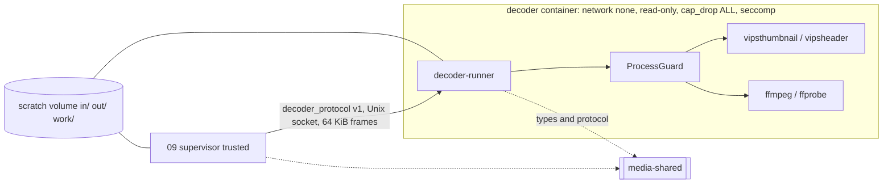
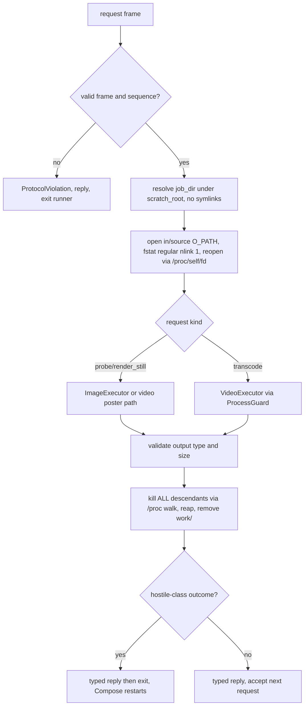

## Epic: 10 Decoder — Sandboxed single-job media runner

**Epic id**: E-19 (local id; the Jira key is added when the parent creates the issue)

**epic_type**: component

### Epic Summary

Build `decoder-runner`, the untrusted process in its own network-less container that turns one decrypted scratch file into thumbnails, a preview, a poster frame, a remux or an H.264 transcode, under hard limits, and reports a typed result. It makes no policy decisions. It is the containment line that keeps a compromised parser from becoming cross-tenant plaintext (R01).

### Problem / Context

libheif, libvips and ffmpeg parse attacker-controlled files and had 2026 CVEs, so the decoder is assumed compromised (ADR-009). It holds no token, no key, no database or blob access and no network (`network_mode: none`). Its only channel is a Unix socket in a volume shared with its supervisor (E-20) and a scratch tree. The transcode policy (compliance, remux, poster offset) lives in `media-shared::policy` (E-18) and is applied by the supervisor; the decoder only probes and executes the `Plan` it is given. Spec: `_docs/02_document/components/10_decoder/description.md`; architecture section 7 "Decoder isolation".

### System context

### Scope

**In Scope**:
- Protocol server: `hello`, `self_check`, `probe`, `render_still`, `transcode`, `cancel`, events `Alive` and `Progress`; one request in flight, `Busy` when a second `run` arrives.
- Magic-byte sniffing and profile choice; image Profile A (`VIPS_BLOCK_UNTRUSTED=1`) and Profile B (HEIC/HEIF/AVIF); pixel limit before decode; orientation 5-8 swap; metadata stripped.
- Video: probe with whitelists, MP4 box scan (`moov_first`), poster frame, lossless remux, CPU x264 encode, scale, HDR to SDR tone mapping, VFR and audio sync, output validation.
- `ProcessGuard`: argv vectors, cleared environment, process group, rlimits, RSS polling, wall and stall kill.
- Containment: non-dumpable, child subreaper, kill-all-descendants after every job, exit after a hostile-class outcome, self-abort watchdog, safe-open of `in/source`.
- Self-check and image build facts (versions, `build_timestamp`); opt-in NVENC probe by test encode [v1.1].
- The `decoder_protocol` wire module in `media-shared` (owned here, linked by E-20).

**Out of Scope**:
- Choosing what to do with a probe, compliance and poster-offset rules (E-18 `policy`, applied by E-20).
- Fetching or posting bytes, job state, retries, encryption of outputs, derived rows (E-18, E-20).
- The image build recipe and weekly rebuild cadence (deployment docs, AC-63 is a CI gate), gVisor (documented contingency only), VAAPI/QSV/VideoToolbox.

### Assumptions

- Two containers per supervisor from one image: `decoder-interactive` (image jobs only, tmpfs scratch with a numeric cap) and `decoder-general` (video and image, disk-backed scratch).
- The kernel is shared with the host; the hardening reduces cross-job leakage but is not a VM boundary (a kernel escape is out of scope for v1.0).
- Compose restarts the container on exit (`restart: unless-stopped`); Docker does not restart on a failed healthcheck, so the runner polices itself.
- Tests that substitute `vipsthumbnail` and `ffmpeg` use a `test-stubs` image variant (gap G-10-1).

### Dependencies

**Epic dependencies** (must be completed first):
- E-00 Bootstrap & Initial Structure (workspace, `decoder.Dockerfile` skeleton, CI image checks).
- E-01 Configuration (typed env section) and E-02 Error model (error code enum only).
- E-18 08_media_jobs (`media-shared` `types`: `Probe`, `Plan`, `Params`, `OutputSpec`; this epic adds `decoder_protocol` to the same crate).

**External dependencies**:
- libvips 8.18.x, libheif >= 1.22.0, ffmpeg 8.x/9.x with libx264, native `aac`, libzimg; GPL image with source offer (RESTRICT-29).
- Reference fixtures DS-xx in `tests/test-data.md`, a red-team corpus, and the 4-core reference worker (REF-CPU4) for speed gates.

### Effort Estimation

**T-shirt size**: XL
**Story points range**: 45-55 (planned child total: 51)

### Users / Consumers

| Type | Who | Key Use Cases |
|------|-----|--------------|
| System | E-20 worker_supervisor (only client) | Probe, render, transcode, cancel, self-check gate |
| Internal | Operator | Image age and self-check result through `doctor` (via E-18 `worker_status`) |
| Internal | Security reviewer | Containment and red-team corpus evidence (AC-25) |

### Requirements

**Functional**:
- Photos: WebP 320 px thumb and 1440 px preview with orientation applied (dimensions swap for 5-8), SSIM >= 0.95 vs a reference render; real width/height read back from the result.
- Video: the probe reports facts only; remux copies the first video and audio streams and moves the index to the front; CPU encode is H.264 High, AAC MP4 `faststart`, short side <= 1080 and long side <= 1920 (orientation independent).
- Every number from the request is clamped to the runner's own ceiling config; `job_dir` must resolve inside `scratch_root` with no symlinks.
- Connection loss while a job runs is treated as `cancel`.

**Non-functional**: see the Non-functional requirements section.

**Security / Compliance**:
- ffmpeg/ffprobe: `-nostdin -protocol_whitelist file -format_whitelist -codec_whitelist`; SVG/PDF/Magick loaders compiled out; `-map_metadata -1`; no `RLIMIT_AS` (breaks NVENC).
- No credentials, network or blob mount; `environ` limited to an allowlist; root filesystem read-only; `no_new_privileges`; seccomp denies `ptrace` and `process_vm_*`.
- Logs: no user paths, stderr tail at most 2 KiB sanitised; AC-25, AC-63 (CI), RESTRICT-13.

### Interface specification

**DecoderProtocol v1** (u32 length prefix, JSON, max 64 KiB, `deny_unknown_fields`, all numbers range-checked)

| Request | Input | Response | Errors (`DecodeError`) |
|---|---|---|---|
| `hello` | protocol version | `Capabilities{protocol, vips, ffmpeg, libheif versions, build_timestamp, nvenc_probe_ok, nvenc_sessions}` | `ProtocolMismatch` |
| `self_check` | `forbidden_targets[]` | `SelfCheckReport[{name, ok}]` | none (failed items are data) |
| `probe` | `job_dir` | `Probe{kind photo\|video, container, moov_first, video{codec, profile, width, height, rotation, bitrate, pix_fmt, primaries, transfer, matrix}, audio{codec}, duration_ms}` | `Unsupported`, `Corrupt`, `LimitExceeded` |
| `render_still` | `job_dir`, `max_edge`, `poster_at_ms`, `limits` | `ImageResult{width, height, bytes}` at `out/result.webp` | `Unsupported`, `Corrupt`, `LimitExceeded{wall, memory, pixels, output}`, `Busy` |
| `transcode` | `job_dir`, `Plan` (`Remux` or `Transcode{encoder, scale_to_short_edge, tone_map, audio, faststart}`), `limits` | `TranscodeResult{probe_of_output, bytes}` at `out/result.mp4` | above plus `Stalled`, `EncoderFailed{exit_code}`, `OutputInvalid` |
| `cancel` | none | `Cancelled` (process group SIGKILLed, `work/` removed) | none |

`DecodeError` also has `ProtocolViolation` (malformed or oversize frame, unknown field, request out of sequence; hostile-class). Events: `Alive` every `alive_interval` (5 s), `Progress{out_time_ms, speed}`. `limits = {cpu, memory_bytes, wall, stall_timeout, max_output_bytes}`.

**`ProcessGuard`** (internal): `run(argv, limits) -> Exited{code} | Killed{reason: wall|memory|stall}`; fallback keys on exit codes, never message text.

**Hostile-class outcomes**: a child killed by a signal, `Killed{wall|memory|stall}`, `LimitExceeded`, a surviving descendant, a peer protocol violation. After the typed reply the runner exits. `Corrupt` and `Unsupported` from a clean non-zero exit are not hostile-class.

**Configuration** (env, no secrets): `decoder_socket_path`, `decoder_gid`, `decoder_scratch_root`, `photo_cpu/memory/job_timeout` (2, 2 GiB, 120 s), `video_cpu/memory/job_timeout` (4, 4 GiB, 40 min), `decoder_stall_kill` 90 s, `decoder_alive_interval` 5 s, `decoder_watchdog` 20 s, `decoder_memory_poll_interval` 1 s, `photo_max_pixels` 250,000,000, `decoder_max_output_photo/video` (32 MiB / 10 GiB), `decoder_format_whitelist`, `decoder_codec_whitelist`, `nvenc` (off) [v1.1].

### Data flow

### Architecture notes

- ADR-009 (sandboxed pipeline), ADR-010 (CPU-first transcoding, NVENC opt-in v1.1), ADR-011 (GPL ffmpeg image, source offer), ADR-001 (Rust). `canonical-names.md`: hardened runner, no gVisor in v1.0.
- Technology pins: libvips 8.18.7 (CLI only, never the crate), libheif >= 1.22.0, ffmpeg with libx264 and native AAC (no `libfdk_aac`, no nonfree filters), tokio 1.54.1+ for the socket loop, no `contracts` port and no clock helper (monotonic `std::time`).
- Encode command: `libx264 -preset veryfast -crf 23 -profile:v high -pix_fmt yuv420p -maxrate 10M -bufsize 20M`, `-c:a aac -b:a 128k -ac 2`, `-movflags +faststart`; values come from `Params`, never from env.
- HDR: downscale first, then `zscale` linear light, `tonemap=hable`, `zscale` BT.709, `yuv420p`; order and operator tuned in gate S5.
- `Plan` is an enum from `media-shared`; the decoder never receives free-form ffmpeg arguments.
- Open owner item: poster-frame HDR (HLG) SSIM tolerance (gap G-10-6); this epic records the SSIM value only.

### Non-functional requirements

| Requirement | Target | Failure threshold | Source |
|---|---|---|---|
| JPEG preview + thumb pair p95 | 600 ms | 2 s | PT-10-1 |
| HEIC preview + thumb pair p95 | 1.5 s | 3 s | PT-10-1, AC-10 |
| Probe p95 (photo header read) | 30 ms | 100 ms | PT-10-1 |
| 1080p transcode, wall per second of media | 0.5 s/s (10-min clip in 5 min) | above 0.5 s/s | PT-10-2, AC-11 |
| 4K HLG to 1080p SDR | 2.0 s/s (10-min clip in 20 min) | above 2.0 s/s | PT-10-2, AC-11 |
| Output/input ratio on DS-05 | 20% or less | above 35% | PT-10-2, AC-44 |
| Idle CPU | under 0.5% | 2% | PT-10-3 |
| `Alive` interval during a job | 5 s +/- 0.5 s | 6 s | PT-10-3 |
| Memory growth over 100 jobs | under 20 MiB | 100 MiB | PT-10-3 |
| Stalled ffmpeg killed | within 90 s of last progress line | later | AC-45 |
| Limits | photos 2 CPU / 2 GiB / 120 s; video 4 CPU / 4 GiB / 40 min | any breach | AC-25 |
| Self-abort | within `decoder_watchdog` (20 s; 3 s in test) +/- 1 s | later | IT-10-18 |

### Design & Architecture

- Architecture doc: `_docs/02_document/architecture.md` (section 7, runtime units)
- Component spec: `_docs/02_document/components/10_decoder/description.md`; tests `.../10_decoder/tests.md`
- System flows: `_docs/02_document/system-flows.md` (F10); containerization: `deployment/containerization.md` (Decoder section)
- ADRs: `adr/009_*`, `adr/010_*`, `adr/011_*`

### Testing strategy

- Integration against the real decoder image: IT-10-1 handshake, IT-10-2 self-check, IT-10-3 framing and busy, IT-10-4 photo probe, IT-10-5 thumbnails and preview, IT-10-6 pixel limit, IT-10-7 poster frame, IT-10-8 CPU transcode, IT-10-9 orientation/VFR/AV sync, IT-10-10 HDR to SDR, IT-10-11 lossless remux, IT-10-12 limits and clamping, IT-10-13 stall watchdog, IT-10-14 containment (descendants), IT-10-15 ptrace/process_vm/proc, IT-10-16 hostile-class exits, IT-10-17 safe-open, IT-10-18 self-abort watchdog (BLOCKED, see spike), IT-10-19 socket loss and cancel, IT-10-20 red-team corpus and NVENC path.
- Performance PT-10-1..3; security ST-10-1 no credentials/network/blob, ST-10-2 argument and environment hygiene, ST-10-3 hostile-type matrix, ST-10-4 no disclosure in logs; acceptance AT-10-1 (corpus then normal service), AT-10-2 (correct outputs and kill timing).
- System scenarios: FT-P-22..28, FT-N-06, FT-N-07, FT-N-08, NFT-PERF-15, 16, 18, 19, 21, NFT-RES-19, NFT-RES-31, NFT-RES-36, NFT-RES-LIM-04, NFT-RES-LIM-09, NFT-SEC-28, NFT-SEC-29, NFT-SEC-45, FT-P-74 (build properties).
- Unit: sniffing table, argv golden builders (including remux), probe parsing for photos and videos, MP4 box scanner (at most 64 boxes), guard kills (wall, memory, stall with a test child), frame parser fuzz.
- Spec gaps handled by spikes or test infrastructure: G-10-1 (test-stubs image), G-10-3 (30 s base files in the manifest), G-10-4 (BLOCKED IT-10-18), G-10-6 (BLOCKED IT-10-7 HLG part, owner item); G-10-2, G-10-5, G-10-7 were resolved at the gap pass.

### Definition of Done

- [ ] All in-scope capabilities implemented; `decoder_protocol` published in `media-shared`
- [ ] Automated tests pass (unit + real-image integration; corpus AT-10-1)
- [ ] Coverage at or above 75% on business logic and 90% on the guard, containment and protocol parser (canonical: `quality-thresholds.mdc`)
- [ ] Image build checks pass in CI (no SVG/PDF/Magick loaders, whitelists present, versions reported)
- [ ] Every corpus item ends in a typed failure with no data exposure and the next job still runs
- [ ] `ptrace` and `process_vm_readv` return EPERM in the real container; a `setsid`/double-fork child is dead before the next request
- [ ] Spikes closed and `tests/spec-gaps.md` entries G-10-1, G-10-3, G-10-4 updated

### Acceptance Criteria

| # | Criterion | Measurable Condition |
|---|-----------|---------------------|
| 1 | AC-10 thumbnail correctness | IT-10-5..7: 320/1440 WebP, orientation 5-8 swapped, SSIM >= 0.95, poster at the supplied offset |
| 2 | AC-11 video outputs | IT-10-8..11: H.264 High 1080p AAC faststart, lossless remux hash-equal packets, 4K HLG tone-mapped |
| 3 | AC-25 containment | IT-10-12..17, ST-10-1..3: 0 data exposed by the corpus, limits hold, self-check passes |
| 4 | AC-28 NVENC probe [v1.1] | IT-10-20 no-GPU path: CPU path used, valid output; real GPU in FT-P-28 |
| 5 | AC-44 derived budget | IT-10-8: `maxrate`/CRF output ratio <= 20% on DS-05 |
| 6 | AC-45 stall and orientation | IT-10-13: killed <= 90 s after last progress; IT-10-9: A/V drift <= 40 ms |
| 7 | AC-71 no state between jobs | IT-10-14, IT-10-19: `work/` removed on every path, socket loss cancels |
| 8 | Hostile-class exit | IT-10-16: runner exits after hostile outcomes, container restarts; clean `Corrupt` does not exit |
| 9 | Self-abort watchdog | IT-10-18: abort within `decoder_watchdog` +/- 1 s (after the test-hook spike) |

### Risks & Mitigations

| # | Risk | Mitigation | Owner |
|---|------|------------|-------|
| 1 | R01: RCE in ffmpeg/libheif/libvips leads to cross-tenant plaintext | Non-dumpable runner, subreaper, kill-all-descendants, seccomp, exit on hostile outcome, `network_mode: none`, setsid test; contingency gVisor | 10, 09 |
| 2 | R34: a hung decoder leaves its slot dead (Docker ignores failed healthchecks) | Runner self-abort watchdog exits; supervisor reconnects | 10, 09 |
| 3 | R21: scratch fills the host disk | Numeric tmpfs cap, dedicated disk mount, container limits | deployment |
| 4 | HEIC 1440 px full decode may miss 5 s p95 | Measure in gate S4; fallback derives the 320 px from the preview | 10 |
| 5 | RSS polling at 1 s misses a spike | Cgroup limit is the hard stop; supervisor treats socket loss as transient | 10 |
| 6 | Whitelists too tight lose clips, too loose weaken AC-25 | Finalise in gate S5 against phone corpora and the red-team set | 10 |
| 7 | `-progress pipe:1` may be subject to `-protocol_whitelist file` | Verify in spike S5 before locking argv builders | 10 |
| 8 | R03/R15: schedule and complexity | Spikes first; plan cut: NVENC task is v1.1 | plan |

### Labels

- `sunnycloud`
- `component:decoder`
- `release:v1.0` (NVENC probe task `release:v1.1`)
- `type:platform`

### Child Issues

| Type | Title | Points |
|------|-------|--------|
| Spike | Gate S5: finalise ffmpeg format/codec whitelists, verify progress sink vs `protocol_whitelist`, HDR tone-map order and budget | 3 |
| Spike | Gate S4 HEIC 1440 px decode timing and the `test-stubs` image variant plus 30 s base files (G-10-1, G-10-3) | 2 |
| Spike | Test-only trigger to freeze the main loop for IT-10-18 (G-10-4); record SSIM only for HLG poster (G-10-6, owner item) | 2 |
| Enabler | `decoder_protocol` module in `media-shared`: framing, requests, responses, events, `DecodeError`, strict-schema parser and fuzz | 3 |
| Task | Runner socket loop: handshake, busy handling, one connection, `Alive`/`Progress`, socket loss = cancel, limit clamping | 3 |
| Task | `ProcessGuard`: argv, cleared env, process group, rlimits, RSS poll, wall/stall kill | 5 |
| Task | Containment: non-dumpable, subreaper, kill-all `/proc` walk, wipe `work/`, hostile-class exit, safe-open of `in/source`, self-abort watchdog | 5 |
| Task | `ImageExecutor`: sniff, Profiles A and B, `vipsheader` pixel limit, `vipsthumbnail`, output read-back | 3 |
| Task | `probe` for photos (header read) and videos (ffprobe parse, `moov_first` box scan) | 3 |
| Task | Video poster path (frame at `poster_at_ms`, tone map, Profile A to WebP) | 2 |
| Task | `VideoExecutor`: remux, CPU encode, scale, HDR to SDR, VFR/audio sync, stream mapping, output validation | 5 |
| Task | `hello`, `self_check` and image build facts | 2 |
| Task | NVENC probe by test encode and `EncoderFailed` reporting [v1.1] | 2 |
| Enabler | Decoder image build checks (`scripts/ci/check-decoder-image.sh`: loaders compiled out, whitelists, versions) | 3 |
| Task | Integration suite IT-10-1..20 against the real image with the red-team corpus | 5 |
| Task | Performance, security and acceptance tests PT-10-1..3, ST-10-1..4, AT-10-1..2 | 3 |
