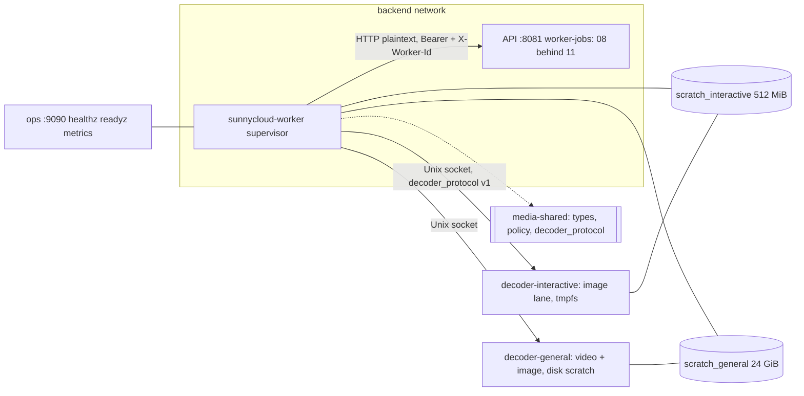
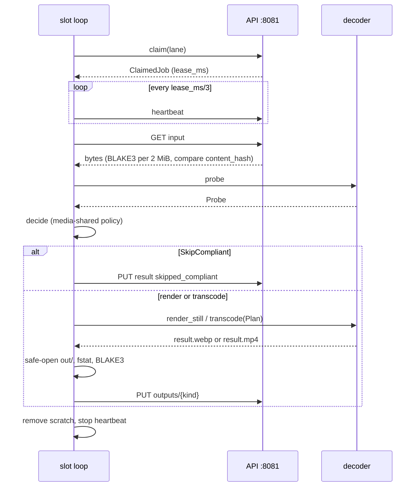

## Epic: 09 Worker Supervisor — Trusted job driver with no database login

**Epic id**: E-20 (local id; the Jira key is added when the parent creates the issue)

**epic_type**: component

### Epic Summary

Build `sunnycloud-worker`, the trusted process that claims media jobs from the API over HTTP, fetches the decrypted original into scratch, probes and decides through the decoder, posts outputs and closes the job. It drives one job at a time per decoder slot without ever parsing media bytes itself, and holds only the worker bearer secret.

### Problem / Context

Per S4-1 and ADR-009 the worker has no database role, no blob mount and no master key; everything goes through the API worker listener `:8081` (`/api/v1/worker-jobs/**`, defined by E-18). The decoder (E-19) is untrusted and network-less, so the supervisor must treat every frame and every output file as hostile, enforce limits and the stall watchdog, and survive being killed at any step (AC-71). Spec: `_docs/02_document/components/09_worker_supervisor/description.md`; flow F10.

### System context

### Scope

**In Scope**:
- `WorkerApi` HTTP client: claim, heartbeat (`lease_ms / 3`), release, fetch input, post output, complete, fail, report status.
- Input fetch into `in/source` with BLAKE3 per 2 MiB block rolled up and compared to `ClaimedJob.content_hash` (AC-72), `Content-Length` checked before the first byte and enforced while streaming.
- `Scratch` lifecycle (`create`, `remove`/`Drop`, start-up `sweep_all`), hostile-input reads of `out/` (`openat2` `RESOLVE_BENEATH | RESOLVE_NO_SYMLINKS`, `fstat` regular file, `st_nlink == 1`, size cap).
- `DecoderClient` over the socket, reconnect with backoff, repeat `hello` and `self_check` after a runner exit.
- Per-slot work loop for `stills`, `poster`, `transcode`; policy application from `media-shared`; output compliance check (`OutputInvalid`).
- Two-tier watchdog, retry inside the claim (single CPU rerun), failure code mapping, worker status report, metrics, graceful shutdown, ops listener, test-build `OffsetClock`.

**Out of Scope**:
- Any media parsing or encoding (E-19); queue SQL, enqueue, derived rows, output sniffing and encryption, the reaper (E-18).
- Container limits (Compose), authentication of the secret (E-18 `WorkerAuthenticator` served by E-21).
- Remote workers on other hosts, per-worker token revocation, `supported_params_versions` claim filter.

### Assumptions

- The supervisor runs on the same Compose host as the API; `:8081` is plaintext on the internal network.
- It depends on `media-shared` and helpers only: no `contracts` port, no sqlx, no media library in its image (distroless, under 50 MB).
- A restart needs no rehydration: lease expiry returns in-flight jobs to the queue.
- `decoder_gid` is a shared numeric group for the socket and the scratch tree; no world-readable modes.
- Step 5 gap-pass defaults: input too large for scratch gives `input_too_large` (permanent); an output failing safe-open gives `output_rejected` (permanent); a descendant killed at job end is hostile-class in E-19.

### Dependencies

**Epic dependencies** (must be completed first):
- E-00 Bootstrap & Initial Structure (workspace, `worker.Dockerfile`, CI crate-graph jobs).
- E-01 Configuration, E-02 Error model, E-03 Clock, E-04 IDs and hashing (`hash_block`, `rollup`), E-09 Observability.
- E-18 08_media_jobs (`media-shared` `types` and `policy`; the server-side worker resources this client speaks to).
- E-19 10_decoder (`decoder_protocol`, runner behaviour).

**External dependencies**:
- Real API with Postgres for tier-2 tests: the server routes are wired in E-21; this epic's integration tests run against them once E-21 lands and use fakes before that (see note under Testing strategy).
- Decoder images, Compose volumes `sock_*` and `scratch_*`, secret file `worker_api_token`.

### Effort Estimation

**T-shirt size**: L
**Story points range**: 32-40 (planned child total: 35)

### Users / Consumers

| Type | Who | Key Use Cases |
|------|-----|--------------|
| System | E-21 http_api worker listener / E-18 `WorkerJobs` | Counterpart of every call |
| System | E-19 decoder | Only client of the socket |
| Internal | Operator | `doctor` reads decoder health and image age from the status it reports |

### Requirements

**Functional**:
- Per job: `claim` -> `Scratch::create` -> `fetch_input` -> `probe` -> by kind: `stills` (one fetch, `render_still{1440}` then `render_still{320}`, post `preview` then `thumb`), `poster` (`render_still{320, poster_at_ms = poster_offset_ms(duration)}`, post `thumb`), `transcode` (`decide`: `SkipCompliant` closes `skipped_compliant` with no output; `Remux` or `Transcode(Plan)` posts `transcode`).
- `Gone` (404) closes the job `obsolete` without retry; `LeaseLost` (409) stops quietly and posts nothing more; `Forbidden` (403) marks the worker not ready and stops claiming.
- `Stalled` or `EncoderFailed` reruns once on CPU (a failed `Remux` reruns as a CPU `Transcode`); permanent codes (`Unsupported`, `Corrupt`, `LimitExceeded`, `OutputInvalid`, `input_too_large`, `output_rejected`, second `Stalled`) fail `Permanent`; transient codes fail `Retry`.
- Always: scratch removed, heartbeat stopped, metrics emitted; SIGTERM stops claiming, lets running jobs finish for `worker_shutdown_grace`, then `cancel` + `release`.

**Non-functional**: see the Non-functional requirements section.

**Security / Compliance**:
- Secret held as `Secret<T>`, never logged; no user or device token exists here (AC-79).
- A hash mismatch never reaches the decoder; frame size, schema and ranges are validated; media type comes from a fixed enum and size from `fstat`.
- Startup self-check gate: any failed item blocks job intake, `worker_selfcheck_ok 0`, status reports `decoder_ok = false`.
- Logs: JSON with `component=worker`, never paths or decoder stderr beyond a 2 KiB sanitised tail.

### Interface specification

**`WorkerApi`** (HTTP to `worker_api_url`, default `http://api:8081`; every request carries the bearer and `X-Worker-Id`)

| Operation | Request | Result | Errors |
|---|---|---|---|
| `claim(lane)` | `POST /api/v1/worker-jobs/claims` | `Option<ClaimedJob{job_id, kind, content_hash, params_version, attempt, lease_ms}>` | `Transient` |
| `heartbeat(job)` | `PUT .../{job_id}/lease` | `Extended` | `LeaseLost` |
| `release(job)` | `DELETE .../{job_id}/lease` | `()` | |
| `fetch_input(job)` | `GET .../{job_id}/input` | bytes into `in/source`, verified | `Gone`, `LeaseLost`, `Forbidden`, `HashMismatch`, `TooLarge`, `Transient` |
| `post_output(job, kind)` | `PUT .../outputs/{kind}` with `Content-Type`, `X-Width`, `X-Height`, `X-Duration-Ms` | 204 or 200 (both success) | `LeaseLost`, `Gone`, `TooLarge`, `TypeRejected`, `Transient` |
| `complete(job, outcome)` | `PUT .../{job_id}/result` | `()` | `LeaseLost` |
| `fail(job, code, Retry\|Permanent)` | `POST .../{job_id}/failure` | `Requeued \| Dead` | `LeaseLost` |
| `report_status()` | `PUT /api/v1/worker-jobs/status` every `worker_status_interval` | `()` | `Transient` (logged, retried next interval) |

**`DecoderClient`**: `hello`, `self_check`, `probe`, `render_still`, `transcode`, `cancel`; returns typed `DecodeError`, never strings.

**`Scratch`**: `create(job_id) -> ScratchDir` (`in/` writable by the supervisor with mode 0440 and group `decoder_gid`, `out/` written by the decoder as `result.<ext>`), `remove()`/`Drop`, `sweep_all()` at start-up.

**`TranscodePolicy`** (pure, from `media-shared`): `decide(probe, caps, encoder_pref) -> SkipCompliant | Remux | Transcode(Plan)`; `Plan` is an enum-only record; `Nvenc` only when `nvenc = on` and `caps.nvenc_probe_ok` [v1.1].

**Test clock** (feature `test-clock`): `OffsetClock` polls `GET /internal/v1/test/clock-offset` and adds the offset to system time.

**Configuration**: `worker_id`, `worker_api_url`, `worker_api_token` (secret file), `worker_sock_interactive/general`, `worker_scratch_interactive/general`, `worker_claim_poll_interval` 500ms, `worker_status_interval` 30s, `decoder_stall_kill` 90s, `decoder_silence_timeout` 20s, `decoder_cancel_grace` 5s, `photo_*` and `video_*` limits (2 CPU, 2 GiB, 120 s; 4 CPU, 4 GiB, 40 min), `worker_max_input_photo/video` (256 MiB / 10 GiB), `worker_scratch_general_cap` 24 GiB, `nvenc` off, `worker_shutdown_grace` 30s, `worker_ops_listen` `:9090`.

### Data flow

### Architecture notes

- ADR-009 (API-only workers), ADR-010 (CPU-first; GPU v1.1), ADR-015 (the supervisor is a leaf: depends on `media-shared`, not on 08 or any component), ADR-002 (single host Compose).
- Technology: Rust, tokio, an HTTP client for the plaintext internal listener (no TLS inside Compose), BLAKE3 1.8.7 via helper 05, `openat2` for safe-open on Linux; distroless image with no media libraries; `mem_limit` set in Compose.
- Slots: `decoder-interactive` claims lane `image` only; `decoder-general` claims `video` and `image` with the first lane rotated each claim; each slot has its own loop and heartbeat.
- The slot-loop type is not named in the spec (gap G-09-1); implementers choose it and tests use only the boundaries.

### Non-functional requirements

| Requirement | Target | Failure threshold | Source |
|---|---|---|---|
| Supervisor time per photo job above decoder time | 40 ms | 150 ms | PT-09-1 |
| Jobs per second with a 50 ms/render fake decoder | 6 | 3 | PT-09-1 |
| Supervisor RSS | 64 MiB | 128 MiB | PT-09-1, PT-09-3 |
| Throughput ratio, 2 supervisors vs 1 | 1.9 | 1.7; duplicate claims 0 | PT-09-2, NFT-PERF-17 |
| Streaming peak RSS (1 GiB input) | 64 MiB | 128 MiB | PT-09-3 |
| Hash of fetched bytes equals manifest | yes | no | PT-09-3, AC-72 |
| Stall kill | no progress for 90 s | later | AC-45 |
| Tier-2 silence | `decoder_silence_timeout` 20 s then `cancel` after 5 s grace | slot blocked beyond | IT-09-11 |
| Wall limits | photo 120 s, video 40 min | any breach | AC-25 |
| Kill at any step | one derived blob per key, empty scratch | duplicate or residue | AC-71 |

### Design & Architecture

- Architecture doc: `_docs/02_document/architecture.md` (runtime units, section 7)
- Component spec: `_docs/02_document/components/09_worker_supervisor/description.md`; tests `.../09_worker_supervisor/tests.md`
- System flows: `_docs/02_document/system-flows.md` (F10); containerization: `deployment/containerization.md` (Worker supervisor)
- ADRs: `adr/009_*`, `adr/010_*`, `adr/015_*`

### Testing strategy

- Integration (fake decoder on a real socket, real API where available): IT-09-1 start-up gate and self-check, IT-09-2 photo one fetch two renders, IT-09-3 video poster and transcode decisions, IT-09-4 real remux and skip, IT-09-5 output compliance check, IT-09-6 retry inside the claim, IT-09-7 input fetch verification and limits, IT-09-8 gone revision closes `obsolete`, IT-09-9 slots and lanes, IT-09-10 heartbeat, 409 and 403, IT-09-11 two-tier watchdog, IT-09-12 hostile output files, IT-09-13 hostile frames, IT-09-14 kill at each step, IT-09-15 reconnect after a runner exit, IT-09-16 encoder choice [v1.1], IT-09-17 shutdown and status, IT-09-18 test clock.
- Performance PT-09-1..3; security ST-09-1 secret handling, ST-09-2 no path to database or blobs, ST-09-3 decoder output cannot exfiltrate files; acceptance AT-09-1 (compliant clip leaves no output; index-at-end is remuxed), AT-09-2 (kill-and-recover with two supervisors).
- System scenarios: FT-P-20..28, FT-N-06..08, NFT-PERF-13..21, NFT-RES-19, NFT-RES-23, NFT-RES-31, NFT-RES-36, NFT-SEC-28, NFT-SEC-29, NFT-SEC-46, NFT-SEC-50, NFT-RES-LIM-04, NFT-RES-LIM-09, FT-N-43.
- Unit: policy table (every non-compliant axis, portrait 1080x1920 compliant, remux case), poster offset (9 s and 10 s clips), slot masks and lane rotation, 409 abort, 403 stops claiming, safe-open rejects symlink, hardlink, FIFO and oversize, frame limits, `OffsetClock`.
- Note on ordering: the real-API tier needs the worker routes from E-21 (a higher id). Code dependency stays on lower ids only; the real-API tests are scheduled when E-21 lands and run as part of E-31. Flagged to the parent as an ambiguity.
- Open spec gaps: G-09-1 (slot-loop type, implement), G-09-4 (observable effect of `OffsetClock`, decompose); G-09-2 and G-09-3 were resolved at the gap pass.

### Definition of Done

- [ ] All in-scope capabilities implemented; supervisor image builds distroless with no media libraries
- [ ] Automated tests pass (unit + integration against fake decoder; real-API tier when E-21 is available)
- [ ] Coverage at or above 75% on business logic and 90% on safe-open, fetch verification and lease handling (canonical: `quality-thresholds.mdc`)
- [ ] CI graph test: no `sqlx`, no database URL, no media library in the worker image
- [ ] Kill-at-each-step test leaves exactly one derived per key and an empty scratch
- [ ] Runbook note: worker secret rotation via `worker_api_token_next` (E-18) and scratch sizing (gate S5)
- [ ] Spec gaps G-09-1 and G-09-4 closed or recorded in `tests/spec-gaps.md`

### Acceptance Criteria

| # | Criterion | Measurable Condition |
|---|-----------|---------------------|
| 1 | AC-10 interactive slot | IT-09-2, IT-09-9, PT-09-1: image-only slot, one fetch for thumb and preview, supervisor overhead <= 40 ms |
| 2 | AC-11 policy applied | IT-09-3, IT-09-4, AT-09-1: compliant clip closes `skipped_compliant` with 0 output bytes; index-at-end clip is remuxed |
| 3 | AC-25 no credentials, hostile output | IT-09-1, IT-09-12, IT-09-13, ST-09-1..3: self-check gate, 0 secrets in any output, no DB path |
| 4 | AC-28 NVENC [v1.1] | IT-09-16: NVENC only when enabled and probed; any failure reruns on CPU |
| 5 | AC-44 output compliance | IT-09-5: non-compliant output fails with `OutputInvalid`, no loop |
| 6 | AC-45 watchdog and retry | IT-09-6, IT-09-10, IT-09-11: single CPU retry; slot never blocked beyond stall/wall limit |
| 7 | AC-71 kill safety | IT-09-14, AT-09-2: kill at fetch, decode and post leaves one derived and empty scratch |
| 8 | AC-72 hash-verified fetch | IT-09-7: mismatched bytes never reach the decoder; FT-N-43 |
| 9 | AC-79 client side | IT-09-10: 403 stops claiming; only the worker secret and URL are held |
| 10 | Scale | PT-09-2: two supervisors give >= 1.7x throughput with 0 duplicate claims |

### Risks & Mitigations

| # | Risk | Mitigation | Owner |
|---|------|------------|-------|
| 1 | R01: hostile decoder output used to exfiltrate or block | Strict schema, `openat2` safe-open, `fstat`, FIFO rejection, server-side sniffer re-validation | 09, 10 |
| 2 | R34: hung decoder, Docker does not restart | Tier-2 watchdog, unhealthy slot, runner self-abort, reconnect with `hello` + `self_check` | 09, 10 |
| 3 | R10: worker credential on plaintext internal port | Backend network only; one secret file; rotation by `worker_api_token_next` | 08, 09 |
| 4 | R21: scratch fills the host disk | `statvfs` refusal, 24 GiB mount sized as 2 x max video input + 4 GiB, tmpfs cap 512 MiB (see ambiguity below) | deployment |
| 5 | Reserved interactive capacity vs one job per decoder (AC-10) | Two decoder containers per supervisor; image-only interactive slot; slot CPU shares in gates S4/S5 | 09 |
| 6 | A video poster waits behind a running transcode | Accepted for v1.0; a second supervisor pair adds a slot | 08, 09 |
| 7 | R15: complexity | Leaf crate with three traits; integration against a fake decoder first | plan |

### Labels

- `sunnycloud`
- `component:worker_supervisor`
- `release:v1.0` (encoder-choice task `release:v1.1`)
- `type:platform`

### Child Issues

| Type | Title | Points |
|------|-------|--------|
| Spike | Confirm slot-loop boundaries, `OffsetClock` observable effect and scratch-size arithmetic (G-09-1, G-09-4; interactive tmpfs 512 MiB in the component spec vs 1g in containerization) | 2 |
| Enabler | `sunnycloud-worker` crate skeleton: typed config section, ops listener (`/healthz`, `/readyz`, `/metrics`), `Secret<T>`, graph test (no sqlx) | 2 |
| Task | `WorkerApi` HTTP client with status-code to error mapping and streaming input verification (BLAKE3 per 2 MiB, rolled up) | 3 |
| Task | `Scratch`: create, remove, `sweep_all`, `openat2` safe-open of `out/`, `statvfs` refusal | 3 |
| Task | `DecoderClient`: framing, strict parsing, reconnect with backoff, `hello` + `self_check` gate | 3 |
| Task | Per-slot work loop for `stills`, `poster`, `transcode`, retry inside the claim and failure-code mapping | 5 |
| Task | Heartbeat, two-tier watchdog, unhealthy slot, lease-lost abort | 3 |
| Task | Worker status report, metrics and graceful shutdown | 2 |
| Task | `OffsetClock` test-build clock (feature `test-clock`) | 2 |
| Task | Policy wiring and output compliance check; NVENC encoder preference [v1.1] | 2 |
| Task | Integration suite IT-09-1..18 with fake decoder, including kill-at-each-step | 5 |
| Task | Performance, security and acceptance tests PT-09-1..3, ST-09-1..3, AT-09-1..2 | 3 |
