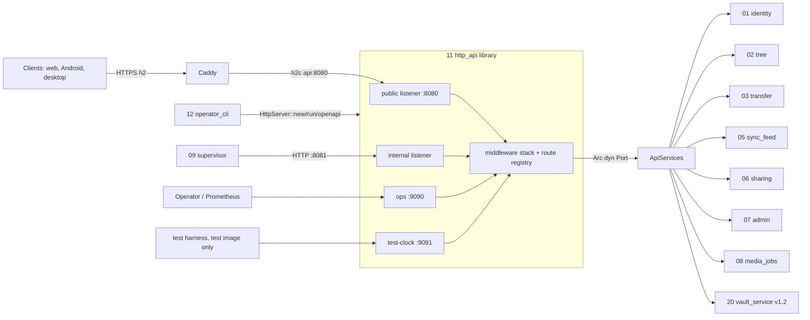
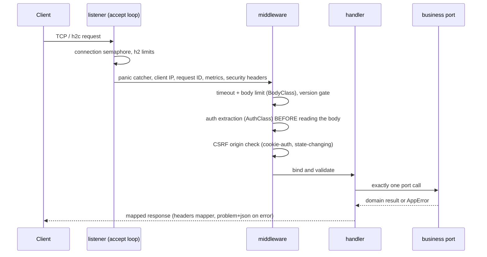

## Epic: 11 HTTP API — Delivery layer, listeners, routes and OpenAPI

**Epic id**: E-21 (local id; the Jira key is added when the parent creates the issue)

**epic_type**: component

### Epic Summary

Build the server's only delivery layer: the hand-built hyper accept loops, the middleware stack, the route registry that drives the router, OpenAPI and the generated CSRF and IDOR test matrices, error mapping to `application/problem+json`, ops endpoints and graceful connection shutdown. It wires every `/api/v1` resource to the business ports of the component epics it composes, and holds no SQL and no business rule.

### Problem / Context

Business logic sits behind `contracts` ports (ADR-015). Somebody must bind HTTP to those ports, enforce the protocol-level policies (CSRF origin rule, body classes, header mapping, client version gate, error-to-status table) and keep 1 Gbps reachable through large HTTP/2 windows (AC-2). Component 11 is a library: the `sunnycloud` binary (E-22, the composition root) builds the services and passes them in as `ApiServices`. This epic therefore **wires everything at the route level** and depends on the component epics it composes; the only inverse dependency is that E-22 depends on this one. Spec: `_docs/02_document/components/11_http_api/description.md`; architecture "Dependency rule".

### System context

### Scope

**In Scope**:
- Listeners (public `:8080`, internal `:8081`, ops `:9090`, test-clock `:9091`) with the hand-built accept loop: global connection semaphore, `hyper_util::server::conn::auto::Builder`, HTTP/2 tuning, graceful shutdown.
- Middleware (outermost first): panic catcher, client IP, request ID, metrics and log, security headers, timeout and body limit by `BodyClass`, client version gate, auth extraction by `AuthClass`, CSRF origin check.
- Error mapper (`AppError` to status, `application/problem+json` with typed extras), content-serving header mapper.
- Route registry (`route!`), router, OpenAPI via `utoipa`, SPA static serving with fallback, `GET /api/v1/server-info` (`ServerInfo`), `/healthz`, `/readyz`, `/metrics`, the test-image clock endpoints.
- One handler per operation: bind, validate, one port call, map; handler modules `routes/{auth,devices,accounts,nodes,transfer,changes,shares,admin,media,internal,ops}.rs` under 500 lines each.
- Generated AC-58 CSRF matrix and AC-59 two-account IDOR matrix; additive-only OpenAPI diff gate (AC-64).

**Out of Scope**:
- Authentication logic, sessions, abuse counters (E-15, E-16 count and return `RateLimited`); sniffing and inline decision (E-14); idempotency and ordering (E-12, E-13, E-14).
- The composition root, config binding, migrations, scheduler and `AbuseLimiter` construction, process start/stop sequence (E-22).
- The `/api/v1/vaults/**` handlers: the group is reserved here, registered by E-30 in v1.2.

### Assumptions

- One API process in v1.0 (decision 12); replicas are unsupported for uploads.
- Caddy proxies over h2c (`versions h2c`); the Caddyfile change is in the deployment docs.

### Dependencies

**Epic dependencies** (must be completed first):
- E-00 Bootstrap & Initial Structure (workspace, `contracts` crate, CI `cargo deny` and graph tests).
- Cross-cutting: E-01 Configuration, E-02 Error model (`AppError`, `ErrorKind`), E-03 Clock, E-04 IDs and hashing, E-07 Audit log, E-08 Abuse rate limiting, E-09 Observability.
- Component ports it requires: E-15 01_identity (`Authenticator`, `SignInService`, `SessionService`, `DeviceGrantService`, `InviteService`), E-13 02_tree (`TreeService`, `TreeReader`), E-14 03_transfer (`UploadService`, `CommitService`, `DownloadService`), E-12 05_sync_feed (`ChangeFeed`), E-16 06_sharing (`ShareService`, `PublicShareService`), E-17 07_admin (`AdminService`, `AccountService`, `AccountDeletionService`), E-18 08_media_jobs (`ThumbnailStateSource`, `DerivedOpener`, `WorkerAuthenticator`, `WorkerJobs`), E-10 04_blobstore and E-11 07a_quota (readiness items; quota only through 07).

**External dependencies**:

### Effort Estimation

**T-shirt size**: XL
**Story points range**: 60-72 (planned child total: 67)

### Users / Consumers

| Type | Who | Key Use Cases |
|------|-----|--------------|
| External | Web, Android, iOS, desktop clients | Every `/api/v1` call, long-poll, content download |
| System | E-22 operator_cli | `HttpServer::new/run/openapi`, readiness registry |
| System | E-20 worker_supervisor | Internal listener resources (owned by E-18) |

### Requirements

**Functional**:
- Every operation declared once in the registry with path, method, owner port method, `AuthClass`, `BodyClass`, `x-id-params`, state-changing flag; 0 undocumented routes.
- `X-Sunnycloud-Client: <family>/<semver>` gate: below `min_client_version` gives 426 `upgrade_required` with `min_version` and `update_url`; public routes and `server-info` exempt; absent header accepted only from a browser session, native clients must send it, malformed value is 400.
- Readiness: `/readyz` is 503 when any contributor is degraded or failing, 200 only when all are ok.

**Security / Compliance**:
- CSRF (AC-58): cookie-authenticated POST/PUT/PATCH/DELETE allowed only with `Sec-Fetch-Site: same-origin` or `Origin` equal to the public origin; otherwise 403 `csrf_rejected`; bearer requests exempt; GET/HEAD never mutate.
- `nosniff` on every response including errors; HSTS one year; `Referrer-Policy: no-referrer`; `Cache-Control: no-store` default; no CORS on `/api`; cookies `__Host-`, `Secure`, `HttpOnly`, `SameSite=Lax` (set from the DTO that E-15 returns).
- Internal routes only on the internal router (AC-79); test-clock routes absent from release builds (FT-N-35).
- No body, token, name or share URL in logs; errors never leak SQL, paths or keys; unexpected errors are opaque to the client and logged once with the chain and request ID.

### Interface specification

**Provided**

| Item | Signature | Consumers |
|---|---|---|
| `HttpServer` (concrete type) | `new(ApiServices, HttpConfig)`, `run(shutdown_signal)`, `openapi()` | E-22 (`serve`, `openapi`) |
| `ReadinessCheck` registry | collects `ReadinessCheck` items for `/readyz` | E-22 registers checks |
| `ServerInfo` | `{block_size, max_lanes, small_file_max, batch_max_entries, max_staged_per_account, longpoll_max_wait, min_client_version, api_versions}` | clients, `GET /api/v1/server-info` (built by E-22) |

**Required** (one `Arc<dyn Port>` each in `ApiServices`): `Authenticator`, `SignInService`, `SessionService`, `DeviceGrantService`, `InviteService`, `TreeService`, `TreeReader` (incl. `lookup_revisions`), `UploadService`, `CommitService`, `DownloadService` (incl. `open_blob_content`), `ChangeFeed`, `ShareService`, `PublicShareService`, `AdminService`, `AccountService`, `AccountDeletionService`, `ThumbnailStateSource`, `DerivedOpener`, `WorkerAuthenticator`, `WorkerJobs`, optional `VaultService` (v1.2), `ReadinessCheck` list.

**Listeners**

| Listener | Default | Serves |
|---|---|---|
| public | `:8080` | `/api/v1/**`, SPA bundle (behind Caddy only) |
| internal | `:8081` (`SUNNYCLOUD_INTERNAL_ADDR`) | `/api/v1/worker-jobs/**` only, plus `GET /internal/v1/test/clock-offset` in the test image; all else 404 |
| ops | `:9090` | `/healthz`, `/readyz`, `/metrics`; never routed by Caddy |
| test-clock | `:9091` | `POST /test/clock`, compiled only with feature `test-clock` |

**Route registry** (group, owner, auth class)

| Group (owner) | Resources | Auth |
|---|---|---|
| System (11) | `GET /api/v1/server-info`, `GET /api/v1/openapi.json`, SPA fallback | Public |
| Auth (01) | `/api/v1/auth/providers`, `.../providers/{provider}/login`, `.../callback`, `POST /api/v1/auth/code-exchanges`, refresh, logout | Public / Session |
| Sessions and devices (01) | `/api/v1/sessions`, `/api/v1/device-grants` (+ poll, approve/deny), `/api/v1/devices`, `DELETE /api/v1/devices/{id}`, `DELETE /api/v1/devices/me` | Public / SessionOnly / DeviceOnly |
| Account (07, 01) | `/api/v1/accounts/me`, `.../quota`, link identity, `GET /api/v1/setup` | Session / SessionOnly / Public |
| Tree (02) | `/api/v1/nodes`, `/nodes/{id}`, `/nodes/{id}/children`, `/revisions/{id}`, `POST /api/v1/revisions:lookup` (<= 1,000 hashes) | SessionOrDevice |
| Transfer (03) | `/api/v1/uploads`, `/uploads/{id}`, `/uploads/{id}/blocks/{index}`, `/staged-uploads/{key}`, `/commits`, `/commits:batch`, `/nodes/{id}/content`, `/revisions/{id}/content` (current only for non-admins) | SessionOrDevice |
| Sync (05) | `GET /api/v1/changes?cursor&wait&limit`, `GET /api/v1/changes/head` | SessionOrDevice (long-poll) |
| Sharing (06) | `/api/v1/shares`, `/shares/{id}`, `/api/v1/public-shares/{token}` (+ `access`, `content`, `thumbnail`) | Session / ShareGrant / Public |
| Admin (07, 01) | `/api/v1/admin/users`, `.../users/{id}`, `.../quota`, `/admin/invites`, `/admin/health` | Admin |
| Media (08) | `/api/v1/nodes/{id}/thumbnail`, `/nodes/{id}/transcode`, `POST /api/v1/thumbnail-states` | SessionOrDevice |
| Worker (08, internal) | `/api/v1/worker-jobs/**` | Worker |
| Vault (20, v1.2) | `/api/v1/vaults/**` reserved | Session |

**AuthClass**: `Public`, `Session`, `SessionOrDevice`, `DeviceOnly`, `SessionOnly` (approve-device, create-share, delete-account, link-provider, revoke by id: device tokens get 403, AC-57), `Admin`, `ShareGrant`, `Worker`.

**BodyClass**: `Small` 64 KiB, `Commit` 4 MiB, `Batch` 4 MiB (500 entries), `Block` exact block length at most 2 MiB (411 without `Content-Length`), `Staged` at most 2 MiB, `Query` 128 KiB, `Auth` 16 KiB, `WorkerOutput` per-kind cap from E-18, `None` for GET. Idle body timeout 30 s, long-poll `wait` + 5 s, download write-idle 60 s, default request timeout 60 s.

**Error mapping**: Validation 400 (422 semantic), Unauthorized 401, Forbidden 403, NotFound 404 (also foreign id), Conflict 409, RateLimited 429 + `Retry-After`, Gone 410 (`resync_required`), PreconditionFailed 409/412 per code (open gap G-11-1), PayloadTooLarge 413, RangeNotSatisfiable 416, UpgradeRequired 426, Unavailable 503 + `Retry-After`, QuotaExceeded 507, Internal 500 opaque; `LastAdmin` is 409.

**Configuration** (typed `HttpConfig`, bound by E-22): `SUNNYCLOUD_PUBLIC_URL`, `_TRUSTED_PROXIES`, `_INTERNAL_ADDR`, `_MAX_CONNECTIONS` 4096, `_H1_HEADER_TIMEOUT` 10s, `_H2_STREAM_WINDOW` 4MiB, `_H2_CONN_WINDOW` 32MiB, `_H2_MAX_STREAMS` 100, `_H2_MAX_PENDING_RESET` 20, `_H2_MAX_HEADER_LIST` 16KiB, `_H2_KEEPALIVE_INTERVAL` 30s / `_TIMEOUT` 20s, `_SHUTDOWN_GRACE` 25s, `_MIN_CLIENT_VERSION`, `_REQUEST_TIMEOUT` 60s, `_BODY_IDLE_TIMEOUT` 30s.

### Data flow

### Architecture notes

- ADR-015 (ports-only dependencies; delivery thin; crate-graph test), ADR-002 (one API process, h2c from Caddy), ADR-004 (blocklist sync, long-poll), ADR-008 (cookies, device/session classes), ADR-009 (internal listener), ADR-014 (no SQL in the crate).
- Technology pins: axum 0.8.9, hyper 1.12, hyper-util, tokio >= 1.54.1, h2 >= 0.4.16, bytes >= 1.11.1 (`cargo deny` floors, RESTRICT-12), `utoipa` (pin at implementation), Prometheus text exposition.
- Business errors arrive as `AppError` (helper 02); the mapper is the only place that knows status codes. Client IP honours `SUNNYCLOUD_TRUSTED_PROXIES` only.

### Non-functional requirements

| Requirement | Target | Failure threshold | Source |
|---|---|---|---|
| Single stream through the stack | 117 MB/s | below 112 MB/s (90% of 1 Gbps) | PT-11-1, AC-2 |
| RSS increase from 1,000 stalled connections | 100 MB | 200 MB | PT-11-2, AC-59 |
| 1 GiB upload delay while stalled connections are open | 5% | 10% | PT-11-2, AC-59 |
| `server-info` latency p95 | 2 ms | 10 ms | PT-11-2 |
| Listing through the stack | 300 ms p95 for 10,000 entries | above 300 ms | NFT-PERF-10, AC-6 |
| Graceful shutdown | readiness 503, accept stops, long-polls woken, drain <= 25 s | acked block lost | AT-11-2, AC-38 |
| CSRF / IDOR coverage | 403 / 404 on N of N generated operations | any operation untested | AC-58, AC-59 |
| Coverage | 90% on CSRF, auth gating, error mapping, header mapping | below 90% blocks | quality-thresholds |

### Design & Architecture

- Architecture doc: `_docs/02_document/architecture.md` (Component list, Dependency rule, sections 3 and 7)
- Component spec: `_docs/02_document/components/11_http_api/description.md`; tests `.../11_http_api/tests.md`

### Testing strategy

- Integration (fakes of every port): IT-11-1 error table, IT-11-2 opaque internal errors, IT-11-3 panic catcher, IT-11-4 request ID, IT-11-5 security headers, IT-11-6 CSRF rule, IT-11-7 version gate, IT-11-8 `ServerInfo`, IT-11-9 listeners and route placement, IT-11-10 auth classes, IT-11-11 registry and OpenAPI parity, IT-11-12 additive-only diff gate, IT-11-13 body classes and timeouts, IT-11-14 content-serving headers, IT-11-15 rate-limit and unavailable mapping, IT-11-16 graceful shutdown, IT-11-17 ops and readiness, IT-11-18 HTTP/2 settings and h2c, IT-11-19 connection limits, IT-11-20 stream abort and cookies from the DTO.
- Performance PT-11-1..2; security ST-11-1 CSRF and cookie replay, ST-11-2 error and header injection, ST-11-3 cross-account matrix completeness, ST-11-4 worker listener exposure; acceptance AT-11-1 (surface completeness), AT-11-2 (SIGTERM during 100 uploads).
- System scenarios: FT-N-27, FT-N-35, FT-P-70, FT-P-05, NFT-SEC-09, 10, 11, 13, 14, 15, 18, 19, 50, NFT-RES-LIM-02, NFT-RES-20, NFT-RES-21, NFT-PERF-02, 03, 10, 30. Step 5: AC-79 through the public proxy; clock endpoint present in the test image and absent from the release image.

### Definition of Done

- [ ] All in-scope capabilities implemented; every route in the registry has an owner port method
- [ ] Automated tests pass (unit + integration IT-11-*; generated CSRF and IDOR matrices green)
- [ ] Coverage at or above 75% on business logic and 90% on CSRF, auth gating, error mapping and header mapping (canonical: `quality-thresholds.mdc`)
- [ ] 0 undocumented routes; OpenAPI diff gate wired into CI against the last release tag
- [ ] Crate-graph test: no component crate imported, no `sqlx`

### Acceptance Criteria

| # | Criterion | Measurable Condition |
|---|-----------|---------------------|
| 1 | AC-58 CSRF | IT-11-6, ST-11-1: 403 on N of N state-changing operations with cookie and foreign/no origin; bearer exempt |
| 2 | AC-59 IDOR matrix and stalled connections | IT-11-10, IT-11-11, ST-11-3: 0 successful cross-account calls; PT-11-2: <= 200 MB and <= 10% upload delay |
| 3 | AC-64 version gate and additive OpenAPI | IT-11-7, IT-11-12: 426 for old clients; removed or tightened operation fails the diff |
| 4 | AC-47 serving headers | IT-11-5, IT-11-14: `nosniff` on every response; 0 inline renders of non-allowlisted types |
| 5 | AC-20 mapping | IT-11-15: `RateLimited` gives 429 with `Retry-After` |
| 6 | AC-21 revoked and shutdown wake | IT-11-10, IT-11-16: revoked gives 401; long-polls woken at shutdown |
| 7 | AC-2 throughput | IT-11-18, PT-11-1: >= 112 MB/s on a single stream (gate S1 through Caddy) |
| 8 | AC-22 / AC-65 readiness | IT-11-17: 503 on pending migration or failed key check |
| 9 | AC-79 listener separation | IT-11-9, ST-11-4: public path answers 404 for worker routes; internal listener only worker routes |

### Risks & Mitigations

| # | Risk | Mitigation | Owner |
|---|------|------------|-------|
| 1 | R04: client-facing HTTP/2 hop is Caddy with default windows; transfers may stall near 400 Mbit/s | Spike S1 and NFT-PERF-04 through Caddy; fall back to a second connection or direct TLS in the accept loop | 11, deployment |
| 2 | R13: large windows times connections raise memory under attack | Auth before body, caps, NFT-SEC-15 gate; reduce windows first if it fails | 11 |
| 3 | R09: tenant isolation depends on every route being scoped | Registry-driven two-account matrix fails CI when an operation is uncovered | 11 |
| 4 | Business logic creeping into handlers | One port call per handler; crate-graph test; review rule | 11 |
| 5 | R15: complexity and breadth (about 60 operations) | Vertical slice first (upload, commit, feed, download), then remaining groups | plan |

### Labels

- `sunnycloud`
- `component:http_api`
- `release:v1.0`
- `type:platform`

### Child Issues

| Type | Title | Points |
|------|-------|--------|
| Spike | Gate S1: HTTP/2 windows and 1 Gbps through Caddy h2c (R04), choose the fallback | 3 |
| Spike | Assign 409 vs 412 for `need_blocks` and `edited_since` with E-13/E-14 owners (G-11-1) | 2 |
| Enabler | Crate skeleton, `HttpServer`, `ApiServices`, `HttpConfig`, accept loop with connection semaphore and HTTP/2 settings | 3 |
| Task | Middleware: panic catcher, client IP, request ID, metrics/log, security headers | 3 |
| Task | Timeout and body limits per `BodyClass` (411, 413, idle, long-poll) | 3 |
| Task | Client version gate and `ServerInfo` route | 3 |
| Task | Auth extraction per `AuthClass` (`Principal`, 401/403, worker route auth) | 3 |
| Task | CSRF origin check | 3 |
| Task | Error mapper to `application/problem+json` with typed extras | 3 |
| Task | Content-serving header mapper | 2 |
| Task | Route registry (`route!`), router, `utoipa` OpenAPI, parity test, additive-only diff tool | 5 |
| Task | Handlers for auth, sessions, devices, accounts, admin (E-15, E-17 ports) | 5 |
| Task | Handlers for nodes, uploads, commits, content, changes (E-12, E-13, E-14 ports) | 5 |
| Task | Handlers for shares, public shares, thumbnail, transcode, thumbnail-states (E-16, E-18 ports) | 3 |
| Task | Internal listener router (worker routes) and test-clock endpoints (feature `test-clock`) | 3 |
| Task | Ops endpoints and `ReadinessCheck` registry | 3 |
| Task | Graceful connection shutdown (readiness 503, long-poll wake, drain) | 2 |
| Task | Generated AC-58 CSRF matrix and AC-59 two-account IDOR matrix from the registry | 5 |
| Task | Integration suite IT-11-1..20 and crate-graph tests | 5 |
| Task | Performance, security and acceptance tests PT-11-1..2, ST-11-1..4, AT-11-1..2 | 3 |
