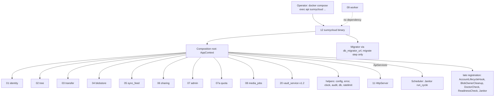
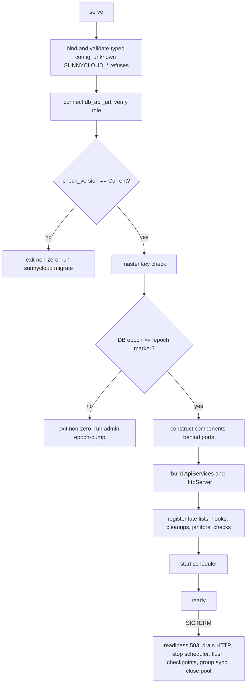

## Epic: 12 Operator CLI — Composition root, scheduler and operator commands

**Epic id**: E-22 (local id; the Jira key is added when the parent creates the issue)

**epic_type**: component

### Epic Summary

Build the `sunnycloud` binary: the composition root that constructs every business component behind its `contracts` port, the janitor scheduler, the `serve` start and stop sequence, and the operator commands (`admin`, `doctor`, `migrate`, `scrub`, `key-check`, `healthcheck`, `openapi`, `version`). It wires everything together and holds no SQL, no blob I/O, no crypto and no business rule.

### Problem / Context

ADR-015 removed all component-to-component crate dependencies: every cross-component call goes through a port in `contracts`. Something must still construct the implementations, register the late lists (account lifecycle hooks, blob-owner cleanups, janitors, doctor and readiness checks) that break wiring cycles, run the janitors without a leader, and give the operator a way to bootstrap, restore, check and repair an installation without the web UI (AC-22, AC-23, AC-30, AC-41, AC-43, AC-65). That is component 12, the only crate that depends on every component crate. Spec: `_docs/02_document/components/12_operator_cli/description.md`; decisions 16 and 17 in `component-decisions.md`; command names in `canonical-names.md` win over older docs.

### System context

### Scope

**In Scope**:
- clap command tree, `--json` output `{result, code, data}`, exit codes (0 success, 1 warnings only, 2 failed/refused/findings, 3 usage or configuration, 130 SIGINT in `serve`), `--yes` guard for destructive commands, `SecretOut` writer for one-time secrets.
- Composition root `AppContext` with lazy service construction; typed config binding and validation; `ApiServices` and `HttpServer` construction; the `AbuseLimiter` and scheduler constructed once and injected.
- `serve` sequence: config, `db_api_url` connect (role verified), schema version check, master-key check, `.epoch` marker check, construct components, build `HttpServer`, register late lists, start scheduler, ready; graceful shutdown order.
- Scheduler: named `Janitor`s on config intervals, failing cycles logged and survived, no leader election, `scheduler_alive` readiness item.
- Commands: `admin create|reset|promote|demote|setup-token|invite|user list|user set-quota|user delete|epoch-bump|restore|keycheck-init|rewrap|media-requeue|media-stats|gc-run|audit export|dev-seed`, `key-check`, `scrub run|status`, `migrate [run|status|revert]`, `doctor [--pre-flight] [--json] [--backup-interval] [--attest-backup]`, `serve`, `healthcheck`, `openapi`, `version`.
- Doctor aggregation over the `DoctorCheck` port (checks are implemented by the owners).

**Out of Scope**:
- Each operation's logic and its `admin_action` audit row (the owning service writes it with `Actor::Operator`).
- HTTP handlers and listeners (E-21), what a janitor cycle does (owners), migrations' content (E-06 and each component), the worker (E-20).

### Assumptions

- Operator commands run as `docker compose exec|run api sunnycloud ...`; `migrate` is a one-shot Compose step with `db_migrator_url` mounted only there.
- One API process in v1.0 (decision 12); janitors claim rows with `FOR UPDATE SKIP LOCKED` or leases, never an advisory-lock leader.
- Step 5 gap-pass defaults: `admin epoch-bump` exits 0 or 1; `doctor` exits 0 ok, 1 warnings only, 2 any failure (missing blobs fail); `--at` is an RFC 3339 UTC timestamp; `--backup-interval` is a duration such as `24h`; SIGINT during `serve` exits 130.
- The composition root grows with every component: wiring only; grep tests keep logic out. E-30 (v1.2) adds its own hook and route registration here; E-20 is a separate binary and not a dependency.

### Dependencies

**Epic dependencies** (must be completed first):
- E-00 Bootstrap & Initial Structure (workspace, CI, Compose skeleton).
- Cross-cutting: E-01 Configuration (key-to-variable table, typed sections), E-02 Error model, E-03 Clock, E-06 Database access and migrations (`Migrator`, `DbTx`, system scope), E-07 Audit log (`AuditReader`), E-08 Abuse rate limiting (`AbuseLimiter`), E-09 Observability; E-04, E-05 only through the components.
- Component ports it requires: E-15 01_identity (`OperatorIdentityOps`, `InviteService`), E-17 07_admin (`AdminService`, `AccountDeletionService`, `DevSeed`, `DeletionPurger`), E-11 07a_quota (`QuotaAdmin`), E-13 02_tree (`TreeRestore`), E-12 05_sync_feed (`EpochAdmin`), E-10 04_blobstore (`MasterKeyring`, `Scrubber`, `GcSweeper`, `EpochMarker`), E-18 08_media_jobs (`MediaAdmin`), E-14 03_transfer and E-16 06_sharing (hooks and janitors), E-21 11_http_api (`HttpServer`).

**External dependencies**:
- Compose test stack (api, db, caddy, worker, decoders) for the restore drill and install check; PostgreSQL 18 with both roles; blob volume with the `.epoch` marker.

### Effort Estimation

**T-shirt size**: XL
**Story points range**: 52-62 (planned child total: 58)

### Users / Consumers

| Type | Who | Key Use Cases |
|------|-----|--------------|
| External | Operator | Install check, admin bootstrap, restore, key management, scrub, doctor |
| System | Compose | `migrate` one-shot step, `serve`, `healthcheck` |
| System | E-21 http_api | Receives `ApiServices`, scheduler-alive readiness item |

### Requirements

**Functional**:
- Every command makes exactly one business call on the owning port and prints the typed result (a fake-port test asserts the single call per command).
- `serve` exits non-zero when `Migrator::check_version` is not `Current` (message names `sunnycloud migrate`) and when the database epoch is below the `.epoch` marker (message names `admin epoch-bump`); the key check runs before any listener.
- `migrate`: one transaction per migration under sqlx's advisory lock; failure or kill rolls that migration back, earlier ones stay, exit 2 naming the failed version; checksum mismatch and unknown-newer database exit 2; `revert` needs `--yes`.
- `admin restore --account --path --at [--dry-run]` reports `Restored{revision, placement: Original | Restored}`.
- Shutdown (SIGTERM, 25 s): readiness 503, stop accepting and wake long-polls, stop scheduler, flush upload checkpoints (03), final group sync (04), close pool.

**Non-functional**: see the Non-functional requirements section.

**Security / Compliance**:
- Tokens issued by owners (256-bit, only SHA-256 stored), printed once through `SecretOut`, never in logs, `--json` or audit rows; `doctor` and `key-check` never print key material.
- System scope reached only through the single system repository module of helper 07 (CI grep test); no `sqlx` and no `blobs/` path in this crate.
- Destructive commands need `--yes` or an interactive confirmation naming the target; non-TTY without `--yes` is exit 3.
- Audit export carries ids only.

### Interface specification

**Provided**

| Port or item | Methods | Consumers |
|---|---|---|
| `Janitor` registry (`Scheduler`) | registers owners' `Janitor`s, `run_cycle(now)` on their interval | internal |
| `ReadinessCheck` (`scheduler_alive`) | item for `/readyz` | E-21 |
| `DoctorCheck` registry | collects owner checks; `DoctorCheck { name, tags (restore, pre-flight), run(ctx) -> Vec<Finding{level Ok\|Warn\|Fail, message, remedy}> }` is defined in `contracts` | `doctor` |
| `AppContext` | lazy builders per service | all commands |

**Required**: see Dependencies (one business call per command; the owner implements, 12 injects). Late-registered lists: `AccountLifecycleHook` (02, 03, 05, 06, 07a, 08, 20), `BlobOwnerCleanup` (02, 08), `Janitor`, `DoctorCheck`, `ReadinessCheck`.

**Command surface** (business call, result and exit code)

| Command | Business call | Result and exit |
|---|---|---|
| `admin create [--note] [--ttl]` | `OperatorIdentityOps::create_admin_invite` | one-time invite once; 0 |
| `admin reset <account>` | `OperatorIdentityOps::reset_admin` | fresh invite once; `LastAdmin`/`NotFound` 2 |
| `admin promote\|demote <account>` | `AdminService::update_user` | `LastAdmin` 2 |
| `admin setup-token` | `OperatorIdentityOps::ensure_setup_token` | only while zero accounts; else 2 |
| `admin invite create\|list\|revoke` | `InviteService` (system scope) | token once on create |
| `admin user list\|set-quota\|delete` | `AdminService` / `AccountDeletionService` | delete needs `--yes` (AC-27) |
| `admin epoch-bump [--yes]` | `EpochAdmin::bump_epoch(now)` (also writes `.epoch`) then `restore`-tagged doctor checks | new epoch and reconcile findings; 0 or 1 |
| `admin restore --account --path --at [--dry-run]` | `TreeRestore::restore_revision` | `Restored{revision, placement}`; `BeyondRetention`, `NotFound` 2 |
| `admin rewrap --new-key-file [--yes]` | `MasterKeyring::rewrap_batch` looped to 0 | progress on stderr |
| `admin keycheck-init` | `MasterKeyring::init_key_check` | samples existing `wrapped_key` first; `KeyCheckSampleFailed` 2 |
| `key-check` | `MasterKeyring::load_and_verify` | `FileMissing`, `WrongLength`, `KeyCheckMismatch`, `KeyCheckAbsentButBlobsExist` 2 |
| `admin gc-run` | `GcSweeper::run_cycle` once | counts; 0 |
| `scrub run [--full] [--rate]` / `scrub status` | `Scrubber::start_run`/`run_step`/`finish_run` / `status` | 2 on mismatch or missing blob |
| `admin audit export --since` | `AuditReader::export` | JSON lines, ids only |
| `admin media-requeue [--account] [--kind]` / `media-stats` | `MediaAdmin::requeue_dead` / `stats` | count / queue depth; 0 |
| `admin dev-seed` | `DevSeed::seed` | refused when `environment = production` |
| `migrate [run]` / `status` / `revert [--steps N] --yes` | `Migrator::run_pending` / `status` / `revert` | see Requirements |
| `doctor [--pre-flight] [--json] [--backup-interval D] [--attest-backup]` | every registered `DoctorCheck` | 0 ok, 1 warnings, 2 any failure |
| `serve`, `healthcheck`, `openapi`, `version` | composition root + `HttpServer` / local | `healthcheck` probes `127.0.0.1:9090/readyz` |

**Doctor checks** (owners implement): config, public URL/TLS 1.3/HTTP/2/proxy body probe (11), database version and API role attributes (helper 07), master key and key check, blob volume and free-space floor (04), providers and redirect URIs, setup state (01), decoder self-check, image age and worker presence from `worker_status` (08), retention vs `--backup-interval` (04), clock skew (helper 03), quota drift via `QuotaAdmin::recompute` (07a, AC-74), missing blobs per revision (AC-73), epoch head and `.epoch` marker (05, decision 5). Read-only; `--json` has identical content.

**Configuration**: same typed sections as the server (helper 01); extra keys `cli_confirm_required` (default on), `cli_progress_interval` (2s); `scrub run` rate default from `scrub_max_rate`; secrets by file (`db_api_url`, `db_migrator_url` only for `migrate`, `master_key_file`, `--new-key-file`); no worker database secret.

### Data flow

### Architecture notes

- ADR-015 (composition root builds every service; no component depends on 12), ADR-014 (two roles: `migrate` uses `sunnycloud_migrator`, runtime uses `sunnycloud`), ADR-002 (single process, janitors inside it), ADR-016 (v1.2 hooks registered later).
- Technology: Rust, clap, tokio, sqlx 0.9 through helper 07 only, `CancellationToken` for cooperative SIGINT cancellation of long commands.
- Command-per-module delivery layer (no module over 500 lines); janitor loops are timers around `run_cycle` and hold no logic; `admin gc-run` and `scrub run` call the same `run_cycle` from the CLI process.
- Hook and cleanup lists are passed to the `DeletionPurger` constructor by the composition root (gap-pass default for G-07-1).
- Decided 2026-11-11 (AZ-3681): `admin reset` of the sole active admin is allowed, no `LastAdmin` (G-12-3). Decided 2026-11-11 (AZ-3787, agent decision): the test-only migration source is the `test-migrations` feature of the test image (G-12-1 resolved, IT-12-11 runnable).

### Non-functional requirements

| Requirement | Target | Failure threshold | Source |
|---|---|---|---|
| `admin user list` with 500 users | 1 s | 3 s | PT-12-1 |
| `doctor` full | 60 s | 180 s | PT-12-1, AC-22 |
| `scrub status` | 2 s | 10 s | PT-12-1 |
| `serve` start to `/readyz` 200 | 10 s | 30 s | PT-12-1 |
| CPU of api container from scheduler | 2% | 5% | PT-12-2 |
| Queries per janitor cycle with nothing due | 3 or fewer | 10 | PT-12-2 |
| Janitor cycle duration p95 | 20 ms | 100 ms | PT-12-2 |
| Install to working server | 30 min following the README | above 30 min | AC-22 |
| Restore drill | dump, wipe, restore, `epoch-bump`, `scrub run --full` exit 0, `doctor` | any step fails | AC-65 |
| Coverage | 90% on exit-code mapping, `--yes` guard, secret writer, start-up order | below 90% blocks | quality-thresholds |

### Design & Architecture

- Architecture doc: `_docs/02_document/architecture.md` (Component list, Dependency rule, runtime units)
- Component spec: `_docs/02_document/components/12_operator_cli/description.md`; tests `.../12_operator_cli/tests.md`; helper specs `common-helpers/07_helper_db.md`, `08_helper_ratelimit.md`

### Testing strategy

- Integration: IT-12-1 exit codes, usage, `--json`; IT-12-2 `create`, `setup-token`, `reset`; IT-12-3 `promote`, `demote`, `user`, `invite`; IT-12-4 `restore`; IT-12-5 `epoch-bump`; IT-12-6 `serve` start refusals; IT-12-7 start sequence and late registration; IT-12-8 graceful shutdown; IT-12-9 scheduler behaviour; IT-12-10 `migrate`; IT-12-11 failing, killed and irreversible migrations (BLOCKED, spike); IT-12-12 `key-check`, `keycheck-init`; IT-12-13 `rewrap`; IT-12-14 `scrub`; IT-12-15 `doctor`; IT-12-16 `gc-run`, `media-requeue`, `media-stats`; IT-12-17 `audit export`, `dev-seed`; IT-12-18 `openapi`, `healthcheck`, `version`, lazy construction; IT-12-19 secret channel and cancellation.
- Performance PT-12-1..2; security ST-12-1 secrets never leave the secret channel, ST-12-2 destructive commands need confirmation, ST-12-3 no listener and no SQL of its own, ST-12-4 database role boundaries; acceptance AT-12-1 (install check), AT-12-2 (restore drill).
- System scenarios: FT-P-64, FT-P-65, FT-N-20, FT-N-21, FT-P-16..19, FT-N-35, FT-P-43, FT-P-69, FT-P-71, FT-P-72, FT-N-33, FT-N-39, FT-N-43, NFT-RES-07, 10, 13, 14, 34, 37, 38, 39, NFT-PERF-30, NFT-SEC-25..27, NFT-SEC-38.
- Spec gaps: G-12-1 and G-12-3 resolved 2026-11-11; G-12-2, G-12-5, G-12-6, G-12-7 resolved at the gap pass.

### Definition of Done

- [ ] All in-scope commands implemented with the documented exit codes
- [ ] Automated tests pass (unit + integration IT-12-*; restore drill AT-12-2 in CI)
- [ ] Coverage at or above 75% on business logic and 90% on exit-code mapping, `--yes` guard, secret writer and start-up order (canonical: `quality-thresholds.mdc`)
- [ ] Grep tests green: no `sqlx`, no `blobs/` paths, no business rule in the crate
- [ ] Command names reconciled in `architecture.md` and deployment docs (no `key rewrap`, `media requeue`, top-level `restore`)
- [x] Spikes closed and `tests/spec-gaps.md` entries G-12-1, G-12-3 updated (2026-11-11)

### Acceptance Criteria

| # | Criterion | Measurable Condition |
|---|-----------|---------------------|
| 1 | AC-22 install check | AT-12-1: `doctor --pre-flight` prints redirect URIs; `doctor` exit 0 on the Compose test stack |
| 2 | AC-23 admin without the web | IT-12-2, IT-12-3: setup token works once; create, reset, promote work |
| 3 | AC-24 scrub | IT-12-14: `scrub run/status`, exit 2 on mismatch |
| 4 | AC-30 restore by path and time | IT-12-4, IT-12-16: restore and `gc-run` per spec |
| 5 | AC-41 epoch bump | IT-12-5, IT-12-6, AT-12-2: skipping the bump makes `doctor` Fail and `serve` refuse |
| 6 | AC-43 key operations | IT-12-12, IT-12-13: `keycheck-init` refuses a wrong key; `rewrap` loops to 0 |
| 7 | AC-65 backup, restore, upgrade | IT-12-10, AT-12-2: restore drill passes end to end; interrupted migration rolls back |
| 8 | AC-72 master key | IT-12-6, IT-12-12: wrong key fails `key-check`, `doctor` and `serve` before any listener |
| 9 | AC-73 / AC-74 doctor | IT-12-15: every revision with a missing blob listed; quota drift reported |
| 10 | AC-80 / AC-68 | IT-12-9, IT-12-14: scrub safe beside a live API; scheduler cycles are the only janitors |
| 11 | Secret hygiene | ST-12-1, NFT-SEC-38: a secret appears once on stdout and nowhere else |

### Risks & Mitigations

| # | Risk | Mitigation | Owner |
|---|------|------------|-------|
| 1 | R02: restore without `epoch-bump` leaves devices ahead of the server | `serve` refuses, `doctor` Fail, restore-drill test; client-side `S > seq` check | 05, 04, 12 |
| 2 | R06: single process hosts the scheduler and the API | Documented limit; claim-safe cycles; notifier behind a port | architecture |
| 3 | R12: janitors share CPU and I/O with requests | Drain-until-empty within a time budget; PT-12-2 thresholds | 12 |
| 4 | R15: composition root grows with every component | Wiring only; grep tests; review rule; vertical slice first | plan |
| 5 | `admin reset` semantics depend on E-15 (identity is `(provider, id)`) | Reset issues a new admin invite; allowed for the sole admin (owner decision G-12-3, 2026-11-11) | 01, 12 |
| 6 | Failing-migration paths untestable in a release binary (G-12-1) | Test-only migration source feature `test-migrations` (decided 2026-11-11, AZ-3787); work in helper 07, helper 01 and the CI epic is listed in 12 description section 4 | 12, helper 07 |

### Labels

- `sunnycloud`
- `component:operator_cli`
- `release:v1.0`
- `type:platform`

### Child Issues

| Type | Title | Points |
|------|-------|--------|
| Spike | Test-only migration source for failing, killed and irreversible migrations (G-12-1) and reset of the sole admin (G-12-3, owner) | 2 |
| Enabler | `sunnycloud` crate skeleton: clap tree, exit-code table, `--json`, `--yes` guard, `SecretOut`, lazy `AppContext` | 3 |
| Task | Composition root: construct all components behind ports, `ApiServices`, late-registered lists, single `AbuseLimiter` | 5 |
| Task | Typed config binding and validation (unknown `SUNNYCLOUD_*` refuses, ranges, providers) | 3 |
| Task | `serve` start and stop sequence (version check, key check, epoch marker check, shutdown order, SIGINT 130) | 5 |
| Task | Scheduler: janitors on intervals, failure survival, metrics, `scheduler_alive` | 3 |
| Task | `migrate run|status|revert` with rollback and refusal behaviour | 3 |
| Task | Identity commands: `admin create|reset|setup-token|invite|promote|demote` | 3 |
| Task | `admin user list|set-quota|delete`, `dev-seed`, `audit export` | 3 |
| Task | `admin epoch-bump`, `admin restore`, `admin gc-run` | 3 |
| Task | `key-check`, `admin keycheck-init`, `admin rewrap` | 3 |
| Task | `scrub run|status` with rate throttle and exit codes | 3 |
| Task | `admin media-requeue`, `admin media-stats` | 2 |
| Task | `doctor` aggregation: registry, levels, `--pre-flight`, `--json`, exit codes | 5 |
| Task | `healthcheck`, `openapi`, `version` | 2 |
| Task | Integration suite IT-12-1..19 with fake owner ports (single-call assertions) | 5 |
| Task | Acceptance, performance and security tests AT-12-1..2 (install check, restore drill), PT-12-1..2, ST-12-1..4 | 5 |
