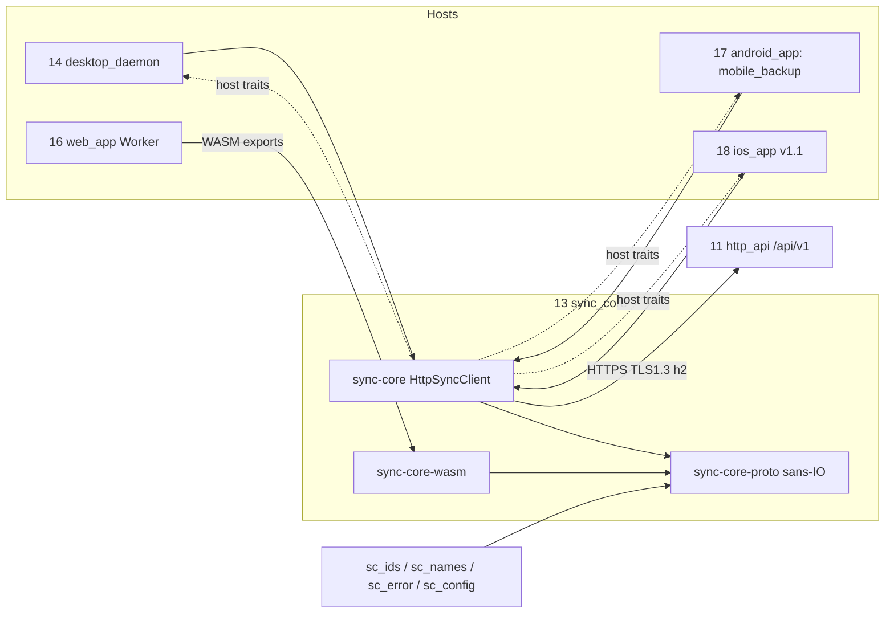
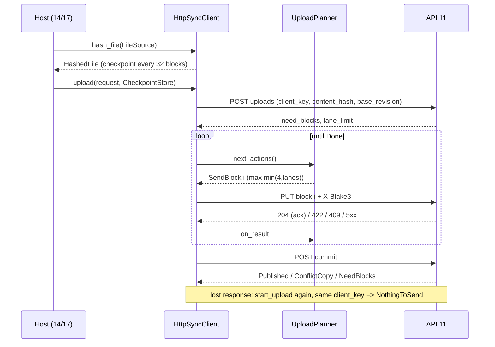

## Epic: Sync Core — the one client-side implementation of the sunnycloud wire protocol

**epic_type**: component
**concern** (cross-cutting only): n/a

### Epic Summary

Build the shared Rust client library (`sync-core-proto` sans-IO, `sync-core` reqwest executor, `sync-core-wasm` adapter, feature-gated UniFFI derives) that hashes, uploads, downloads, polls the change feed, refreshes tokens and negotiates the API version for the desktop daemon, Android, iOS and the web Worker. It is the only place the client side of the protocol exists, so server and clients agree byte for byte (ADR-004, ADR-013).

### Problem / Context

Four client families must implement the blocklist protocol (2 MiB blocks, 4 lanes, resume, batch commit, long-poll, token rotation). Two executors exist (reqwest natively, `fetch` in the browser) and both must plan identically; a second or third protocol copy would break AC-3, AC-7, AC-8 and AC-52. The library has no UI, no watcher, no scheduler and no persistent state: stores are host traits.
- Architecture: `_docs/02_document/architecture.md` (component 13, Dependency rule, ADR-015); component spec `components/13_sync_core/description.md`; flows F4, F5, F6, F7, F14 in `system-flows.md`.
- Constraint: client-side traits (`SyncApi`, `CredentialProvider`, `FileSource`, `DownloadSink`, `CheckpointStore`, `ProgressSink`) live in `sync-core`, never in the server-only `contracts` crate.

### System Context

### Scope

**In Scope**:
- Block hashing, file-hash rollup, commit-ID rules, `client_key` derivation use (helper 05), `UploadPlanner`, feed-page invariant checks, `ServerUrl` validation.
- `HttpSyncClient` implementing `SyncApi`: connect and `ServerInfo` negotiation, large upload with resume, small upload with `stage_small` plus `batch_commit`, verified download, `poll_changes`/`head_cursor`/`list_children`, tree mutations with base revisions, `lookup_revisions`, device grant, mobile code exchange, refresh (single flight), `sign_out`, `cancel`.
- Typed wire-code mapping table; `Secret` redaction; rate-limit and 426 handling.
- WASM adapter for hashing, rollup, commit ID, resume diff; UniFFI derives; conformance vector file shared with 16, 17.

**Out of Scope**:
- Reconcile/merge rules and watcher (14), backup run, asset mapping and checkpoint DB (17 `mobile_backup`), token storage (hosts), vault crypto (19), any server logic.
- Cross-node dedupe by hash (not in scope of the product); iOS 26.1 upload extension (deferred).
- flutter_rust_bridge (rejected, ADR-013).

### Assumptions

- `ServerInfo` (defined in E-21) is the authority for block size, lanes, small-file cap, batch size, staged cap, long-poll wait, minimum client version; OpenAPI is the contract.
- Helper crates `sc_ids` (hashing also built for WASM), `sc_names`, `sc_error` (`ApiError::parse`), `sc_config` build for client targets without server dependencies.
- 03 transfer returns `NothingToSend{revision}` for a new file at `(parent, name, hash)` after a lost commit response (13 risk 2, `tests/spec-gaps.md` IT-13-16 B): confirmed by the spike below.
- One HTTP/2 connection carries all four lanes unless gate S1 fails on lossy links.

### Dependencies

**Epic dependencies** (must be completed first):
- E-00 Bootstrap & Initial Structure (Cargo workspace, CI, `tests/run.sh` skeleton).
- E-01 Configuration (`sc_config`, `sync` section typing), E-02 Error model (`ApiError::parse`, code table), E-04 IDs and hashing (`FileHasher`, `rollup`, `derive_client_key`, vector file), E-05 Name rules (optional preflight, `split_path`).
- E-21 http_api (OpenAPI document, `GET /api/v1/server-info`, 426/410/422/507 behaviour) and, for integration tests, E-13 tree, E-14 transfer, E-12 sync_feed, E-15 identity (device grant, mobile code, refresh endpoints).

**External dependencies**:
- reqwest 0.13.5 (rustls), tokio >= 1.54.1, h2 >= 0.4.16, bytes >= 1.11.1, rustls >= 0.23.45, rustls-platform-verifier 0.7.1, blake3 1.8.7, uniffi 0.32.2, wasm-bindgen =0.2.130.
- REF-SRV/REF-LOAD hardware for gate S1 timing (R03 owner item).

### Effort Estimation

**T-shirt size**: XL
**Story points range**: 55-75 (child issues below total 66)

### Users / Consumers

| Type | Who | Key Use Cases |
|------|-----|--------------|
| System | 14 desktop_daemon | `SyncApi` for hashing, upload, download, feed, device login |
| System | 17 android_app / 18 ios_app (`mobile_backup`) | Same API through UniFFI; bounded memory; `cancel()` |
| System | 16 web_app Worker | WASM hashing, rollup, commit ID, resume diff |
| Internal | Developers of hosts | Fake `SyncApi`, `MemoryCheckpointStore`, conformance vectors |

### Interface Specification

`SyncApi` (async, typed, no HTTP types). Construction: `HttpSyncClient::connect(SyncConfig, Arc<dyn CredentialProvider>) -> Result<(HttpSyncClient, ServerInfo), ConnectError>`; `ConnectError = InsecureScheme | Unreachable | UpgradeRequired{message, update_url} | ProtocolMismatch{what} | Unauthorized`. `ServerInfo{block_size, max_lanes, small_file_max, batch_max_entries, max_staged_per_account, longpoll_max_wait, min_client_version, api_versions}`.

| Operation | Input | Output | Typed errors |
|---|---|---|---|
| `hash_file` | `Arc<dyn FileSource>`, `Option<ResumeHashState>`, progress | `HashedFile{block_hashes, file_hash}` | `SourceChanged`, `Io` |
| `lookup_revisions` | `[FileHash]` (chunked at 1000) | `[RevisionRef]` with `client_meta` | none |
| `get_revision`, `root_node` | `revision_id`; none | `RevisionView{blocklist, content_hash, size, client_meta}`; `NodeView` | `NotFound` |
| `upload` | `UploadRequest{local_key, parent, name, source, hashed, base_revision?, client_key, client_meta?, import_hint}` (`local_key` keys the checkpoint; `client_key` is used when the store holds no key for `hashed.file_hash`, a stored key for the same hash wins), `Arc<dyn CheckpointStore>`, progress | `CommitOutcome::{Published, ConflictCopy, NothingToSend}` | `QuotaExceeded`, `SizeTooLarge`, `SessionCapReached`, `FreeSpaceFloor`, `InvalidName`, `NotAFolder`, `ParentNotFound`, `ParentGone`, `BlocklistMismatch`, `SourceChanged`, `Io` |
| `stage_small` | `staged_key`, bytes <= `small_file_max`, hash (`PUT /api/v1/staged-uploads/{key}`, `X-Blake3`) | `Staged{staged_key, size}` | `QuotaExceeded`, `StagedCapReached`, `FreeSpaceFloor` |
| `batch_commit` | `BatchCommit{commit_id, entries <= batch_max_entries}` | per entry `Committed | EntryError` | `BatchTooLarge`, `CommitIdReused` |
| `download` | `RevisionRef`, `Arc<dyn DownloadSink>`, `resume_from` | `Verified{file_hash}` | `HashMismatch{block}`, `NotFound`, `BlobUnavailable`, `Io` |
| `poll_changes` | `Cursor{epoch, seq}`, `wait`, `limit` | `ChangePage{items, next_cursor, has_more}` or `ResyncRequired{reason}` | `ProtocolViolation{detail}` |
| `head_cursor`, `list_children` | root/node, page token | `Cursor`; `ListingPage{items, next}` (files carry `content_hash`) | `NotFound`, `NotAFolder` |
| `create_folder`, `move_node`, `delete_node` | ids, names; `base_revision` only for file delete | `NodeView` / `()` | `NameConflict`, `InvalidName`, `Cycle`, `ParentNotFound`, `ParentGone`, `NotAFolder`, `EditedSince` (delete) |
| `device_grant_request`, `device_grant_poll` | device name, platform; `device_code` | `DeviceAuthorization{user_code, verification_uri, interval}`; `Token | Pending | SlowDown | Denied | Expired` | none |
| `exchange_mobile_code`, `refresh`, `sign_out`, `cancel` | `code`, `code_verifier`; none | `SessionTokens{access, refresh, expires_in}`; `()` | `InvalidCode`; `Unauthorized` |

Common errors on every operation: `Transport`, `Cancelled`, `UpgradeRequired`, `Unauthorized`, `RateLimited{retry_after}`, `AccountNotActive`; unknown wire codes become `Unexpected{code, request_id}`. Host traits: `CredentialProvider{bearer()->Credential{access: Secret, refresh: Option<Secret>}, on_rotated(access, refresh)}`, `FileSource{len, read_at, identity()->(size, mtime_ns)}`, `DownloadSink{write_verified(offset, bytes), finish(verified)}`, `CheckpointStore{load/save/clear(local_key)->UploadCheckpoint, save_batch/load_batches/clear_batch}`, `ProgressSink{on_progress(done,total)}`.
`UploadPlanner`: `new(block_count, need_blocks, lanes_max, retry_policy)`; `next_actions() -> [SendBlock{i}|Wait{ms}|RereadSession|Commit|Done|RestartSession]`; `on_result(i, Acked|HashRejected(422)|Transient{retry_after?}|BlockConflict{retry_after?}|SessionGone)`; `on_session(need_blocks)`; `on_commit(NeedBlocks|BlocklistMismatch|Ok|SessionGone)`.

### Data Flow

### Design & Architecture

- Architecture doc: `_docs/02_document/architecture.md`
- Component spec: `_docs/02_document/components/13_sync_core/description.md`
- System flows: `_docs/02_document/system-flows.md` (F4-F8, F14)

### Architecture Notes

- ADR-004 (protocol constants, order and feed), ADR-013 (UniFFI, no flutter_rust_bridge), ADR-015 (client traits in `sync-core`), ADR-005 (conflict copies chosen by the server; the client never renames), ADR-008 (token lifecycle), ADR-001 (Rust).
- Split justified by two executors that must plan identically; `sync-core-wasm` is a build target of the protocol part, not a third part. Trimming the WASM surface is a risk-register item (R15 note), kept as confirmed.
- Transport: reqwest 0.13.5, rustls TLS >= 1.3, ALPN h2, `https_only`; the compile-time feature `allow-plain-http` exists for debug builds only and CI asserts release binaries lack it (AC-54). Explicit HTTP/2 windows 8 MiB stream / 32 MiB connection, keep-alive pings 20 s.
- Token lifecycle: 401 triggers single-flight `refresh`; the new refresh token is persisted by `on_rotated` before the new access token is used; a failed persist is retried once, then treated as `Unauthorized` (Step 5 gap default). Desktop device tokens never refresh.
- Config section `sync` (typed via E-01): `retry_base` 500ms, `retry_max` 30s, `max_attempts_per_block` 8, `connect_timeout` 10s, `request_idle_timeout` 60s, `longpoll_wait` 30s, `longpoll_client_margin` 10s, `hash_checkpoint_blocks` 32, `hash_cpu_share` 0.25, `batch_max_bytes_in_flight` 64 MiB.

### Requirements

**Functional**:
- At most `min(4, max_lanes)` blocks in flight; a block is acked only on the server's 204; a 422 resends that block; `BlockConflict` follows the planner rules (wait, re-read session, resend, or restart).
- Idempotence: `client_key` reused on every retry (random UUIDv7 desktop/web, `derive_client_key` mobile); batch `commit_id` is a random UUIDv7 stored before the first `stage_small`; lost commit response recovered by repeating `start_upload`.
- Verified download: rolling BLAKE3 per block against the revision blocklist; mismatching bytes never reach the sink; resume at the last verified boundary.
- Feed page checks (ascending `(seq,id)`, `seq` in `(cursor.seq, next.seq]`, same epoch, `next >= cursor`); the library never persists the cursor.

**Non-functional**:
- See Non-Functional Requirements below.

**Security / Compliance**:
- HTTPS/TLS 1.3 only; tokens wrapped in `Secret`, never logged or put in URLs; no cross-host redirects; server numbers range-checked; names returned as data, never used as paths.

### Non-Functional Requirements

| Target | Threshold | Failure | Test |
|---|---|---|---|
| Large transfer, single client (AC-2) | >= 112 MB/s (90% of 1 Gbps), 0% failed blocks | below 100 MB/s or below 90% of calibrated goodput | PT-13-1, NFT-PERF-04 (gate S1, REF-SRV) |
| Resume re-send (AC-3) | <= 16 MiB per drop | > 16 MiB | IT-13-2, AT-13-1 |
| 50 GiB finish (AC-4) | last ack to `Published` <= 2 s | > 2 s | IT-13-3 |
| 10,000 small files (AC-40) | <= 45 s target, 0 duplicates | > 60 s | PT-13-4 |
| Mobile memory (AC-52) | RSS <= 100 MB target | > 150 MB | PT-13-2, IT-13-18 |
| Planner cost at 25,600 blocks | `next_actions` mean <= 50 us, state <= 4 MB | > 1 ms / > 16 MB | PT-13-3 |
| `cancel()` | all ops return `Cancelled` within 1 s | > 1 s | IT-13-18 |

### Testing Strategy

- Component tests: `components/13_sync_core/tests.md` — IT-13-1..20 (planner properties, wire-code table, batch replay, token refresh fixture, resync order, vectors), PT-13-1..4, ST-13-1..3, AT-13-1..2. Unit/IT use an in-process scripted fake HTTP server (drop, bit flip, delay, 401, 410, 422, 426, 429); integration uses the real server container with PostgreSQL (`core` profile).
- System scenarios: FT-P-01..05, FT-P-32, FT-P-34, FT-P-35, FT-N-01, FT-N-02, FT-N-26, FT-N-27, FT-N-38, NFT-PERF-04, NFT-PERF-05, NFT-PERF-07, NFT-PERF-22, NFT-PERF-23, NFT-RES-01, NFT-RES-02, NFT-RES-18, NFT-RES-22, NFT-RES-25, NFT-RES-27, NFT-RES-28, NFT-RES-33, NFT-RES-LIM-03, NFT-SEC-12, NFT-SEC-21 (owned by E-31).
- Conformance: shared vector file (sizes 0, 1, 2 MiB-1, 2 MiB, 2 MiB+1, 6 MiB, 100 MiB) must give identical hashes from native, WASM (Chromium, Firefox, WebKit) and Kotlin UniFFI builds.
- Coverage: 75% overall, 90% on critical paths (planner, token refresh, verified download, wire-code table).

### Definition of Done

- [ ] All in-scope capabilities implemented
- [ ] Automated tests pass (unit + blackbox)
- [ ] Minimum coverage threshold met (canonical: `quality-thresholds.mdc` Quality Thresholds)
- [ ] Runbooks written (n/a: library; host README documents `allow-plain-http` and trust-store init)
- [ ] Documentation updated (OpenAPI mapping table, host trait guide)
- [ ] CI check proves release binaries lack `allow-plain-http`; `cargo tree` shows pinned versions

### Acceptance Criteria

| # | Criterion | Measurable Condition |
|---|-----------|---------------------|
| 1 | AC-2/AC-4 client side | PT-13-1 >= 112 MB/s on REF-SRV; IT-13-3 finish <= 2 s for 5 GiB and 50 GiB |
| 2 | AC-3 resume | IT-13-2/AT-13-1: each resume re-sends <= 16 MiB over 10 seeded drops, no re-hash from zero |
| 3 | AC-7, AC-38, AC-68 | IT-13-4/5/15: corrupt block gives `HashMismatch`, sink never sees it; non-204 leaves block needed |
| 4 | AC-8, AC-70 | IT-13-6: `ConflictCopy` / `EditedSince{current}`; `move_node` request has no `base_revision` |
| 5 | AC-40 | IT-13-7/8, PT-13-4: save-before-stage, 0 duplicates, 10,000 files <= 60 s at 20 ms RTT |
| 6 | AC-41, AC-69 | IT-13-11/12: six invariant violations give `ProtocolViolation`; 410/422 give `ResyncRequired`, head cursor first |
| 7 | AC-46, AC-31, AC-78 | IT-13-14/16/17: lookups chunked at 1000; same `client_key` after lost commit gives `NothingToSend` (new-file leg after spike) |
| 8 | AC-52 | IT-13-18: `cancel()` returns `Cancelled` <= 1 s; RSS <= 150 MB on 5 GiB |
| 9 | AC-54, AC-64 | IT-13-13, ST-13-1: `http://` gives `InsecureScheme` with 0 sockets; 426 gives `UpgradeRequired`, 0 retries |
| 10 | AC-58, AC-21, AC-76 | IT-13-9/10: 4 concurrent 401s cause 1 refresh; persist before use; device token 401 is `Unauthorized` at once |
| 11 | Cross-implementation | IT-13-20: 0 differences native/WASM/UniFFI on the vector file |

### Risks & Mitigations

| # | Risk | Mitigation | Owner |
|---|------|------------|-------|
| 1 | R04/R03: one h2 connection and Caddy windows miss 90% (gate S1) | Tune windows in S1; add a second connection (config) before anything else | 13 |
| 2 | R05: mobile token rotation loses a refresh token | Persist-before-use, 30 s server grace, retry once then sign out (IT-13-9) | 13, 17 |
| 3 | R27: 100 MB daemon budget vs in-flight buffers | In-flight cap 16 MiB option, measure in S2 | 13, 14 |
| 4 | R31: UniFFI/`syn` pin clash | UniFFI only, pin in workspace lockfile | 13 |
| 5 | G-03-1 resolved 2026-11-11: AC-3 is 16 MiB, limits stay | Client lanes min(4, max_lanes, lane_limit) = 4, no extra cap; planner takes `lanes_max` only (AZ-3953) | owner |
| 6 | Lost-commit recovery for new files depends on 03 | Decided 2026-11-13 (AZ-3732, AZ-3949: `sync_api.md` § Lost-commit recovery; owner: 03 answers `NothingToSend` for a committed key until `upload_session_ttl`, AZ-3734/AZ-3738) | 13, 03 |

### Labels

- `sunnycloud`
- `component:sync_core`
- `env:stg`
- `type:integration`

### Child Issues

| Type | Title | Points |
|------|-------|--------|
| Spike | Confirm with 03 `NothingToSend` for a new file at `(parent, name, hash)` after a lost commit (IT-13-16 B, `tests/spec-gaps.md`) | 2 |
| Spike | Gate S1 client side: h2 windows, Caddy hop, second-connection decision | 3 |
| Spike | Decide G-03-1 handling: lane count and checkpoint interval vs AC-3 (owner input) | 2 |
| Enabler | `sync-core-proto` crate: DTOs, `ServerUrl`, hashing wrappers, commit-ID rules, feed-page checker | 5 |
| Task | `UploadPlanner` state machine and property tests (IT-13-1, IT-13-2) | 5 |
| Task | Typed error model and wire-code mapping table (IT-13-13) | 3 |
| Task | `HttpSyncClient::connect`, `ServerInfo` validation, version header, 426, transport policy | 5 |
| Task | Tree operations: listing, `get_revision`, `lookup_revisions`, create/move/delete (IT-13-6, IT-13-14) | 3 |
| Task | Large-upload executor: lanes, ack-on-204, resume, lost-commit recovery (IT-13-3, IT-13-15, IT-13-16) | 5 |
| Task | Small upload: `stage_small`, save-before-stage batch records, pacing, `batch_commit` (IT-13-7, IT-13-8) | 5 |
| Task | Verified ranged download with resume (IT-13-4, IT-13-5) | 3 |
| Task | Feed client: `poll_changes`, `head_cursor`, backoff, page invariants (IT-13-11, IT-13-12) | 3 |
| Task | Token lifecycle: single-flight refresh, `on_rotated`, device grant, mobile code, `sign_out` (IT-13-9, IT-13-10) | 5 |
| Task | Host traits, `MemoryCheckpointStore`, `cancel()`, `Secret` redaction, rate-limit handling (IT-13-17..19, ST-13-2) | 3 |
| Task | UniFFI derives, foreign-trait callbacks and platform-verifier init hook | 3 |
| Task | `sync-core-wasm` adapter and cross-implementation vector gate (IT-13-20) | 3 |
| Enabler | Scripted fake HTTP server fixture (drop, bit flip, delay, 401/410/422/426/429) | 3 |
| Task | Integration suite against the real server stack and perf tests PT-13-1..4, ST-13-3, AT-13-1/2 | 5 |
