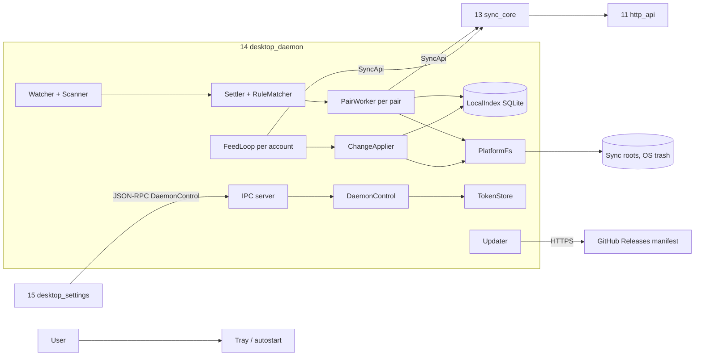
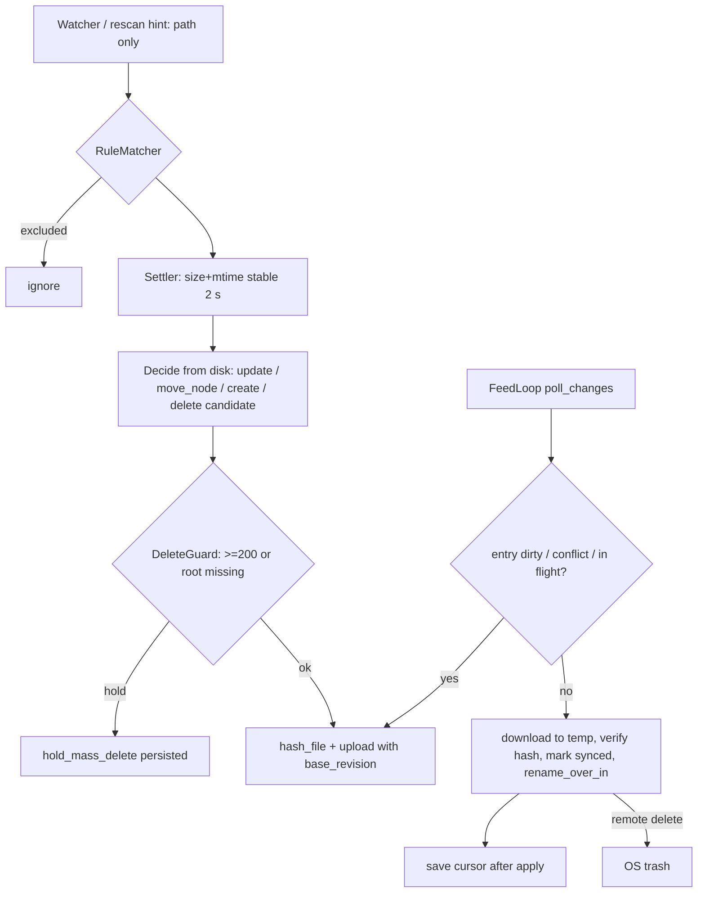

## Epic: Desktop Daemon — safe local-side folder sync for Linux and Windows

**epic_type**: component
**concern** (cross-cutting only): n/a

### Epic Summary

Build the per-user background process (plus its `ipc_schema` crate) that keeps local folders identical to server folders: it turns filesystem hints into verified uploads, feed events into safe local writes, and refuses to propagate destructive mistakes. Linux and Windows ship in v1.0; macOS items are v1.1.

### Problem / Context

Folder sync is a headline use case (AC-5, AC-35). The daemon must stay within 100 MB and 1% idle CPU at 100,000 files (AC-15), work with no tray (AC-26), survive save-in-place editors (AC-34), hostile names (AC-37), cloud placeholders (AC-32) and locked files (AC-33), and never delete without a guard (AC-29). It implements the local side only; the wire protocol is E-23.
- Architecture: `architecture.md` (component 14, ADR-012, ADR-015, ADR-017); spec `components/14_desktop_daemon/description.md`; flows F3, F7, F9, F14, F15 in `system-flows.md`; data model section 11 (`LocalIndex`).

### System Context

### Scope

**In Scope**:
- Server address setting, watcher hints (`notify` 8.2.1), own 2 s settle, safety rescans (start, interval, resume, watcher error), echo suppression, rename-over and directory-rename tracking, case-insensitive roots.
- `LocalIndex` (rusqlite WAL), upload checkpoints and 13 batch records, rebuild; mass-delete guard and root sentinel; first-sync merge (also after restore); placeholder skipping; lock retry; include/exclude rules (`ignore` grammar, AC-66).
- Safe local writes through directory handles (`PlatformFs` per OS); remote deletes to the OS trash; hostile and unrepresentable names (`%XX` escape).
- Device login (RFC 8628 client), `TokenStore` (keyring, 0600 file fallback), local IPC server, tray, autostart installers, update check with signature verification.
- [v1.1] macOS: `PlatformFs` macOS, LaunchAgent via `SMAppService`, permission probe (`access_denied`, AC-67).

**Out of Scope**:
- HTTP framing, hashing loops, lanes, resume, long-poll mechanics, token refresh (E-23); settings screens (E-25); files-on-demand placeholders; vault on desktop (v1.2); sharing UI.

### Assumptions

- A server listing carries `content_hash` for files (E-21); one feed loop and one cursor per account fan out to pairs by ancestry.
- Linux `openat2` is available (fallback `openat` + `O_NOFOLLOW`); Windows handle-relative `NtCreateFile` works under a standard user.
- Update manifest layout (field names, per-OS shape, serial storage, offline signing tool) is settled by an ADR before the updater task (open item).
- `sc_config`, `sc_clock` (`ManualClock`, `Resumed` detection), `sc_ids`, `sc_names` build for desktop targets.

### Dependencies

**Epic dependencies** (must be completed first):
- E-00 Bootstrap, E-01 Configuration (`desktop` keys), E-02 Error model, E-03 Clock, E-04 IDs and hashing, E-05 Name rules (`portable_check`, `escape_name`, `name_key`).
- E-23 sync_core (`SyncApi` and host traits), E-21 http_api (server contract), E-15 identity (device grant, `DELETE /api/v1/devices/me`), E-12 sync_feed, E-13 tree and E-14 transfer (server behaviour for conflicts, base revisions, staged uploads) for integration.

**External dependencies**:
- Crates: notify 8.2.1, `ignore`, rusqlite 0.41.1 (bundled), keyring 4.2.0, tray-icon 0.26.1, interprocess 2.4.7, tokio >= 1.54.1, Rust >= 1.90 (workspace pin).
- Lab: WIN-VM, LIN-VM, REF-WIN-WEAK, cfapi test provider (DS-14), `mock-update-server` (DS-31); signing accounts (Windows, R19) are owner items.

### Effort Estimation

**T-shirt size**: XL
**Story points range**: 75-100 (child issues below total 88; 10 points are [v1.1] macOS)

### Users / Consumers

| Type | Who | Key Use Cases |
|------|-----|--------------|
| External | Desktop user (Linux, Windows) | Sync folders in the background; tray status; recover from holds |
| System | 15 desktop_settings | `DaemonControl` over JSON-RPC (the only surface it uses) |
| System | OS (systemd user unit, Task Scheduler logon task) | Start at login without UI |
| Internal | Operators | Publish update manifests signed offline |

### Interface Specification

`DaemonControl` (JSON-RPC 2.0 over a user-only local socket / ACL'd pipe; types in crate `ipc_schema`, which contains no token-returning method):

| Method | Input | Output | Errors |
|---|---|---|---|
| `status` | none | `DaemonStatus{server_url, account, pairs[], skipped_count, escaped_count, holds[], update_available, access_denied, watcher_degraded}` | none |
| `set_server` | `url` (validated by `ServerUrl` plus `GET /api/v1/server-info`) | `()` | `HttpsRequired`, `ServerUnreachable`, `UpgradeRequired{message}`, `SignedIn` |
| `list_server_folders` | `parent: Option<NodeId>` | `[FolderEntry{node_id, name}]` (paged) | `NotSignedIn`, `ServerUnreachable`, `UnknownFolder` |
| `list_pairs` / `add_pair` | `PairSpec{server_node_id or server_path + create_if_missing, local_root, rules_text}` (exactly one of node id and path) | pairs / `PairId` | `NotSignedIn`, `RootInvalid`, `RootNested`, `RulesInvalid{line}`, `CloudManagedRoot`, `AlreadyPaired`, `UnknownFolder` |
| `update_pair` / `remove_pair` / `pause` / `resume` | `PairId`, partial spec | `()` | `UnknownPair`, `RulesInvalid` |
| `list_skipped` / `list_escaped` | optional `PairId`, page | `[SkippedEntry{rel_path, reason}]` / `[EscapedEntry{original_name, saved_name, rel_path}]` | `UnknownPair` |
| `get_settings` / `set_settings` | `SettingsPatch` (bandwidth, hash throttle, autostart, tray) | applied `Settings` (echo) | `SettingInvalid{key}` |
| `resolve_hold` | `PairId`, `HoldDecision::{ConfirmDeletes, RestoreFromServer}` | `()` | `NoSuchHold` |
| `login_start` / `login_status` / `logout` | device name; none | `LoginPrompt{verification_url, user_code, expires_at}`; `LoginState::{Pending, Approved, Denied, Expired, SignedOut}` | `ServerNotSet`, `ServerUnreachable`, `HttpsRequired` |
| `subscribe` | none | stream of `StatusEvent` (new `DaemonStatus`) | none |

Internal traits (private to the crate, faked in tests): `LocalIndexStore` (`get_entry`, `upsert_entries`, `entries_in_state`, `find_by_file_id`, `find_by_node`, `set_pair_state`, `set_cursor`, `meta_get/set`, `rebuild`, plus the `CheckpointStore` side; errors `IndexCorrupt`, `IndexNewerThanDaemon`, `Io`); `PlatformFs` (`open_root`, `is_case_insensitive`, `create_new_in`, `rename_over_in`, `trash`, `stat_no_follow`, `file_id`, `is_placeholder`, `open_for_read`, `walk`; errors `Locked`, `Placeholder`, `EscapesRoot`, `NameNotRepresentable`, `TrashUnavailable`, `PermissionDenied`, `Io`); `TokenStore` (`load/save/delete`; `KeyringTokenStore`, `UserFileTokenStore`; errors `StoreUnavailable`, `PermissionTooOpen`). The daemon provides to 13: `CredentialProvider`, `FileSource`, `DownloadSink` (verified blocks only), `CheckpointStore`, `ProgressSink`.

### Data Flow

### Design & Architecture

- Architecture doc: `_docs/02_document/architecture.md`
- Component spec: `_docs/02_document/components/14_desktop_daemon/description.md`
- System flows: `_docs/02_document/system-flows.md`

### Architecture Notes

- ADR-012 (native daemon, separate Slint process, Tauri fallback only for settings), ADR-017 (offline-signed manifest, two pinned Ed25519 keys, `serial`, `expires`, source fixed at build time), ADR-005 (server-named conflict copies, edit beats delete), ADR-004 (feed), ADR-015 (ports).
- One tokio runtime, one `FeedLoop` per account, one `PairWorker` actor per pair; watcher is a hint source, the `LocalIndex` plus the disk is the truth; no event kind is trusted.
- `LocalIndex`: SQLite WAL, `synchronous=NORMAL`, forward-only `PRAGMA user_version` migrations; an index, never truth: loss means rescan plus first-sync merge, nothing deleted.
- Autostart written directly (no `auto-launch` crate): systemd user unit `WantedBy=default.target`; Windows Task Scheduler logon task (`InteractiveToken`), because a service cannot own a tray; macOS LaunchAgent [v1.1].
- Token only in keyring (service `sunnycloud`, user = account id) or a 0600 file in a 0700 dir with one WARN (owner-confirmed fallback, R25).
- Config keys (E-01): `desktop.settle` 2s, `rescan_interval` 15m, `wake_gap` 60s, `lock_retry_initial` 500ms, `lock_retry_max` 4s, `mass_delete_threshold` 200, `hash_cpu_share` 0.25, `update_check_interval` 24h, `sparse_warn_bytes` 10GiB, `macos_permission_probe` 10s. Update URL and keys are build-time constants.

### Requirements

**Functional**:
- Upload only after `(size, mtime)` unchanged for `desktop.settle`; a downloaded file is never re-uploaded (echo record written before rename).
- Save-in-place (rename-over) yields one revision on the same file ID; directory rename is one `move_node`; case-only change is a rename on case-insensitive roots.
- Feed rows never overwrite `dirty`, `conflict`, `delete_held` or in-flight entries; the local change uploads first with its base revision.
- Cursor saved only after apply; `ResyncRequired` runs `head_cursor` then the first-sync merge; nothing deleted except via the guard.

**Non-functional**:
- See Non-Functional Requirements below.

**Security / Compliance**:
- 40-case hostile corpus per OS: 0 writes outside root, 0 overwrites (directory-handle writes only); IPC reachable only by the current user, no token in any IPC type; updater rejects unsigned, unpinned-key, expired, replayed-serial, lower/same version, altered and truncated payloads; no tokens or user paths above DEBUG in logs.

### Non-Functional Requirements

| Target | Threshold | Failure | Test |
|---|---|---|---|
| Idle CPU, 100,000 files (AC-15) | <= 0.5% target | > 1% | PT-14-1, NFT-PERF-24 (gate S2) |
| Resident memory, 100,000 files | <= 80 MB target | > 100 MB | PT-14-1, NFT-RES-LIM-06 |
| First scan, 100,000 files | <= 30 s target | > 60 s | PT-14-1 |
| Initial hashing share while user active | <= 25% of one core, low priority | > 30% | PT-14-2 |
| Settle (AC-18) | first upload byte >= last write + 2.0 s | upload before 2 s | IT-14-1 |
| Mass-delete guard (AC-29) | 199 pass, 200 held in both directions | any other count | IT-14-5 |
| Locked file (AC-33) | CPU <= 1%, upload <= 10 s after release | spin or never reported deleted violated | IT-14-10, PT-14-3 |
| Convergence after 30 min suspend (AC-35) | <= 60 s after wake | > 60 s | IT-14-12 |
| IPC apply (AC-16) | response p95 <= 200 ms, effective <= 1 s | > 1 s / > 5 s | PT-14-4 |
| Resume (AC-3) | <= 10 MiB re-sent, hashing CPU after restart < 5% of first run | more | IT-14-19 |

### Testing Strategy

- Component tests: `components/14_desktop_daemon/tests.md` — IT-14-1..24, PT-14-1..4, ST-14-1..5, AT-14-1..3. Unit tier: fake `SyncApi`, fake `PlatformFs`, `ManualClock`, config mock with short durations (`settle` 400 ms, `lock_retry_initial` 50 ms); IT tier: real daemon binary, real server container, real file systems (ext4, XFS, NTFS), profile `desktop`.
- System scenarios: FT-P-07, FT-P-08, FT-P-10, FT-P-12, FT-P-51..61, FT-P-77, FT-N-05, FT-N-17..19, NFT-PERF-24, NFT-PERF-26, NFT-RES-11, NFT-RES-12, NFT-RES-15..18, NFT-RES-25, NFT-RES-LIM-06, NFT-RES-LIM-07, NFT-SEC-31..34, FT-P-75 [v1.1] (owned by E-31).
- H-LIN / H-WIN items (LibreOffice, Word, cfapi, suspend, tray, standard-user logon task) run only on the lab; absent hardware is `NOT-RUN(H-*)`, never PASS. Unit coverage 75% overall, 90% on DeleteGuard, ChangeApplier dirty-path rule, FirstSyncMerger, updater verification.
- IT-14-24 and ST-14-5 are listed BLOCKED in `tests.md`; see `tests/spec-gaps.md` (AC-67 field resolved at the Step 5 gap pass; Windows reserved-name marker still an owner item).

### Definition of Done

- [ ] All in-scope capabilities implemented
- [ ] Automated tests pass (unit + blackbox)
- [ ] Minimum coverage threshold met (canonical: `quality-thresholds.mdc` Quality Thresholds)
- [ ] Runbooks written (inotify `max_user_watches` guide, hold recovery, update-signing procedure)
- [ ] Documentation updated (packages, autostart, keyring fallback WARN text)
- [ ] Component acceptance of the spec met: hostile corpus per OS, 100k-file budget, 199/200 guard, 5-editor save-in-place, 0 token-returning IPC methods, updater 8 of 8 bad builds rejected

### Acceptance Criteria

| # | Criterion | Measurable Condition |
|---|-----------|---------------------|
| 1 | AC-15 | PT-14-1: scan <= 60 s, idle CPU <= 1%, RSS <= 100 MB at 100,000 files (Linux C-REF, WIN-VM) |
| 2 | AC-18, AC-34 | IT-14-1/2/8: no echo upload; 1 revision, same file ID, 0 conflict copies for 5 editors |
| 3 | AC-29 | IT-14-5: 199 deletes propagate; 200 or a missing/empty/unmounted root hold; hold survives restart |
| 4 | AC-31 | IT-14-11: 1,000 files, 200 collide: 0 lost, 0 identical bytes sent, exactly 100 conflict copies |
| 5 | AC-32, AC-33 | IT-14-9/10: 0 hydrated bytes, 100 skipped; locked file uploads <= 10 s after release |
| 6 | AC-35, AC-41, AC-69 | IT-14-12/13/6: converge <= 60 s; head cursor then merge; re-apply after kill is idempotent |
| 7 | AC-37, AC-42, AC-66 | IT-14-14/7/4: 0 writes outside root; case-only rename is `move_node`; excluded path never touched |
| 8 | AC-48, AC-49, AC-54 | IT-14-16/17/18/15: other user denied; 8 of 8 bad updates rejected; token only in keychain/0600 file; `HttpsRequired` |
| 9 | AC-16, AC-26, AC-21, AC-70 | IT-14-15/20/21/22: setting echoed <= 1 s; works without tray; revoked token stops <= 5 s; move-vs-edit same node |
| 10 | AC-67 [v1.1] | IT-14-24: `access_denied` reported <= 10 s, other pairs keep syncing, resumes <= 10 s after grant |

### Risks & Mitigations

| # | Risk | Mitigation | Owner |
|---|------|------------|-------|
| 1 | R27: 100 MB budget vs buffers, hashing, SQLite (gate S2) | Lower in-flight cap, measure under load per OS | 14 |
| 2 | R28: inotify limit forces rescan-only | `watcher_degraded` in status, `max_user_watches` guide, shorter rescan | 14 |
| 3 | R24/R26: irreversible deletes; no stable dir IDs | OS trash, mass-delete guard, multiset `(size, mtime, hash)` fallback | 14 |
| 4 | R17: updater key theft | Offline signing, two pinned keys, expiry and serial; ADR for layout | 14, CI |
| 5 | R25: Linux plaintext fallback token | Warn once, prefer keyring | 14 |
| 6 | Unverified: standard-user logon task, keyring in systemd user context, Windows CPU at 100k files | Spikes below | 14 |
| 7 | Largest integration risk: exact `SyncApi` surface | Build against E-23 trait with fake first; contract tests | 14, 13 |

### Labels

- `sunnycloud`
- `component:desktop_daemon`
- `env:stg`
- `type:platform`
- `release:v1.1` on the child items marked [v1.1]

### Child Issues

| Type | Title | Points |
|------|-------|--------|
| Spike | Gate S2: 100k-file watcher, scan and RSS per OS (Linux, Windows) | 3 |
| Spike | Windows standard-user logon-task registration without a prompt (IT-14-20) | 2 |
| Spike | Linux keyring behaviour in a systemd user context; fallback WARN text (FT-P-61) | 2 |
| Spike | Update manifest layout ADR and offline signing tool (open item, ADR-017) | 3 |
| Enabler | `ipc_schema` crate: DaemonControl types, no token types, schema-walk test (ST-14-2) | 3 |
| Task | `LocalIndexStore`: schema, migrations, checkpoint side, rebuild (IT-14-19) | 5 |
| Task | `PlatformFs` trait and Linux implementation (`openat2`, freedesktop trash) (ST-14-1) | 5 |
| Task | `PlatformFs` Windows implementation (handle-relative create, recycle bin, placeholders) | 5 |
| Task | Watcher, Scanner, Settler and RuleMatcher (IT-14-1, IT-14-4, IT-14-12) | 5 |
| Task | Decide-from-disk, echo suppression, rename-over, directory move, case-insensitive roots (IT-14-2, 7, 8) | 5 |
| Task | DeleteGuard, root sentinel and hold persistence (IT-14-5) | 3 |
| Task | FeedLoop, ChangeApplier, dirty-path rule, trash on remote delete (IT-14-3, 6, 13, 22) | 5 |
| Task | FirstSyncMerger and resume after kills (IT-14-11) | 5 |
| Task | Placeholders, lock retry, hashing budget (IT-14-9, IT-14-10, PT-14-2) | 3 |
| Task | `TokenStore` and device login client (IT-14-18, IT-14-21, IT-14-23) | 3 |
| Task | Local IPC server with endpoint ownership rules (IT-14-16) | 5 |
| Task | Tray and autostart installers (systemd unit, logon task) (IT-14-20) | 5 |
| Task | Updater verification and staging (IT-14-17, ST-14-3) | 5 |
| Task | `DaemonControl` implementation, `status`, `subscribe`, settings echo (IT-14-15, PT-14-4) | 3 |
| Task | Hostile and unrepresentable names: `%XX` escape, `list_escaped`, corpus run (IT-14-14, ST-14-5) | 3 |
| Task | [v1.1] macOS `PlatformFs`, LaunchAgent and permission probe `access_denied` (IT-14-24) | 5 |
| Task | [v1.1] macOS tray main-thread, notarised packaging hooks | 3 |
| Spike | [v1.1] macOS placeholder (`SF_DATALESS`) and TCC behaviour | 2 |
