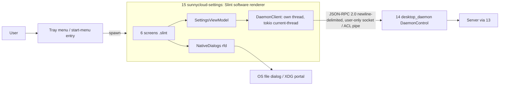
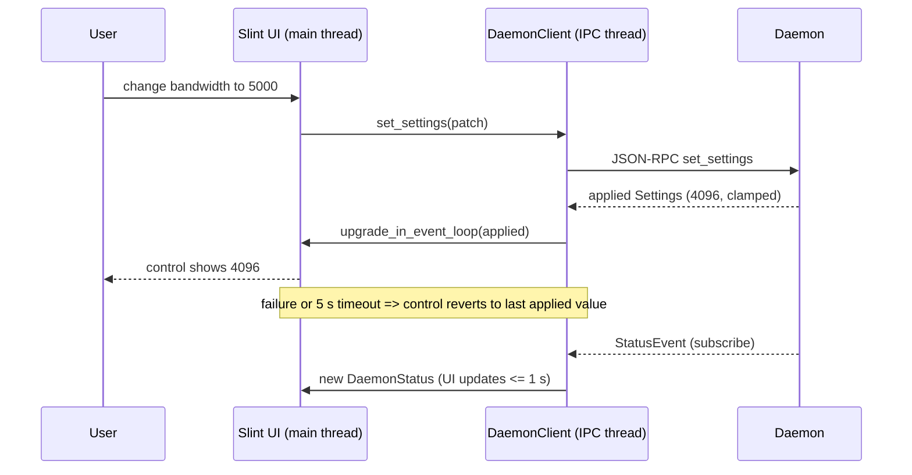

## Epic: Desktop Settings — a small native window over the daemon

**epic_type**: component
**concern** (cross-cutting only): n/a

### Epic Summary

Build `sunnycloud-settings`, a separate on-demand Slint process (software renderer) in which the user signs the daemon in, manages sync pairs, rules and a few settings, and resolves holds. It is a stateless view: every action is one JSON-RPC call to the daemon, it never sees a token and has no HTTP client.

### Problem / Context

AC-16 requires a window that opens within 1 s cold on a 2019 Windows HDD laptop and on Ubuntu Wayland with NVIDIA, with no environment-variable workarounds; AC-17 forbids any custom file browser; AC-15 excludes the window from the daemon's 100 MB because it is a separate process. The MVE showed a GL path costing 160-420 ms and 121-136 MB and no EGL fallback, while the software build opened in 47-61 ms at about 17 MB. A Tauri 2 + Svelte fallback exists with five written triggers (ADR-012).
- Architecture: `architecture.md` (component 15, ADR-012); spec `components/15_desktop_settings/description.md`; the daemon contract is E-24 `ipc_schema`.

### System Context

### Scope

**In Scope**:
- Six screens: Account (server address, sign-in prompt, sign-out), Folders (pairs, add/remove/pause, server-folder picker or typed path), Rules (multi-line patterns with live `RulesInvalid{line}`), Settings (bandwidth, hash throttle, start at login, tray, pause all), Status (skipped, escaped, errors, update available), Attention (mass-delete hold, root missing; macOS access denied in v1.1).
- `DaemonClient` with endpoint trust check, reconnect backoff, status refresh by `subscribe` plus one `status` call at open and a 2 s fallback timer.
- Native dialogs only (`rfd`), single-instance guard, accessibility properties, typed errors shown beside the causing field.

**Out of Scope**:
- Any file browser (AC-17), token handling, server calls, autostart and update logic (daemon), update-source settings, vault, language other than English in v1.0.
- Persisting window geometry or last tab.

### Assumptions

- E-24 publishes `ipc_schema` (types, method names, errors) early; this epic can start against a stub daemon.
- `DaemonStatus` includes `access_denied` and `watcher_degraded` (Step 5 gap default) and the client table includes `subscribe` and `list_pairs`.
- GNOME without zenity or XDG portal needs a documented message, not a fallback browser.

### Dependencies

**Epic dependencies** (must be completed first):
- E-00 Bootstrap (workspace, CI jobs `cargo tree` gate), E-01 Configuration (IPC endpoint path rule only).
- E-24 desktop_daemon (`ipc_schema` crate and `DaemonControl` runtime; the stub daemon unblocks UI work).

**External dependencies**:
- Slint 1.18.1 (`default-features = false`; `std`, `compat-1-18`, `backend-winit`, wayland, x11, `renderer-software`, `accessibility`), rfd 0.17.2, interprocess 2.4.7, tokio (current-thread), serde.
- Reference machines for gate S3: REF-WIN-WEAK and REF-LIN-WAYLAND-NV (owner hardware, R03); AT-SPI (Linux) and UI Automation (Windows) for UI tests.

### Effort Estimation

**T-shirt size**: L
**Story points range**: 30-45 (child issues below total 42)

### Users / Consumers

| Type | Who | Key Use Cases |
|------|-----|--------------|
| External | Desktop user | Sign in, pair folders, edit rules, change settings, resolve holds |
| System | 14 desktop_daemon | Receives every request over JSON-RPC |
| Internal | QA | Stub-daemon UI automation |

### Interface Specification

`DaemonClient` mirrors `DaemonControl` (E-24); errors are shown as localized messages next to the offending control, unknown errors as a generic message plus the daemon's correlation id.

| Method | Input | Output | Errors |
|---|---|---|---|
| `status` | none | `DaemonStatus` (with `access_denied`, `watcher_degraded`) | `DaemonNotRunning`, `EndpointUntrusted` |
| `set_server` | typed address | `()` | `HttpsRequired`, `ServerUnreachable`, `UpgradeRequired{message}`, `SignedIn` |
| `list_server_folders` | `parent` (none = root) | `[FolderEntry{node_id, name}]` | `NotSignedIn`, `ServerUnreachable`, `UnknownFolder` |
| `list_pairs` | none | pairs with state | `NotSignedIn` |
| `subscribe` | none | stream of `StatusEvent` carrying the new `DaemonStatus` | `DaemonNotRunning` |
| `add_pair` / `update_pair` / `remove_pair` / `pause` / `resume` | form spec (picked node id **or** typed path with create-if-missing, never both) | `PairId` / `()` | `NotSignedIn`, `RootInvalid`, `RootNested`, `RulesInvalid{line}`, `CloudManagedRoot`, `AlreadyPaired`, `UnknownFolder` |
| `list_skipped` / `list_escaped` | optional `PairId`, page | skipped (path, reason) / escaped (original, saved) | `UnknownPair` |
| `get_settings` / `set_settings` | `SettingsPatch` | applied `Settings` (shown as echoed) | `SettingInvalid{key}` |
| `resolve_hold` | `PairId`, `RestoreFromServer | ConfirmDeletes` | `()` | `NoSuchHold` |
| `login_start` / `login_status` / `logout` | device name | `LoginPrompt{verification_url, user_code, expires_at}` (never a token) / `LoginState` | `ServerNotSet`, `ServerUnreachable`, `HttpsRequired` |

`NativeDialogs`: `pick_folder() -> Option<PathBuf>`, `pick_file() -> Option<PathBuf>`, `confirm(text) -> bool`, via `rfd::AsyncFileDialog` awaited inside `slint::spawn_local`. A chosen path is shown in a read-only text field.

### Data Flow

### Design & Architecture

- Architecture doc: `_docs/02_document/architecture.md`
- Component spec: `_docs/02_document/components/15_desktop_settings/description.md`
- System flows: `_docs/02_document/system-flows.md` (F3 device login, F9 watcher cycle)

### Architecture Notes

- ADR-012: separate executable never linked into the daemon; Slint under its GPL-3.0-only route (AGPL-compatible, ADR-011); release profile fat LTO, `opt-level = "s"`, `strip`, `panic = "abort"`.
- Threading: Slint owns the main thread; IPC runs on a `std::thread` with a tokio current-thread runtime; results posted with `upgrade_in_event_loop`; `#[tokio::main]` is not used.
- Single-instance lock in the user runtime dir; a second launch raises the first window. Daemon not running: message plus a button that runs the autostart command; the window never starts a daemon itself.
- Compile-time constants (no config file): fallback refresh 2 s, request timeout 5 s (matches the AC-16 apply budget), reconnect backoff 250 ms to 2 s.
- Tauri 2 + Svelte fallback triggers (ADR-012): cold start > 1 s p95 after trimming, unfixed Windows/macOS blocker, screen-reader failure, rfd focus deadlock, licence change. The IPC contract is identical, so a shell reuses `DaemonClient` logic.

### Requirements

**Functional**:
- Every action is a single `DaemonControl` call; the shown value of a setting is the daemon's echo; failure or a 5 s timeout reverts the control (no hidden state).
- Rules editor marks only the line named by `RulesInvalid{line}`, disables Save while an error exists, and sends the text unchanged (trailing newline, non-ASCII).
- Attention screen: counts, "Restore from server", and "Delete on server too" only after a confirm; root-missing offers no delete button.

**Non-functional**:
- See Non-Functional Requirements below.

**Security / Compliance**:
- No token or secret ever received; the client trusts only an endpoint owned by the current user (Windows: pipe server SID; Unix: owner and mode) and refuses before sending a byte; daemon error text rendered as plain text; no HTTP client in the binary (`cargo tree` CI check); INFO logs contain no user paths or user codes.

### Non-Functional Requirements

| Target | Threshold | Failure | Test |
|---|---|---|---|
| Cold start p95 (AC-16, gate S3) | <= 300 ms target (spike 47-61 ms) | > 1 s p95 | PT-15-1, NFT-PERF-25 |
| Cold start max | <= 600 ms | > 1.5 s | PT-15-1 |
| Resident memory, Status screen 5 min | <= 30 MB (spike ~17 MB), growth <= 2 MB | > 60 MB | PT-15-2 |
| Setting shown as applied (AC-16) | <= 1 s | > 5 s | PT-15-3, NFT-PERF-26 |
| Status refresh | UI change <= 1 s per event; fallback poll 2 s +/- 0.5 s | no update | IT-15-9 |
| Hostile daemon answers | no crash, no hang > 5 s, no markup rendering | any | ST-15-1 |
| Release dependency set | no HTTP client, no femtovg/skia | any hit | ST-15-2 |

### Testing Strategy

- Component tests: `components/15_desktop_settings/tests.md` — IT-15-1..14, PT-15-1..3, ST-15-1..3, AT-15-1..3. IT with a stub daemon (scripted `DaemonControl` answers from `tests/ui/stub-daemon/*.yaml`; the stub sits at the process boundary this component owns) and IT with the real daemon and server; UI automation via AT-SPI (Linux) and UI Automation (Windows).
- System scenarios: FT-P-48, FT-P-49, FT-P-50, FT-P-59 (prompt UI), FT-P-60 (UI part), FT-P-75 [v1.1], NFT-PERF-25, NFT-PERF-26, NFT-SEC-32 (steps 3 and 4, client side) (owned by E-31).
- Cold-start and DPI claims are valid only on REF-WIN-WEAK and REF-LIN-WAYLAND-NV; elsewhere `NOT-RUN(HW-REF)` and VM results are informational. IT-15-14 (macOS) is BLOCKED in `tests.md` but the `access_denied` field exists since the Step 5 gap pass (`tests/spec-gaps.md` section 1).

### Definition of Done

- [ ] All in-scope capabilities implemented
- [ ] Automated tests pass (unit + blackbox)
- [ ] Minimum coverage threshold met (canonical: `quality-thresholds.mdc` Quality Thresholds)
- [ ] Runbooks written (package notes: XDG portal or zenity requirement on minimal Linux desktops)
- [ ] Documentation updated (about dialog names Slint, GPL notices)
- [ ] Component acceptance met: cold start <= 1 s p95 on both reference machines, no custom path browser in the accessibility tree, setting applied <= 5 s, `cargo tree` clean

### Acceptance Criteria

| # | Criterion | Measurable Condition |
|---|-----------|---------------------|
| 1 | AC-16 cold start | PT-15-1: p95 <= 1 s (target 300 ms) on REF-WIN-WEAK and REF-LIN-WAYLAND-NV, no env vars |
| 2 | AC-16 setting applied | PT-15-3/IT-15-5: UI shows applied <= 1 s, daemon effect <= 5 s, 0 restarts |
| 3 | AC-17 | IT-15-3: every path choice opens the OS dialog; 0 list widgets with directory entries |
| 4 | AC-29 UI | IT-15-6/AT-15-2: two decisions map to `resolve_hold`; declined confirm sends nothing |
| 5 | AC-66 UI | IT-15-4: error marker on the reported line only; Save disabled while invalid |
| 6 | AC-48 client side | IT-15-12/ST-15-1: squatted endpoint refused, 0 bytes sent; hostile JSON handled |
| 7 | AC-15 separation | IT-15-11: distinct PID, daemon RSS unchanged within 2 MB while the window is open |
| 8 | AC-49 display | IT-15-13: "update available" shown; no control for an update URL or key |
| 9 | AC-54 | IT-15-1: `HttpsRequired` shown beside the server address field |
| 10 | AC-67 [v1.1] | IT-15-14: access-denied message rendered <= 10 s after the daemon reports it |

### Risks & Mitigations

| # | Risk | Mitigation | Owner |
|---|------|------------|-------|
| 1 | Windows cold start and fractional DPI unmeasured (gate S3) | Spike on both references; fallback triggers written | 15 |
| 2 | Screen-reader support of Slint widgets unverified | `accessible-*` properties; manual NVDA/Narrator check; fallback trigger 3 | 15 |
| 3 | rfd/portal missing on minimal Linux desktops | In-window message naming portal or zenity; docs | 15 |
| 4 | Slint GPL-3.0-only route constrains proprietary builds | Recorded in ADR-012/011; licence notices in About | owner |
| 5 | R03: reference laptops not provisioned | Owner hardware before gate S3; otherwise `NOT-RUN(HW-REF)` | owner |

### Labels

- `sunnycloud`
- `component:desktop_settings`
- `env:stg`
- `type:platform`
- `release:v1.1` on the child item marked [v1.1]

### Child Issues

| Type | Title | Points |
|------|-------|--------|
| Spike | Gate S3: cold start on REF-WIN-WEAK and REF-LIN-WAYLAND-NV with the software renderer (PT-15-1) | 2 |
| Spike | `rfd` dialog behaviour per OS: GNOME without zenity, wlroots without portal, Windows (IT-15-3) | 2 |
| Spike | Screen-reader reach of Change/Remove/checkbox/number field (NVDA, Narrator, Orca) | 2 |
| Enabler | Stub daemon implementing `DaemonControl` from `ipc_schema` with scripted answers | 3 |
| Task | `DaemonClient`: framing, reconnect backoff, 5 s timeout, endpoint ownership check (IT-15-10, IT-15-12, ST-15-1) | 5 |
| Task | App shell: Slint software-renderer build profile, threading model, single-instance lock (IT-15-11) | 3 |
| Task | Account screen: server address, sign-in prompt, sign-out (IT-15-1, IT-15-8) | 3 |
| Task | Folders screen with server-folder picker and typed path (IT-15-7) | 5 |
| Task | Rules screen with live validation and grammar help (IT-15-4) | 3 |
| Task | Settings screen with echo and revert (IT-15-5) | 3 |
| Task | Status and Attention screens: skipped, escaped, holds, update, daemon-down (IT-15-6, IT-15-9, IT-15-13) | 3 |
| Task | `NativeDialogs` wrapper and no-backend message (IT-15-3) | 2 |
| Task | Release gates in CI: `cargo tree` (no HTTP client, no femtovg/skia), size, ST-15-2, ST-15-3 | 2 |
| Task | UI automation suite on AT-SPI and UIA, AT-15-1..3 and perf PT-15-2, PT-15-3 | 3 |
| Task | [v1.1] Access-denied message on the Attention/Status screen (IT-15-14) | 1 |
