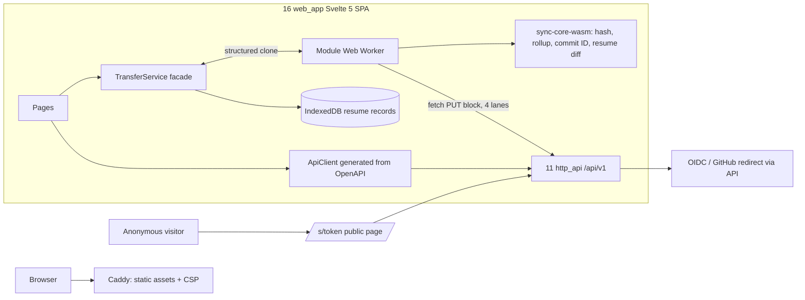
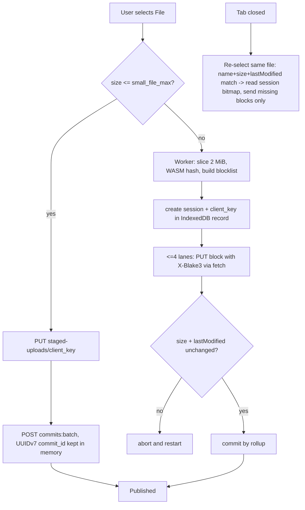

## Epic: Web App — browser client with a bounded-memory transfer engine

**epic_type**: component
**concern** (cross-cutting only): n/a

### Epic Summary

Build the Svelte 5 single-page app: sign-in and first-run, file browser, sliced uploads and verified downloads of up to 50 GiB with bounded heap, share dialogs and the public share page, device approval, and the small admin section. It owns no server logic and stores no tokens (the session is an HttpOnly cookie).

### Problem / Context

The browser is the only client every user has. AC-50/AC-51 demand 50 GiB transfers in Chrome, Firefox and Safari with heap <= 150 MB up and <= 200 MB down, resume after tab close with <= 10 MiB re-sent, and detection of a file edited mid-upload. The browser cannot run the Rust HTTP client, so the Worker drives `fetch` itself and calls the sans-IO WASM module for every rule that must match the server byte for byte; the design rejects a third protocol implementation. Content serving (AC-47), CSRF behaviour (AC-58) and the device-approval warning (AC-57) are user-visible here.
- Architecture: `architecture.md` (component 16, ADR-001, ADR-004, ADR-007 placeholder, ADR-008); spec `components/16_web_app/description.md`; flows F2, F3, F4, F5, F6, F10 in `system-flows.md`.

### System Context

### Scope

**In Scope**:
- Sign-in page (provider list from the API), setup-token first-run page, account page, device and session list with revoke.
- File browser (keyset paging, virtual list), create folder, rename, move, delete; thumbnail display and polling; inline-versus-attachment rule (`renderMode`).
- Upload: single-request staging plus one batch commit up to `small_file_max`, sliced large upload (2 MiB blocks, up to 4 lanes), IndexedDB resume, edit detection; folder upload by `webkitdirectory` (files only).
- Download strategies per browser and size with an always-labelled outcome (`VerifiedSaved`, `SavedUnverified(reason)`, `Failed(reason)`).
- Share dialogs (files only), public page `/s/<token>`, device approval page, admin section (users, invites, quotas, health), CSP and bundle hygiene, `/vault` placeholder (v1.0).

**Out of Scope**:
- API or storage logic, any token handling in JS, server-side rendering, offline mode, folder sync (desktop), version history and trash, vault page implementation (v1.2, behind a build flag).
- Sharing between accounts other than links.

### Assumptions

- `sync-core-wasm` (E-23) exposes block hashing, rollup, commit ID and resume diff as block-sized calls so the Worker heap stays bounded.
- `ServerInfo` values win over build-time defaults (`web.lanes` 4, `web.small_file_max` 2 MiB); a `block_size` other than 2 MiB disables upload with a clear message.
- Same-origin deployment on one host (cookies, CSRF `Origin`/`Sec-Fetch-Site` supplied by the browser).
- The CSP is deployment-owned (Caddy, E-00/E-21 release compose); this app supplies a build that passes it.

### Dependencies

**Epic dependencies** (must be completed first):
- E-00 Bootstrap (web workspace, CI `web` job, OpenAPI client drift check), E-02 Error model (stable `ApiError.code` set via OpenAPI), E-04 IDs and hashing and E-05 Name rules (via WASM).
- E-23 sync_core (`sync-core-wasm`, vector file), E-21 http_api (OpenAPI, share, device, admin, thumbnail-state routes).
- Server features consumed: E-15 identity (providers, sessions, devices, approval, setup), E-16 sharing, E-17 admin, E-18 media_jobs (thumbnail states), E-13 tree, E-14 transfer.

**External dependencies**:
- Svelte 5, Vite, TypeScript, openapi-typescript (or equivalent), wasm-bindgen `--target web`, Vitest, Playwright (Chromium, Firefox; WebKit for inline checks only).
- Owner Mac (H-MAC) with `safaridriver` for Safari; `blobs-large` (200 GiB XFS) and a 60 GiB browser scratch volume for C-LARGE runs.

### Effort Estimation

**T-shirt size**: XL
**Story points range**: 55-80 (child issues below total 62)

### Users / Consumers

| Type | Who | Key Use Cases |
|------|-----|--------------|
| External | End users | Browse, upload, download, share, approve devices |
| External | Anonymous visitor | Open a share link, enter a password |
| Internal | Operator / admin | Users, invites, quotas, health |
| System | Caddy | Serves built assets and CSP |

### Interface Specification

`TransferService` (page-facing Svelte stores):

| Method | Input | Output | Errors |
|---|---|---|---|
| `enqueueUpload` | `File[]`, target folder id | `UploadJobId[]` | `InvalidName`, `QuotaExceeded` (507), `SizeTooLarge`, `SessionCapReached`, `FreeSpaceFloor`, `ParentNotFound`, `AccountNotActive`, `TooManyFiles` |
| `resumeUpload` | re-selected `File`, `UploadJobId` | `Resumed{resent_bytes}` or `Restarted{reason: ChangedSinceLastTime}` | `FileUnreadable`, `UploadSessionGone` |
| `cancelUpload` | `UploadJobId` | `()` | none |
| `download` | node id or share token, optional revision | `DownloadOutcome::{VerifiedSaved, SavedUnverified(reason), Failed(reason)}` | `HashMismatch`, `Forbidden`, `NotFound`, `Network` |
| `progress` | none | store of per-job `{bytes_done, state, lanes}` | none |

Worker protocol (page to module Worker, structured clone; the page keeps no `File` after hand-off): `start{file, parent, name, baseRevision?}`, `resume{file, session}`, `cancel`; replies `progress`, `done{revision}`, `failed{typedError}`.
`ApiClient` (generated; thin wrapper adds `X-Request-Id`, `X-Sunnycloud-Client: web/<version>`, typed `ApiError`, `Result<T, ApiError>`): server info, auth (session info, sign-out, providers, setup), tree (keyset list, create folder, rename, move, delete), uploads (create session, get session, put block, commit, `PUT /api/v1/staged-uploads/{staged_key}`, `POST /api/v1/commits:batch`), download and range, shares (create, list, revoke, public open, password unlock), devices (list, revoke, approval lookup/approve/deny), admin (users, invites, quotas, health), thumbnail state per listing item.
`renderMode(mediaType) -> 'inline' | 'attachment'`: inline only for `image/jpeg`, `image/png`, `image/gif`, `image/webp`, `image/avif`, `video/mp4`, `video/webm` (parameters and case normalised); everything else, including an empty string, is `attachment`. The media type is the server's, never the file extension.
Error handling by code: 401 to sign-in, 426 `upgrade_required` shows the server text without retry, 429 shows retry-after, 507 `quota_exceeded` shows the quota message, unexpected errors show the correlation id.

### Data Flow

### Design & Architecture

- Architecture doc: `_docs/02_document/architecture.md`
- Component spec: `_docs/02_document/components/16_web_app/description.md`
- System flows: `_docs/02_document/system-flows.md`

### Architecture Notes

- ADR-001 (one shared Rust core compiled to WASM), ADR-004 (protocol constants; resume loses at most 8 MiB per drop in the protocol, 10 MiB in AC), ADR-008 (cookie sessions, device approval), ADR-007 (vault v1.2: no vault code ships in v1.0), ADR-009 (thumbnail states), ADR-011 (licence).
- Svelte 5 runes SPA, Vite build with hashed static assets and WASM; no inline scripts, no `{@html}` anywhere (lint rule), build fails on an inline script or a non-self URL.
- CSP required from the edge: `default-src 'self'; script-src 'self' 'wasm-unsafe-eval'; style-src 'self'; connect-src 'self'; frame-ancestors 'none'; base-uri 'none'; form-action 'self'` (vault page v1.2 must reassess `wasm-unsafe-eval` under AC-62).
- Browser storage: IndexedDB resume record `{fileName, size, lastModified, sessionId, blocklist}` (24 h rolling session); `localStorage` preferences wrapped in try/catch; never tokens, passwords or share passwords. Share tokens removed from history with `replaceState`.
- Build constants: `web.thumb_poll_interval` 2s, `web.max_inflight_files` 200, `web.hash_verify_max_ff_safari` 2 GiB.

### Requirements

**Functional**:
- Large upload: at most 4 concurrent block PUTs, one block per request, no streaming bodies; `409 BlockConflict` handed to the WASM planner; `NothingToSend` ends with 0 bytes; before commit re-read `size` and `lastModified`.
- Download: Chromium `showSaveFilePicker` streams with incremental hash (verified at any size); Firefox/Safari up to 2 GiB verified path (mechanism fixed by spike S12); above 2 GiB native `<a download>` with the text "not verified in the browser" and the server file hash shown. A mismatch is never `VerifiedSaved`.
- Share: files only, expiry default read from the API and capped by the server maximum, URL shown once; missing, expired and revoked render the same "link not available" page; `password_required` prompt; 429 shows retry-after.
- Thumbnails: poll pending items every `web.thumb_poll_interval` only while the tab is visible; `failed` shows a placeholder.

**Non-functional**:
- See Non-Functional Requirements below.

**Security / Compliance**:
- HttpOnly cookie never read by JS; all state-changing calls `credentials: same-origin` with browser-supplied `Origin`/`Sec-Fetch-Site`; untrusted names rendered as text; open-redirect guard accepts relative `return` paths only; admin routes hidden for non-admins and guarded server-side.

### Non-Functional Requirements

| Target | Threshold | Failure | Test |
|---|---|---|---|
| Upload heap, 50 GiB (AC-50, gate S12) | <= 120 MB target | > 150 MB (worker + page) | PT-16-1, NFT-PERF-27 |
| Download heap, 50 GiB (AC-51) | <= 160 MB target | > 200 MB | PT-16-2, NFT-PERF-28 |
| Resume re-send (AC-3, AC-50) | <= 10 MiB | > 10 MiB | IT-16-5, NFT-RES-29 |
| Main-thread task during hashing | <= 50 ms; input latency p95 <= 100 ms | > 100 ms / > 200 ms | PT-16-3 |
| 100,000-file selection | heap <= 150 MB, first upload <= 5 s | > 300 MB / > 15 s | PT-16-4 |
| Share page ready (AC-12) | p95 <= 1 s | > 2 s | PT-16-5 |
| Inline renders of non-allowlisted types (AC-47) | 0 | any | IT-16-2 |
| Virtual list | <= 200 DOM rows for 10,000 entries | more | IT-16-16 |

### Testing Strategy

- Component tests: `components/16_web_app/tests.md` — IT-16-1..19, PT-16-1..5, ST-16-1..4, AT-16-1..4. Unit: Vitest (`renderMode`, resume-record logic, error mapping, WASM as built); IT: Playwright in the `browsers` container (profile `web`) against the real server behind the release Caddyfile; Safari via `safaridriver` on the owner Mac (H-MAC; Playwright WebKit is not a substitute); 50 GiB runs on `blobs-large` (C-LARGE).
- System scenarios: FT-P-09, FT-P-20, FT-P-36..39, FT-P-62, FT-P-64..68, FT-N-03, FT-N-09..11, NFT-PERF-27, NFT-PERF-28, NFT-RES-29, NFT-SEC-09, NFT-SEC-10, NFT-SEC-19, NFT-SEC-21; v1.2: FT-P-47, NFT-SEC-42, NFT-PERF-29, NFT-RES-LIM-08 (owned by E-31).
- BLOCKED in `tests.md` and `tests/spec-gaps.md`: IT-16-7 (`TooManyFiles` trigger), IT-16-8 (Firefox/Safari verified path, spike S12), IT-16-12 (setup-token page route and states); child spikes resolve each. Heap is measured by CDP metrics, Firefox memory report and `vmmap` (Safari: weak evidence, labelled).

### Definition of Done

- [ ] All in-scope capabilities implemented
- [ ] Automated tests pass (unit + blackbox)
- [ ] Minimum coverage threshold met (canonical: `quality-thresholds.mdc` Quality Thresholds)
- [ ] Runbooks written (CSP requirement handed to the deployment owner, browser support matrix)
- [ ] Documentation updated (download-label wording, admin guide pointers)
- [ ] 50 GiB upload/download pass in Chrome, Firefox, Safari with the heap limits; 0 inline scripts in the bundle; CSP header test passes

### Acceptance Criteria

| # | Criterion | Measurable Condition |
|---|-----------|---------------------|
| 1 | AC-50 | PT-16-1: 50 GiB upload heap <= 150 MB in Chromium, Firefox, Safari; edit mid-upload restarts (IT-16-6) |
| 2 | AC-3, AC-4 | IT-16-5: tab closed at 50%, re-select resumes with <= 10 MiB re-sent; finish <= 2 s after last block |
| 3 | AC-51, AC-7 | PT-16-2/IT-16-8: 50 GiB download heap <= 200 MB; labels correct; corrupt block gives `HashMismatch`, never verified |
| 4 | AC-47 | IT-16-1/2: 0 inline renders of html, svg, xml, js, pdf, polyglot in three engines |
| 5 | AC-40 | IT-16-3: <= 2 MiB files use staging + one batch with stable UUIDv7 `commit_id`; 2 MiB+1 uses blocks |
| 6 | AC-12 | IT-16-10/PT-16-5: identical "link not available" DOM text for three failure cases; page ready p95 <= 2 s |
| 7 | AC-57 | IT-16-11: both locations side by side, mismatch warning, countdown, approve/deny once |
| 8 | AC-58, AC-64, AC-21 | IT-16-13/14: no cookie read, no custom token header; 426/429/507/401 handled as specified |
| 9 | AC-10, AC-6, AC-70, AC-77 | IT-16-15/16: thumbnail polling; 10,000 entries once each; open folder refreshes after a move; links follow the node |
| 10 | AC-23 | IT-16-17 admin guards pass; first-run page assertions written after the route spike (IT-16-12) |
| 11 | CSP and hygiene | IT-16-9: required CSP header, 0 inline scripts, 0 non-self requests, 0 violations; IT-16-19: no vault chunk in v1.0 |

### Risks & Mitigations

| # | Risk | Mitigation | Owner |
|---|------|------------|-------|
| 1 | R30: Firefox/Safari verified download over 2 GiB with bounded heap unproven (gate S12) | Spike S12; labelled fallback; release gate on S12 | 16 |
| 2 | Vite + wasm-bindgen glue unproven | Spike with E-23 early | 16, 13 |
| 3 | `wasm-unsafe-eval` versus v1.2 CSP target (AC-62) | Re-evaluate before vault page; ADR note | 16 |
| 4 | iOS Safari memory ceilings for hashing very large files | Block-sized WASM calls; measure on owner Mac/iPhone | 16 |
| 5 | Size of `sync-core-wasm` (trim kept as confirmed) | Track bundle size budget; trim is a risk-register item | 13, 16 |
| 6 | Playwright 50 GiB input may buffer whole file in Firefox/WebKit | Spike first; labelled manual-driven run on the lab host | 16 |

### Labels

- `sunnycloud`
- `component:web_app`
- `env:stg`
- `type:integration`

### Child Issues

| Type | Title | Points |
|------|-------|--------|
| Spike | Vite + wasm-bindgen integration with `sync-core-wasm` (single-threaded, `--target web`) | 3 |
| Spike | S12: Firefox/Safari verified download up to 2 GiB with bounded heap (IT-16-8, `tests/spec-gaps.md`) | 3 |
| Spike | iOS Safari memory ceilings for hashing very large files | 2 |
| Spike | Specify setup-token first-run page route, fields and states (IT-16-12, AC-23) | 1 |
| Spike | Decide `TooManyFiles` trigger limit (IT-16-7) | 1 |
| Enabler | SPA scaffold: routing, generated `ApiClient`, error mapping, CSP/bundle build checks, lint ban on `{@html}` (IT-16-9, IT-16-14) | 5 |
| Task | Auth pages: sign-in, setup first-run, account, device and session list (IT-16-12, IT-16-13) | 3 |
| Task | File browser: keyset paging, virtual list, create/rename/move/delete, refresh after move (IT-16-16) | 5 |
| Task | `TransferService` small-file path: staging, batch commit, queue cap (IT-16-3, IT-16-7) | 3 |
| Task | Worker large-upload engine: slicing, WASM hashing, 4 lanes, planner integration (IT-16-4, IT-16-18) | 5 |
| Task | IndexedDB resume records, edit detection, tab-close recovery (IT-16-5, IT-16-6) | 3 |
| Task | Download strategies and outcome labels (IT-16-8, AT-16-2) | 5 |
| Task | Share dialog and public page `/s/<token>` (IT-16-10, ST-16-4) | 5 |
| Task | Device approval page (IT-16-11) | 3 |
| Task | Thumbnails: state polling and placeholders (IT-16-15) | 2 |
| Task | Admin section: users, invites, quotas, health (IT-16-17) | 5 |
| Task | `renderMode`, hostile-name rendering, no-secrets-in-storage tests (IT-16-1, IT-16-2, ST-16-1, ST-16-2) | 2 |
| Task | `/vault` placeholder behind the build flag (IT-16-19) | 1 |
| Enabler | Playwright `web` profile harness, Safari lab runner, 50 GiB heap sampling (PT-16-1..4) | 5 |
