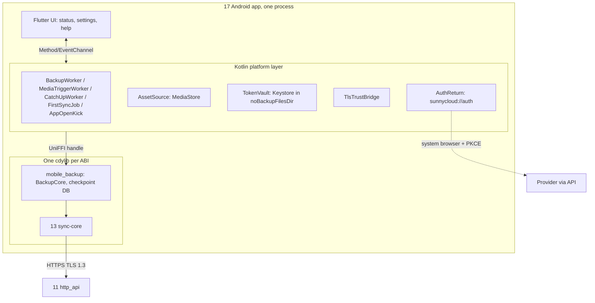
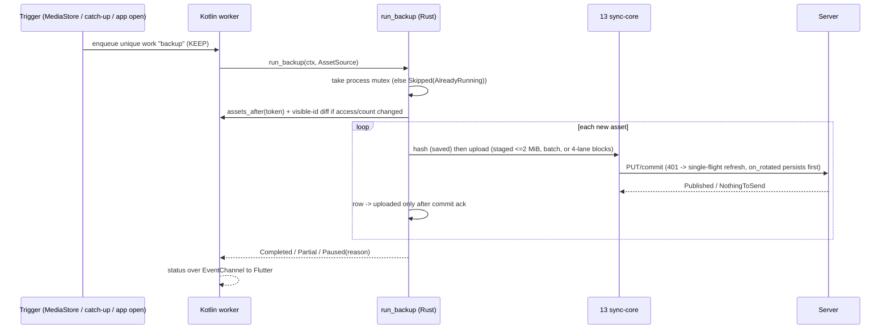

## Epic: Android App — background camera backup on one shared Rust uploader

**epic_type**: component
**concern** (cross-cutting only): n/a

### Epic Summary

Build the Android client: sign-in through the system browser with a one-time code, backup status and settings in Flutter, a Kotlin platform layer (WorkManager, MediaStore, Keystore, TLS bridge) and the shared Rust crate `mobile_backup` that owns the backup run, checkpoint DB and asset mapping on top of E-23. It owns AC-78 through `mobile_backup`; iOS (E-28) reuses the crate.

### Problem / Context

Camera backup must start from the system, not from the Flutter UI: a WorkManager worker runs without a Flutter engine, so a Dart-FFI bridge is not callable there. One upload implementation in Rust serves every entry point (AC-52); Kotlin is the only code that touches Android APIs and the only owner of the UniFFI handle; Flutter only displays status. Hard parts: 15-minute access tokens with rotating refresh tokens (R05), limited photo access on Android 14 (AC-53), OEM task killers (R32), reinstall without re-upload (AC-46), 50,000 assets surviving 10 forced kills (AC-52), foreground/background races (AC-78).
- Architecture: `architecture.md` (component 17, ADR-013, ADR-008, ADR-016); spec `components/17_android_app/description.md`; flows F-android-backup in `diagrams/flows/flow_android_backup.md`, F10 and F11 in `system-flows.md`.

### System Context

### Scope

**In Scope**:
- Sign-in via system browser, one-time code with PKCE, 15-minute access token and rotating refresh token, HTTPS-only server address (`set_server`), `TokenVault`, `TlsTrustBridge` (user-added CAs accepted with a persistent warning).
- Permission states (full, limited, denied), "N photos visible, tap to allow more", visible-id diff, `ACCESS_MEDIA_LOCATION` with `setRequireOriginal`.
- Entry points: MediaStore content-URI trigger, 15-minute catch-up, app-open kick, user-initiated data-transfer job (Android 14+) or user-started `dataSync` foreground service (Android 11-13).
- `mobile_backup`: `BackupCore`, checkpoint DB (`asset`, `cursor`, `session`, `batch`), in-process run mutex, idempotent keys, folder `Camera Uploads/<device label>/` with asset-id name suffix, reinstall rebuild, quota/network pauses, skipped counts by reason.
- Status UI, settings (Wi-Fi only, charging only, buckets), permission and battery/OEM help; native library build (NDK r28+, 16 KB alignment, JNA >= 5.17.0), minSdk 30.

**Out of Scope**:
- The upload protocol (E-23); file browsing and download on Android (out of v1.0 by owner decision); transcoding, remuxing or poster frames (server side); vault and camera-backup-to-vault (v1.2); Live Photo pairing and iOS (v1.1, E-28); sharing UI; cross-device content dedupe.
- An always-on foreground service for automatic backup (Play policy).

### Assumptions

- Android 14 hides the library total; the app shows "N photos visible, tap to allow more" and never "of M".
- Overwriting a photo in place keeps its MediaStore asset ID on supported devices (spike; an OEM that changes it is reported, not worked around).
- `derive_client_key(device_id, asset_id, file_hash)` gives a stable per-asset key; batch `commit_id` is always a random UUIDv7 stored in `batch`.
- The Android app runs in one process, so the Rust mutex has no lease to renew.

### Dependencies

**Epic dependencies** (must be completed first):
- E-00 Bootstrap (workspace, `mobile` CI job, UniFFI drift check, 16 KB alignment check), E-01 Configuration (`android` keys), E-02 Error model, E-04 IDs and hashing (`derive_client_key`), E-05 Name rules (display names).
- E-23 sync_core (UniFFI derives, `SyncApi`, host traits, platform-verifier init), E-21 http_api (OpenAPI, `server-info`), E-15 identity (mobile login code, refresh rotation, `DELETE /api/v1/devices/me`), E-14 transfer and E-13 tree (staged uploads, `NothingToSend`, `lookup_revisions` support, `client_meta`).

**External dependencies**:
- Flutter, UniFFI 0.32.2, AndroidX WorkManager, rustls-platform-verifier (Kotlin component), rusqlite (bundled), NDK r28+, JNA >= 5.17.0.
- Google Play account and media-permission declarations (R18, R32, owner items); devices Pixel, Samsung, Xiaomi (R03, owner hardware); Android emulator API 34+ (userdebug, KVM), plus API 30 and 33 images; Appium.

### Effort Estimation

**T-shirt size**: XL
**Story points range**: 60-85 (child issues below total 67)

### Users / Consumers

| Type | Who | Key Use Cases |
|------|-----|--------------|
| External | Android user | Sign in, back up photos and videos, see coverage and pauses |
| System | 18_ios_app | Reuses `mobile_backup` and `BackupCore` |
| System | Server (11) | Receives uploads in `Camera Uploads/<device label>/` |
| Internal | QA | Emulator and device lab runs |

### Interface Specification

`BackupCore` (Rust `mobile_backup`; UniFFI to Kotlin, Rust crate API for 18):

| Method | Input | Output | Errors |
|---|---|---|---|
| `exchange_code` | `code`, `code_verifier`, device label | `()`; stores tokens through `TokenVault` | `InvalidCode`, `ServerUnreachable`, `UpgradeRequired` |
| `refresh` | none | `()` (single flight via 13) | `NotSignedIn`, `TokenRejected`, `ServerUnreachable` |
| `sign_out` | none | `()`; `DELETE /api/v1/devices/me`, then clears the vault even if the server is unreachable | none |
| `run_backup` | `RunContext{trigger, deadline, network_policy}`, `Arc<dyn AssetSource>` | `BackupOutcome::{Completed, Partial{remaining}, Paused(PauseReason), Skipped(AlreadyRunning)}` | `NotSignedIn`, `ServerUnreachable`, `UpgradeRequired`, `TokenRejected` |
| `set_server` | `url` | `ServerCheck` (https scheme, reachability, `GET /api/v1/server-info`; `trust = UserAdded` warning) | `HttpsRequired`, `ServerUnreachable`, `UpgradeRequired` |
| `status` | none | `BackupStatus{visible, uploaded, pending, paused, skipped{gone,name,size,failed}, last_error, access_level, location_redacted}` | none |
| `rebuild_checkpoint` | listing page callback | `RebuildReport` | `ServerUnreachable` |
| `cancel` | none | flag checked between blocks | none |

`PauseReason` = `QuotaExceeded`, `NoNetwork`, `MeteredNetwork`, `PermissionDenied`, `LimitedAccess`, `ServerRejectedName`, `UpgradeRequired`, `AccountNotActive`, `SignedOut`. Wire errors map: 507 pauses; `SizeTooLarge` gives `skipped_size`; `InvalidName` gives `skipped_name`; asset deleted between listing and upload gives `skipped_gone`; `ParentNotFound/ParentGone` recreates the camera folder and retries once.
`AssetSource` (Kotlin callback trait): `assets_after(token, limit) -> [AssetDescriptor{asset_id, change_token, display_name, mime, size, date_taken, relative_path}]` (visible only; `IS_PENDING`/`IS_TRASHED` filtered), `current_token() -> ChangeToken` (opaque bytes), `list_visible_ids(page)`, `open_read(asset_id) -> ReadableFd` (raises `AssetGone`; `setRequireOriginal`), `access_level() -> Full | Limited | Denied`.
Kotlin: `TokenVault{save(access, refresh, expires_at), load(), clear()}` (Keystore-wrapped, `noBackupFilesDir`, `allowBackup="false"`); `AuthReturn` (`sunnycloud://auth?code&state`; refuses `http://` outside debug); `TlsTrustBridge`. As `CredentialProvider`, `on_rotated` returns only after `save` completes.
Checkpoint DB: `asset(asset_id PK, change_token, size, date_taken, content_hash, upload_name, client_key, node_id, revision_id, state, linked_from)` with states `new, hashing, uploading, uploaded, skipped_gone, skipped_name, skipped_size, failed`; `cursor(key, value)`; `session(asset_id, session_id, block_bitmap_hint)`; `batch(commit_id PK, entries)`.

### Data Flow

### Design & Architecture

- Architecture doc: `_docs/02_document/architecture.md`
- Component spec: `_docs/02_document/components/17_android_app/description.md`
- System flows: `_docs/02_document/system-flows.md`, `_docs/02_document/diagrams/flows/flow_android_backup.md`

### Architecture Notes

- ADR-013: UniFFI only (no flutter_rust_bridge, removes the `syn` pin clash); Kotlin owns the handle; cancellation is the manual `cancel()` flag; one `.so` per ABI containing `mobile_backup` + 13 (+ 19 in v1.2).
- AC-78 is enforced in three layers, none relied on alone: Kotlin unique work `backup` with `KEEP` and an "rerun after" flag; Rust in-process mutex; idempotent upload keys (`derive_client_key`, stored random `commit_id`).
- Token lifecycle (ADR-008): 401 refreshed single-flight by 13; persist-before-use; a kill between rotation and write is healed within the 30 s server grace, later it forces sign-in (accepted risk 4).
- Server layout: `Camera Uploads/<device label>/`; collision suffix `<stem> (<asset_id>)<ext>`; the server's conflict-copy naming is a last resort.
- Release facts (ADR-016): Android is v1.0; minSdk 30; Android 15 limits dataSync services to 6 h/24 h, so large first syncs use the user-initiated job on 14+.
- Config (E-01): `android.catchup_interval` 15m, `unmetered_only` true, `charging_only` false, `batch_commit_max` (server value), `hash_ahead` 8. Logs: ring buffer file, no file names or tokens, diagnostics export only after confirmation.

### Requirements

**Functional**:
- One run at a time; a second `run_backup` returns `Skipped(AlreadyRunning)` and makes no API call; rows reach `uploaded` only after the commit ack and a kill between ack and write is healed by idempotent upload.
- Start uploading within 10 s of a background trigger without a Flutter engine; hash saved after hashing so 10 forced kills re-hash <= 1% of 50,000 assets.
- Limited access: re-read access level and visible count at every run; newly picked older photos are queued by the visible-id diff; every skipped asset is counted and listed by reason so visible = uploaded + pending + skipped.
- Reinstall: rebuild from the camera-folder listing (`client_meta`), fallback hash plus `lookup_revisions` (1,000 per call); same asset ID with a new hash uploads as a new file with `linked_from`.

**Non-functional**:
- See Non-Functional Requirements below.

**Security / Compliance**:
- Tokens only in `TokenVault`, excluded from backups (RESTRICT-33, FT-N-36), never in Dart, logs or intents; plain HTTP refused (AC-54), 0 cleartext requests carry tokens; deep-link input validated (state, code size) before any network call; camera backup never targets a vault; the diagnostics export needs user confirmation.

### Non-Functional Requirements

| Target | Threshold | Failure | Test |
|---|---|---|---|
| Capture-to-server on Pixel (AC-9, gate S9) | every photo <= 60 s | > 60 s | PT-17-1, IT-17-14 |
| Samsung/Xiaomi p95 | <= 5 min, published per device | > 5 min is a published finding | PT-17-1 |
| Background start latency (AC-52) | first byte <= 10 s | > 10 s | IT-17-18 |
| Memory (AC-52) | peak <= 120 MB target | > 150 MB | PT-17-2, NFT-RES-LIM-03 |
| 50,000-asset first sync, 10 `kill -9` | <= 1% re-hashed, 0 duplicates, count 50,000 | any breach | IT-17-13 |
| Throughput of first sync | >= 80% of goodput | < 50% | PT-17-3 |
| Reinstall, 5,000 assets (AC-46) | 0 media bytes | any media byte | IT-17-12 |
| Token fixture, 40 min run | one refresh per expiry, no lost block | lost block | IT-17-4 |

### Testing Strategy

- Component tests: `components/17_android_app/tests.md` — IT-17-1..19, PT-17-1..3, ST-17-1..4, AT-17-1..4. Tiers: Rust unit with fake `AssetSource` (and a fake `SyncApi` only at the client trait boundary); IT-EMU on the API 34+ emulator (rooted kill loops, Appium + `adb`) against the real server container; IT-DEV on Pixel/Samsung/Xiaomi (H-ANDROID); no phones means `NOT-RUN(HW-DEVICE)`, never PASS. Durations come from config mocks and WorkManager's test driver.
- System scenarios: FT-P-29, FT-P-30, FT-P-32, FT-P-34, FT-P-35, FT-P-76 (AC-78), FT-N-26, FT-N-36, NFT-PERF-12, NFT-PERF-22, NFT-PERF-23, NFT-RES-27, NFT-RES-28, NFT-RES-33, NFT-RES-LIM-03, NFT-SEC-12, NFT-SEC-44 (owned by E-31).
- `tests.md` still marks IT-17-6 and IT-17-10 BLOCKED, but `set_server` and `BackupStatus.location_redacted` were added at the Step 5 gap pass (`tests/spec-gaps.md` section 1); the child tasks treat them as unblocked. IT-17-17 private-CA leg resolved by the owner (user-added CAs accepted with warning).
- Coverage 75% overall, 90% on run mutex, token lifecycle, checkpoint transitions.

### Definition of Done

- [ ] All in-scope capabilities implemented
- [ ] Automated tests pass (unit + blackbox)
- [ ] Minimum coverage threshold met (canonical: `quality-thresholds.mdc` Quality Thresholds)
- [ ] Runbooks written (battery/OEM help per vendor, Play declaration notes, diagnostics export)
- [ ] Documentation updated (permission rationale, backup exclusion rules)
- [ ] Component acceptance met: 50,000 assets / 10 kills, token fixture run, reinstall 0 bytes, backup archive has 0 token occurrences, plain HTTP refused, 16 KB alignment CI check green

### Acceptance Criteria

| # | Criterion | Measurable Condition |
|---|-----------|---------------------|
| 1 | AC-9 | Pixel: every photo on the server <= 60 s (battery exempt, Wi-Fi); Samsung/Xiaomi p95 <= 5 min published; no phones = `NOT-RUN(HW-DEVICE)` |
| 2 | AC-52 | IT-17-13/18, PT-17-2: <= 1% re-hashed after 10 kills, 0 duplicates, start <= 10 s, memory <= 150 MB; IT-17-16: 0 upload-protocol calls in Kotlin/Dart |
| 3 | AC-78 | IT-17-1/2/3: 100 assets give exactly 100 server files with foreground+background at once (10 rounds) |
| 4 | AC-46 | IT-17-12: 5,000 backed-up assets give 0 media bytes after reinstall; edited photo uploads as a linked new file |
| 5 | AC-53 | IT-17-8: banner `20 photos visible, tap to allow more` exactly; 10 newly picked older photos uploaded next run |
| 6 | AC-54 | IT-17-6, ST-17-3: `http://` refused, 0 cleartext requests |
| 7 | AC-58, AC-21, AC-76 | IT-17-4/7/17: one refresh per expiry; refresh refused clears the vault; code single use and cleared |
| 8 | AC-64 | IT-17-15: 426 gives `Paused(UpgradeRequired)` with the server text |
| 9 | RESTRICT-33 | IT-17-5, ST-17-1: backup archive 0 token occurrences, restored app signed out |
| 10 | AC-14 camera half [v1.2] | Deferred; covered by FT-P-45 when v1.2 is under test |

### Risks & Mitigations

| # | Risk | Mitigation | Owner |
|---|------|------------|-------|
| 1 | R31: UniFFI/NDK/16 KB/JNA build problems | Early device build spike, pinned NDK, CI alignment check | 17 |
| 2 | R32: OEM task killers, Play permission and background policy | Device matrix, 15-minute catch-up, early Play pre-review, minSdk 30 | 17, owner |
| 3 | R05: lost rotation forces sign-in after the 30 s grace | Persist-before-use; accepted risk 4 documented in help text | 17, 13 |
| 4 | R18: Play closed-testing and media declaration | Open accounts early; sideload/F-Droid contingency | owner |
| 5 | MediaStore asset ID may change on overwrite on some OEMs | Spike on emulator and three phones; report the device | 17 |
| 6 | Boundary: checkpoint DB belongs to 17, 13 must not duplicate it | Epic scope review; contract test of `CheckpointStore` | 17, 13 |

### Labels

- `sunnycloud`
- `component:android_app`
- `env:stg`
- `type:integration`

### Child Issues

| Type | Title | Points |
|------|-------|--------|
| Spike | Single-library UniFFI build on device: NDK r28, 16 KB alignment, JNA, forced-kill behaviour | 3 |
| Spike | Play Store declarations: photo/video permission, `ACCESS_MEDIA_LOCATION`, user-initiated transfer limits | 2 |
| Spike | MediaStore asset ID stability on in-place overwrite (emulator + three phones) | 2 |
| Spike | OEM background behaviour and catch-up timing per vendor (gate S9 protocol, IT-17-14) | 2 |
| Enabler | `mobile_backup` crate skeleton, checkpoint DB schema and migrations (`asset`, `cursor`, `session`, `batch`) | 5 |
| Task | `run_backup` loop: change token, visible-id diff, hashing ahead, in-process mutex (IT-17-1, IT-17-9) | 5 |
| Task | `BackupCore` UniFFI surface incl. `set_server`, `status`, `cancel`, wire-error mapping (IT-17-6, IT-17-15) | 5 |
| Task | Auth: `exchange_code`, `refresh`, `sign_out`, `TokenVault` bridge and `AuthReturn` (IT-17-4, IT-17-7, ST-17-2) | 3 |
| Task | Kotlin `AssetSource` over MediaStore incl. `setRequireOriginal` and access levels (IT-17-8, IT-17-10) | 5 |
| Task | Kotlin entry points: `BackupWorker`, `MediaTriggerWorker`, `CatchUpWorker`, `AppOpenKick` with unique work (IT-17-2) | 5 |
| Task | `FirstSyncJob`: user-initiated data-transfer job (14+) and `dataSync` service (11-13) (IT-17-16) | 3 |
| Task | `TlsTrustBridge` and persistent user-CA warning (IT-17-17) | 3 |
| Task | Camera folder layout, asset-id name suffix, `ParentGone` recovery (IT-17-11) | 2 |
| Task | Reinstall rebuild: listing path, hash + `lookup_revisions` fallback, `linked_from` (IT-17-12) | 5 |
| Task | Flutter UI: sign-in, status, settings, permission help, coverage banner (IT-17-19) | 5 |
| Task | Flutter channel bridge: EventChannel status, MethodChannel commands, no-token payload check | 3 |
| Task | Battery/OEM help pages and diagnostics export with confirmation (ST-17-4) | 1 |
| Enabler | Native library CI: per-ABI cdylib build, 16 KB alignment check, UniFFI drift check | 3 |
| Enabler | Emulator test harness: Appium + `adb` media push, rooted kill loop, token-fixture hookup (profile `android-emu`) | 5 |
