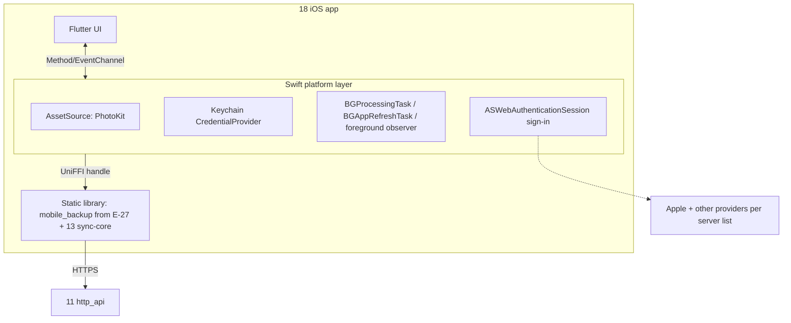

## Epic: iOS App — best-effort photo backup on the shared uploader [v1.1]

**epic_type**: component
**concern** (cross-cutting only): n/a

### Epic Summary

Build the iOS client (v1.1): iOS entry points (PhotoKit, background scheduling, Keychain, system-browser sign-in) around the shared Rust crate `mobile_backup` defined by E-27, with Flutter UI. It adds no protocol code. Camera backup on iOS is best effort; foreground catch-up with visible progress is the reliable path.

### Problem / Context

iOS limits background work (RESTRICT-27), so there is no time guarantee for background backup (AC-9 iOS). The App Store requires Sign in with Apple whenever Google or GitHub sign-in is offered (guideline 4.8, RESTRICT-21, AC-19). The iOS 26.1 background upload extension is deferred (static `BackgroundUploadURLBase`, 104 interim responses unsupported by hyper); `mobile_backup` stays sans-IO so it can be added later. This is a stub-level epic: tests and details are expanded when v1.1 is planned.
- Architecture: `architecture.md` (component 18, ADR-013, ADR-016, ADR-008); spec `components/18_ios_app/description.md`.

### System Context



### Scope

**In Scope** (v1.1):
- Sign in with Apple, and Google/GitHub only when Sign in with Apple is enabled on the server (provider list from the API); `ASWebAuthenticationSession` one-time-code sign-in with PKCE.
- PhotoKit `AssetSource` (opaque `ChangeToken` wrapping `PHPersistentChangeToken`; original and edited renders linked by `group_id`), authorization states (authorized, limited, denied), coverage banner "N photos visible, tap to allow more".
- Foreground catch-up with progress, ETA and "backing up n of N"; system-scheduled `BGProcessingTask` and `BGAppRefreshTask` (best effort, resumable).
- Keychain token (`kSecAttrAccessibleAfterFirstUnlockThisDeviceOnly`, not synced), persisted before the new access token is used; iCloud "Optimise Storage" download opt-in (default off; Wi-Fi and charging); reinstall rebuild; UniFFI static library for Swift.

**Out of Scope**:
- iOS 26.1 upload extension; Live Photo pairing beyond the linked-resource upload (FT-P-33 deferred); file browsing and download; vault camera backup (never); a second protocol implementation.

### Assumptions

- E-27 delivers `mobile_backup` and `BackupCore` with a platform-neutral `AssetSource`; shared mobile config keys (`android.*`) are unified as `mobile.*` when this epic is planned.
- Sign in with Apple is enabled on the server in v1.1 (E-15 follow-up); the app reads providers from `GET /api/v1/auth/providers`.
- iOS ignores user-installed CAs; test servers use a publicly trusted certificate (`lan` profile).

### Dependencies

**Epic dependencies** (must be completed first):
- E-27 android_app (`mobile_backup`, `BackupCore`, checkpoint schema), E-23 sync_core (UniFFI), E-21 http_api, E-15 identity (Sign in with Apple, mobile code, refresh rotation), E-04 IDs and hashing, E-05 Name rules, E-01 Configuration, E-02 Error model.

**External dependencies**:
- Apple Developer account, signing, notarisation and App Store review (R18, owner items); AGPL App Store exception consent from all copyright holders (ADR-011); `cargo deny` allowlist for the iOS binary (no GPL crates).
- Owner Mac with Xcode, an iPhone (DEV-IPHONE) with an iCloud account; Appium XCUITest.

### Effort Estimation

**T-shirt size**: L
**Story points range**: 25-40 (child issues below total 32)

### Users / Consumers

| Type | Who | Key Use Cases |
|------|-----|--------------|
| External | iPhone user | Sign in, back up the photo library while the app is open, best effort in background |
| System | Server (11) | Receives uploads in `Camera Uploads/<device label>/` |
| Internal | QA | H-IOS lab runs |

### Interface Specification

`BackupCore` and `AssetSource` are those of E-27. iOS differences:

| Item | iOS behaviour |
|---|---|
| `AssetSource.assets_after` | PhotoKit fetch by opaque `ChangeToken(bytes)` wrapping `PHPersistentChangeToken`; original and edited renders are separate resources linked by `group_id`; `list_visible_ids` is diffed when authorization level or visible count changes |
| `AssetSource.access_level` | `Full`, `Limited` (limited-library picker), `Denied` |
| `open_read` | file URL of an exported resource; iCloud-only assets raise `NeedsDownload`, downloaded only with the opt-in on |
| Triggers | app open, foreground observer, `BGProcessingTask`, `BGAppRefreshTask` |
| Token store | Keychain item; `CredentialProvider::on_rotated(access, refresh)` returns after the write |

Provides to 13: `CredentialProvider`, `FileSource`, `CheckpointStore` (same schema as E-27 plus `content_identifier` and `group_id` columns), `ProgressSink`. Requires `BackupCore` (E-27) and `SyncApi` (E-23).

### Data Flow

```mermaid
sequenceDiagram
  participant U as User / iOS scheduler
  participant S as Swift layer
  participant R as run_backup (mobile_backup)
  participant API as Server
  U->>S: app open or BGTask window granted
  S->>R: run_backup(ctx, PhotoKit AssetSource)
  R-->>S: Skipped(AlreadyRunning) if another run holds the mutex
  loop inside the granted window
    R->>API: hash, upload, commit (checkpoint after every ack)
  end
  U-->>S: window expires -> cancel()
  S->>R: cancel(); checkpoint consistent, at most one block lost
  S-->>U: progress, ETA, coverage banner
```

### Design & Architecture

- Architecture doc: `_docs/02_document/architecture.md`
- Component spec: `_docs/02_document/components/18_ios_app/description.md`
- System flows: `_docs/02_document/system-flows.md`

### Architecture Notes

- ADR-013 (UniFFI for Swift, one static library, no flutter_rust_bridge), ADR-016 (iOS is v1.1), ADR-008 (token rotation; Apple has no device flow, mobile sign-in uses the one-time code), ADR-011 (App Store exception), ADR-001.
- The Rust loop runs only while the process runs (foreground or a granted background window of about 30 s to minutes); every run is resumable from the checkpoint, so a suspended app loses at most one block.
- No claim that the backlog completes in the background (screen lock suspends the app); the UI shows progress and ETA instead.
- Same AC-78 design (in-process mutex plus idempotent `client_key`); the iOS sibling criterion is AC-81 (added 2026-11-11, `tests/spec-gaps.md` IT-18-9 resolved).

### Requirements

**Functional**:
- Google and GitHub buttons appear only when the server reports Sign in with Apple enabled; otherwise a message that sign-in is unavailable on iOS for this server.
- Authorization level re-read at the start of every run; limited access shows `N photos visible, tap to allow more`; picked photos uploaded on the next run.
- iCloud-only assets are listed as pending with a reason and downloaded only with the opt-in on, Wi-Fi and charging.
- Reinstall rebuilds the checkpoint from the camera-folder listing, falls back to hash plus batched `lookup_revisions`; 0 media bytes sent.

**Non-functional**:
- See Non-Functional Requirements below.

**Security / Compliance**:
- Keychain item not synced (`kSecAttrSynchronizable` false), restored encrypted backup on another device is signed out (RESTRICT-33); plain HTTP refused (AC-54); no tokens or file names in logs.

### Non-Functional Requirements

| Target | Threshold | Failure | Test |
|---|---|---|---|
| Memory during first sync and a background window (AC-52) | footprint <= 120 MB target | > 150 MB | PT-18-1, NFT-RES-LIM-03 |
| Foreground catch-up | visible resumable progress; loses at most one block on suspend | lost progress | IT-18-3 |
| Background runs | arrival times recorded, never asserted (RESTRICT-27) | n/a | IT-18-4 |
| Reinstall, 2,000 assets (AC-46) | 0 media bytes | any media byte | IT-18-6 |
| Token fixture | one refresh per expiry, persist-before-use | lost token | IT-18-5 |

### Testing Strategy

- Component tests: `components/18_ios_app/tests.md` — IT-18-1..10, PT-18-1, ST-18-1..2, AT-18-1..3 (all stub-level, not run for v1.0). Tiers: Rust unit tests of E-27 `mobile_backup` are not repeated; IT-IOS with Appium XCUITest on a real iPhone (H-IOS) and the simulator for non-background flows against the real server container; no Mac/phone means `NOT-RUN(H-IOS)`, never PASS.
- System scenarios: FT-P-31, FT-P-35, FT-P-63, FT-N-26, FT-N-34, NFT-RES-27, NFT-RES-28, NFT-RES-LIM-03, NFT-SEC-44 (Keychain check); FT-P-33 deferred (owned by E-31).
- Open items from `tests/spec-gaps.md`: IT-18-9 (resolved 2026-11-11: AC-81), IT-18-10 (Live Photo stored form), G-7 (time bound for 100-photo foreground catch-up, owner).

### Definition of Done

- [ ] All in-scope capabilities implemented
- [ ] Automated tests pass (unit + blackbox)
- [ ] Minimum coverage threshold met (canonical: `quality-thresholds.mdc` Quality Thresholds)
- [ ] Runbooks written (TestFlight/App Store release steps, signing)
- [ ] Documentation updated (best-effort wording, provider rule)
- [ ] Component acceptance met: foreground catch-up visible and resumable, Google/GitHub hidden without Apple, reinstall 0 media bytes, limited access banner shown

### Acceptance Criteria

| # | Criterion | Measurable Condition |
|---|-----------|---------------------|
| 1 | AC-9 iOS | IT-18-3/AT-18-1: 500 pending assets reach 500 of 500 with the app in the foreground; background best effort, not asserted |
| 2 | AC-19 | IT-18-1/AT-18-2: provider matrix (a)-(d) renders as specified |
| 3 | AC-46 | IT-18-6: 2,000 backed-up assets give 0 media bytes after reinstall |
| 4 | AC-52 | IT-18-4/9, PT-18-1: resumable runs, footprint <= 150 MB |
| 5 | AC-53 | IT-18-2/AT-18-3: banner `20 photos visible, tap to allow more`; picks uploaded next run |
| 6 | AC-54 | IT-18-7, ST-18-2: `http://` refused, 0 cleartext bytes with tokens |
| 7 | RESTRICT-33 Keychain | ST-18-1: accessibility attribute as stated, not synchronizable, restored device signed out |

### Risks & Mitigations

| # | Risk | Mitigation | Owner |
|---|------|------------|-------|
| 1 | R18: Apple account, signing, App Store review, AGPL consent, guideline 4.8 wording | Open accounts early; DCO from first outside contribution; `cargo deny` allowlist | owner |
| 2 | Background upload constraints keep the extension out of v1.1 | Sans-IO core keeps it addable; foreground path is the guarantee | 18 |
| 3 | Depends on E-27 device spike for library layout | Sequence after the Android spike; reuse the same build scripts | 18, 17 |
| 4 | R32-like: OS limits and permission changes at any time | Re-read authorization every run; visible-id diff | 18 |
| 5 | AC-78 iOS sibling criterion | Resolved 2026-11-11: AC-81 added by the owner; IT-18-9 traces to it | owner |

### Labels

- `sunnycloud`
- `component:ios_app`
- `release:v1.1`
- `env:stg`
- `type:integration`

### Child Issues

| Type | Title | Points |
|------|-------|--------|
| Spike | Add the AC-78 iOS sibling criterion and confirm shared mutex and key rules (IT-18-9, owner) | 1 |
| Spike | Live Photo stored form and checkpoint columns (IT-18-10, FT-P-33) | 2 |
| Enabler | Swift package and UniFFI static library build for iOS from E-27 sources | 3 |
| Task | PhotoKit `AssetSource`: change tokens, edited renders `group_id`, access levels, `open_read` (IT-18-2) | 5 |
| Task | Keychain `CredentialProvider` with persist-before-use (IT-18-5, ST-18-1) | 2 |
| Task | `ASWebAuthenticationSession` sign-in and provider-list rule (IT-18-1, IT-18-7) | 3 |
| Task | Background scheduling: `BGProcessingTask`, `BGAppRefreshTask`, foreground observer, `cancel()` on expiry (IT-18-4, IT-18-9) | 3 |
| Task | Flutter UI for iOS: progress with ETA, coverage banner, settings, help (IT-18-3) | 3 |
| Task | iCloud Optimise Storage opt-in: `NeedsDownload`, Wi-Fi and charging gating (IT-18-8) | 3 |
| Task | Reinstall rebuild verification on iOS (IT-18-6) | 2 |
| Task | Appium XCUITest suite, memory profiling and AT-18-1..3 (PT-18-1) | 5 |
