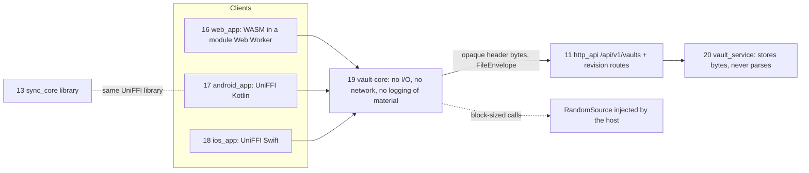
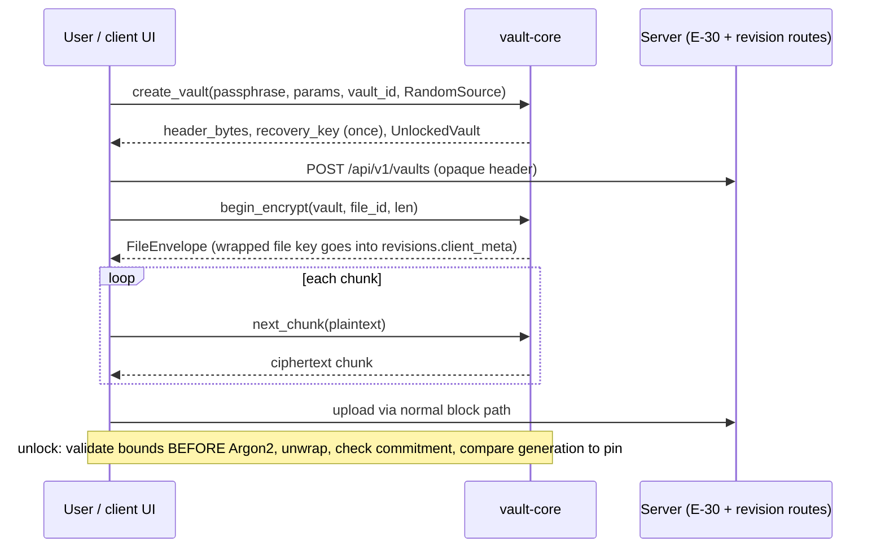

## Epic: 19 Vault Core — Client-side vault cryptography (v1.2)

**Epic id**: E-29 (local id; the Jira key is added when the parent creates the issue)

**epic_type**: component

### Epic Summary

Build `vault-core`, the pure Rust library that creates and unlocks the end-to-end encrypted vault, wraps and unwraps per-file keys and encrypts and decrypts file content in chunks, compiled once to native, WebAssembly and UniFFI. The server never links it. It ships only after an external review of the construction passes (AC-62, RESTRICT-03).

### Problem / Context

The vault is opt-in and client-side so a stolen database or blob volume yields no plaintext (AC-13). The same code must run in a browser Worker, on Android and iOS and in native tests with identical outputs, with bounded memory (AC-14) and a header that is safe to parse although it comes from an untrusted server (AC-61). The format in the spec is a design proposal for the review, not a frozen format; `format_version` exists from day one so a fallback (libsodium `secretstream`) is possible. Spec: `_docs/02_document/components/19_vault_core/description.md`; ADR-007; restrictions "Encryption and vault".

> Release gate: nothing in this epic ships in v1.0 or v1.1 (FT-P-73). Built, fuzzed and reviewed for v1.2; released only after the external review has no unresolved findings.

### System context

### Scope

**In Scope**:
- Header format with `format_version`, `generation` counter, KDF parameters, salt; bounds validation before any Argon2 work.
- KDF (Argon2id v0x13, 64 MiB, t=3, p=1 defaults), vault key wrapped under the KEK and under a key derived from the recovery key, key-commitment value, header authentication (entire header as AAD), rollback pin (`pinned_generation`).
- Operations: `check_passphrase`, `generate_passphrase`, `create_vault`, `unlock`, `unlock_with_recovery`, `rewrap_header`, `begin_encrypt`, `FileEncryptor::next_chunk/finish`, `begin_decrypt`, `FileDecryptor::next_chunk/finish`, `lock`.
- Per-file key per revision, AAD binding `vault_id || file_id || format_version` (the parent is not bound), XChaCha20-Poly1305 STREAM (BE32, 19-byte nonce prefix), authenticated plaintext length, final-chunk flag.
- Passphrase policy (12+ characters and zxcvbn score 4, or 6 generated words from a fixed 7,776-word list), zeroization, injected randomness.
- Build targets: native, WASM (`wasm-bindgen`, module Worker, single-threaded), UniFFI (compiled into the same library as E-23).
- Known-answer vector file shared by all three targets, fuzz targets, external-review support.

**Out of Scope**:
- Server storage of the header (E-30), the wrapped file key's storage in `revisions.client_meta` (E-13), server-side limits, vault-aware listing (E-13, E-14).
- UI and unlock rate limiting (E-26, E-27, E-28; client-side open question), refusal of camera backup into a vault.
- Link sharing of vault files (not in v1.2), name encryption (undecided, data-model A6), desktop vault access.

### Assumptions

- Crate pins with `Cargo.lock` committed: `chacha20poly1305 =0.11.0` (default features off, `alloc`), `aead-stream =0.6.0` (unaudited, 2026), `argon2 =0.6.0` (no `parallel`), `zeroize`, `blake3` 1.8.7, `zxcvbn` behind feature `passphrase-policy`, `wasm-bindgen =0.2.130`, `wasm-pack` 0.15.x, UniFFI 0.32.x ([Verify at pin]).
- WASM core measured at about 60 KB with zero imports; RNG bytes come from `crypto.getRandomValues`, never `Math.random`.
- Parent folder binding is deliberately omitted (owner decision at Step 5): the server controls the tree, names and current revision and can move, hide or roll back vault files but not read or alter content.
- A device that has never seen a vault has nothing to pin (stated limit); offline passphrase guessing against a stolen header is not rate-limited (NFT-SEC-43 product text).

### Dependencies

**Epic dependencies** (must be completed first):
- E-00 Bootstrap & Initial Structure (workspace, WASM and UniFFI toolchains, CI vector gate, `cargo deny` allowlist).
- E-23 13_sync_core (the mobile UniFFI bindings are compiled into the same library; assembly is done by E-27/E-28). Soft dependency: this epic builds and tests standalone.
- No `contracts` port, no helper dependency (helper 02 is not needed); no server component.

**External dependencies**:
- External cryptographic review of the construction (AC-62): scope, reviewer and budget must be agreed before the format is frozen (owner action).
- Low-end phone and Safari for the Argon2 benchmark (spike S7); NDK r28+ and 16 KB alignment check for Android.

### Effort Estimation

**T-shirt size**: XL
**Story points range**: 42-52 (planned child total: 47)

### Users / Consumers

| Type | Who | Key Use Cases |
|------|-----|--------------|
| System | E-26 web_app | WASM in a module Web Worker; vault page |
| System | E-27 android_app, E-28 ios_app | UniFFI bindings, native wrapper owns the `UnlockedVault` handle |
| System | E-30 vault_service | Counterpart: stores the opaque header and `FileEnvelope` bytes this crate produces |
| External | End user | Create a vault, unlock by passphrase or recovery key, change the passphrase |
| Internal | External reviewer | Format document, vectors, fuzz corpus |

### Requirements

**Functional**:
- Unlock <= 1 s native, <= 2 s in the browser (AC-14); 100 MiB files supported with block-sized calls only; larger files rejected `TooLarge{limit}` (100 MiB configurable).
- Empty files and exact multiples of the chunk size round-trip; unknown `format_version` rejected; chunk size 64 KiB to 4 MiB.
- Header bounds checked before any Argon2 work: `t` in 3..=10, `m` from 64 MiB to the platform cap (512 MiB native; mobile and WASM caps set by S7), `p = 1`, known version only; `t = u32::MAX` returns `ParamsOutOfBounds{field}` immediately.
- `rewrap_header` increments `generation`; `unlock` returns `HeaderRolledBack{seen, pinned}` for an older header.
- Swapping a wrapped key and ciphertext into another file or vault fails (1,000 of 1,000 swaps); moving a file within a vault leaves it decryptable.

**Non-functional**: see the Non-functional requirements section.

**Security / Compliance**:
- XChaCha20-Poly1305 with key commitment (keyed BLAKE3 of `"sunnycloud vault commit v1" || vault_id`), constant-time comparisons, no secret in `Debug`, logs, panics or error text.
- `UnlockedVault` is move-only, `!Clone`, `Drop` zeroizes; WASM linear memory cannot be guaranteed wiped, so the page terminates the Worker on lock (heap scan finds no key, AC-62).
- Recovery key: 256-bit random, shown once as grouped base32 with checksum; full entropy so no Argon2 for it (RESTRICT-22).
- Residual risk text (offline guessing, metadata exposure) is a product requirement (NFT-SEC-43).

### Interface specification

All operations are free functions or methods on `UnlockedVault`; no `contracts` port. `VaultError` enumerates the failures.

| Operation | Input | Output | Errors (`VaultError`) |
|---|---|---|---|
| `check_passphrase` | passphrase | `Ok` | `TooShort` (< 12 chars), `TooWeak` (zxcvbn < 4) |
| `generate_passphrase` | `RandomSource` | 6 words (about 77 bits), always accepted by `check_passphrase` | `Rng` |
| `create_vault` | passphrase, `KdfParams` (default 64 MiB, t=3, p=1), `vault_id`, `RandomSource` | `NewVault{header_bytes, recovery_key (shown once), UnlockedVault}` | `Passphrase*`, `ParamsOutOfBounds`, `Rng` |
| `unlock` | `header_bytes`, passphrase, `pinned_generation: Option<u64>` | `UnlockedVault` (carries `generation`) | `HeaderMalformed`, `UnknownVersion`, `ParamsOutOfBounds{field}`, `HeaderAuthFailed`, `WrongPassphraseOrTampered`, `KeyCommitmentMismatch`, `HeaderRolledBack{seen, pinned}` |
| `unlock_with_recovery` | `header_bytes`, recovery key | `UnlockedVault` | same family plus `RecoveryKeyInvalid` |
| `rewrap_header` | `UnlockedVault`, new passphrase | new `header_bytes`, `generation + 1` | as `create_vault` |
| `begin_encrypt` | `UnlockedVault`, `file_id`, `plaintext_len`, `RandomSource` | `FileEncryptor` + `FileEnvelope{header, wrapped_file_key}` (fresh key per revision) | `TooLarge{limit}`, `Rng` |
| `FileEncryptor::next_chunk` / `finish` | plaintext chunk (declared chunk size) | ciphertext chunk (+16 B tag); `finish` sets the final flag | `ChunkSize`, `LengthMismatch` |
| `begin_decrypt` | `UnlockedVault`, `file_id`, `FileEnvelope` | `FileDecryptor` | `WrappedKeyRejected`, `UnknownVersion`, `HeaderAuthFailed` |
| `FileDecryptor::next_chunk` / `finish` | ciphertext chunk | plaintext chunk | `ChunkAuthFailed{index}`, `Truncated`, `Reordered`, `TrailingData` |
| `lock` | `UnlockedVault` | zeroizes all key material | none |

**Format summary (proposal for review)**: header stores `(version, generation, m_cost KiB, t_cost, p_cost, salt)`, the passphrase-wrapped and recovery-wrapped vault key and the key-commitment value; the wrapping AEAD takes the entire serialised header except the wrapped blobs as AAD (0 of 10,000 fuzzed mutations accepted). File header carries chunk size, plaintext length and nonce prefix; chunk AAD binds `vault_id || file_id || format_version || chunk_size || plaintext_len`.

**Configuration**: compile-time constants only (`format_version`, KDF bounds, chunk bounds). Caller-supplied: `max_file_bytes` (100 MiB default), KDF params at creation.

### Data flow

### Architecture notes

- ADR-007 (opt-in client-side vault), ADR-001 (one shared Rust core), ADR-013 (UniFFI, no flutter_rust_bridge), ADR-016 (v1.2 staged release); risks R23 and R35.
- Technology: Rust, `no_std + alloc`-friendly, no global state, incremental chunk API so memory stays at about one chunk plus Argon2 memory; randomness injected via `RandomSource` because `getrandom` has no `wasm32-unknown-unknown` backend by default.
- Fallback if the reviewer rejects `aead-stream`: libsodium `secretstream` (wire format changes, hence `format_version`); costs a C toolchain on WASM, Android and iOS.
- Names: `seal_name`/`open_name` exist only if the review decides names are ciphertext (data-model A6, owner pending).
- If zxcvbn plus the word list is too large for WASM, the web page uses `zxcvbn-ts` and only the length rule lives here (the rule would exist twice).
- Open: envelope length vs the `client_meta` CHECK bound (IT-19-7, gap); memory ceilings for WASM and mobile Argon2 (IT-19-5, benchmark S7).

### Non-functional requirements

| Requirement | Target | Failure threshold | Source |
|---|---|---|---|
| Native unlock p95 (REF-SRV class CPU) | at most 1 s | above 1 s | PT-19-1, AC-14 |
| Browser unlock p95 | at most 2 s | above 2 s | NFT-PERF-29, AC-14 |
| Peak allocation above unlocked baseline (100 MiB encrypt/decrypt) | at most 3 chunks (12 MiB) | 16 MiB | PT-19-2 |
| Total peak, iOS Safari (iPhone 12+) and 4 GB Android Chrome | at most 250 MB | above 250 MB | AC-14, NFT-RES-LIM-08 |
| Header mutation acceptance | 0 of 10,000 | any accepted | AC-61 |
| Swap rejection | 1,000 of 1,000 | any accepted | AC-60 |
| Outputs identical on native, WASM, UniFFI | same vectors | any difference | IT-19-1 |
| Heap scan after `lock` (Worker terminated) | no key bytes | any key bytes | AC-62, ST-19-2 |
| Coverage | 90% on header parsing, bounds, AAD binding, chunk decryptor (security-critical) | below 90% blocks | quality-thresholds |

### Design & Architecture

- Architecture doc: `_docs/02_document/architecture.md` (Component list, section 7 Vault)
- Component spec: `_docs/02_document/components/19_vault_core/description.md`; tests `.../19_vault_core/tests.md`
- System flows: `_docs/02_document/system-flows.md` (F17); ADR `adr/007_*`; restrictions `RESTRICT-22`, `RESTRICT-23`, `RESTRICT-33`

### Testing strategy

- Integration (native, WASM in V8, UniFFI): IT-19-1 known-answer vectors agree on all targets, IT-19-2 round trip for edge sizes at both chunk sizes, IT-19-3 chunk tamper, reorder, truncation, append and final-flag cases, IT-19-4 header tamper at every offset, IT-19-5 Argon2 bounds checked before any work, IT-19-6 key commitment, IT-19-7 fresh wrapped key per revision, IT-19-8 generation counter and rollback pin, IT-19-9 passphrase policy and generation, IT-19-10 recovery key, IT-19-11 swaps of wrapped keys and ciphertext, IT-19-12 size limit and chunk-size contract.
- Performance PT-19-1 unlock time, PT-19-2 memory over 100 MiB; security ST-19-1 no secrets in Debug/errors/logs/panics, ST-19-2 zeroize on lock and drop, ST-19-3 constant-time comparisons, ST-19-4 randomness and nonces, ST-19-5 fuzzing (cargo-fuzz header parser and chunk decryptor, same corpus in V8); acceptance AT-19-1 (create, lock, unlock two ways, decrypt 100 MiB), AT-19-2 (release gate: external review, manual).
- System scenarios: FT-N-13, FT-N-14, FT-N-15, FT-N-16, FT-N-37, FT-P-44, FT-P-46, FT-P-47, NFT-SEC-39, 40, 41, 42, 43, NFT-PERF-29, NFT-RES-LIM-08.
- Unit: known-answer vectors, 10,000-case header mutation fuzz, bounds table including `t = 2`, `t = 11`, `m` above cap (no Argon2 run), passphrase policy (score 3 rejected, score 4 and generated accepted), 1,000 random swaps, truncate/reorder/append at every chunk index.
- Spec gaps: IT-19-5 (memory ceilings, implement, spike S7), IT-19-7 (envelope vs `client_meta` bound, decompose); IT-19-11 parent binding was resolved by the Step 5 owner decision.

### Definition of Done

- [ ] All in-scope operations implemented behind a stable `VaultError` set; format frozen after the review plan is agreed
- [ ] Automated tests pass (unit + integration on native, WASM and UniFFI; fuzz corpus clean)
- [ ] Coverage at or above 75% on business logic and 90% on critical paths (canonical: `quality-thresholds.mdc`)
- [ ] The vector file is a CI gate on all three targets; `cargo deny` allowlist passes for the iOS build
- [ ] External review report has no unresolved findings (manual gate AT-19-2) before the v1.2 tag
- [ ] Product text states the residual risks (offline guessing, metadata, server-controlled tree)
- [ ] Documentation: format document for the reviewer, WASM size note, Argon2 default decision from S7
- [ ] Spec-gap entries IT-19-5 and IT-19-7 updated in `tests/spec-gaps.md`

### Acceptance Criteria

| # | Criterion | Measurable Condition |
|---|-----------|---------------------|
| 1 | AC-13 server sees ciphertext only | IT-19-1..3, AT-19-1: tampered, truncated, reordered or wrong-vault ciphertext rejected; downloaded bytes differ from plaintext |
| 2 | AC-14 limits and speed | PT-19-1, PT-19-2: unlock <= 1 s native / 2 s browser; 100 MiB peak <= 250 MB on reference devices |
| 3 | AC-60 binding | IT-19-2, IT-19-7, IT-19-11: 1,000 of 1,000 swaps rejected; empty and exact-multiple files round-trip; unknown versions rejected |
| 4 | AC-61 header bounds | IT-19-4, IT-19-5, IT-19-8: m < 64 MiB or > 512 MiB, t < 3, p != 1, chunk outside 64 KiB..4 MiB rejected; 0 of 10,000 mutations accepted |
| 5 | AC-62 zeroize and review | ST-19-2: no key bytes after lock; AT-19-2: review passed |
| 6 | RESTRICT-33 passphrase policy | IT-19-9: 12+ chars and score 4, or generated, accepted; score 3 rejected |
| 7 | RESTRICT-22 recovery key | IT-19-10: recovery unlock works; key shown once with checksum |
| 8 | Identical outputs on all targets | IT-19-1: native, WASM and UniFFI vectors equal |

### Risks & Mitigations

| # | Risk | Mitigation | Owner |
|---|------|------------|-------|
| 1 | R23: the external review changes the format; `aead-stream` is unaudited | `format_version` from day one; schedule slack; libsodium fallback; v1.0/v1.1 unaffected | 19, 20 |
| 2 | R35: the parent is bound in neither AAD; a malicious server can move, hide or roll back files | Stated in the spec and product text; generation pin; included in the review scope | 19, 20 |
| 3 | Construction risk in the STREAM nonce handling (same class as R08 for server blobs) | Known-answer vectors, fuzzing, review | 19 |
| 4 | Argon2 timing on low-end phones and Safari unmeasured | Spike S7; parameters stay at the 64 MiB floor or rise only where 1 s / 2 s holds | 19 |
| 5 | zxcvbn dictionary and word list inflate the WASM size | Feature flag; fallback to `zxcvbn-ts` with only the length rule here | 19 |
| 6 | Offline guessing against a stolen header | zxcvbn score 4 or generated passphrase; recovery key full entropy; product text (NFT-SEC-43) | 19 |
| 7 | UniFFI/NDK/16 KB alignment problems (R31) | Pin NDK r28+, early device build, CI alignment check | 17, 19 |
| 8 | R15: schedule | Entire epic is v1.2; no v1.0 dependency | plan |

### Labels

- `sunnycloud`
- `component:vault_core`
- `release:v1.2`
- `type:platform`

### Child Issues

| Type | Title | Points |
|------|-------|--------|
| Spike | Agree the external review plan (scope, reviewer, budget) and freeze the format; decide on libsodium fallback (R23, owner) | 3 |
| Spike | S7 benchmark: Argon2 on a low-end phone and Safari; set the WASM and mobile memory caps (IT-19-5) | 3 |
| Spike | Envelope length vs the `revisions.client_meta` CHECK bound with the data-model owner (IT-19-7) | 2 |
| Enabler | Crate skeleton: `no_std + alloc`, pins, `RandomSource`, `VaultError`, zeroize, native/WASM/UniFFI CI matrix | 3 |
| Task | Passphrase policy: `check_passphrase`, `generate_passphrase` with the 7,776-word list, `passphrase-policy` feature | 3 |
| Task | Header format, serialisation and bounds validation before any Argon2 work | 3 |
| Task | `create_vault`, `unlock`, `unlock_with_recovery`, `rewrap_header`: KDF, double wrap, key commitment, generation pin | 5 |
| Task | Per-file encryption: `begin_encrypt/decrypt`, STREAM chunks, AAD binding, wrapped file key, length and final-flag checks | 5 |
| Task | `lock`, move-only `UnlockedVault`, no-`Debug` secrets, constant-time comparisons | 3 |
| Task | WASM adapter (`wasm-bindgen`, module Worker glue, 100 MiB file spike with Vite + SvelteKit) | 3 |
| Task | UniFFI adapter for Kotlin and Swift (block-sized calls, handle ownership) | 3 |
| Task | Known-answer vector file and the three-target CI gate | 3 |
| Task | cargo-fuzz targets (header parser, chunk decryptor) and the 10,000-mutation test | 3 |
| Task | Performance and security tests PT-19-1..2, ST-19-1..4 | 3 |
| Task | Acceptance tests AT-19-1 and review-gate evidence package AT-19-2 | 2 |
