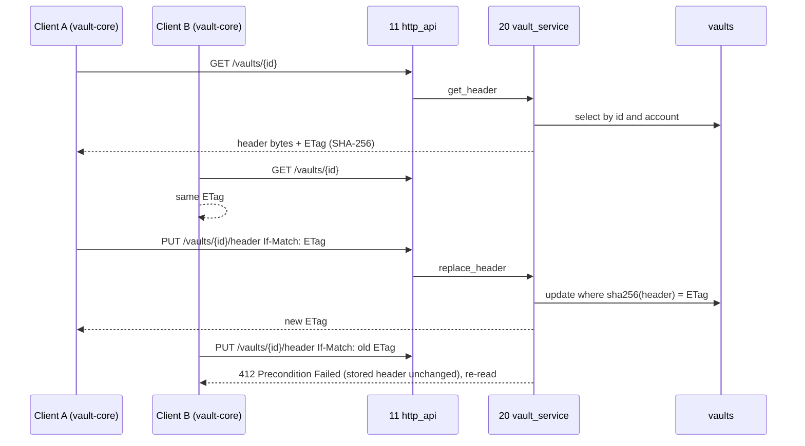

## Epic: 20 Vault Service — Server side of the end-to-end vault (v1.2)

**Epic id**: E-30 (local id; the Jira key is added when the parent creates the issue)

**epic_type**: component

### Epic Summary

Build the small server component that stores and returns the opaque vault header with optimistic concurrency (`ETag` and `If-Match`), enforces vault limits, accepts best-effort unlock-failure reports for the audit log and erases vault rows on account deletion. It never sees a passphrase, key or plaintext and never links `vault-core`. Released only together with E-29 and after the external review (AC-62).

### Problem / Context

Vault ciphertext uses the normal revision and blob path; the per-file wrapped key travels inside the revision's `revisions.client_meta`, so it commits atomically with the revision and no `CommitEffect` or separate key call is needed. What the server must add is: a place for the authenticated opaque header, protection against two clients silently overwriting each other (passphrase change, recovery), the 100 MiB per-file limit applied at commit, a way for other components to know a node is under a vault root, and cleanup at account erase. Spec: `_docs/02_document/components/20_vault_service/description.md` (stub-level; routes, ports and table are a proposal for the review).

> Release gate: nothing in this epic ships in v1.0 or v1.1 (FT-P-73).

### System context

```mermaid
flowchart LR
  WEB[16/17/18 clients with 19 vault-core] -->|HTTPS| H[11 http_api /api/v1/vaults/**]
  H -->|VaultService| V[20 vault_service]
  V --> DB[(vaults table, RLS by account_id)]
  V -->|TreeReader: vault root is a live folder of the caller| T[02 tree]
  V -->|AuditWriter: vault_failure ids only| A[helper 04 audit]
  P[07 DeletionPurger] -->|AccountLifecycleHook erase_batch| V
  CW[02/03 commit path] -. CommitContext.vault, max_vault_file_bytes .-> V
  SH[06 sharing] -. refuses vault targets .-> V
  M[08 media planner] -. vault flag in CommitContext, no dependency on 20 .-> V
```

### Scope

**In Scope**:
- `vaults` table (`id`, `account_id`, `root_node_id` UNIQUE composite FK to `nodes`, `header` bytea, `created_at`, `updated_at`) with the standard row-level policy.
- `VaultService`: `create_vault`, `get_header`, `replace_header`, `report_unlock_failure`; `ETag` = SHA-256 of the stored header bytes; `If-Match` required on replace.
- Server-side limits from config: `max_vault_file_bytes` (100 MiB, applied at commit by E-14) and `max_vault_header_bytes` (default to be fixed by the spike).
- Routes in the E-21 registry (`/api/v1/vaults` POST, `/vaults/{id}` GET, `/vaults/{id}/header` PUT, `/vaults/{id}/unlock-failures` POST) and registration in the E-22 composition root.
- `AccountLifecycleHook` (`initialize` no-op, `erase_batch` removes the account's `vaults` rows).
- The vault-membership answer for E-13/E-14/E-16 (flag set in `CommitContext`, size limit, share refusal), once the owner decision exists.

**Out of Scope**:
- All cryptography, passphrase policy, generation counter and rollback detection (E-29 and the clients).
- Upload and download mechanics (E-14), tree structure and `client_meta` storage (E-13), UI (E-26, E-27, E-28).
- Link sharing of vault files (refused by E-16 with `TargetNotShareable`; 20 provides no envelope reader), vault thumbnails and transcodes.

### Assumptions

- The server treats `header` as opaque bytes with a length cap and does not parse it.
- Each query is scoped by `account_id`; volume is low (primary-key lookups, no cache).
- The former `vault_files` table is dropped; the wrapped file key lives in `revisions.client_meta`.
- Whether names are ciphertext and one-or-many vaults per account are undecided (data-model A6); the epic plans for one vault per account with `VaultExists` only if the owner decides so.
- The data-model changes (drop `vault_files`, `vaults` as above, a way for 02/03 to tell a node lies under a vault root) are done by the data-model owner and the tree/transfer epics.

### Dependencies

**Epic dependencies** (must be completed first):
- E-00 Bootstrap & Initial Structure; cross-cutting E-01 Configuration, E-02 Error model, E-06 Database access and migrations, E-07 Audit log (`AuditWriter`), E-09 Observability.
- E-13 02_tree (`TreeReader`; `revisions.client_meta`; vault-membership hook points), E-14 03_transfer (commit path, 100 MiB limit), E-16 06_sharing (share refusal), E-17 07_admin (`DeletionPurger` drives the hook).
- E-21 11_http_api (route registry, `ApiServices` slot for `VaultService`) and E-22 12_operator_cli (composition root and late registration of the hook): this epic adds its pieces to both.
- E-29 19_vault_core (byte layout of the header and `FileEnvelope` fixed after the review plan is agreed).

**External dependencies**:
- Owner decisions listed in `tests/spec-gaps.md`: vault membership, vaults per account, header cap default.
- The external review (shared with E-29).

### Effort Estimation

**T-shirt size**: M
**Story points range**: 20-26 (planned child total: 23)

### Users / Consumers

| Type | Who | Key Use Cases |
|------|-----|--------------|
| System | E-21 http_api | `/api/v1/vaults/**` routes |
| System | E-26 web_app, E-27 android_app, E-28 ios_app | Create vault, read and replace the header, report an unlock failure |
| System | E-17 07_admin `DeletionPurger` | Erase vault rows at account deletion |
| System | E-13/E-14/E-16/E-18 | Vault membership: no jobs, 100 MiB limit, no shares |
| Internal | Operator | `vault_failure` audit events, no secrets |

### Requirements

**Functional**:
- Header round-trip is byte-identical; `ETag` header equals the SHA-256 of the stored bytes.
- Concurrent `replace_header` calls: exactly one wins, the others get 412 and the stored header is unchanged; missing `If-Match` is refused with 428.
- `create_vault` requires a root node that is a live folder of the caller; foreign or missing root is 404.
- Vault files commit through the normal path with the wrapped key in `client_meta`; no job is enqueued for them (`CommitContext.vault`); a share of a vault file is refused.
- `erase_batch(account, limit) -> EraseProgress{remaining}` leaves zero `vaults` rows.

**Non-functional**: see the Non-functional requirements section.

**Security / Compliance**:
- The server holds ciphertext, an authenticated opaque header and wrapped keys only; a database dump of a vault account contains no plaintext and no key (AC-13).
- Vault routes are in the AC-59 two-account matrix (0 cross-account successes, all 404); create and replace are `SessionOnly`, get and report are `Session`.
- Failure reports carry ids only, never the passphrase or attempt-count text; logs the same.
- Residual risk accepted and documented: unlimited offline guessing against a stolen header; the server chooses tree shape and can move, hide or roll back vault files (E-29 risks).

### Interface specification

**Provided ports** (declared in `contracts`)

| Port | Methods | Consumers |
|---|---|---|
| `VaultService` | `create_vault`, `get_header`, `replace_header`, `report_unlock_failure` | E-21 |
| `AccountLifecycleHook` | `initialize(tx, account)` (no-op), `erase_batch(account, limit) -> EraseProgress{remaining}` | E-17, registered by E-22 |

**Required**: `TreeReader` (E-13: vault root must be a live folder of the account), `AuditWriter` (helper 04: `vault_failure` events), helpers db, config, error.

**Operations (proposed)**

| Operation | Input | Output | Errors |
|---|---|---|---|
| `create_vault` | account, `header: bytes`, root node | `VaultId`, `ETag` | `VaultExists` (if one per account is decided), `HeaderTooLarge`, `NotFound` |
| `get_header` | account, vault id | `header: bytes`, `ETag` | `NotFound` |
| `replace_header` | account, vault id, `header: bytes`, `if_match: ETag` | new `ETag` | `NotFound`, `HeaderTooLarge`, `PreconditionFailed` |
| `report_unlock_failure` | account, vault id | `()` | none (best-effort; audit `vault_failure`, ids only) |

**HTTP routes** (reserved; REST naming rules apply)

| Endpoint | Method | Auth | Description |
|---|---|---|---|
| `/api/v1/vaults` | POST | SessionOnly | create a vault with its header; returns `ETag` |
| `/api/v1/vaults/{id}` | GET | Session | header, `ETag` header, root node id |
| `/api/v1/vaults/{id}/header` | PUT | SessionOnly | replace; requires `If-Match`; 412 on mismatch, 428 when missing |
| `/api/v1/vaults/{id}/unlock-failures` | POST | Session | best-effort failure report |

**Data owned**: `vaults` only. **Configuration**: `max_vault_file_bytes` (100 MiB), `max_vault_header_bytes` (no default yet). No durations.

### Data flow



### Architecture notes

- ADR-007 (opt-in vault), ADR-015 (port-only access; no `vault-core` dependency), ADR-014 (row-level policy on `vaults`), ADR-016 (v1.2); canonical-names: vault files cannot be link-shared in v1.2; risks R23 and R35.
- Technology: Rust, sqlx 0.9 through helper 07 (account scope, short transactions), PostgreSQL 18; ETag computed with the shared hashing helper (E-04) over the stored bytes.
- Membership answer must be derivable from the node or its ancestry without calling 20 (so 02/03/06 do not depend on it): owner decision pending; the epic delivers the agreed mechanism with E-13/E-14/E-16 tasks.
- The generation counter lives inside the header (E-29); the server cannot read or enforce it, so a returning client's pin is what stops a rolled-back header.
- Module files stay under 500 lines; the crate is tiny (one table, four operations).

### Non-functional requirements

| Requirement | Target | Failure threshold | Source |
|---|---|---|---|
| Header round trip | byte-identical, 100% | any difference | IT-20-1, AC-61 |
| Concurrent replacement | 50-way race: exactly 1 success, 49 get 412 | 2 successes or a silent overwrite | IT-20-2 |
| Per-file vault limit | 100 MiB accepted, 100 MiB + 1 rejected with a clear message | accepted above limit | IT-20-5, AC-14 |
| Header cap | max accepted, max + 1 rejected (value fixed by spike) | no cap | IT-20-1 |
| Cross-account access | 0 successes | any success | AC-59, ST-20-1 |
| Account erase | 0 `vaults` rows remaining | any row | IT-20-8, AC-27 |
| Query shape | primary-key lookups only | scan | data access pattern |
| Coverage | 90% on `replace_header` precondition logic | below 90% blocks | quality-thresholds |

### Design & Architecture

- Architecture doc: `_docs/02_document/architecture.md` (Component list: 20 vault_service; section 7 Vault)
- Component spec: `_docs/02_document/components/20_vault_service/description.md`; tests `.../20_vault_service/tests.md`; data model section 10.2
- System flows: `_docs/02_document/system-flows.md` (F17, F13); ADRs `adr/007_*`, `adr/015_*`, `adr/016_*`

### Testing strategy

- Integration (real Postgres 18 and real API via testcontainers, and Compose scenarios in the `core` profile; client crypto cases use the real `vault-core` native build, the server is never given a key): IT-20-1 header round trip is byte-identical and ETag is its SHA-256, IT-20-2 `If-Match` rules and a 50-way replacement race, IT-20-3 generation counter, stale header and a returning client (with E-29), IT-20-4 no link sharing of vault files, IT-20-5 no media jobs and size limit for vault files only, IT-20-6 database dump holds only ciphertext and opaque bytes, IT-20-7 vault root must be a live folder of the caller, IT-20-8 account deletion removes vault rows and ciphertext.
- Security: ST-20-1 vault routes in the two-account matrix and scope rules, ST-20-2 failure reports and logs carry ids only.
- Acceptance: AT-20-1 two devices, one vault, a passphrase change and a restored backup.
- System scenarios: FT-P-44, FT-P-47, FT-N-13, FT-N-16, NFT-SEC-13, NFT-SEC-39, NFT-SEC-41, NFT-SEC-43, FT-P-19, NFT-RES-30.
- Unit: header round-trip equality, `If-Match` mismatch gives 412 and leaves the stored header unchanged, missing `If-Match` refused, deletion hook leaves zero rows, no job for `CommitContext.vault`, share of a vault file refused by 06.
- Spec gaps (from `tests/spec-gaps.md`): vault membership (owner), vaults per account (owner, IT-20-7), header cap default (decompose, BLOCKED part of IT-20-1); IT-20-7 second-vault case BLOCKED on the owner decision.

### Definition of Done

- [ ] All in-scope operations and routes implemented; hook registered in the composition root
- [ ] Automated tests pass (unit + integration + AT-20-1)
- [ ] Coverage at or above 75% on business logic and 90% on the precondition and scoping paths (canonical: `quality-thresholds.mdc`)
- [ ] Vault routes appear in the generated AC-58 and AC-59 matrices with 0 failures
- [ ] Owner decisions recorded (membership mechanism, vaults per account, header cap) and `tests/spec-gaps.md` updated
- [ ] Data-model changes applied (drop `vault_files`, add `vaults`) and cross-checked with E-13/E-14/E-16 tasks
- [ ] Documentation: OpenAPI entries for the four routes; runbook note that vault data is unrecoverable without passphrase or recovery key

### Acceptance Criteria

| # | Criterion | Measurable Condition |
|---|-----------|---------------------|
| 1 | AC-13 ciphertext only | IT-20-6, ST-20-2: a dump of a vault account has no plaintext and no key |
| 2 | AC-14 limit | IT-20-5: 100 MiB accepted, larger rejected with a clear message; camera backup writes nothing into the vault |
| 3 | AC-61 header integrity | IT-20-1..3: byte-identical return; concurrent replacement detected (412); rollback handled with E-29 |
| 4 | AC-59 IDOR | IT-20-7, ST-20-1: 0 cross-account successes, all 404 |
| 5 | AC-27 erase | IT-20-8: zero `vaults` rows and no vault ciphertext after deletion |
| 6 | RESTRICT-22/23 | IT-20-3, IT-20-6: the server holds ciphertext and an opaque authenticated header only |
| 7 | No link sharing (owner decision) | IT-20-4: a share of a vault file is refused (`TargetNotShareable`) |
| 8 | No derived files | IT-20-5: no media job is enqueued for vault files |

### Risks & Mitigations

| # | Risk | Mitigation | Owner |
|---|------|------------|-------|
| 1 | R23: format changes after the external review | Header is opaque bytes; service unaffected by format changes; `format_version` in the header | 19, 20 |
| 2 | R35: malicious server can move, hide or roll back vault files | Documented; client generation pin; review scope | 19, 20 |
| 3 | Vault membership undefined (how 02/03/06/08 learn a node is under a vault root; moves in/out; already-shared plaintext) | Spike and owner decision before any commit-path change; membership answerable without calling 20 | 02, 03, 06, 20 |
| 4 | One vs many vaults per account and name encryption undecided (A6) | Plan for one vault; `VaultExists` only if decided; revisit at the spike | owner |
| 5 | Header cap has no default | Spike proposes a value; test pairs max and max + 1 | 20 |
| 6 | Stolen database allows unlimited offline guessing | Residual risk stated in product text (NFT-SEC-43); zxcvbn 4 or generated passphrase in E-29 | 19 |
| 7 | R15: complexity and schedule | Stub-level component, one table, scheduled last | plan |

### Labels

- `sunnycloud`
- `component:vault_service`
- `release:v1.2`
- `type:platform`

### Child Issues

| Type | Title | Points |
|------|-------|--------|
| Spike | Decide vault membership mechanism, vaults per account and the `max_vault_header_bytes` default (spec-gaps: Vault membership, Vaults per account, Header cap); record in `tests/spec-gaps.md` | 3 |
| Enabler | Migration for `vaults` (drop `vault_files`), RLS policy and config keys | 2 |
| Task | `VaultService`: `create_vault`, `get_header`, `replace_header` with SHA-256 `ETag` and `If-Match`, caps | 3 |
| Task | `report_unlock_failure` with audit `vault_failure` (ids only) | 2 |
| Task | `AccountLifecycleHook::erase_batch` for `vaults` | 2 |
| Task | Register vault routes in the E-21 registry and OpenAPI (412, 428) and the hook and service in the E-22 composition root | 3 |
| Task | Wire vault membership into the commit path (`CommitContext.vault`, 100 MiB limit) and the share refusal with E-13, E-14, E-16 owners | 3 |
| Task | Integration, security and acceptance suite IT-20-1..8, ST-20-1..2, AT-20-1 | 5 |
