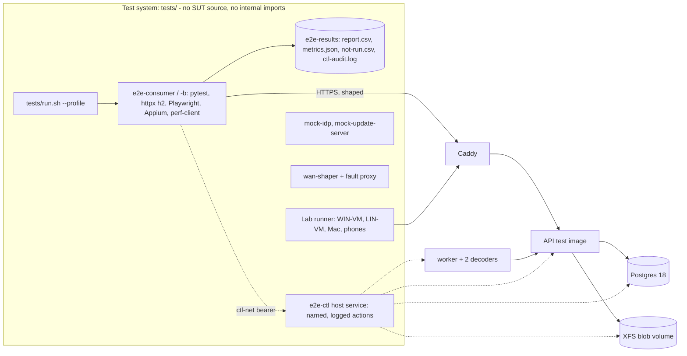
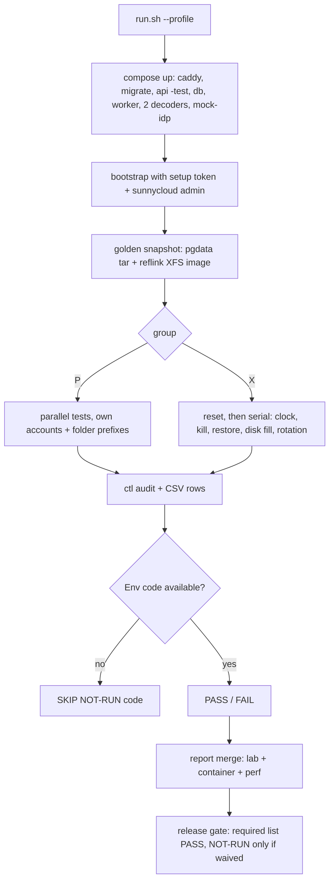

## Epic: Blackbox Tests — harness, data sets and the 249 system scenarios

**epic_type**: tests
**concern** (cross-cutting only): n/a

### Epic Summary

Build the standalone black-box test system for sunnycloud: the Compose test stack and `tests/run.sh` profiles, the `e2e-ctl` fault-injection service, mocks, shaping, the DS-* data-set generators, the lab runners, and every system scenario (blackbox 121, resilience 39, security 50, performance 30, resource-limit 9) that proves the 79 acceptance criteria and 33 restrictions. It parents the blackbox test tasks decomposed from `_docs/02_document/tests/`.

### Problem / Context

Acceptance is proved only through the interfaces a user, client or operator has: HTTP API `/api/v1`, web UI, apps, desktop daemon and settings window, the sync folder, and the operator CLI. Many criteria need reference hardware or real operating systems (AC-1, 2, 9, 10, 11, 16, 26, 32-35, Safari in AC-50/51), so execution is BOTH: Docker Compose for everything hardware-independent and a lab for `H-*` items; absent hardware is reported `NOT-RUN(<code>)`, never PASS. Source: `tests/environment.md` (authoritative for hosts, runners, timeouts), `tests/test-data.md`, `tests/traceability-matrix.md` (79/79 ACs, 33/33 restrictions covered, 0 BLOCKED scenarios), `tests/spec-gaps.md` (57 open gap entries).

### System Context

### Scope

**In Scope**:
- Harness: `tests/compose.test.yml`, `tests/run.sh` profiles (`core`, `web`, `desktop`, `android-emu`, `perf`, `lan`, `gpu`), golden snapshot and reset (< 60 s), pinned image digests, `-test` image variants, report format and gating.
- `e2e-ctl` (process kill, power-loss option, disk fill, test clock, DB restore, unmount, network drop, bit flip, raw blob read, isolation inspection, read-only DB probe, blob reconciliation, internal worker call, alternate-key start, operator command, sampling, proxy byte counters, provider faults, DB outage, interrupted upgrade).
- Mocks (`mock-idp`, `mock-update-server`, GeoIP DS-32), `wan-shaper` profiles, XFS loop volumes (`blobs-small` 32 GiB, `blobs-large` 200 GiB sparse, ext4 variant), `perf-client`.
- Generators and data sets DS-01..DS-36; the scenario groups of all five scenario files; release gates S1-S12 and S14; hardware classes (REF-SRV, REF-LOAD, REF-CPU4, REF-WIN-WEAK, REF-LIN-WAYLAND-NV, WIN-VM, LIN-VM, MAC, DEV-*, EMU).
- Resolution tasks for open spec gaps tagged *decompose* or *implement*.

**Out of Scope**:
- Component unit and integration tests (their own epics, `components/*/tests.md`); implementing product code; owner-held hardware purchase and live provider/Apple/Google accounts (owner items).
- Vault scenarios run only when v1.2 is under test; iOS/macOS/NVENC scenarios only for v1.1.

### Assumptions

- Execution decision BOTH (recommended in `environment.md`; not yet confirmed by the owner); a perf result from non-reference hardware never counts as PASS.
- Product durations (retention, TTLs, settle, leases) come from config, set short in the test stack; the test clock is used only where the AC asserts the production default (7-day retention, 10-minute codes, 90/91-day horizon), group `X`.
- Teardown purges accounts through `e2e-ctl`, not the deletion API, except in AC-27 tests; a leak check compares blob-volume bytes per group.
- Client-specific drivers (Playwright code, Appium suites, desktop lab scripts) are authored in E-24..E-28; this epic owns the shared stack, services, data sets and the system scenarios.

### Dependencies

**Epic dependencies** (must be completed first):
- E-00 Bootstrap and E-01..E-09 (config, error, clock, ids, names, db, audit, ratelimit, observability) for the stack to start; harness tasks can begin against the E-00/E-21 skeleton.
- Components E-10..E-22 (server, workers, CLI) for `core`, `perf`, `ops` suites; E-23..E-27 for desktop, web, Android and sync-client scenarios; E-28 and E-29/E-30 only for v1.1 / v1.2 scenarios. Scenario tasks start when their component epics are done (this epic is last).

**External dependencies**:
- REF-SRV (8 physical cores, 32 GB, NVMe/XFS, 1 GbE), REF-LOAD, REF-CPU4 cpuset on REF-SRV, REF-WIN-WEAK, REF-LIN-WAYLAND-NV, WIN-VM (Defender on), LIN-VM (stock GNOME Wayland), owner Mac and iPhone, Pixel/Samsung/Xiaomi devices, REF-NV (v1.1) — owner items (R03, G1/G11); exact models recorded in every perf report.
- Wildcard certificate + DNS-01 for the `lan` profile, live provider accounts (gate S8), Office licence for AC-34, an N-1 release candidate image for the upgrade test.

### Effort Estimation

**T-shirt size**: XL
**Story points range**: 190-230 (child issues below total 210)

### Users / Consumers

| Type | Who | Key Use Cases |
|------|-----|--------------|
| Internal | Developers and CI | `core` PR gate, nightly `perf`/`web`/`desktop`/`android-emu` |
| Internal | Release manager | Per-release required list, NOT-RUN waivers |
| External | Owner | Hardware provisioning, gap decisions |
| System | GitHub Actions / Woodpecker | Run `tests/run.sh`, upload `e2e-results` |

### Interface Specification

- Entry point: `tests/run.sh --profile <core|web|desktop|android-emu|perf|lan|gpu> [--release 1.0] [--suite ops]`, `tests/run.sh reset`; inside the container `pytest -v --tb=short -p e2e_report` (never quiet); lab: `tests/lab/run-lab.sh --target <win-vm|lin-vm|weak-win|lin-nv|android|mac>` reverts the VM snapshot first.
- Scenario record: ID, Traces to (AC/RESTRICT), Env code (`C`, `C-LARGE`, `C-REF`, `EMU`, `H-ANDROID`, `H-LIN`, `H-WIN`, `H-MAC`, `H-IOS`, `H-GPU`, `H-LIVE`, `CI`, `MAN`, `EXT`), isolation group (`P` parallel up to 8, `X` exclusive after reset), release tag. A later-release scenario is skipped, not failed, on an earlier build.
- Report: CSV columns Test ID, Test Name, Execution Time (ms), Result (PASS/FAIL/SKIP), Error Message; a documented not-run is `SKIP` with message `NOT-RUN(<code>): reason`; summary prints PASS/FAIL/NOT-RUN per code, non-zero exit on any FAIL. Outputs `e2e-results/report.csv`, `metrics.json` (measured values and reference-hardware ids), `not-run.csv`, `ctl-audit.log` (gitignored).
- `e2e-ctl` (host process on `ctl-net`, bearer token, one audit line per call): actions `kill/start`, `stop-db/start-db`, `disk-fill`, `unmount`, `net-drop(byte offset)`, `bitflip(blob)`, `raw-blob-read`, `inspect(decoder)`, `probe(fixed queries)`, `reconcile-blobs`, `internal-http(Authorization)`, `alt-key-start`, `exec-operator(cmd)`, `restore-db`, `purge-account`, `sample(docker stats, /proc)`, `proxy-bytes(path)`, `clock-advance`. The consumer has no DB credentials, no blob mount, no master key and no route to `backend-net`/`proxy-net`.
- Mocks: `mock-idp` control API (valid callback, 12 negative callbacks, unverified/verified email, slow provider > 10 s, GitHub- and Apple-shaped); `mock-update-server` serving Ed25519-signed manifests (valid with active and recovery key, unsigned, unpinned key, lower/same version, expired, replayed serial, altered and truncated payload).
- Networks: `client-net`, `edge-net`, `proxy-net`, `backend-net`, `ctl-net (internal)`; shaping profiles `shape-wan` (RTT 20 ms, 1 Gbit), `shape-off`, `shape-perf` (two hosts), `shape-flaky`.

### Data Flow

### Design & Architecture

- Architecture doc: `_docs/02_document/architecture.md`
- Test specs: `_docs/02_document/tests/` — `blackbox-tests.md`, `performance-tests.md`, `resilience-tests.md`, `resource-limit-tests.md`, `security-tests.md`, `environment.md`, `test-data.md`; supporting `traceability-matrix.md`, `spec-gaps.md`, `gap-decisions.md`, `restriction-ids.md`.
- System flows: `_docs/02_document/system-flows.md`; deployment: `deployment/ci_cd_pipeline.md` (tier to runner mapping, job `core`, `ops-drill`).

### Architecture Notes

- ADR-002 (one API process; test stack mirrors the release Compose service names), ADR-009 (decoder isolation inspected through `e2e-ctl`), ADR-014 (DB roles checked by NFT-SEC-46), ADR-017 (signing: only GitHub release workflow; fallback CI builds and tests only), ADR-016 (release tags drive profiles).
- Test image only: `POST /test/clock` on `:9091` and `GET /internal/v1/test/clock-offset` on `:8081`; release images return 404 and CI asserts it on the pushed digest before signing (FT-N-35).
- Blob volume on loop-mounted XFS; `blobs-ext4` only for the XFS-vs-ext4 comparison (gate S14). Images pinned by digest (RESTRICT-30). Timeouts: `core` 45 min, `perf` 4 h, `C-LARGE` 8 h, desktop lab 12 h; any step with no log output for 2 minutes is STALLED and aborted (30 s watcher).
- Gates (solution roadmap): S1 throughput 1 Gbps with encryption and buffering off (AC-2, AC-6, AC-40); S2 100k-file watcher per OS (AC-15); S3 Slint cold start (AC-16); S4 thumbnail timing and bulk import (AC-10); S5 transcode reference clips (AC-11, AC-28, AC-44, AC-45); S7 vault unlock (v1.2); S8 live provider flows (AC-19); S9 Android device matrix (AC-9); S10 decoder isolation with GPU (v1.1); S11 external vault review (v1.2); S12 browser 50 GiB (AC-50, AC-51); S14 XFS vs ext4 (AC-5). S6 and S13 are not defined in any document (see Risks).

### Requirements

**Functional**:
- Every one of the 79 ACs (AC-36 does not exist) and 33 restrictions maps to at least one runnable scenario; each scenario drives only public interfaces and records pass/fail by the real system under test (no stubs, no passthrough).
- Hardware-dependent scenarios run on the lab and report `NOT-RUN(<code>)` when hardware is absent; vault, iOS, macOS, NVENC scenarios are tagged and skipped on earlier builds.

**Non-functional**:
- See Non-Functional Requirements below.

**Security / Compliance**:
- Secrets via Docker secrets only; no credentials, logs or `e2e-results` in git; `e2e-ctl` bound to `ctl-net` only with an audited bearer; test master keys generated per run.

### Non-Functional Requirements

| Target | Threshold | Failure | Test |
|---|---|---|---|
| `core` PR gate runtime | <= 45 min on 4 vCPU/16 GB | timeout | CI job `core` |
| Stack reset to golden | < 60 s | > 60 s | `run.sh reset` |
| Reported perf numbers | only from REF-SRV/REF-LOAD/REF-CPU4 | any other host counted as PASS | report check |
| Large-file runs | `C-LARGE` <= 8 h; 50 GiB pass about 8 min per direction at 112 MB/s | timeout | nightly |
| Harness reliability | 0 flaky reruns hide a FAIL; STALLED detected within 2 min | silent hang | watcher |
| AC-12 timing deltas | 10,000 samples per case, medians, quiet host | noise above 1 ms | NFT-SEC-17 |

### Testing Strategy

- Self-tests of the harness (fault actions take effect, golden reset restores, report contract, NOT-RUN mapping) plus the scenarios themselves. Unit tests of generators (manifests, hashes, compliance verifier).
- Scenario groups (from `tests/`): FT-P-01..77 (positive), FT-N-01..44 (negative), NFT-PERF-01..30, NFT-RES-01..39, NFT-RES-LIM-01..09, NFT-SEC-01..50. Interaction ACs AC-68..80 are covered by FT-N-42..44, NFT-RES-34..39, NFT-SEC-48..50, FT-P-76.
- Coverage targets: AC 79/79, restrictions 33/33 (traceability matrix); AC/restriction scenario coverage waivers only per item with a reason.
- Open spec gaps (`tests/spec-gaps.md`): decompose-time 29, implement-time 9, owner 19; tasks below settle the first two classes, owner items are escalated.

### Definition of Done

- [ ] All in-scope capabilities implemented
- [ ] Automated tests pass (unit + blackbox)
- [ ] Minimum coverage threshold met (canonical: `quality-thresholds.mdc` Quality Thresholds)
- [ ] Runbooks written (stack bring-up, lab operation, adding a scenario, NOT-RUN waiver process)
- [ ] Documentation updated (`environment.md` hardware inventory filled with models)
- [ ] For each release the required list is PASS or explicitly waived with a reason

### Acceptance Criteria

| # | Criterion | Measurable Condition |
|---|-----------|---------------------|
| 1 | Coverage | Traceability: 79 of 79 ACs and 33 of 33 restrictions each have >= 1 implemented scenario |
| 2 | PR gate | `tests/run.sh --profile core` green on a GitHub-hosted runner in <= 45 min with small data |
| 3 | Fault injection | Every `e2e-ctl` action has a self-test; each is logged in `ctl-audit.log` |
| 4 | NOT-RUN honesty | Without hardware a scenario ends `SKIP` with `NOT-RUN(<code>)`; summary counts them; exit code non-zero only on FAIL |
| 5 | Perf validity | Gate S1, S4, S5 numbers are recorded with the REF-* ids; off-reference runs are `NOT-RUN(HW-REF)` |
| 6 | Release gate | Release-candidate report merges container, perf and lab results and lists each waiver |
| 7 | Test clock | A CI check proves release images return 404 on both clock routes (FT-N-35) |
| 8 | Data sets | DS-01..DS-36 regenerate deterministically (seeded); manifests and per-block BLAKE3 verified by the generator |
| 9 | Isolation | Group `P` tests use their own accounts; group `X` starts from a reset stack; leak check passes |

### Risks & Mitigations

| # | Risk | Mitigation | Owner |
|---|------|------------|-------|
| 1 | R03: reference hardware not provisioned, so AC-1, 2, 10, 11 stay unproven | Provision REF-SRV/REF-CPU4 before the first perf gate; report NOT-RUN meanwhile | owner |
| 2 | Owner items: phones, Windows weak laptop, Mac, iPhone, live accounts, domain (G1, G11, test-data gaps) | Owner states models/accounts; `lan` profile and lab controller ready | owner |
| 3 | R04 / R07 / R14: S1 and contention gates may fail | Run S1 through Caddy early; record churn in the same runs | tests, 11 |
| 4 | Gates S6 and S13 are referenced or implied but not defined (R07, R14 cite S6) | Spike defines them with the owner; map to NFT-PERF-09 / S1 contention measurements | tests |
| 5 | 22 of 57 spec gaps need an owner decision (e.g. G-1 NFC/NFD, G-5 audio-only clips, G-10 inline eligibility, G-03-1) | Escalate in one batch; unblock scenarios as decided | owner |
| 6 | Paused-VM suspend tests weaker than real suspend; Linux lock tests not applicable | Label evidence; report "not applicable" instead of pass | tests |
| 7 | Playwright 50 GiB input may buffer in Firefox/WebKit | Spike in E-26; labelled manual-driven lab run | tests, 16 |

### Labels

- `sunnycloud`
- `component:blackbox_tests`
- `env:stg`
- `type:platform`
- `release:v1.1` / `release:v1.2` on the child items marked [v1.1] / [v1.2]

### Child Issues

| Type | Title | Points |
|------|-------|--------|
| Spike | Confirm execution decision BOTH and fill the hardware inventory (REF-SRV, REF-CPU4, WIN-VM, LIN-VM, Mac, phones) | 2 |
| Spike | Define gates S6 and S13 and map S1-S14 to scenarios (owner) | 1 |
| Spike | Settle decompose-time gaps G-2, G-9, G-12, G-15, G-19, G-21, G-S5, G-S6 (`tests/spec-gaps.md`) | 3 |
| Spike | Escalate owner gaps G-1, G-5, G-7, G-10, G-R4, G-R5, G-03-1, session cap/floor defaults | 2 |
| Enabler | `tests/compose.test.yml`, `run.sh` profiles, secrets, networks, pinned digests | 5 |
| Enabler | Golden snapshot and `reset` (pgdata tar + XFS reflink), blob volume tooling, ext4 variant | 3 |
| Enabler | `-test` image wiring, test-clock helpers, 404 assertion check for release images | 2 |
| Enabler | `e2e-ctl` core: bearer, audit log, action registry, ctl-net binding | 5 |
| Enabler | `e2e-ctl` fault actions: kill/start, DB outage, net-drop, disk-fill, unmount, restore-db | 5 |
| Enabler | `e2e-ctl` observation actions: bit flip, raw blob read, isolation inspect, DB probe, reconcile, sampling, proxy bytes | 5 |
| Enabler | `e2e-ctl` operator-command, internal-http, alt-key-start, purge-account | 3 |
| Enabler | Consumer framework: pytest, httpx h2, hypothesis, CSV reporter, NOT-RUN mapping, P/X groups, STALLED watchdog | 5 |
| Enabler | `mock-idp` (OIDC, GitHub, Apple-shaped, 12 negative callbacks, slow provider, email verification) | 5 |
| Enabler | `mock-update-server` and signing key fixtures (DS-31) | 3 |
| Enabler | `wan-shaper`, fault proxy, shaping profiles, `perf-client` (Rust) with iperf3 calibration and stall mode | 5 |
| Enabler | Containers: `browsers`, `desktop-linux-a/-b`, `e2e-consumer-b`; lab controller and VM snapshot revert | 5 |
| Enabler | CI wiring of tiers and runners (`core`, `ops-drill`, nightly `perf`/`web`/`desktop`/`android-emu`), `report-merge` | 3 |
| Enabler | Generators: tree, listing, collide, names, hostile (DS-01, 02, 11, 12, 13, 17, 23) | 5 |
| Enabler | Generators: big files, slices, bg-uploads, accounts-500, stall/declared sessions (DS-09, 10, 24, 25, 26, 29, 30, 34) | 3 |
| Enabler | Generators: photos, bulk photos, red-team (DS-03, 04, 16) | 3 |
| Enabler | Generators: video set with compliance verifier (DS-05..08, 35, 36) | 5 |
| Enabler | Generators: phone fixtures, backup set, editor scripts, slow writer, lock script, cfapi provider, GeoIP (DS-14, 15, 21, 22, 27, 28, 32) | 5 |
| Task | Blackbox positive: transfer and durability (FT-P-01..06) | 5 |
| Task | Blackbox positive: sync, conflicts, case rules (FT-P-07..15) | 5 |
| Task | Blackbox positive: retention, restore, account deletion (FT-P-16..19, test clock) | 3 |
| Task | Blackbox positive: media pipeline (FT-P-20..27) | 5 |
| Task | Blackbox positive: mobile (FT-P-29, 30, 32, 34, 35, 76) | 5 |
| Task | Blackbox positive: sharing, content serving, encryption, scrub (FT-P-36..43) | 5 |
| Task | Blackbox positive: desktop and settings (FT-P-48..61, 77) | 5 |
| Task | Blackbox positive: auth, web, ops, licence, versions (FT-P-62..74) | 5 |
| Task | Blackbox negative: integrity, names, media, share, content (FT-N-01..07, 09..12) | 5 |
| Task | Blackbox negative: deletion safety, auth, transport, scope (FT-N-17..36, 38..41) | 5 |
| Task | Blackbox negative: interaction scenarios (FT-N-42..44) | 3 |
| Task | Security: auth, CSRF, refresh, transport, apps (NFT-SEC-01..12) | 5 |
| Task | Security: tenancy matrix, DoS, shares, upload abuse, names (NFT-SEC-13..22) | 5 |
| Task | Security: encryption, scrub, deletion, decoder, SSRF (NFT-SEC-23..30) | 5 |
| Task | Security: desktop IPC/updater/tokens, supply chain checks (NFT-SEC-31..38) | 5 |
| Task | Security: backups, decoder escape, DB roles, audit, invites, device codes, worker endpoints (NFT-SEC-44..50) | 5 |
| Task | Resilience: upload crashes, disk, restore, retention (NFT-RES-01..10) | 5 |
| Task | Resilience: desktop, ops, upgrade, database restart (NFT-RES-11..22) | 5 |
| Task | Resilience: workers, provider, clocks, mobile, interaction ACs (NFT-RES-23..39) | 5 |
| Task | Performance: throughput, scale, small files (NFT-PERF-01..07; gate S1) | 5 |
| Task | Performance: sync latency, listing, range reads (NFT-PERF-08..11; gate S14) | 3 |
| Task | Performance: media (NFT-PERF-13..17, 20, 21; gates S4, S5) | 5 |
| Task | Performance: mobile, desktop, web, install (NFT-PERF-12, 22..28, 30; gates S2, S3, S9, S12) | 5 |
| Task | Resource limits (NFT-RES-LIM-01..07) | 5 |
| Task | Release gate: required list per release, waiver file, `_docs/_process_leftovers` records | 3 |
| Task | [v1.1] iOS/macOS/NVENC scenarios (FT-P-28, 31, 33, 63, 75; FT-N-08, 34; NFT-PERF-18, 19; NFT-RES-31; NFT-RES-LIM-09; gate S10) | 5 |
| Task | [v1.2] Vault scenarios and data sets DS-18, 19 (FT-P-44..47, FT-N-13..16, 37; NFT-SEC-39..43; NFT-PERF-29; NFT-RES-LIM-08; gates S7, S11) | 5 |
